## Advanced Surfaces

The [primitives](surfaces.md) are shapes the renderer knows the equation of.  The surfaces here
are built rather than known: you describe an outline, a path or a rule, and the geometry is
worked out from it.

Everything in this chapter accepts the
[usual surface properties](surfaces.md#what-every-surface-has) — a material, transforms, a
name — and everything here can go into a [group](surfaces.md#groups) or a
[CSG](surfaces.md#combining-surfaces) like any other surface.

### Paths

Four of these surfaces are built from a **path**: a 2D outline drawn in its own plane.

<picture>
  <source media="(prefers-color-scheme: dark)" srcset="images/advanced/pathClause-dark.svg">
  <source media="(prefers-color-scheme: light)" srcset="images/advanced/pathClause.svg">
  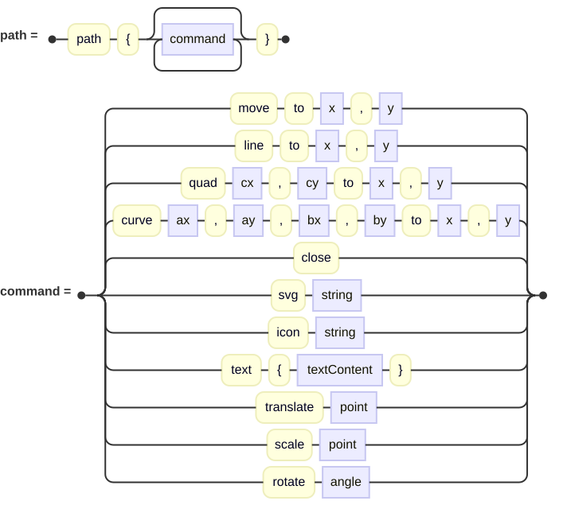
</picture>

| Command | What it does |
| --- | --- |
| `move to x, y` | Lift the pen and put it down somewhere new. |
| `line to x, y` | A straight segment. |
| `quad cx, cy to x, y` | A quadratic curve, bending toward one control point. |
| `curve ax, ay, bx, by to x, y` | A cubic curve, with two control points. |
| `close` | Join back to where this run of the path started. |
| `svg '…'` | The whole path as an SVG path string. |
| `icon '…'` | The outline of a [FontAwesome icon](#icons). |
| `text { … }` | The outline of a run of [text](#text-as-a-path). |

A path may hold more than one **run** — each starts with a `move to` and usually ends with a
`close`.  Whether any given spot ends up solid is decided by the **even-odd rule**: draw a
line from that spot out to infinity, count how many times it crosses the outline, and the spot
is filled when that count comes out odd.  In practice that reduces to a few things worth
remembering:

- A run on its own is solid.
- A run drawn *inside* another cuts a **hole** through it.
- A run inside that hole is solid again, and so on — each level of nesting flips fill to hole
  and back.
- Two runs side by side, with neither inside the other, are simply two solid pieces.

As far as *holes* go, the direction a run is drawn in — clockwise or counter-clockwise — makes
no difference; the only thing that counts is whether one run sits inside another.  This is the
same rule an SVG file selects with `fill-rule="evenodd"`, and it is worth noting it is *not*
SVG's default non-zero winding: a pasted `svg` outline that leaned on winding direction to
keep a hole open will come out filled here, so make sure the hole's run is genuinely nested
inside the outer one rather than trying to reverse its direction.

The direction a run is drawn in does matter to one thing, but it is not something a scene has
to get right.  When a path is given thickness — extruded, spun on the lathe, swept along a
spline — each of its segments also becomes a **wall**, and which way that wall faces follows
the direction the segment was drawn: a run has to go **counter-clockwise** for its walls to
face outward, and a hole inside it has to go **clockwise** so that *its* walls face out of the
material too, one way round per level of nesting.  Rather than ask that of the outline, each of
these surfaces sorts its runs out for itself before it builds any geometry, turning round the
ones that run the wrong way.  So a path may be drawn in whichever direction suits, pasted in
from an SVG file, or taken from a font or an icon, and its walls come out facing the light
either way.

The `svg` form is worth knowing about: it takes the `d` attribute out of an SVG file, so an
outline drawn in a vector editor can be pasted straight in.

#### Icons

A path may also be a [FontAwesome](https://fontawesome.com) icon, so any of its thousands of
symbols can be given thickness, spun or laid flat like any other outline:

```
extrusion {
    path { icon 'solid:star' }
    min Y 0  max Y 40
}
```


An icon is named as `style:name` — `solid:star`, `brands:github` — or as just `name`, in which
case the style is taken to be `regular`.  The name picks out the zip's `svgs/{style}/{name}.svg`
file, whose `d` outline is then handled exactly as an `svg` string is.

Icons are not built in: you install a FontAwesome zip once with the
[`libraries --fa-zip`](libraries.md#fontawesome-icons) command, and every scene draws its icons
from there.  An icon arrives at the scale and orientation SVG uses — a box some hundreds of units
across, with Y running *downward* — so, like a pasted `svg` outline, it usually wants scaling down
and flipping to sit the right way up.  `gallery/Local/paths/icons.igl` extrudes two of them, named both
ways.

#### Text as a path

A path may also be a run of **text**.  Where the [text surface](#text) turns a string into
finished, extruded letters in one step, `text` inside a `path` gives you the letters' *outline*
instead — the glyphs laid out and folded into the path — which you can then extrude, spin on the
lathe, sweep along a spline, or carve out of another shape with a [CSG](surfaces.md#combining-surfaces):

```
extrusion {
    path {
        text {
            text 'Ray'
            font 'Merriweather'
            layout { horizontal position center }
        }
    }
    min Y 0  max Y 0.25
    rotate X -90
}
```

The block is written exactly like the [text surface](#text) — the same `text`, `font`, `layout`
and `kerning` — with one difference: because a path is not a surface, it takes *only* those, not a
surface's own grammar.  There is no `material`, no `translate` or `rotate`, no `open` inside the
`text` block here; those belong to the shape the path feeds, as in the extrusion above.  Text
comes at the font's own scale, where a line is about one unit tall — small enough to use as it is,
unlike an icon.

#### Moving a path

A path may carry **2D transforms** of its own — `translate`, `scale` and `rotate` — applied to the
whole outline once it is drawn, before it is given depth.  They are the flat, two-dimensional
counterpart of the [transforms a surface carries](transforms.md), and they read the same way, with
two-number points and a single-angle turn instead of three-number points and an axis:

| Transform | What it does |
| --- | --- |
| `translate [dx, dy]` | Move the outline.  `translate X dx` and `translate Y dy` move along one axis. |
| `scale [sx, sy]` | Resize it.  `scale s` resizes it evenly; `scale X sx` scales along one axis. |
| `rotate a` | Turn it about the origin, within its own plane (no axis — a path is flat). |

Several compose in the order written, exactly as a surface's do — the first acts on the raw
outline, the next on its result.  This is what lets an outline be placed relative to the shape that
carries it.  A [lathe](#lathe), for instance, spins a path about the Y axis and reads each point's
X as its distance from that axis, so a [text path](#text-as-a-path) — whose letters sit near the
origin — has to be moved out before it will spin into a ring rather than a blob:

```
lathe {
    path {
        text { text 'i'  font 'Merriweather' }
        translate [1.5, 0]      // out to a radius of 1.5 before it is spun
    }
}
```

`gallery/Local/extrusions/text-lathe.igl` takes that further — the `i` spun into a ring, then cut down to a
quarter turn with a [CSG](surfaces.md#combining-surfaces) intersection.

### Extrusion

A path given thickness along Y.  Here is the star's path on the left — an outer run with a
second run nested inside it, which the even-odd rule turns into a hole — beside the solid it
extrudes into.  The arrows show which way each run happens to be drawn; as
[noted above](#paths), an extrusion sorts that out for itself, so neither direction is a
requirement.

<table>
<tr>
<td width="46%" valign="middle">

<picture>
  <source media="(prefers-color-scheme: dark)" srcset="images/figures/path-extrusion-dark.svg">
  <source media="(prefers-color-scheme: light)" srcset="images/figures/path-extrusion.svg">
  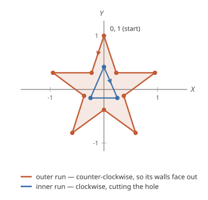
</picture>

</td>
<td width="54%" valign="middle">

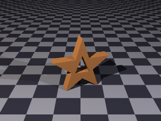

</td>
</tr>
</table>

```
extrusion {
    path {
        move to 0, 1
        line to -0.23, 0.31
        // ... the rest of the star, counter-clockwise ...
        close

        // A second run, inside the first, is cut out of it.
        move to 0, 0.42
        line to 0.25, -0.16
        line to -0.25, -0.16
        close
    }

    min Y -0.18
    max Y 0.18
    rotate X -90
}
```

<picture>
  <source media="(prefers-color-scheme: dark)" srcset="images/advanced/extrusionClause-dark.svg">
  <source media="(prefers-color-scheme: light)" srcset="images/advanced/extrusionClause.svg">
  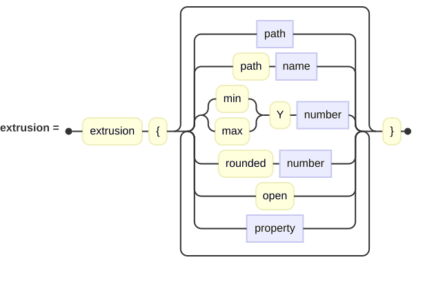
</picture>

`min Y` and `max Y` say how thick, exactly as they do for a
[cylinder](surfaces.md#cylinder-and-conic), and `open` leaves the two ends off.  A path is
drawn flat in X and Y, so an extrusion comes out lying down; `rotate X -90` stands it up.

**`rounded r` rounds every edge.**  Nothing anyone makes has a perfectly sharp edge, and an outline
extruded with sharp ones reads as cut from sheet.  Rounded, the extrusion keeps its outline's shape and
size, and every edge -- where the top and bottom meet the sides, and down each corner of the outline that
turns outward -- becomes a quarter round of radius `r`:

```
extrusion {
    path Body
    min Y 0
    max Y 1.75
    rounded 0.25
}
```

The top and bottom are flat inside the outline drawn in by `r`, a quarter round runs from there to the
sides, and the sides stand where the outline was drawn.  Every part is an exact surface but the outline
drawn in, which is fitted to it within a ten-thousandth of the outline's size.  A rounded extrusion is
still one solid, so it may be cut into as any extrusion may (a guitar's soundhole, say), and holes in
the outline are rounded down into as its outside is rounded off.  It costs more to render than a sharp
one: a guitar body's outline of eleven curves and two lines took about five times as long rounded as
sharp, where it filled the picture.

Refused, each saying where: a rounding more than half the thickness, one larger than the outline's
tightest outward curve, and one wider than half the outline anywhere it is narrow.  An `open`
extrusion has no edges to round, and a [tapered extrusion](#tapered-extrusion) cannot also be rounded.

**`path` takes the name of an outline as readily as the block.**  A scene that draws one shape and
raises it to several thicknesses says it once:

```
Star = path { move to 0, 1  /* ... */  close }

extrusion { path Star  min Y -0.18  max Y 0.18 }
extrusion { path Star  min Y -0.60  max Y 0.60  translate X 2 }
```

That is also what lets a primitive be handed the shape it is to extrude, an outline being a value
like any other — see [Things of Your Own](scene-files.md#things-of-your-own).  A lathe's and a
generic shape's `path`, and a sweep's `profile`, all take a name the same way.

The complete scene is
[`docs/examples/advanced/extrusion.igl`](examples/advanced/extrusion.igl).

### Tapered Extrusion

`tapered extrusion` is the same shape with the outline scaled as it rises rather than carried
straight up.  The word `taper` says what the outline has been scaled to by the top; the bottom is
always the size it was drawn.  Below, one outline — a square — at no taper, at 0.45, and at 0.

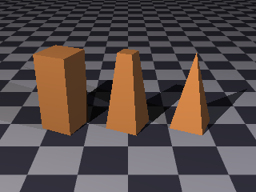

```
tapered extrusion {
    taper 0.45

    path {
        move to -0.5, -0.5
        line to 0.5, -0.5
        line to 0.5, 0.5
        line to -0.5, 0.5
        close
    }

    min Y 0
    max Y 2.3
}
```

<picture>
  <source media="(prefers-color-scheme: dark)" srcset="images/advanced/taperedExtrusionClause-dark.svg">
  <source media="(prefers-color-scheme: light)" srcset="images/advanced/taperedExtrusionClause.svg">
  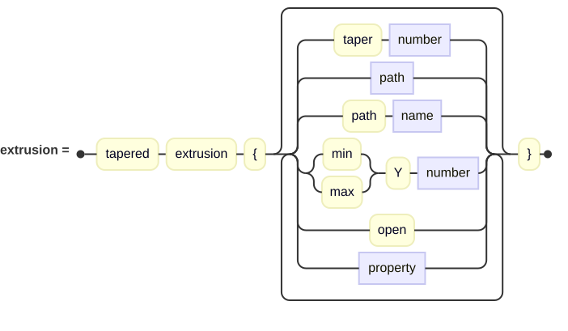
</picture>

Everything an [extrusion](#extrusion) takes, this takes too — several runs, holes, curves, `min Y`
and `max Y`, `open`.  A taper asks nothing of the outline: quadratic and cubic runs come through it
exactly as straight ones do, staying curves the whole way up while only their size changes.  A taper of 1 is no taper at all and gives back exactly an extrusion; a taper of
0 brings the outline to a single point, closing the top into an apex, and there is no top cap
there to be left off.  A taper below 0 is refused, since an outline cannot be scaled through
nothing and out the other side.

The scaling is **about the Y axis**, not about the outline's own middle, so where the outline sits
in relation to the origin decides what it draws towards.  An outline around the origin narrows
into itself; one drawn off to the side leans over as it narrows, which is a way of getting a lean
without a shear.

Because the walls lean, so do their normals — a tapered post catches the light differently down
its sides than a straight one does, which is most of what makes it read as tapered rather than
merely as narrower at the top.

The complete scene is
[`docs/examples/advanced/tapered-extrusion.igl`](examples/advanced/tapered-extrusion.igl).

### Field

An area of the X/Z plane, given by a 2D outline, filled with copies of one surface — or a line in it,
given by a path, laid with them.

```
Blade = ribbon { width 0.03 at [0, 0, 0]  width 0.002 at [0.16, 0.36, 0] }

field {
    of Blade
    spacing 0.09
    jitter 0.9

    within {
        move to -4, -1.6
        quad 0, 2.6 to 4, -1.6
        quad 0, 0.2 to -4, -1.6
        close
    }
}
```

**What it buys is an area of any shape.**  A patch of grass cut to a verge, a border, an island in a
roundabout — before this there were two shapes to be had, a square and a circle, and a scene wanting
anything else had to write a loop and a containment test of its own.

It is not only for grass.  Balls in a pit, a stand of trees, soldiers drawn up in ranks — anything
that is one thing in many places over an area, and none of it needing a loop.

<picture>
  <source media="(prefers-color-scheme: dark)" srcset="images/advanced/fieldClause-dark.svg">
  <source media="(prefers-color-scheme: light)" srcset="images/advanced/fieldClause.svg">
  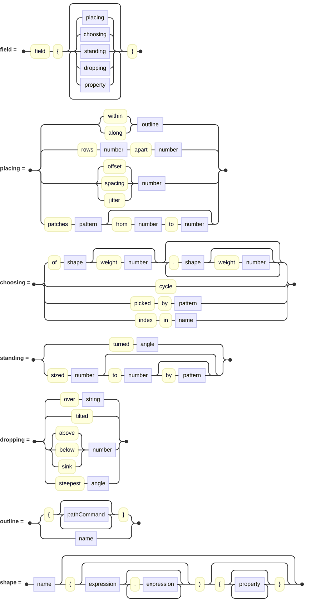
</picture>

| | |
| --- | --- |
| `within` | The outline to fill, in the X/Z plane. |
| `along` | A path to lay the copies along instead, in the X/Z plane; see [Laying a field along a path](#laying-a-field-along-a-path). |
| `of` | The surface to fill it with, by name or by a call of a primitive — or several, after commas, each with an optional `weight`.  A call may take a block after it, as a call anywhere may ([Things of Your Own](scene-files.md#things-of-your-own)): `of Tuft(2) { material Straw }`. |
| `spacing` | How far apart the copies stand, before any jitter. |
| `jitter` | How far a copy may stray from the grid, as a fraction of the spacing. |
| `turned` | How far each copy may be turned about the up axis: the whole spread, centered on the way it faces as made.  `turned 360` faces each any way at all. |
| `sized` | `sized 0.8 to 1.2` stands each copy at a size from the first to the second, as a scale of it as made; `sized 2` stands all of them at that size.  `sized 0.8 to 1.2 by <pattern> { … }` sets each by a pattern rather than chance; a pattern needs both sizes, so it is refused after one alone. |
| `cycle` | Take the things after `of` in turn rather than at random. |
| `picked by <pattern> { … }` | Pick which of the things after `of` stands at a place by a pattern rather than chance; see [Fields in patches](#fields-in-patches). |
| `patches <pattern> { … }` | A pattern saying where the field stands anything, its value the chance; `from <a> to <b>` gives it an edge. |
| `over '<name>'` | Drop every copy straight down onto the surface of that name standing beside the field. |
| `tilted` | A dropped copy leans with the ground under it, rather than standing upright. |
| `above`, `below` | The lowest and highest ground a dropped copy may stand on. |
| `steepest` | The steepest ground a dropped copy may stand on, as an angle from level. |
| `sink` | How far a dropped copy is sunk into the ground, along its own up. |
| `rows <n> apart <d>` | Along a path: lay that many rows side by side, that far apart, centered on it. |
| `offset` | Along a path: how far to its left, as it is walked, the rows lie; to its right, if less than nought. |
| `index in <name>` | Name each copy's number, and give each place its own surface rather than an instance of one shape.  The `in <name>` is not optional. |

**The copies are *instances* by default**, and that is the right way round: an
instance's saving is in the *building* rather than the testing, which is exactly this case — one
tuft of grass built once and stood in two thousand places costs one tuft to make.  What an instance
cannot do is let each differ, since every one is the same geometry.  A scene that needs each its own
way says `index in <name>` and pays to build each of them.

**`index` is worth asking for only when something differs**, and what differs is the copy's own
number.  Name it with `in` — the way a loop names its counter — hand it to a primitive, and let
the primitive's arithmetic do the rest:

```
primitive Blade(n) -> ribbon {
    tall = 0.24 + random(n, 1) * 0.30
    …
}

field {
    of Blade(n)
    within Verge
    spacing 0.07
    jitter 0.9
    index in n
}
```

The number is set in a scope of its own for each copy, so it does not overwrite a name the field was
written among and does not outlive the field.

**A shape that cannot stand in two places is copied whether you ask or not.**  Anything that
[`gives light`](surfaces.md#a-surface-that-gives-light) or has a medium inside it, anything that
moves while the shutter is open, and anything holding a [joint](animation.md#joints) that aims or
reaches, a mark or a span, is built afresh at each place, since each of those has to be worked out
where it actually stands.  (A [body](animation.md#bodies) or a [swarm](animation.md#swarms) cannot be
a field's copy at all: each must stand at the top of the scene.)  A lamp in a group is no bar to
sharing — it is lit at every place the group stands — and nor is a shape that is itself shared, as
what a primitive hands back usually is: a shared shape may hold shared shapes, so a wood of shared
trees hung with shared leaves builds each kind of tree, and each leaf, once.  The field works that
out from the shape rather than from what the scene said, so there is nothing to remember and nothing
to get wrong.

So the clause is all of it or none of it: `index` has to name a number, because naming one is the
only thing left for it to do.  Asking for copies of a shape that *may* be shared would build the
same geometry over and over, which is strictly worse than one instance of it.

**`of` takes a name or a call.**  A named surface is the same shape everywhere, which is what an
instance wants; a call of a primitive is what lets each copy be its own.

**Or several, each built once.**  A wood is not one tree in a thousand places, and it should not be a
thousand trees built one by one either.  A handful of things after `of`, each built once and stood
wherever it is picked — and turned and sized as it is stood there — reads as a wood for the cost of a
handful:

```
field {
    of Oak(10, 'summer', 1), Oak(9, 'summer', 2), Elm(11, 'summer', 3) weight 2
    within Wood
    spacing 4  jitter 0.9
    turned 360
    sized 0.85 to 1.15
}
```

Each is picked as often as its `weight` says against the others' — the elm above, twice as often as
either oak — and `cycle` takes them in turn instead, by row and column together, so over a grid they run
in diagonal stripes; with `cycle`, a weight is how many stripes of that thing run together.  `turned` is
in the scene's own unit of angle, like a rotation, and a small one keeps copies roughly facing the way
they were made: `turned 20` faces each within ten degrees of it, either way.

**What stands at a place belongs to the place.**  Which thing it is, how far it is turned and how big it
is are worked out from the place itself rather than drawn one after another, so cutting a pond out of
the middle of a wood leaves every tree around the pond as it was.  A field that asks for none of this
stands its copies exactly where it always did.

This is usually what to reach for in place of `index in n`.  The `Grass` the
[undergrowth library](libraries.md#undergrowth) offers is eight tufts, turned and sized, and sets up
thirteen times faster than when it built every tuft its own; keep `index` for when each copy must
differ in a way no turn or size can give, like the wildflowers that each take a color of their own.

**A lattice is very easy to see and impossible to unsee.**  `jitter` defaults to nought, which gives
ranks and files — right for soldiers, wrong for grass.  Anything meant to look natural wants most of
a cell of it, around `0.8` to `1`.  The jitter is repeatable: `with seed` decides it, so the same
scene gives the same field every time and two fields beside each other need not be the same one
twice.

**The outline may be written out, named, or handed in.**  An outline is a value like a material, so
it can be given a name and used in more than one field — and, more to the point, **passed to a
primitive**, which is what lets a library offer an area of any shape instead of the one or two it
happens to have built in:

```
Verge = path { move to -4, -1.4  quad 0, 2.4 to 4, -1.4  quad 0, 0.1 to -4, -1.4  close }

primitive Sward(outline, step, wobble) -> field {
    return field { of Blade  within outline  spacing step  jitter wobble }
}

object Sward(Verge, 0.09, 0.9)
```

**Each copy is tested where it has been moved to, not where the grid put it.**  Testing the grid
point instead would let a copy's jitter carry it outside the very outline it was chosen for, which
shows along every edge.

#### Dropping a field onto the ground

A field stands its copies on its own plane, which is level.  Ground is seldom level, and `over` drops
every copy straight down onto a surface standing beside the field instead — a hill, a height field, a
bank — named by its `named` name:

```
heightfield { ...  named 'hill' }

field {
    of Oak(10, 'summer', 1), Birch(9, 'summer', 2), Elm(11, 'summer', 3)
    within Wood
    spacing 6  jitter 0.9
    turned 360  sized 0.85 to 1.15
    over 'hill'
    above 1  below 14
    steepest 30
    sink 0.2
}

object Grass(Meadow) { over 'hill' tilted  above 0.4 }
```

**Each copy falls onto that surface and nothing else.**  A canopy, a roof or the field's own copies do
not catch it, and a place with nothing of the ground below it stands nothing — so the outline may be
drawn generously and the ground's own edge decides where the copies stop.  Nothing is built at a place
where nothing lands, so a generous outline costs a few drops there and no more.  Hair the ground grows is
fallen through: a copy stands on the skin.

**Copies stand upright, as trees and people do, unless the field says `tilted`**, when each leans with
the ground under it, as grass and stones do.  An upright trunk on a slope touches the ground on its
uphill side only, and `sink` sets it that much lower so its downhill side is not standing in the air.

**`above`, `below` and `steepest` keep copies off ground they do not belong on**: a wood off the beach
and under its tree line, and off slopes too steep to hold a tree.  Heights are in the space the field
shares with the ground, and `steepest` is an angle from level in the scene's own unit.

**The ground has to stand beside the field**, in the same group or both at the top of the scene, as
anything placed against another does; it is dropped onto only once it has been placed itself.  A field
from a primitive is dropped by the block on its call, as the grass above is.  A dropped field cannot
itself be placed against anything — `on`, `under`, `left of` and the rest are refused — since it is
empty until its copies land, which is after placing is done; say where it stands with its own
transforms.

The grid is laid out level, so ground that slopes away holds its copies a little further apart along
its surface than level ground does — at thirty degrees, by about fifteen percent.

#### Laying a field along a path

A field may lay its copies along a path instead of filling an outline: fence posts, a ring of standing
stones, benches along a front, seats round a curved terrace.  Write `along` where `within` would go:

```
Front = path { move to -40, 0  curve -15, 18, 15, -18 to 40, 0 }

field { of Bollard(0.9)  along Front  spacing 2.5 }
field { of Bench(1.8)  along Front  spacing 9  offset 3 }
field { of Oak(9, 'summer', 1), Oak(8, 'summer', 2)  along Front  spacing 8  rows 2 apart 14  turned 360 }
```

**Each copy is turned to run with the path where it stands.**  Its own X runs the way the path does,
so a length of railing or a bench follows a curve, and a round post or a tree is none the worse.  What
faces -Z as it was made faces the path's right, as the path is walked from its start, and what faces +Z
its left; draw the path the other way round to turn everything about.  `turned` spreads the copies about
that way rather than about the way they were made.

**The spacing is fitted to the length**: a whole number of gaps, each the spacing asked or a little
more, so an open path has a copy at both ends, as a fence has a post at each.  A closed path goes round
with no two copies at its seam, and a path whose end meets its start is closed however it was drawn.
Each run of a path — each part begun with its own `move to` — is laid by itself.

**`rows <n> apart <d>` lays rows side by side**, centered on the path, and each row is spaced along its
own length: the row on the outside of a bend is longer than the one inside it, and holds more.
`offset` sets them to one side of the path — to its left, as it is walked, or to its right if less than
nought — so one path can carry the railing at its edge and the benches a few paces back from it.

`jitter` moves a copy along the path and across it, by as much as that share of the spacing, and
`over '<name>'` drops a field laid along a path onto the ground like any other: a fence over a hill.

#### Fields in patches

A wood is not the same everywhere.  It has clearings, groves of one kind of tree among another, and
places where the trees grow taller.  Three things a pattern can say do all of that, each read from the
pattern's value at a place on the field's own ground — as a map of it, seen from above:

```
field {
    of Oak(9, 'summer', 1), Birch(8, 'summer', 2), Fir(10, 'summer', 3)
    picked by bozo { scale 40 }
    within Wood
    spacing 6  jitter 0.9  turned 360
    patches bozo { scale 30 } from 0.38 to 0.42
    sized 0.7 to 1.3 by bozo { scale 25 }
}
```

**`patches` says where the field stands anything.**  It is the `patches` [hair](#hair) has, with
everything a pigment's pattern can say: the pattern's value at a place is the chance something stands
there, so on its own it thins a wood gently from thick to bare.  **`from <a> to <b>` gives it an edge**:
nothing stands where the value is below `a`, something always stands where it is above `b`, and the
chance rises evenly between.  `from 0.38 to 0.42` cuts clearings with a fringe a few trees wide in a wood
that is full everywhere else; `from 0.4 to 0.4` cuts them with a knife.

**An edge turned about — the larger first — keeps the places the other leaves**, exactly: a meadow given
the wood's own pattern with `from 0.42 to 0.38` grows in its clearings and nowhere else, place for place
where the two share a grid.

**`picked by` picks what stands at a place** from the things after `of`: the first where the pattern is
lowest, the last where it is highest.  Each takes as large a share of the places as its weight says,
however the pattern's own values fall — a noise pattern's values crowd toward its middle, and banded by
their value three kinds of tree would come out as one kind with a fringe of the other two.  Where two
groves meet they mingle a little, as real ones do, rather than meeting in a line.  It cannot be had with
`cycle`, which takes the things in turn instead.

**`sized … by` sets each copy's size by a pattern** in the same way: the smallest where the pattern is
lowest, the largest where it is highest, spanning the whole range asked for, with neighbours a little
different from one another.

Each pattern may be different, and usually wants to be: one shared by the patches and the picking would
put every clearing at the edge of the first kind of tree.  They work alike whether the field fills an
outline, follows a path — gaps in a hedge — or is dropped onto the ground.

### Ribbon

A flat strand of a given width, running through a series of points — a blade of grass, a strap, a
length of tape, a leaf of a palm.

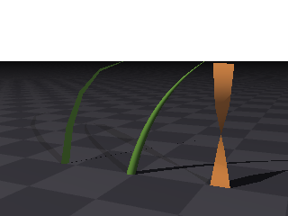

A blade of grass, the same path as a [`tube`](#tube) for comparison, and a length of tape given a
half turn.  The scene is [`docs/examples/advanced/ribbon.igl`](examples/advanced/ribbon.igl).

```
ribbon {
    width 0.045 at [0, 0, 0]
    width 0.026 at [0.10, 0.38, 0]
    width 0.002 at [0.36, 0.55, 0]
}
```

<picture>
  <source media="(prefers-color-scheme: dark)" srcset="images/advanced/ribbonClause-dark.svg">
  <source media="(prefers-color-scheme: light)" srcset="images/advanced/ribbonClause.svg">
  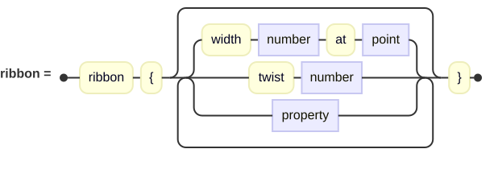
</picture>

**It is the flat answer to the `tube`'s round one**, and which you want is decided by whether the
thing has a face.  A stem, a wire or a cane is a rod: it looks the same from every side, and a tube
is right.  A blade of grass is not — turned edge-on it very nearly disappears, and that flicker as
blades turn is most of what a field of grass looks like.  A rod cannot do it, having no edge to turn.

**Which way it faces is worked out, not asked for.**  The strip is laid along a path that does not
spin on straight runs nor flip where the path bends the other way, so a ribbon written without
thinking about it comes out flat rather than wrung.  What that leaves you is the *starting* face,
which follows from the path itself — turn the whole surface to aim it, and use `twist` to turn it
along its own length.  `twist` is in radians, and is spread evenly from the first point to the last,
so `3.14159` is the half turn on the right above.

**It is a strip of [bilinear patches](surfaces.md#bilinear-patch)**, one between each pair of points,
each handed the normals of the points it spans so the strip shades as one surface with no crease at
the joins.  That is why it is affordable in quantity where a [`sweep`](#sweep) is not: a sweep lofts
a profile with two dozen tessellation steps a segment, which is fine for one pipe and not for forty
thousand blades of grass.

Two or more points are needed, and the widths are the whole width of the strip rather than a radius —
unlike a tube, which takes half of one.

### Strand

A single fiber — a hair, a whisker, a thread, a wire too fine to be worth a tube.  It runs smoothly
through a series of points, each with the strand's width there:

```
strand {
    width 0.02 at [0, 0, 0]
    width 0.012 at [0.1, 0.3, 0]
    width 0.001 at [0.3, 0.45, 0]
}
```

<picture>
  <source media="(prefers-color-scheme: dark)" srcset="images/advanced/strandClause-dark.svg">
  <source media="(prefers-color-scheme: light)" srcset="images/advanced/strandClause.svg">
  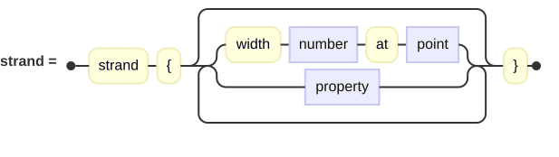
</picture>

**It is hit as a flat strip that always faces the ray, and lit as the fiber it is.**  Where across the
strip a ray passes says where on a round strand of the same width it would have struck, which is what
a fiber's way with light needs to know — see [How hair is lit](#how-hair-is-lit).  Asked only that
much, a strand is far cheaper than a [`tube`](#tube): it is kept as a handful of numbers rather than
as surfaces, and that is what lets a scene hold millions of them.

The points are joined by a curve through every one of them, turning smoothly at each, so a few points
make a smooth bend.  Widths are the whole width rather than a radius, as a ribbon's are, and two or
more points are needed.

**A strand of metal is a wire**, shaded as the round surface it is rather than as a fiber: a guitar's or
a piano's strings, a wire fence, a whisk.  Its material is a [`metal`](materials.md#metals), or says
`metallic`, and with that it has the highlights, mirroring and roughness any metal has, and it stops the
light that falls on it where a hair would let most of that through.

```
strand {
    width 0.012 at [0, 0, 0]
    width 0.012 at [25.5, 0, 0]
    material { metal 'iron'  roughness 0.12 }
}
```

**It stays whole however fine it is.**  A cylinder a hundredth of an inch across, seen from a few feet, is a
fraction of a pixel wide, and the picture's samples land on it only now and then: a string drawn as a
cylinder comes out as a dotted line.  A strand finer than a pixel is widened to it and seen for the share
of it it covers, so it is a faint, continuous line instead.  And since the pixel then sees the whole of its
round at once, it is shaded that way: each lamp's highlight, its diffuse light and what it mirrors
averaged round it exactly, rather than wherever a sample happened to land, which would make a polished
wire glitter.  A wire wide enough to be seen place by place is shaded place by place, and in what both
see -- the lamps' light, the mirror, the glow and what is bounced onto it -- the two agree, so a string seen
at a slant keeps its brightness where it narrows below a pixel.  A fine wire is shaded as plain metal, though:
a coat, a sheen, a film or light gathered from caustics shows only where the wire is wide enough to be seen
place by place.

**A wire far finer than its pixel looks about itself in proportion.**  Seen from far enough off, a ray takes
in every string of a piano at once, and each of them looking for what it mirrors with all of a mirror's
rays -- each of which met the other strings and looked again -- made a piano take the best part of an hour
at 40 x 30.  So a wire whose share of the ray, times the rays it would send to mirror or to gather bounced
light, comes to less than one sends a single ray as often as that says and counts it for as much more.  It
comes to the same on average, and the strings along a ray then send no more rays between them than one
surface would.  A wire covering a sixteenth of its pixel or more is shaded as before.

**A wound string is brushed round itself.**  The bass strings of a guitar are a core wire with another
wound round it; give such a strand's material `anisotropy` and no direction, and its grooves run round
it, drawing its highlight out along its length as the winding does.  See
[Brushed metal](materials.md#brushed-metal).

**Strands are rarely written one at a time.**  For fur, a pile or a head of hair, have a surface
grow them: see [Hair](#hair), next.

### Hair

Hair grown over a surface — fur, a rug's pile, moss, a head of hair.  It is written inside the surface
it grows on, as one of its properties, and the surface grows it:

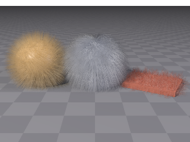

Plain fur on the left, fur combed downward and sagging under its own weight in the middle, and a rug
whose pile curls and gathers into tufts.  The scene is
[`docs/examples/advanced/hair.igl`](examples/advanced/hair.igl).

```
sphere {
    material { pigment color [0.42, 0.44, 0.50] }
    hair { density 2500  length 0.35  lean 40  comb [0, -1, 0]  droop 0.4 }
    scale 0.5
}
```

<picture>
  <source media="(prefers-color-scheme: dark)" srcset="images/advanced/hairClause-dark.svg">
  <source media="(prefers-color-scheme: light)" srcset="images/advanced/hairClause.svg">
  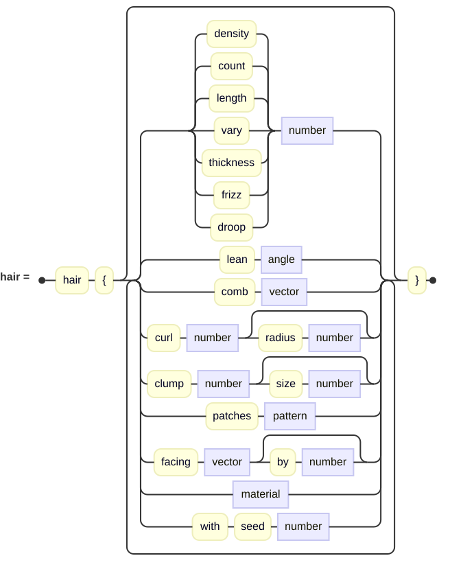
</picture>

| Property | What it does |
| --- | --- |
| `density` | How many strands grow on each unit of the surface's area. |
| `count` | Exactly how many strands grow, however large the surface.  Say this or `density`, not both. |
| `length` | How long a strand is.  Always needed. |
| `vary` | How much one strand's length may differ from another's, as a fraction either way: 0.2 unless said. |
| `thickness` | How wide a strand is at its root; it tapers to a point.  A fiftieth of its length unless said. |
| `lean` | How far strands lean from straight out, as an angle: nought stands up, a right angle lies flat. |
| `comb` | The direction they lean toward, laid along the surface.  Unsaid, each leans its own way. |
| `curl` | How many turns a strand winds through, root to tip.  `curl 3 radius 0.02` also says how far from its line it winds, which is a twelfth of its length unless said. |
| `frizz` | How far strands wander, roughly as a fraction of their length. |
| `clump` | How strongly neighboring strands gather into locks, from nought to one.  `clump 0.6 size 20` also says how many strands make a lock, which is 30 unless said. |
| `droop` | How far strands sag: one bends a strand until its tip hangs nearly straight down. |
| `patches` | A pattern saying where the hair grows: `patches bozo { scale 0.3 }`.  Its value at each root is the chance a strand grows there. |
| `facing` | The way the surface must face for hair to grow on it: `facing [0, 1, 0]` grows it only on what faces up, thinning toward the sides.  `facing [0, 1, 0] by 3` keeps it to what faces nearly that way. |
| `material` | The hair's own material.  Unsaid, each strand wears the material of what it grows from. |
| `with seed` | Fixes where the strands grow and the way each one goes. |

`lean` is an angle in the scene's own unit, like a rotation's: degrees, unless the scene says
`angles are radians`.

**Lengths and areas are measured where the surface is placed, not in its own space.**  A cube scaled
flat into a rug grows a pile of the length asked for, rather than one flattened along with the cube,
and a density counts strands on each unit of the rug's area as it stands, not the cube's it was made
from.  So the numbers mean what they look like they mean, however the surface was scaled to size.

**Hair can grow in places only**, which is how moss grows on a stone or a rug's pile on its top and not
its edges.  `facing` gives the way the surface must face, and a strand grows where it does as often as
the surface faces squarely that way: everywhere on what faces it, on half of what is turned sixty
degrees off, and nowhere on what faces away.  `by` raises that to a power, so `by 3` keeps the hair to
faces turned nearly that way.  `patches` gives a pattern, with everything a pigment's pattern can say,
and a strand grows at each root as often as the pattern's value there says; the pattern is read in the
space of the surface the hair is written in.  The two together put moss on a boulder's top in patches:

```
hair {
    density 150000  length 0.015  thickness 0.006
    patches bozo { poly 2 wave  scale 0.3 }
    facing [0, 1, 0] by 1.2
    material { pigment color [0.17, 0.29, 0.07] }
}
```

A `density` still counts strands on each unit of the whole surface, so hair kept to a tenth of it grows
a tenth as many; a `count` is the number that grow where they may.

**The hair goes wherever its surface goes.**  It is found through the surface, so moving it in a
group, setting it in [motion](cameras.md#motion-blur) or using it again by name takes the hair
along.  Placing something [`on`](transforms.md#placing-one-thing-against-another) a furry surface sets
it on the skin, not on the tips of the fur.

**Roots fall evenly, whatever the surface's shape.**  They are found by casting straight lines at the
surface from every direction, and lines cast that way cross any patch of any surface as often as any
other patch of the same area — so the poles of a sphere and every face of a cube get their fair share,
without the surface having to describe itself.  That works for anything with an end to it: a group, a
CSG, a mesh, a line of text.  It cannot work for a plane, which goes on forever, and hair on one is an
error.  A sheet — a disc, a patch — grows hair on the side its normal faces.

**On one side of a [CSG](surfaces.md#combining-surfaces), hair shows only where it is outside the
other side** — fur on one sphere of a union is hidden where it is buried in the other.  Hair grown on
the CSG itself grows on the combined shape.

**Strands are usually much finer than a pixel, and are drawn as what they are: a part of it.**  A ray is a
thin cone a pixel wide, and a strand finer than that is widened to the cone's width where it meets it and
seen in proportion to how much of it it fills — the rest of the pixel showing whatever lies beyond, more
strands or the skin or the sky.  So fur comes out smooth, rather than as a scatter of strands caught and
missed, with no [antialiasing](context.md#anti-aliasing) at all; the figures' scenes ask for none.
Antialiasing on top only softens it a little, and costs several times as much, since every sample sees
every strand it touches.  The shadows strands cast fade the same way: a strand finer than the patch a
pixel sees blocks only its share of the light reaching it.

#### How hair is lit

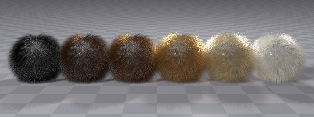

The six named shades of hair, each a fur of the same shape, lit by a lamp in front and a dimmer one
behind.  The scene is [`docs/examples/advanced/hair-shades.igl`](examples/advanced/hair-shades.igl).

**A strand is not shaded as a surface.**  A hair is a glassy fiber with its color inside it, and light
leaves it three ways: some is mirrored off the outside, which is the white highlight a head of hair
has; some passes through and out the far side, which is the glow of hair with the light behind it; and
some goes in, is mirrored inside and comes back out colored, a second and softer highlight just below
the first.  A strand is lit all three ways by every light, from behind as much as in front — the sky
included, all the way round — after Chiang, Bitterli, Tappan and Burley's model, as PBRT has it.

**Its color is the color a head of such hair comes out**, and any pigment will do: the inside of each
strand is made to absorb as much as hair of that color does.  Hair with no material of its own wears
the material of what it grows from, and takes its color from there too, where each strand grows —
read in the skin's own space at the strand's root, so that a striped skin grows striped fur however
the strands lie.  Fur grown over a group whose parts are dressed differently comes out in each part's
color, even when the group itself has no material.

**Or color it as natural hair is colored**, by its melanin:

```
hair { density 2500  length 0.3  material { melanin 'auburn' } }
```

`melanin` names a shade — `'black'`, `'brown'`, `'auburn'`, `'ginger'`, `'blond'` or `'platinum'` — or
gives an amount of eumelanin, the pigment that runs from brown to black, with, after a comma, an amount
of pheomelanin, which is red: `melanin 1.3` is brown and `melanin 0.5, 0.8` is auburn.  Amounts run
from nothing, which is white, to about eight, which is black.  Melanin colors hair in place of the
pigment, and nothing but hair takes any notice of it.

**A material's `roughness` says how blurred a strand's highlights are**: 0.3 unless said, about what
real hair measures, and smoother hair shines in a narrower band.  Hair wearing its skin's material
takes none of the skin's finish.

**Light bounces from strand to strand.**  A strand sends most of the light reaching it onward, so light
soaks deep into fair hair and comes back out having bounced about among the strands — and that light is
most of what makes fair hair fair: fur with no melanin at all is several times brighter for it than its
strands lit one at a time would be.  Before a head of hair is first drawn, the light from each lamp is
followed into it, strand by strand, and where it goes is recorded in a grid laid over the hair, which
every strand then draws on.  Black hair, which keeps little of what reaches it, is hardly changed by it.
A strand standing alone has no others to bounce light to it.

**What reaches the skin comes back up.**  Fair hair passes much of the light falling on it down to
whatever it grows from, and the skin sends back as much as its color says, among the strands again.  So
a rug's pile is lit from below by its backing, and should stand on a backing of its own color: pale pile
on a dark backing comes out gray, as it would.  Only what lies among the hair counts — the skin, and the
floor right beside it — so this is still the light among the strands, not the light of the whole room.

**A surface beneath hair is lit through it.**  Each strand in the way of a light sends on what it does
not absorb or turn back, in its own color: black hair stops nearly all of it and blond much less, so the
skin under fair fur, and the floor under a fair-haired animal, are lit through it.

#### What hair costs

A strand takes about three hundred bytes, and growing them is quick.  A sphere of radius one at a
density of fifty thousand — over six hundred thousand strands of pale, dense fur — takes about
twenty-two seconds to grow, gather the light among and render at 160 by 120, and just under a gigabyte:
about twelve seconds before the first pixel, most of it following the light among the strands, and
ten drawing them, since at that size each pixel sees through dozens of them.  Gathering the light is
done once for each head of hair and each light, before the first pixel, and takes about a third of a
second for a fur ball of six thousand strands.  Hair on a shape shared between places gathers its light
once for each place, the first time a ray meets it there, and keeps up to about 25 MB a place to read it
from.  A surface may grow at most two million.

**A low light raking across a rug costs more than one overhead**, since each shadow ray toward it runs
through the pile on the way; a ray stops looking once next to nothing gets past the strands it has
met, which keeps that to a few hundred strands rather than the whole rug.  A fire-lit room with a shag
rug, a sheepskin and a teddy bear —
[`a-rug-by-the-fire`](../gallery/Local/interiors/a-rug-by-the-fire.igl) — takes about four and a quarter
minutes at 800 by 600 with antialiasing.

### Lathe

A path spun about the Y axis.  The path is the silhouette of one side of the finished object,
so it is usually drawn from the axis outward and back again.  On the left is the goblet's
profile — the points it passes through, and the control points that shape its curves — beside
the solid it sweeps out.

<table>
<tr>
<td width="42%" valign="middle">

<picture>
  <source media="(prefers-color-scheme: dark)" srcset="images/figures/path-lathe-dark.svg">
  <source media="(prefers-color-scheme: light)" srcset="images/figures/path-lathe.svg">
  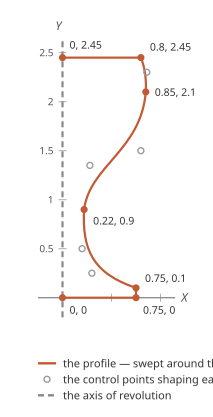
</picture>

</td>
<td width="58%" valign="middle">

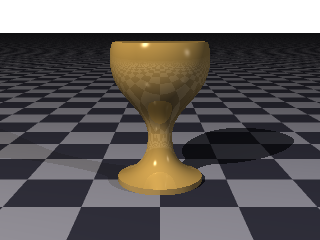

</td>
</tr>
</table>

```
lathe {
    path {
        move to 0, 0                                // on the axis, at the foot
        line to 0.75, 0
        line to 0.75, 0.1
        curve 0.3, 0.25, 0.2, 0.5 to 0.22, 0.9      // drawn in for the stem
        curve 0.28, 1.35, 0.8, 1.5 to 0.85, 2.1     // flaring out into the bowl
        quad 0.86, 2.3 to 0.8, 2.45
        line to 0, 2.45                             // and back to the axis
    }
}
```

<picture>
  <source media="(prefers-color-scheme: dark)" srcset="images/advanced/latheClause-dark.svg">
  <source media="(prefers-color-scheme: light)" srcset="images/advanced/latheClause.svg">
  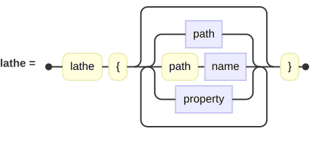
</picture>

The X of each point is how far that part of the profile stands from the axis and the Y is how
high up it sits.  Anything round and symmetrical — a glass, a vase, a bottle, a chess
piece — is quicker to write this way than any other.  A profile may be drawn on either side of
the axis: one at negative X spins into exactly the same solid as its mirror image.

The complete scene is [`docs/examples/advanced/lathe.igl`](examples/advanced/lathe.igl), and
`gallery/Local/extrusions/` has several more.

### Sweep

A 2D profile carried along a 3D spline.  The profile says what the cross-section is; the
spline says where it goes.

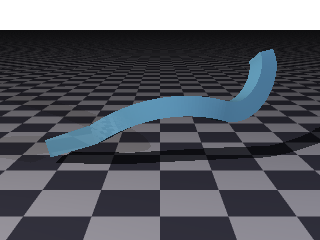

```
sweep {
    profile {
        move to -0.22, -0.22
        line to  0.22, -0.22
        line to  0.22,  0.22
        line to -0.22,  0.22
        close
    }

    discontinuous spline {
        move to -2.6, 0.4, 0.6
        line to -1.4, 0.9, 0
        quad 0, 1.9, -0.6 to 1.4, 1.4, 0
        curve 2.1, 1.2, 0.3, 2.6, 2.2, 0.6 to 2.4, 2.6, 0.8
    }

    steps 40
}
```

<picture>
  <source media="(prefers-color-scheme: dark)" srcset="images/advanced/sweepClause-dark.svg">
  <source media="(prefers-color-scheme: light)" srcset="images/advanced/sweepClause.svg">
  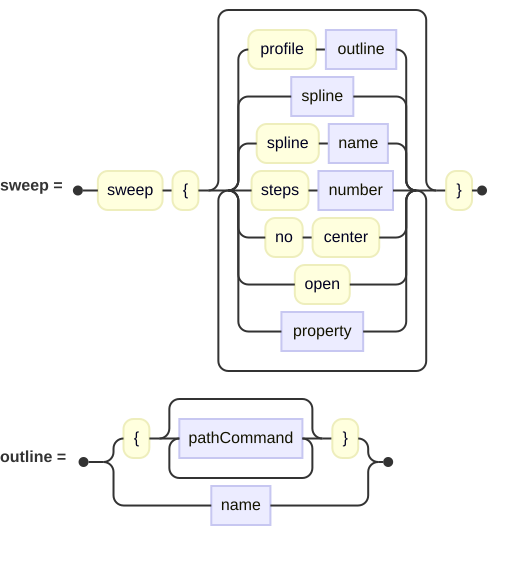
</picture>

<picture>
  <source media="(prefers-color-scheme: dark)" srcset="images/advanced/splineClause-dark.svg">
  <source media="(prefers-color-scheme: light)" srcset="images/advanced/splineClause.svg">
  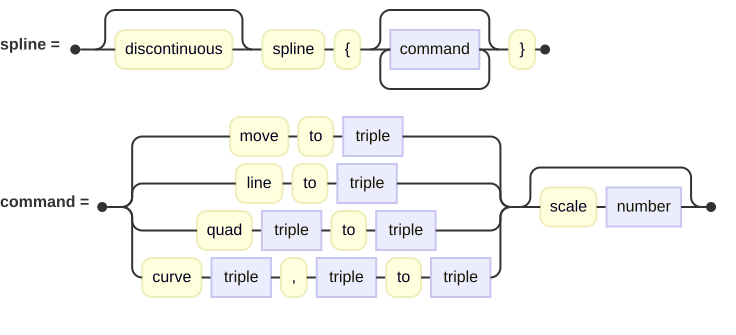
</picture>

A spline is written like a path, except every point is a full 3D triple rather than an X,
Y pair.  It may be written out in the sweep, or named — `Rail = spline { ... }` — and the sweep given
its name, `spline Rail`, which is how a sweep and the things [put along the spline](animation.md#along-a-spline)
share one way.  `steps` is how finely the profile is carried along it.  If there are too few, the
result is visibly faceted.  If there are too many, it costs more time to render than it
needs to.

**A changing cross-section.**  Any spline point may carry a `scale`, and the profile grows or
shrinks to match as it passes through — the sweep's answer to a [tube](#tube)'s varying radius,
but applied to whatever shape the profile is rather than to a radius.  It is interpolated
between the points that set it, so the profile eases from one size to the next rather than
jumping, and a point with no `scale` keeps the profile at its natural size (`scale 1`):

```
sweep {
    profile { ... }
    spline {
        move to 0, 0, 0  scale 1
        line to 0, 5, 0  scale 2.5     // two and a half times as big by the top
    }
}
```

**Where the spline runs through the profile.**  Because the spline is the path the profile
rides along, a sweep **centers** the profile about the 2D origin before carrying it — so the
spline threads the middle of the profile, wherever in its own plane the profile was actually
drawn.  This matters most for an outline that lives off to one side, as a pasted `svg` or an
`icon` tends to (its coordinates often fill a box with a corner at the origin); without
centering the spline would run along the profile's edge rather than down its middle.  A sweep
that means to keep the profile's own placement — to aim the spline at the profile's 2D
origin — says `no center`.

**Capped or open ends.**  A profile that ends with `close` is a solid's cross-section, so the
sweep caps both of its ends with the profile filled in.  `open` leaves them uncapped: a hollow
pipe, a gutter or a hose seen end on, whose outline is closed only so that it is smooth all the
way round.  A profile that never closes is a ribbon whatever you say, since there is no inside
to fill.

**One outline.**  A profile is a single run, drawn from its one `move to`: a second run, or a hole in
it, is refused, since only one outline can be carried along the spline.

**Tangent continuity.**  A sweep expects its spline to flow smoothly from one segment into the
next, and refuses if it does not, telling you which control point is at fault and by how many
degrees it bends:

```
The sweep's spline isn't tangent-continuous at control point 1 (near [-1.400, 0.900, 0.000])
-- the segments meeting there bend by about 13.2 degrees instead of flowing smoothly into
each other.  Mark it "discontinuous" if this kink is intentional.
```

That is a genuine kindness — handwritten control points almost never line up by accident, and
a kink you did not mean is much easier to fix when something says exactly where it is.  When
you did mean it, write `discontinuous` before `spline`, as the example above does.

A curve whose control point stands on its own end — as a curve that eases out of a straight is often
drawn — is no kink and no fault: its way there is the way toward its next point that differs, as the
curve itself sets off.  Only a segment whose points are all the one place is refused, `discontinuous`
or not, having no way to go at all.

The complete scene is [`docs/examples/advanced/sweep.igl`](examples/advanced/sweep.igl).

### Tube

A pipe threaded through a series of points, each with a radius of its own, so it may taper
along its length.

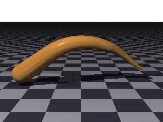

<picture>
  <source media="(prefers-color-scheme: dark)" srcset="images/advanced/tubeClause-dark.svg">
  <source media="(prefers-color-scheme: light)" srcset="images/advanced/tubeClause.svg">
  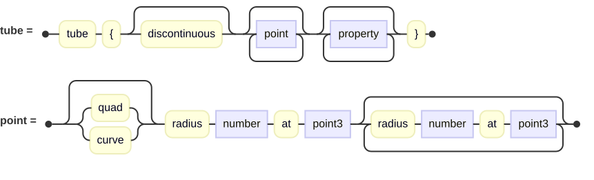
</picture>

```
tube {
    discontinuous

    radius 0.45 at [-2.8, 0.6, 0.5]
    radius 0.38 at [-1.4, 1.6, 0]
    quad  radius 0.3  at [-0.2, 2.5, -0.4]  radius 0.24 at [1.2, 1.9, 0.2]
    curve radius 0.18 at [1.9, 1.6, 0.6]  radius 0.1 at [2.6, 0.9, 0.9]  radius 0.05 at [3, 0.7, 1]
}
```

A bare `radius … at …` is a straight segment.  `quad` takes two such points and bends between
them; `curve` takes three.  The radius is interpolated along with the position, which is what
gives the taper.

A tube checks for tangent continuity exactly as a sweep does, a control point on its own end
included, and `discontinuous` says the kinks are meant.

Where a sweep carries an arbitrary profile, a tube is always round — which makes it the right
tool for cables, pipes, handles and stems, and it is what the
[L-system](#l-systems) renderer uses to draw branches.  The complete scene is
[`docs/examples/advanced/tube.igl`](examples/advanced/tube.igl), and
`gallery/Local/paths/power-cord.igl` is a longer one.

### Isosurface

A shape described by writing down arithmetic.  Where every other surface here is a shape you name
and then adjust, an isosurface is a **function** of `x`, `y` and `z`, and the surface is everywhere
that function comes out at nought:

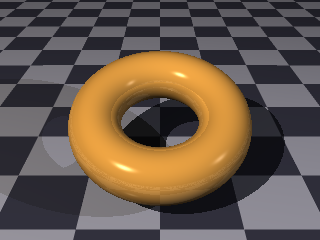

```
isosurface {
    function { (√(x² + z²) - 1)² + y² - 0.16 }
    bounded by [-1.5, -0.5, -1.5], [1.5, 0.5, 1.5]
}
```

<picture>
  <source media="(prefers-color-scheme: dark)" srcset="images/advanced/isosurfaceClause-dark.svg">
  <source media="(prefers-color-scheme: light)" srcset="images/advanced/isosurfaceClause.svg">
  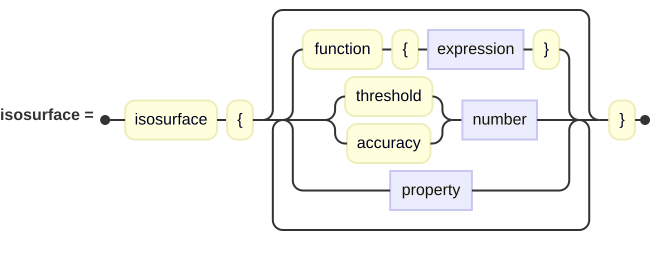
</picture>

That one is a torus.  Change what is written and you change the shape rather than which sort of
surface you are using, which is the point of it: the shapes an isosurface is *for* are the ones
nothing else here will give you.

Inside is wherever the function comes out **below** nought and outside is wherever it comes out
above, so the sign matters — `x² + y² + z² - 1` is a solid ball of radius one, and negating it
would turn the whole of space inside out.

#### `bounded by` is required here

Every other surface treats [`bounded by`](surfaces.md#bounding) as a hint the renderer may use to
skip it cheaply.  For an isosurface it is **the region the surface is looked for in**, because a
function has no size of its own — `x² + y² + z² - 1` says nothing about where to start looking.
Leave it out and the scene is refused rather than rendered empty.

Draw the box a little larger than the shape you expect.  Anything outside it simply is not there,
so a box drawn too tight slices the shape off rather than failing in any way that announces itself.

#### The other two properties

| Property | What it does |
| --- | --- |
| `threshold` | The value of the function that makes the surface.  Nought by default. |
| `accuracy` | How closely a crossing is pinned down, in the surface's own units.  A ten-thousandth by default. |

`threshold` is where the "iso" of the name comes from: one function can make a whole family of
shells, since `x² + y² + z²` at a threshold of 4 is a sphere of radius 2 and at 9 one of radius 3.

Nothing here asks how steep the function is allowed to get.  If you have used POV-Ray's
isosurfaces you will know `max_gradient`, and the advice to raise it until the speckles go away;
that number exists because the renderer cannot otherwise tell whether it has stepped over the
surface.  This one works the bound out from the function itself, so there is nothing to tune and no
speckles to tune it away.

#### What a function may hold

The arithmetic and the [functions](scene-files.md#functions) that take numbers and give numbers
back, together with `x`, `y` and `z` — which mean the point being asked about, whatever else the
scene may have named `x`.  Any name the scene has given a *number* to may be used as well, and is
read once, when the scene is prepared:

```
twist = 2

isosurface {
    // A square column that turns as it rises, capped top and bottom by taking the larger of two
    // functions -- which is an intersection, since a point is inside only if it is inside both.
    function {
        max((x ⋅ cos(twist * y) - z ⋅ sin(twist * y))⁴ +
            (x ⋅ sin(twist * y) + z ⋅ cos(twist * y))⁴ - 0.06, y² - 0.81)
    }
    bounded by [-0.8, -1, -0.8], [0.8, 1, 0.8]
}
```

Two things a function may not hold, both of which say so plainly if you write them:

- **Vectors and tuples.**  A function works on one number at a time, so `length([x, y, z]) - 1`
  will not do; write `√(x² + y² + z²) - 1` instead.
- **`%`.**  Use `mod(value, divisor)`, which repeats either side of the origin where the operator
  mirrors about it — repeating is what a function that tiles something wants.

`smoothstep` is a third, in a smaller way: it may be *evaluated* perfectly well, but a surface
needs the slope of its function to know which way it faces, and that one has no slope written down
here.  A function using it is refused for that reason rather than for being unusable.

`gallery/Local/equations/isosurfaces.igl` puts three of these side by side — a gyroid clipped to a ball, the
twisted column above, and a ball blended smoothly into a cylinder.

### Signed Distance Surface

A shape written as arithmetic that answers, for any point, **how far the nearest surface is** —
negative inside, nought on it, positive outside.

```
sdf {
    function { sqrt((sqrt(x² + z²) - 0.55)² + y²) - 0.22 }
    bounded by [-1, -0.4, -1], [1, 0.4, 1]
}
```

That one is a torus, written as the distance to a circle less the tube's radius.

**Why this and not an [isosurface](#isosurface), which would draw the same torus?**  Because a
distance can be walked along.  Knowing the nearest surface is a quarter of a unit away means a
quarter of a unit can be crossed without meeting anything, whatever direction is taken — so the ray
moves in long strides through open space and shortens only as it closes in.  An isosurface knows
nothing about its function beyond what it can bound, and has to creep.  The four shapes in
`gallery/Local/equations/every-shape-in-one-line.igl` take **19 seconds** as isosurfaces and **half a
second** as these, for the same picture — a little under forty times, measured at 800x400.

**What it asks in return is that the function really is a distance.**  Sphere tracing steps by
whatever the function reports, so one that grows faster than distance does will report more room than
there is and the march will step clean through the surface.  `x² + y² + z² - 1` is such a function —
a value rather than a distance, growing twice as fast at the surface — and drawn this way it comes
out with pieces missing.  Write `sqrt(x² + y² + z²) - 1` instead, or use an isosurface, which takes
anything at all and cannot miss a crossing.

<picture>
  <source media="(prefers-color-scheme: dark)" srcset="images/advanced/sdfClause-dark.svg">
  <source media="(prefers-color-scheme: light)" srcset="images/advanced/sdfClause.svg">
  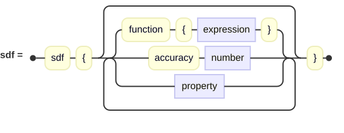
</picture>

| Property | What it does |
| --- | --- |
| `function` | The arithmetic giving the distance. |
| `accuracy` | How closely a crossing is pinned down.  A ten-thousandth by default. |
| `bounded by` | **Required**, for the reason an isosurface requires it. |

#### What distances buy you

Distances **compose**, and that is the whole attraction:

| | |
| --- | --- |
| two shapes joined | `min(a, b)` |
| the part in common | `max(a, b)` |
| one cut out of the other | `max(a, -b)` |

And because those are distances rather than choices, any of them can be *softened*.  A smooth
minimum blends two shapes into each other over a width you name — a fillet for a line of arithmetic:

```
min(a, b) - (max(k - abs(a - b), 0) / k)² * k / 4
```

Rounding a shape is subtracting a radius from its distance.  Hollowing it is taking the absolute
value and subtracting a thickness.  Repeating it forever is `mod` on the point before measuring, so
one shape is drawn everywhere for the cost of one.

### Julia

A quaternion Julia set: the points that stay bounded when `q → q² + c` is applied over and over.

```
julia {
    c [-0.2, 0.6, 0.2, 0]
    iterations 10
}
```

**There is no equation to solve here.**  Every other surface in this guide can be asked where a ray
meets it; this one cannot, because whether a point belongs is settled by iterating until the answer
runs away.  What can be had instead is an *estimate* of how far the surface is, which is enough to
walk a ray by — the same marching the [signed distance surface](#signed-distance-surface) uses.

<picture>
  <source media="(prefers-color-scheme: dark)" srcset="images/advanced/juliaClause-dark.svg">
  <source media="(prefers-color-scheme: light)" srcset="images/advanced/juliaClause.svg">
  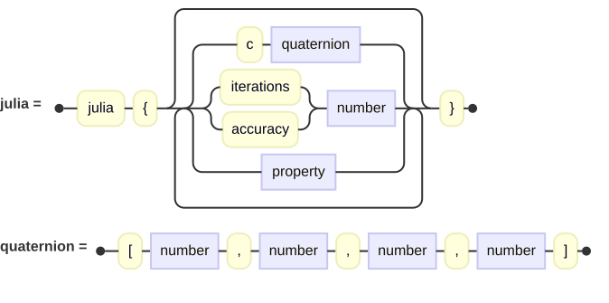
</picture>

| Property | What it does |
| --- | --- |
| `c` | The quaternion added each time round, as four numbers.  This **is** the shape. |
| `iterations` | How many times to apply it.  Ten by default; above twenty is hard to see. |
| `accuracy` | How closely a crossing is pinned down. |

Unlike most surfaces here it needs its numbers: move `c` and you get a different object, not the same
one resized, so there is nothing a transform could stand in for.  It needs no `bounded by` — every
set of this form lies inside a ball of radius two, so it knows its own extent.

A quaternion has four parts and space has three, so what is drawn is a **slice**: the fourth part of
the point is held at nought.  Changing `c`'s fourth number moves the shape through the object it is a
slice of, which is a good deal more interesting than it sounds.

#### Rough surfaces, with `noise`

A function may call [`noise`](scene-files.md#functions), which is what makes a surface genuinely
rough.  Inside a function it takes the three coordinates separately — `noise(x, y, z)` — and gives
back a number between 0 and 1, from the same field every pattern in the library draws on:

```
isosurface {
    // A rock: the distance from the middle, less a radius, pushed in and out by noise.
    function { √(x² + y² + z²) - 0.7 + 0.32 ⋅ (noise(3 * x, 3 * y, 3 * z) - 0.5) }
    bounded by [-1.2, -1.2, -1.2], [1.2, 1.2, 1.2]
}
```

Taking a half off the noise first is what makes the displacement go both ways rather than only
outward, and multiplying the coordinates before handing them over is how the roughness is scaled —
larger numbers, finer detail.

This is worth comparing with a [`normal` block](materials.md#roughening-the-surface), which does
something that looks similar and is not the same thing at all.  Perturbing the normal tilts the
light without moving the surface, so a bump-mapped ball still has the silhouette of a ball.  Moving
the function moves the surface, so **the outline is as rough as the middle** — and casts a rough
shadow to match.  The price is that it is real geometry and has to be marched, so the two techniques
each have their place rather than one replacing the other.

Because the three coordinates are handed over separately, they may be scaled differently, which is
how a surface gets a grain that runs one way:

```
// Bark: noise sampled much more finely across the trunk than along it, so the ridges run upward.
function {
    max(√(x² + z²) - 0.32 + 0.12 ⋅ (noise(18 * x, 2.2 * y, 18 * z) - 0.5), y² - 0.9)
}
```

And because the noise varies with height as well as across the ground, a landscape made this way can
lean out over itself — which a [height field](#height-field) cannot do, having one height per place
by definition:

```
// Terrain with overhangs.
function { y + 0.1 - 0.95 ⋅ (noise(2.2 * x, 1.3 * y, 2.2 * z) - 0.5) }
```

`gallery/Local/equations/isosurface-noise.igl` renders all three.  One layer of noise is smooth and rolling; for
the finer detail of real stone or bark, add layers of it, each finer and fainter than the last, which
a function can now say for itself — `noise(p) + noise(2p) / 2 + noise(4p) / 4`.

The complete scene is
[`docs/examples/advanced/isosurface.igl`](examples/advanced/isosurface.igl).

### Parametric

The other way of writing a shape down as arithmetic.  An [isosurface](#isosurface) says where a
shape *is* — everywhere a function of `x`, `y` and `z` comes out at nought.  A parametric surface
says what a shape is *made of*: two parameters, `u` and `v`, run over the spans you give them, and
three expressions say where the point at each place goes.

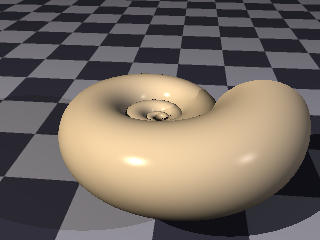

```
parametric {
    u [0, 6.283185307179586]
    v [0, 18.849555921538759]

    X { 0.09 * exp(0.14 * v) * cos(v) * (1 + 0.50 * cos(u)) }
    Y { 0.09 * exp(0.14 * v) * 0.50 * sin(u) }
    Z { 0.09 * exp(0.14 * v) * sin(v) * (1 + 0.50 * cos(u)) }
}
```

That one is a nautilus: `u` goes once round the tube, `v` three times round the spiral, and
`exp(0.14 ⋅ v)` makes every turn the same amount bigger than the one inside it — which is the rule a
shell really grows by, and the reason it comes out looking like one rather than like a coil of pipe.

The two sorts suit different shapes, and it is worth knowing which you want.  An isosurface is at
home with shapes described by a *rule about space* — a blend of two solids, a field that repeats, a
thing defined by distance.  A parametric surface is at home with shapes that are *swept, wound or
grown*: shells, horns, twisted columns, and sculptural forms that are easy to walk around and hard
to state as a rule. Ask yourself whether you would sooner describe your shape by a test a point
passes, or by a tour over its surface.

Nothing here is ever turned into triangles.  A rectangle of `u` and `v` is bounded by asking the
three expressions what they can come to over it, which gives a box the whole of that piece must lie
inside; a ray missing that box misses every point of it, and the piece is put down unopened.  Where
a piece is small enough to hold just one crossing, the crossing is then solved for exactly.  So the
surface is as smooth as it is written to be, however close you go.

#### A parametric surface is a sheet

It has no inside.  A shell looks solid and is not, so a parametric surface cannot be filled,
refracted through, or usefully put in a [CSG](surfaces.md#combining-surfaces) — the same as a
[generic shape](#generic-shape), a disc or a parallelogram.  Light it from both sides and both sides
are lit, and it does not matter which way round you wrote it.

#### The properties

<picture>
  <source media="(prefers-color-scheme: dark)" srcset="images/advanced/parametricClause-dark.svg">
  <source media="(prefers-color-scheme: light)" srcset="images/advanced/parametricClause.svg">
  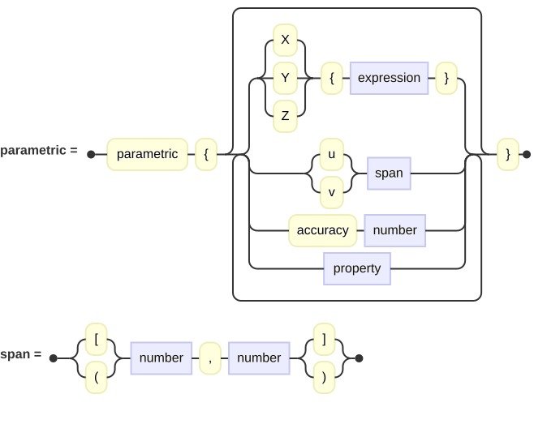
</picture>

| Property | What it does |
| --- | --- |
| `u`, `v` | The spans the two parameters run over, written `[start, end]`.  Both are required. |
| `X`, `Y`, `Z` | The arithmetic giving a point's three coordinates.  All three are required. |
| `accuracy` | How closely a crossing is pinned down, in the surface's own units.  A ten-thousandth by default. |

The spans are what make the shape end.  A sheet is only drawn over the parameters you give, so
halving the span of `v` above leaves you a shell of half as many turns, and there is no other way to
stop it — the arithmetic itself would happily wind on forever.

Either bracket of a span may be a parenthesis instead, `u (0, 6.283185307179586]` or `v (0, 1)`,
since a span is written the same way wherever the language takes one.  To a surface they mean the
same thing as the square brackets: whether a sheet's edge is in or out is a line's worth of points,
which no ray can tell apart from its being there.

#### What the expressions may hold

The same arithmetic an [isosurface's function](#what-a-function-may-hold) may hold, with the same two
exclusions: no vectors or tuples, and `mod` rather than `%`.  Any name the scene has given a number
to may be used, and is read once, when the scene is prepared.

**Write `u` and `v`, and not `x`, `y` or `z`.**  Those three are how the arithmetic underneath names
what a function is of, and `u` is lowered into the first of them — so writing `x` inside one of these
expressions silently means the same thing as `u`, and `z` means nought.  Neither is what anybody
means by it, and it cannot be told apart afterwards to warn you about.

#### What it costs

More than a shape that can be solved for.  A ball written out as a parametric surface takes about
fifteen times what the [sphere](surfaces.md#sphere) primitive takes, for the same picture — so write
what you mean, and reach for this only for shapes nothing else here gives you.

The cost is in the narrowing rather than in the arithmetic, and **what drives it is how much of the
sheet a coarse piece can cover**.  A piece spanning a wide range of `v` on the shell above covers
every turn of the spiral at once, so nothing can be put down until the turns come apart.  That makes
the number of turns, rather than the size or the arithmetic, the thing to watch — the same shell
drawn over one turn to six, at 220×165:

| Turns | 1 | 2 | 3 | 4 | 5 | 6 |
| --- | --- | --- | --- | --- | --- | --- |
| Seconds | 0.05 | 0.08 | 0.18 | 0.71 | 2.4 | 4.8 |

Three turns is free and six is not, so if a surface of yours is slower than you expect, look for a
parameter that sweeps the sheet back over itself and see whether the shape can be had with fewer
passes.

The complete scene is
[`docs/examples/advanced/parametric.igl`](examples/advanced/parametric.igl).

### Generic Shape

An arbitrary closed 2D path, left flat rather than given thickness.  Where an extrusion makes a
solid out of a path, a generic shape is the path itself — a [shape](surfaces.md#shapes), with a
front and a back and no inside.


```
generic shape {
    path {
        move to -1, 0.6
        curve -0.55, 1.3, 0.55, 1.3 to 1, 0.6     // a rounded top
        line to 1, -0.6
        quad 0.3, -0.3 to 0, -1.1                  // a notch, cut with two quadratics
        quad -0.3, -0.3 to -1, -0.6
        close
    }
}
```

<picture>
  <source media="(prefers-color-scheme: dark)" srcset="images/advanced/genericShapeClause-dark.svg">
  <source media="(prefers-color-scheme: light)" srcset="images/advanced/genericShapeClause.svg">
  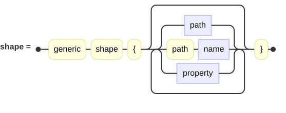
</picture>

The complete scene is
[`docs/examples/advanced/generic-shape.igl`](examples/advanced/generic-shape.igl).

### Text

Letters turned into real geometry.  Each glyph's outline becomes a path, and the path is
extruded — so text is lit, shadowed and reflected like anything else in the scene.

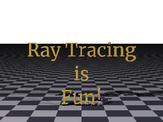

<picture>
  <source media="(prefers-color-scheme: dark)" srcset="images/advanced/textClause-dark.svg">
  <source media="(prefers-color-scheme: light)" srcset="images/advanced/textClause.svg">
  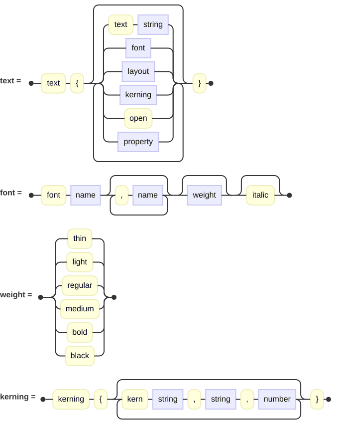
</picture>

```
text {
    text 'Ray Tracing\nis\nFun!'
    font 'Merriweather'

    layout {
        text alignment center
        horizontal position center
        vertical position center
    }

    scale [1, 2, 1]      // letters 0.2 deep rather than 0.1
    rotate X -90
}
```

| Property | What it does |
| --- | --- |
| `text` | What to write.  `\n` starts a new line. |
| `font` | Which font face, or a list of them separated by commas, the first that can be had being used; see [Managing Fonts](fonts.md) and [Falling Back to Another Font](fonts.md#falling-back-to-another-font). |
| `layout` | Alignment, positioning, the gap between lines, and a path to lay the text along; see [Laying out text](#laying-out-text). |
| `kerning` | Gaps of your own between particular pairs of letters, for this text only. |
| `open` | Leave the front and back faces off. |

`kerning` takes the pairs one `kern` at a time, the left letter, then the right, then the
adjustment, in the font's own design units, negative to draw the two together:

```
text {
    text 'AVATAR'
    font 'Merriweather'
    kerning {
        kern 'A', 'V', -120
        kern 'T', 'A', -90
    }
}
```

A pair named here is used ahead of any the [font catalog](fonts.md#kerning) holds for the face,
and those ahead of the font's own.  An adjustment of nought is read as "not said", so it cannot
take back a pair the font carries; `1` comes as near to that as makes no difference.

Like an extrusion, text is built lying flat: its letters in the X–Z plane, their tops toward +Z,
each line a unit tall, and given depth up Y, a tenth of a unit of it.  So it wants standing up, and
`rotate X -90` does that, its letters reading the right way round from −Z.  **Scaling Y before that
is how you set how thick the letters are**; scaling Z there would squash them shorter instead.

The font need not already be in your catalog — a font Google Fonts carries is fetched the
first time a scene asks for it.  [Managing Fonts](fonts.md) covers the catalog, and how to add
a face Google does not have.

The complete scene is [`docs/examples/advanced/text.igl`](examples/advanced/text.igl).

#### Laying out text

<picture>
  <source media="(prefers-color-scheme: dark)" srcset="images/advanced/layoutClause-dark.svg">
  <source media="(prefers-color-scheme: light)" srcset="images/advanced/layoutClause.svg">
  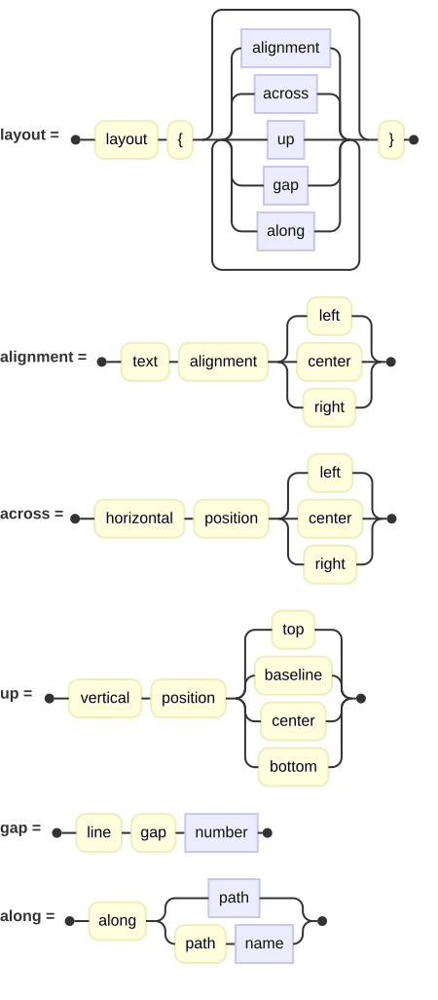
</picture>

A `layout` block says how the text is set out, and every property in it may be left to its
default.

| Property | Default | What it does |
| --- | --- | --- |
| `text alignment` | `left` | How lines of different lengths line up with one another. |
| `horizontal position` | `left` | Whether the block starts at the origin, is centered on it, or ends at it. |
| `vertical position` | `baseline` | Where the origin runs through the block: `top` is the font's ascender line, so the whole block hangs below it; `baseline` is the first line's baseline; `center` is the middle of the block; `bottom` is the last line's descender line, so the whole block stands above it. |
| `line gap` | 0.3 | The space between lines, on top of a line's own height of one unit. |
| `along path` | — | Lay the text along a path instead of a straight line; see below. |

#### Text along a path

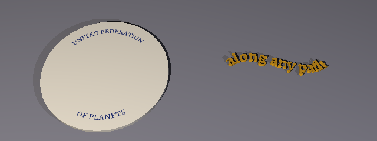

Lettering painted around a circle, standing on it above and hanging from it below, and letters
extruded along a curve.  The scene is
[`docs/examples/advanced/text-along-a-path.igl`](examples/advanced/text-along-a-path.igl).

`along path` lays the text along any [path](#paths) — a curve, a circle, lines with corners, an
SVG — written out in place or named.  The text is set out exactly as it would be along a straight
line, and then each glyph is laid on the path whole, by its middle, and turned to run with the path
there.  The glyphs keep their shapes; they are not bent.

```
path {
    text {
        text 'UNITED FEDERATION'
        font 'Merriweather'
        layout {
            along path { move to -6.8, 0  curve -6.8, 3.756, -3.756, 6.8 to 0, 6.8
                         curve 3.756, 6.8, 6.8, 3.756 to 6.8, 0 }
            horizontal position center
            vertical position bottom
        }
    }
}
```

The other layout properties keep their meanings, with the path standing in for the straight line:

* **`vertical position` says where the path runs through the text, and so which side of the path
  the text is on.**  The text stands on the path's *left*, looking along it the way it was drawn.
  With `bottom` the path runs under the descenders, so the whole of the text is on its left; with
  `top` it runs over the tallest letters, so the whole of it is on its right; with `baseline` the
  letters sit on it and only their descenders cross it, and with `center` they straddle it.  So
  text runs *outside* a circle across the top if the arc is drawn left to right and the text stands
  on it by its `bottom` — as above — and outside it across the bottom if that arc is drawn left to
  right too, and the text hangs from it by its `top`.  Capitals, which have no descenders, sit
  right on a path by their `baseline`; by their `bottom` they stand a descender's depth off it.
* **`horizontal position` says where along the path the text goes:** starting at its start
  (`left`), centered on its middle (`center`) or ending at its end (`right`).
* **Text that runs past an end of its path carries straight on** in the direction the path was
  going there.

The path is drawn in the text's own units, where a line is one unit tall, so a circle meant to
carry text a fifth of a unit tall is drawn five times larger than it will be, and the text and its
path are scaled down together afterward.  The runs of a path are followed one after another, in the
order they were drawn, and the gap from one to the next counts for nothing.

### Tapered Text

`tapered text` scales each glyph as it is given depth, the same way
[`tapered extrusion`](#tapered-extrusion) scales an outline as it rises — which is no coincidence,
since a text solid *is* a group of extrusions, one per glyph.  Each letter here is narrow on the
face you read and flares away behind it, its walls sloping out in plain view.

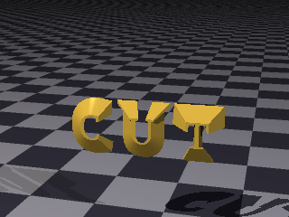

```
tapered text {
    taper 0.55
    text 'CUT'
    font 'Merriweather'
    rotate X -90
}
```

<picture>
  <source media="(prefers-color-scheme: dark)" srcset="images/advanced/taperedTextClause-dark.svg">
  <source media="(prefers-color-scheme: light)" srcset="images/advanced/taperedTextClause.svg">
  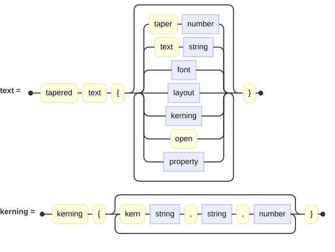
</picture>

Everything ordinary [text](#text) takes, this takes too, and `taper` means what it means for an
extrusion: what is left of the outline at the `max Y` end.

**Which end that is, once the text is standing up, is the opposite of what you may expect.**
Standing text up with `rotate X -90` turns the `max Y` end towards the reader.  So a taper **under
1**, as above, puts the *narrow* face forward and leaves every letter's slope facing you — which is
what you want when the taper is the thing being shown.  A taper **over 1** turns it round: the
widest face comes forward and hides its own slope behind it, which is the handsomer raised,
chiselled letter.  There is no rotation that stands text up *and* swaps the two ends; any that did
would read the letters backwards.

Two things to know about going over 1.  Much past about 1.5 and the letters start to grow into one
another, since each spreads about its own middle into whatever gap the layout left.  And that same
spreading reaches **below the baseline** as far as it reaches above the cap, so text stood on a
floor at nought sinks its widest face into it, taking the foot of an `E` or the tail of an `R` with
it — lift the text by about half the cap height times what the taper adds.  Under 1 neither applies:
the letters draw in from their middles, and the full-size end at the back is what rests on the floor.

**Each glyph is tapered about its own middle, not about the scene's Y axis.**  That is the one
place this differs from an extrusion, and it has to: a line of text is laid out along X, so every
letter but the first sits well off the axis a taper draws towards.  Tapering them where they stand
would pull them all in towards one point and leave a starburst rather than a word.

How thick the letters are decides how steep the chisel is, since the taper is spread over that
depth — so scaling Y before standing the text up changes the bevel as well as the depth.

The complete scene is
[`docs/examples/advanced/tapered-text.igl`](examples/advanced/tapered-text.igl).

### Height Field

Terrain as a grid of heights, one for each point of a square: either **drawn**, as an image whose
brightness says how high the ground stands, or **described**, as a function of where you are.

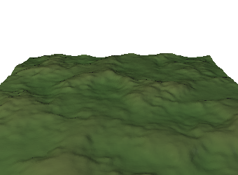

<picture>
  <source media="(prefers-color-scheme: dark)" srcset="images/advanced/heightFieldClause-dark.svg">
  <source media="(prefers-color-scheme: light)" srcset="images/advanced/heightFieldClause.svg">
  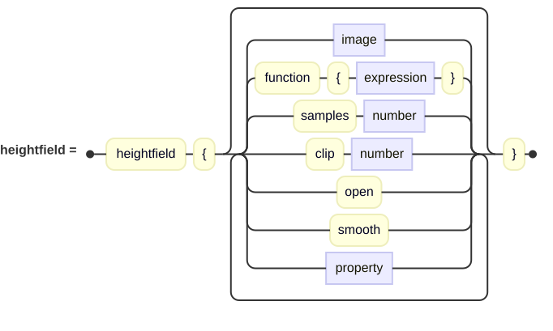
</picture>

```
heightfield {
    image 'terrain.png'

    material {
        pigment linear Y gradient {
            [0, [0.25, 0.4, 0.2], 0.45, [0.5, 0.45, 0.3], 1, [0.9, 0.9, 0.92]]
        }
    }

    // The field is built over the unit square, so center it and then give it its extent.
    translate [-0.5, 0, -0.5]
    scale [7, 1.6, 7]
}
```

The field is built over the unit square in X and Z, so it is nearly always translated to center it
and then scaled to whatever size the scene wants.

> **An image's heights run from 0 to 0.25, not from 0 to 1.**  A picture's brightness is quartered
> on its way in, so a height field made from a white pixel stands a quarter of a unit tall.  This
> matters most when a pigment is mapped by altitude: a `linear Y gradient` has a period of one in the
> surface's own space, so left alone it sweeps a quarter of itself across the whole hill and
> everything lands in whichever band comes first.  `scale [1, 0.25, 1]` on the *pigment* makes its
> stops read as plain fractions of the terrain's height.  **A function's heights are not quartered**
> — what it answers is the height — so the same pigment over the two forms wants different scaling.

| Property | What it does |
| --- | --- |
| `image` | The picture to read.  A path or a web address. |
| `function` | An expression giving the height, in place of an image. |
| `samples` | How many points across a function is sampled at.  256 by default. |
| `clip` | Ignore anything darker than a given brightness, from nought to one, cutting the terrain off there. |
| `open` | Leave the sides and underside off. |
| `smooth` | Shade the terrain as the smooth surface it stands for. |

A field takes its heights from an `image` or from a `function`, never both.  `samples` belongs to
the function form — a picture brings its own size with it — and `clip` to the image form, since a
picture's pixels cannot be reached from the scene while a function can simply say `max(..., 0)`.
Saying otherwise is refused rather than quietly ignored.

**A closed field stands on a floor at height nought**, whichever form it takes: its walls run down
from the edge of the terrain to nought, and its underside is the unit square there.  An image's
heights never go below it, but a function's may, and where one does the terrain dips through its own
floor — so lift such a function clear of nought, or make the field `open`.  A `clip` on a closed
field raises everything darker than the clip to the height the clip's brightness stands for — a
quarter of it, as with any brightness — in a level plain; `open`, the field leaves that plain out,
and the terrain stops at the clip with nothing beneath it.

#### Terrain from a function

The same shape written out instead of drawn.  Inside the braces, `x` and `z` run from 0 to 1 across
the square, and what the expression answers is the height:

```
heightfield {
    // Ridged multifractal: three octaves, each half as tall and twice as fine as the one before.
    function {
        0.30 * (1 - abs(2 * noise(x *  3, 0, z *  3) - 1)) +
        0.15 * (1 - abs(2 * noise(x *  6, 0, z *  6) - 1)) +
        0.07 * (1 - abs(2 * noise(x * 12, 0, z * 12) - 1))
    }
    samples 400

    translate [-0.5, 0, -0.5]
    scale [30, 30, 30]
}
```

This is the third way to make terrain here, and the three are worth telling apart.  An **image**
needs a picture beside the scene, and is the only one that can carry real-world elevation data.  A
**function height field** needs nothing but the scene, and is a mesh, so it is fast.  An
[isosurface](#isosurface) written as `y - f(x, z)` describes the same terrain but is *marched*
rather than meshed: slower, and its silhouette is exact where a mesh shows facets against the sky.

Being a mesh, a function height field costs what its grid costs, and `samples` is the dial: a
400-point grid is 318,000 triangles.  Raise it until the facets stop showing along the skyline,
which is where a mesh gives itself away, and no further.

Measured on the same island written both ways, at 400x300:

| | Time |
| --- | --- |
| Height field, `samples 256` | 1.4s |
| Height field, `samples 512` | 3.6s |
| Isosurface, `y - f(x, z)` | 7.2s |

So the mesh is two to five times quicker, and the gap widens as the grid coarsens.  What the
isosurface buys for that is an exact silhouette and a shape that need not be a height at all.

An overhang is beyond all three: there is one height for each point on the ground.  Only the
isosurface can be made to lean out over itself, and then only by writing it as a genuine volume
rather than as a height.

The image may be a **web address**, as it may for an
[image pigment](pigments-and-patterns.md#image-pigments), and `uncached` before `image` works
here too.

#### `smooth`, and when a terrain wants it

A height field is a mesh of **flat** triangles, so a surface that is meant to be smooth shows the
edges of every one of them — a fine diamond hatching wherever the light rakes across it.  `smooth`
gives each grid point a normal taken from the slope of the ground either side of it, so the
triangles meeting there agree about which way the surface faces.

It costs nothing to compute, and it applies to both forms — the normals come from the sampled grid,
and a picture fills that grid exactly as a function does.  It is **off by default only because
turning it on changes the shading of every height field already written**, not because it is
particular to one form or the other.

Reach for it when the land is smooth and the light is low; the `dunes` scene in the gallery is the
worst case there is, and it needed 2000 samples flat against 1100 smooth for a better picture in
less than half the time.  Rugged terrain — the two island scenes — hides its faceting well enough
never to ask.

What `smooth` does **not** do is change the geometry: the silhouette against the sky, and the edge
of every shadow, are still the mesh's own outline.  Those are what a finer grid still buys.

A height field cannot make an overhang or a cave: there is exactly one height for each point
on the ground, because there is exactly one pixel.  That is the limit of the technique rather
than of this renderer.

The map in the picture above was itself rendered by this ray tracer — a plane wearing a bozo
pattern, seen from straight above — so the example needs nothing from outside.  The complete
scene is
[`docs/examples/advanced/height-field.igl`](examples/advanced/height-field.igl).

### Object Files

A mesh loaded from a Wavefront `.obj` file, which is how you bring in geometry modeled
somewhere else:

```
object file {
    source 'model.obj'
}
```

<picture>
  <source media="(prefers-color-scheme: dark)" srcset="images/advanced/objectFileClause-dark.svg">
  <source media="(prefers-color-scheme: light)" srcset="images/advanced/objectFileClause.svg">
  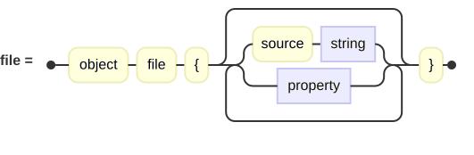
</picture>

The triangles become [smooth triangles](surfaces.md#triangle-and-smooth-triangle) where the
file carries normals, and plain ones where it does not.

### L-Systems

An L-system is a short set of rewriting rules.  A starting string is rewritten by the rules,
over and over, and the result is read as instructions for a turtle that draws in 3D.  A handful
of rules produces something no one would write out by hand.

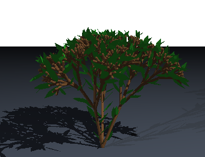

```
bush = lsystem {
    axiom '$A'

    productions {
        'A' -> '[&FL!A]/////[&FL!A]///////[&FL!A]'
        'F' -> 'S/////F'
        'S' -> 'FL'
        'L' -> '[C^^{-f+f+f-|-f+f+f}]'
    }

    materials {
        'C' -> blade
    }

    controls {
        tubes
        angle 22.5
        length 1
        diameter 0.5
        factor 0.9
    }
}

lsystem bush {
    generations 6
    material stem
    scale 0.15
}
```

That bush is from Prusinkiewicz and Lindenmayer's *The Algorithmic Beauty of Plants*, and
every stem and leaf in the picture comes from the four rules above.

| Part | What it is |
| --- | --- |
| `axiom` | The string the rewriting starts from. |
| `productions` | The rules.  Each replaces one character with a longer run. |
| `materials` | Binds a character to a material, so parts can differ in color. |
| `controls` | How the turtle draws: the turn angle, the stem diameter, and so on. |
| `generations` | How many times to apply the rules. |
| `commands` | Gives a letter of your own one of the turtle's commands. |
| `leaf`, `surfaces` | The surfaces a `~` stamps. |
| `ignore` | Letters a rule's context looks past. |

<picture>
  <source media="(prefers-color-scheme: dark)" srcset="images/advanced/lsystemClause-dark.svg">
  <source media="(prefers-color-scheme: light)" srcset="images/advanced/lsystemClause.svg">
  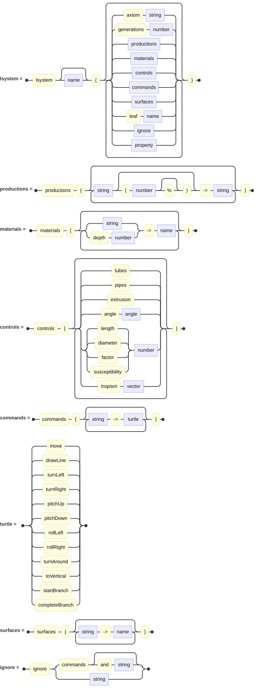
</picture>

The definition and the use are separate on purpose.  A named L-system may be drawn several
times at different generation counts, which is how you show a thing growing.

Some of the characters a production may use:

| Character | What the turtle does |
| --- | --- |
| `F` | Draw forward. |
| `f` | Move forward without drawing. |
| `+` `-` | Turn left, turn right. |
| `&` `^` | Pitch down, pitch up. |
| `\` `/` | Roll left, roll right. |
| `[` `]` | Remember where you are; go back there.  This is what makes a branch. |
| `{` `}` | Begin and end a filled polygon — a leaf. |
| `\|` | Turn right around. |
| `!` | Narrow the stem. |
| `$` | Turn to face straight up. |
| `~` | Stamp a leaf — a surface of your own, or the built-in blade. |
| `%` | Cut off the rest of this branch. |

There are a few more, and `Geometry/LSystems/LSystemShapeRenderer.cs` has the full table.

A production may be given a probability, in which case several rules may compete for the same
character and one is chosen at random each time:

```
productions {
    'F' (0.34) -> 'F[+F]F[-F]F'
    'F' (0.33) -> 'F[+F]F'
    'F' (0.33) -> 'F[-F]F'
}
```

That is what keeps a stand of trees from looking like one tree copied.  The choice is made
from a seed, so a scene still renders the same way twice; `with seed` on the L-system changes
which stand of trees you get.

#### Parameters

A module may carry numbers, and a production may do arithmetic on them:

```
R = 1.456

tree = lsystem {
    axiom '$A(1)'
    productions {
        'A(s)' -> '!F(s)[+A(s / R)][/(90)-A(s / R)]'
    }
}
```

`A(s)` binds the name `s` to whatever number the module carries; `F(s)` draws a segment of exactly
that length; `A(s / R)` passes on a smaller one.

**Why it matters** is best put by Prusinkiewicz and Lindenmayer, who introduced it: without
parameters every line is one step long, or two, or three, so even an isosceles right triangle cannot
be traced — the hypotenuse is √2 times the side and no whole number of steps lands on it. You can
shrink the step until it divides everything, but then a single internode takes hundreds of symbols.

**The first number drives the turtle.** `F(a)` steps `a`, `f(a)` moves without drawing, `+(a)`,
`-(a)`, `^(a)`, `&(a)`, `\(a)` and `/(a)` turn by `a` **degrees**, and `!(w)` sets the width
outright rather than shrinking it by `factor`. Any further numbers are the model's own business —
`F(x, t)` may carry a counter the turtle never looks at.

**A command written bare still uses `controls`.** That is the other half of the rule, and it is what
keeps every L-system written before parameters existed drawing exactly as it did.

**Arithmetic is ordinary arithmetic.** A module's argument is an expression like any other, so it
may call `sqrt`, hold a nested call, and — as `R` does above — use a value the scene named. That is
why there is no need for anything like the book's `#define`.

##### Conditions

A production may be guarded, and then it only applies where the guard is true:

```
productions {
    'A(t) : t > 3'  -> 'F(1)'
    'A(t) : t <= 3' -> 'F(1)A(t + 1)'
}
```

Conditions use `==` for equality, not the single `=` the book prints — everything after the colon is
an ordinary expression in this language.

**A rule applies only when the letter, the number of parameters *and* the condition all agree.** So
`F(x)` and `F(x, t)` are two different rules rather than one that sometimes goes wrong, and a module
that suits no rule is carried through untouched.

##### Parameters in a context

A context may name parameters too, and then it binds them for the condition and the successor to
use:

```
productions {
    'A(x)<B(y)>C(z) : x + y + z > 10' -> 'E((x + y) / 2)F((y + z) / 2)'
}
```

That is the book's own example. Given `A(4)B(5)C(6)`, the `B(5)` becomes `E(4.5)F(5.5)` — the rule
can see what its neighbours are carrying, not merely that they are there. This is how a signal
passes along a filament: each module works out its new value from the ones either side of it.

**A context naming parameters wants exactly that many.** `A(x)` matches an `A` carrying one number
and not an `A` carrying none or two — the same rule the predecessor follows. **A context written as
a bare letter names nothing and so asks nothing**, which is what keeps every context-sensitive
L-system written before parameters existed working unchanged.

**If a context and the predecessor bind the same name, the predecessor wins.** The module being
rewritten is the one the rule is about.

##### Where a letter ends and arithmetic begins

The book warns that `+`, `&`, `^` and `/` are letters of the alphabet *and* arithmetic operators,
and which is meant depends on where it sits. In `F(x*h)+F(x*q)` the `*` is a multiplication and the
`+` is a turn.

A word is read module by module — a letter, then a balanced parenthesis **only if one follows it
immediately** — so the two can never be confused. One consequence is worth knowing: a parenthesis
that does not follow a letter directly is not a parameter list. In `[F(2)]` the `(2)` belongs to the
`F`, not to the bracket.

#### Bending, with `tropism`

A plant drawn from rules alone runs dead straight between its turns, and that is the surest sign
that nobody grew it.  Real branches sag under their own weight, lean away from a prevailing wind,
and reach toward the light.  `controls` can say so:

```
controls {
    tubes
    angle 28
    tropism [0, -1, 0]
    susceptibility 0.12
}
```

`tropism` is the direction segments bend **toward** — straight down for gravity, something with a
sideways lean for a wind, upward for a plant reaching for the light.  `susceptibility` is how
readily they give way to it, and **it is nought unless you say otherwise**, so an L-system written
before any of this existed draws exactly as it always did.

The turn is Prusinkiewicz and Lindenmayer's, from *The Algorithmic Beauty of Plants*: after each
segment the turtle is rotated by an angle of `e |H x T|` about the axis `H x T`, where `H` is the
heading, `T` the tropism and `e` the susceptibility.  The cross product does two jobs at once,
which is the neatness of it — its direction is the axis to turn about, and its length is the sine
of the angle between heading and tropism.  So a segment already pointing along the tropism is left
alone, and one lying square across it bends the most.  It is the torque on a stick held at one end
with a force pulling on the other.

Two consequences worth knowing.  **The bend accumulates**: each segment turns a little further than
the last, so a branch curves rather than taking one kink and carrying on.  And **it applies to the
trunk too** — at a high susceptibility a tree does not merely droop at the tips, it lies down.
Values around 0.1 give a tree that has weathered something; 0.3 gives a weeping form.

`controls` chooses `pipes` or `tubes` for the stems — `tubes` taper into one another and leave
no shoulder at a joint, `pipes` are cheaper where the diameter never changes.  The third choice,
`extrusion`, draws no stems at all: it takes the turtle's track as an outline in the X/Z plane,
closes it, and stands it a unit tall from `y = 0`, which is how a Koch snowflake becomes a solid
(`gallery/Local/l-systems/snowflake.igl`).  The turtle starts at the origin heading along +X with
+Y up, so `+` and `-` keep it in that plane; only its drawing steps add corners to the outline.

#### Letters of your own

**`commands`** gives a letter a turtle command's meaning.  Many of the book's curves rewrite letters
other than `F` and still mean every one of them as a step forward; the dragon curve is written in
`L` and `R`:

```
lsystem {
    axiom 'L'
    productions {
        'L' -> 'L+R+'
        'R' -> '-L-R'
    }
    commands {
        'L' -> drawLine
        'R' -> drawLine
    }
    controls { angle 90 }
    generations 10
}
```

The commands a letter may be given are `move`, `drawLine`, `turnLeft`, `turnRight`, `pitchUp`,
`pitchDown`, `rollLeft`, `rollRight`, `turnAround`, `toVertical`, `startBranch` and
`completeBranch`.  A letter that is neither a command nor given one is carried along by the
rewriting and passed over by the turtle, which is what `A` and `S` are in the bush above.

**`leaf` and `surfaces`** say what a `~` stamps.  A bare `~` stamps the `leaf` surface, or the
built-in green blade when there is none; `~` followed by a letter bound in `surfaces` stamps that
letter's surface instead (`surfaces { 'B' -> berry }`, and then `~B`).  A stamped surface is drawn
as if growing along +Z from its base at the origin, its width along X and its face toward +Y, and
it is placed at the turtle with that frame turned to the turtle's heading and roll.  It is not
scaled by `length`: it is the size you made it, in the L-system's own units.  A surface that brought
a material of its own keeps it; a bare one takes whatever material a letter set before it, and only
the built-in blade falls back on its own green.  `gallery/Local/l-systems/berry-tree.igl` stamps a
flattened sphere.

**`materials`** binds a material to a letter or to a depth.  Bound to a letter, it changes what the
turtle draws with from that letter on, to the end of the branch it stands in.  Bound to a depth —
`depth 0 -> bark` for the trunk, `depth 1 -> heartwood` for what forks from it, and so on — it
colors a plant from trunk to twig without a rule for every level.  The depths need not run
unbroken: a depth left out takes the material of the one above it, and anything deeper than the
last takes the last.  A material by depth does not reach the leaves, which would otherwise come out
the color of the twigs they grow from; a letter's does.  `gallery/Local/l-systems/materials.igl`
does both.

**`ignore`** is for rules with a context.  A rule may name the letter that has to stand before the
one it rewrites and the one that has to follow it, `'0<1>1' -> '1'` rewriting a `1` only between a
`0` and a `1`.  Turns and steps in between usually should not count, and `ignore '+-F'` says which
letters a context looks past.  `ignore commands` looks past every command that turns the turtle or
narrows the stem (`+ - ^ & \ / | $ !` and their alternate spellings), and `ignore commands and
'F'` adds letters to those.  `gallery/Local/l-systems/context-sensitive.igl` grows three of the
book's plants this way.

The complete scene is [`docs/examples/advanced/lsystem.igl`](examples/advanced/lsystem.igl),
and `gallery/Local/l-systems/` has a dozen more, from a Hilbert curve to a berry tree.

### Grown Tree

A tree grown rather than built.  An L-system says how a plant branches; a grown tree says only how
much **room** it has, and the branching follows from that.  The room is scattered with points, and
round after round each point draws the nearest twig within its reach a step toward it, until every
point has a twig at it.  Branches crowd where the room is full and stretch where it is thin, no two
forks divide alike, and the crown comes out the shape of the space it was given.  This is space
colonization, from Runions, Lane and Prusinkiewicz, *Modeling Trees with a Space Colonization
Algorithm* (2007).

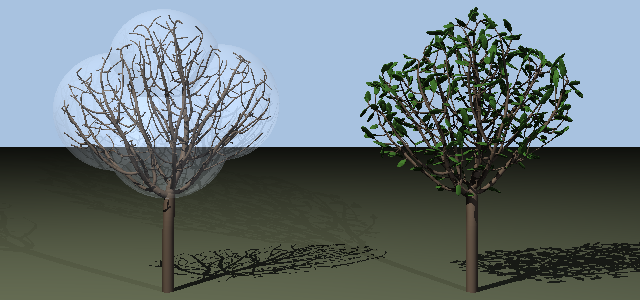

```
room = union {
    sphere { scale 1.8  translate [0, 4.5, 0] }
    sphere { scale 1.7  translate [-1.5, 5.2, 0] }
    sphere { scale 1.7  translate [1.5, 5.5, 0.4] }
    sphere { scale 1.6  translate [0, 6.5, -0.2] }
}

grown {
    crown room
    points 1500
    reach 1.2
    kill 0.24
    step 0.12
    twig 0.016
    leaf leaf
    with seed 7
    material bark
}
```

<picture>
  <source media="(prefers-color-scheme: dark)" srcset="images/advanced/grownClause-dark.svg">
  <source media="(prefers-color-scheme: light)" srcset="images/advanced/grownClause.svg">
  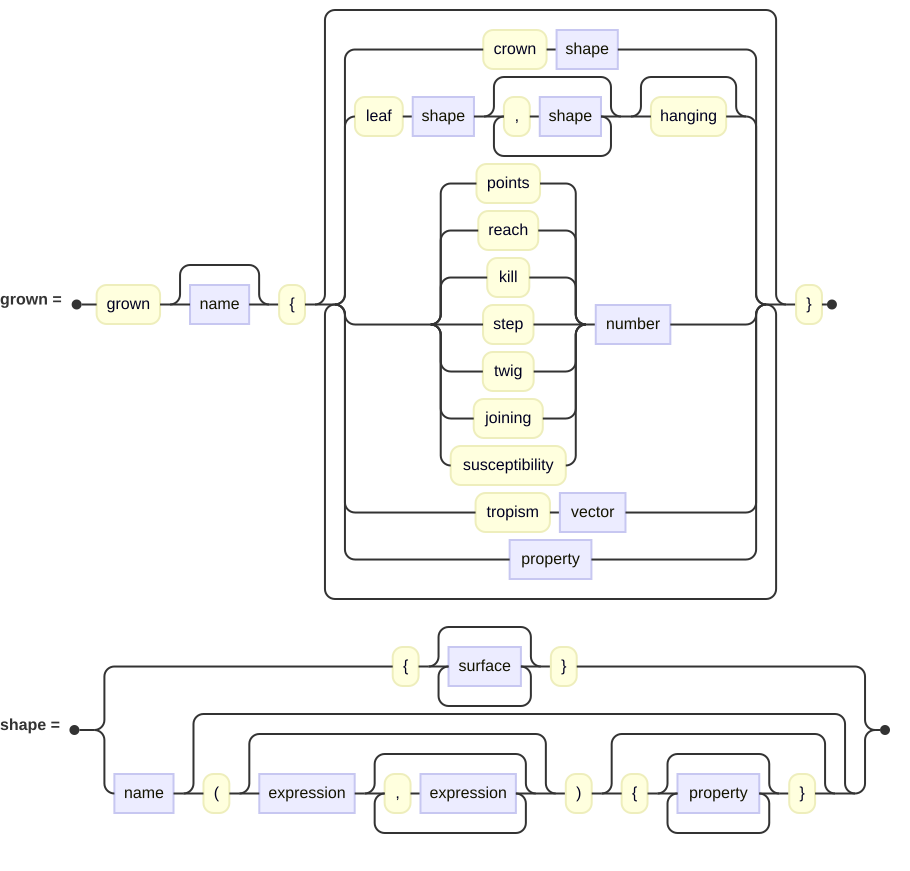
</picture>

**The tree stands on the origin** and grows straight up +Y until the crown's points can reach it, then
out into the crown.  So the crown must stand over the origin, and come within `reach` of the line
straight up from it; one off to the side is refused rather than grown into a trunk that never stops.

**Put the lowest of the crown in the middle.**  The trunk climbs until the first of the crown's points
can reach it, and if that point lies in a ball hanging low off to one side, the trunk turns hard toward
it: a dog-leg at the foot of the crown.  A crown whose lowest part is over the trunk — a middle ball,
with the others set no lower — is entered from beneath and divides there, as a tree does.

**`crown`** is the room it has: any closed surface.  Write it out in braces, as a group's surfaces are
— `crown { sphere { scale 3  translate [0, 6, 0] } }` — or name one, or call a primitive that makes
one.  A group's parts may overlap; a point is room wherever any of them is, so a crown of three balls
is three balls, not the places where an odd number of them overlap.  A CSG works as well, and so does
anything else with an inside.  A plane or an open-ended cylinder has no inside to fill, and is refused.

**`points`** is how many points fill the crown (1500 unless you say).  More points, more twigs, and
growth that follows the crown's shape more closely.

**`reach`** is how far a point reaches for a twig (1), **`kill`** how near a twig comes before the
point is used up (0.25), and **`step`** how far a twig grows each round (0.1).  Together they set the
tree's character more than anything else:

- A far `reach` lets a point pull from across the crown, which grows a few long leaders; a near one
  makes every twig answer only to what is close by, which branches finely.  A narrow crown wants a
  near reach, or its points pull a handful of limbs its whole height and it grows a broom.  About a
  tenth of the crown's breadth is a good start.
- `kill` must be less than `reach`, or every point would be used up before it drew anything.  A
  fifth of the reach leaves room between twigs for leaves.
- `step` must be well under `kill` — a half or less — so a twig can reach a point rather than step
  past it.

**`tropism`** and **`susceptibility`** bend every step of growth toward a direction, as an L-system's
do ([Bending, with `tropism`](#bending-with-tropism)): `tropism [0, -1, 0]  susceptibility 0.4` and
the limbs arch as though weighed down.  Unsaid, nothing bends.

**How thick the wood is** comes back from the twigs.  Every twig ends `twig` thick (0.01), and where
branches meet, the wood below is as thick as those it feeds put together: its radius raised to the
**`joining`** is the sum of theirs raised to it.  That is the pipe model, and Leonardo's rule for
trees with an exponent of 2, which keeps the wood's cross-section the same across a fork; measured
trees mostly fall between 2 and 3, and 2.5 is the default.  A higher joining gathers less of the
twigs' thickness into each limb, for a slender trunk under a big crown.  Between forks the wood keeps
its thickness, so each run is drawn as a chain of straight [tube](#tube) segments of that one radius,
end to end with round ends, and no joint shows along it; it thins only at a fork, where each branch
sets off from inside the thicker wood below.

**`leaf`** is what grows at the end of every twig and the two places behind it.  It is written the way
the crown is — in braces, by name, or as a call — and authored **standing on the origin and growing up
+Y**, the way its twig runs, with its width along X and its face toward +Z.  (An L-system's leaf grows
along +Z, its turtle's heading; the clusters the [trees library](libraries.md#trees) hangs on its twigs
grow up +Y, and a grown tree takes those as they are.)  Laid along its twig, each leaf turns its face
toward the sky, give or take an eighth of a turn — which is what a leaf does, and what lets snow laid on
a shoot's +Z side lie on top of it.  A leaf is made once and shared by every place it stands, so a
thousand leaves cost one leaf's geometry.  A leaf that keeps a material of its own wears it; the tree's
`material` is the wood's.

**Several leaves**, after commas, and each place takes one of them at random:

```
leaf Cluster(1), Cluster(2), Cluster(3), Cluster(4)
```

One leaf is a tree of one cluster, and in autumn that turns all at once, a flat orange; four that each
turn their own way turn cluster by cluster, as a tree does.  A leaf that comes back an empty group, as a
winter cluster can, keeps its share of the places by standing nowhere — so a winter tree of four
clusters, two of them bare, is bare in half its places.

**`hanging`**, written after the leaves, hangs them from the twig instead of laying them along it: each
stands upright in the tree's own space, turned any way about the upright, authored hanging down −Y from
the origin.  A willow's curtain hangs so — a strand laid along its twig flies sideways from any limb bent
past level — and so does fruit.

**`with seed`** scatters the points.  The same seed always grows the same tree, twig for twig; another
grows another of the same kind.

**What it costs.**  Growing is done once, before rendering: a tree of two thousand points grows in about
half a second.  What it grows renders like any other wood and leaves.  Every tree in the
[trees library](libraries.md#trees) but the palm is grown this way, and the undergrowth's `Boxwood`; and
`gallery/Local/countryside/bare-wood.igl` shows a winter stand of them, where the branching is all there
is to see.

The complete scene is [`docs/examples/advanced/grown.igl`](examples/advanced/grown.igl).

### Fracture

A solid broken into pieces.  Seeds are scattered through it, and each piece is the part of the solid
nearer its own seed than any other — the seed's Voronoi cell — so the pieces fit together exactly, the
way the pieces of anything broken do.  Each is a convex polyhedron, found exactly: no tessellation, no
marching, as cheap per face as a cube.  It is what the [rocks library](libraries.md#rocks)'s walls and
rubble, the [roads library](libraries.md#roads)'s crazy paving and the
[windows library](libraries.md#windows-and-doors)'s broken panes are made of.

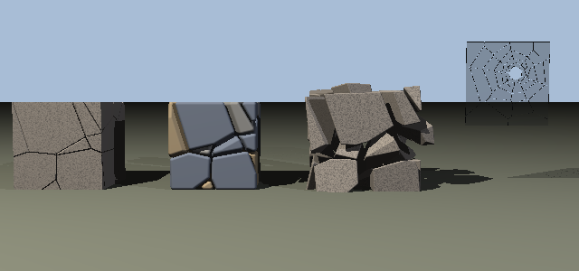

```
fracture {
    solid { cube { scale 0.8  translate [0, 0.8, 0] } }
    pieces 30
    gap 0.03
    rounded 0.05
    loose
    materials gray, buff, slate
    with seed 4
}
```

<picture>
  <source media="(prefers-color-scheme: dark)" srcset="images/advanced/fractureClause-dark.svg">
  <source media="(prefers-color-scheme: light)" srcset="images/advanced/fractureClause.svg">
  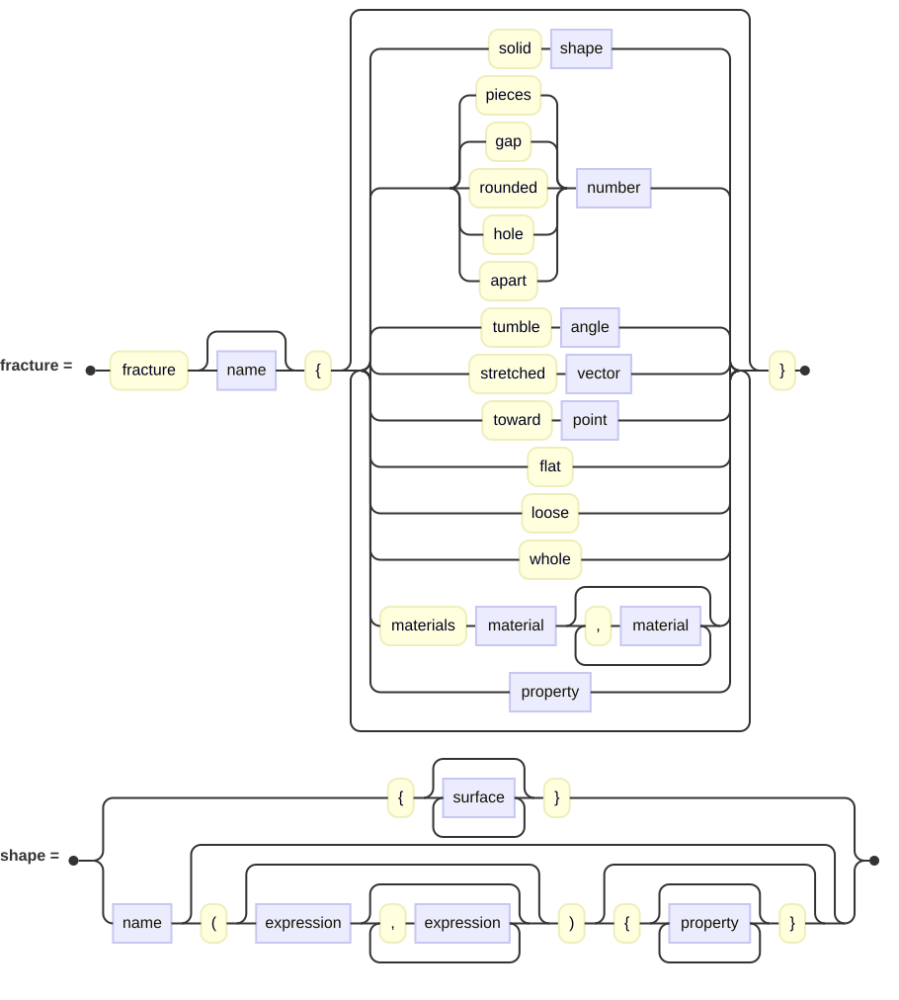
</picture>

**`solid`** is what is broken: any closed surface, written in braces, named, or made by a primitive,
as a [grown tree](#grown-tree)'s crown is.  A box — a cube under any transform, or an intersection of
them, which is how a wall with sloping faces is written — is broken exactly, its own planes bounding
every piece.  Anything else is broken by cutting each piece from it, so a ball breaks into pieces whose
outer faces are the ball's.  A plane or an open-ended shape has no inside, and is refused; so, unless
it is a box or the pieces are `whole`, is a solid that glows, holds a medium or moves, since every piece
is cut from the one solid shared among them.

**`pieces`** is how many (20 unless you say), near enough.  **`gap`** is how wide the cracks between
them are: nought, and they fit with no crack at all; a hair, and the thing reads as cracked; more, and
as laid stones.  **`rounded`** wears every piece's edges and corners round by that much — exactly, the
piece drawn in by the radius and grown back by a ball — while its faces stay where they were, so a slab
broken and worn is still its full thickness.  A piece too small to be worn so far is worn by half as
much, and if that is still too much, left sharp.

**How a solid breaks:**

- **`flat`** breaks it only across X and Z, every crack running straight down: paving, dried mud,
  basalt columns.
- **`stretched [x, y, z]`** makes the pieces that many times longer along each axis than across it.
  `stretched [2.2, 1, 1.3]` breaks a wall into rough courses of stones laid lengthwise, which is the
  one rule a waller keeps.
- **`toward <point>`** makes the pieces smaller near a point, as a thing breaks round where it was
  struck.  A thin solid — a pane, a slab — breaks there in rings and spokes, the radial cracks running
  out from the point as they do in glass; a thick one only more finely.  **`hole r`** leaves out every
  piece within that distance of the point, a hole struck through.
- **`whole`** keeps the pieces whole: never cut by the solid, but kept where their seeds lie inside it.
  The solid's outline is then made of whole stones rather than of its own smooth skin — a heap of rubble
  broken from a mound, a cairn.  Seeds are scattered round the solid as well, so the outermost pieces are
  no bigger than the rest.

**Where the pieces go.**  **`apart d`** moves each piece that far out from the solid's middle — from the
point struck, if there is one — and **`tumble a`** turns each about its own middle by up to that angle:
a thing caught breaking, or stones not quite laid true.

**What the pieces are made of.**  Unsaid, they wear the fracture's own `material`, and its pattern runs
on from piece to piece, as it does across the cracks in a broken slab.  **`loose`** gives each piece a
place of its own in its pattern instead, so the grain of one does not run on into the next — the
pieces are separate stones, not one block cracked.  **`materials A, B, C`** gives them several to take
one of at random, each a name, a primitive's parameter or a `material` written out.  A piece of a solid
that is not a box has the solid's own skin for its outer faces, and wears its material there as well as
on its broken faces: the solid is made once for each of the materials, so that each skin is its own.

**What it costs.**  Breaking is done once, before rendering: a wall of three hundred stones breaks in a
fifth of a second.  The pieces then render as any polyhedra do — a worn one a little dearer than a sharp
one, since its edges and corners are cylinders and balls.

The complete scene is [`docs/examples/advanced/fracture.igl`](examples/advanced/fracture.igl).

### Shape Grammar

A building described by rules rather than by placing its parts.  Its first scope is a box standing on
the ground, and each rule is handed a scope and does what it says with it: divides it and hands the
parts on to other rules, or puts something in it — a wall, a window, a roof.  It goes on until nothing
is left to hand on, and what was put in the scopes is the building.  This is the split grammar
architects' tools use (CGA, after Müller and Wonka): a lot raised into a mass, the mass into its faces, a
face into floors, a floor into bays, a bay into wall round a window.  It is what the
[buildings library](libraries.md#built-by-rules)'s `Terrace`, `Apartments` and `Chapel` are made of.

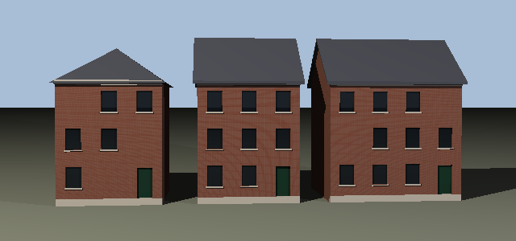

```
shapes {
    axiom Lot
    size [10, 0, 8]
    rules {
        Lot -> extrude 9 { Mass }
        Mass -> faces depth 0.3 { front: Facade  sides: Wall }
                roof gable 40 overhang 0.3 material slate gables material brick
        Facade -> split Y { 0.5 Plinth  ~1 Floors  0.35 Cornice }
        Floors -> repeat Y 2.8 index in floor { Floor }
        Floor -> repeat X 2.5 { Bay }
        Bay -> if (floor == 0 && index == count - 1) { Door } else { choose { 4 Window  1 Wall } }
        Window -> split X { ~1 Wall  1.1 { split Y { 0.8 Wall  1.5 Opening  ~1 Wall } }  ~1 Wall }
        Opening -> move [0, 0, 0.12] { size [width, height, depth - 0.12] { fill material glass } }
        Door -> fill material paint
        Wall -> fill material brick
        Plinth -> fill material stone
        Cornice -> move [0, 0, -0.15] { size [width, height, depth + 0.15] { fill material stone } }
    }
    with seed 3
}
```

<picture>
  <source media="(prefers-color-scheme: dark)" srcset="images/advanced/shapesClause-dark.svg">
  <source media="(prefers-color-scheme: light)" srcset="images/advanced/shapesClause.svg">
  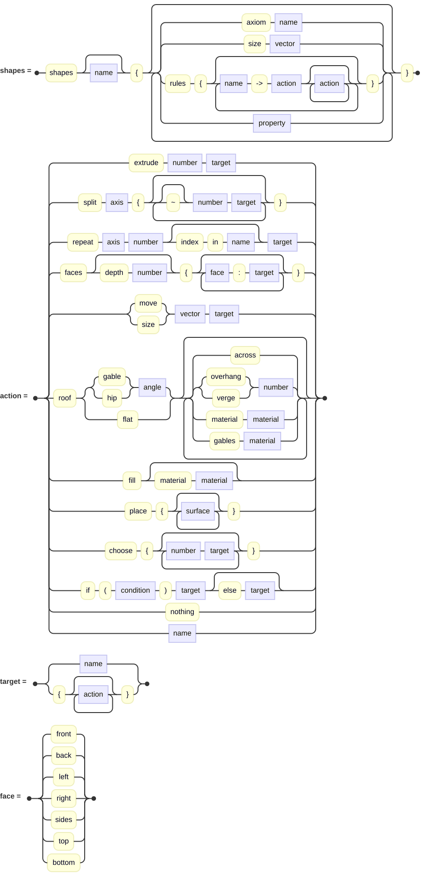
</picture>

**`size`** is the first scope's: across X, up Y and back along Z.  It stands on the ground with its middle
over the origin and its front toward `-Z`, which is the way the buildings library's buildings face; its
height is usually nought, a lot, raised by the first rule.  **`axiom`** names the rule it is handed to.
**`rules`** holds the rules, each a name, `->`, and what it does — any number of actions, one after another,
each to the same scope — up to the next name and arrow.

**A scope is a box with axes of its own**: X across it, Y up it, Z into what it stands for.  Every rule
sees its scope's size as **`width`**, **`height`** and **`depth`**, so a window can be sized by its bay; the
part of a split or repeat sees its number and how many there are as **`index`** and **`count`**; and the
names of the scene, or of a primitive's parameters, are there too.  Where an action hands a scope on,
it names a rule or writes actions in braces.

**Dividing a scope:**

- **`extrude h`** gives the scope a height: a lot raised into a mass.
- **`split X|Y|Z { … }`** divides it along one of its axes into parts, each a size and where it goes: a
  plain number is that size, and a number after **`~`** a share of what the plain ones leave.  Plain
  sizes that will not fit are all shrunk alike to fit, and the shares come to nothing.
- **`repeat X|Y|Z s`** tiles it with as many parts of about that size as fit, stretched to fit exactly —
  a longer wall gets more bays, not wider ones.  **`index in name`** gives the part's number a name of its
  own as well, so an inner rule can still tell which floor it is on after its own `index` has become the
  bay's.
- **`faces [depth d] { … }`** hands on the faces of a box, each as a scope standing on that face, d deep,
  its Z pointing in — so its -Z faces out, the way a window from the windows library is built: **`front`**
  (the side toward -Z), **`back`**, **`left`**, **`right`**, **`top`** and **`bottom`**, and **`sides`** for any
  of the four upright faces not named.  The four walls overlap at the corners, which is what lets each be
  built whole.
- **`move v`** moves the scope along its own axes, and **`size v`** sets its size, its corner where it
  was: a cornice is a band moved out and made deeper, a balcony a slab moved out in front of the wall.

**Choosing:** **`choose { w a  w b … }`** goes one of several ways, each as likely as its weight — the
same way for the same seed and the same place every time, so a scene renders alike twice and two
choices at one place draw apart.  **`if (condition) a [else b]`** goes by what the rule sees, as the
ground floor's last bay above is a door.  **`nothing`** puts nothing there.

**Filling a scope:**

- **`fill [material M]`** fills it with a box.  The box is a polyhedron in the grammar's own space, not a
  cube stretched to fit, so **a material's pattern runs on unbroken** from one box to the next: a facade's
  brick from bay to bay, its courses level all the way along.  That also means the pattern is in the
  grammar's units — brick laid in meters, not undone from a cube's scale.
- **`place { … }`** stands surfaces in it, written as a group's are: their own origin at the middle of
  the scope's near face, their axes the scope's, unscaled — so a window from the windows library goes in
  the wall it should, sized by the scope's `width` and `height` in its own arguments.
- **`roof gable a | hip a | flat`** roofs a box scope over its top.  A gabled roof has its ridge along X,
  or along Z if it is **`across`**, its slopes at the angle given, and its gable ends a solid of the
  **`gables`** material standing in the walls; a hipped one slopes on all four sides — on a square, a
  spire; a flat one is a slab.  **`overhang o`** reaches past the walls, and **`verge v`** past a gabled
  one's gable ends instead — nought for a terrace, whose houses' roofs meet over the walls between them.

**What it costs.**  A grammar is carried out once, as the scene is read; what it built is then an
ordinary group of polyhedra and placed things.  A terrace of five shops with flats over them is under
four hundred boxes and a hundred windows and doors placed — sixteen shapes, each made once and shared
wherever it stands — and renders as fast as any group of boxes does.  A rule that hands its scope on two
hundred deep is taken to be going round in a circle, and refused.

The complete scene is [`docs/examples/advanced/shapes.igl`](examples/advanced/shapes.igl).
