## Animation

An animation is a scene rendered again and again, a moment later each time.  A scene says how long it runs,
and everything in it may be worked out from **`time`** — the moment of the frame being rendered, in seconds —
or from **`frame`**, its number.  The whole scene is carried out afresh for every frame, so whatever reads
the time changes: where a thing stands, how it is turned, its color, a lamp's brightness, the sun's height,
the camera.

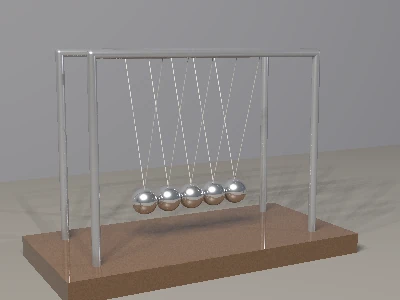

```
context { animation length 2  rate 30 }

Hop = keys loop {
    0: 0
    0.5: 1.5 ease out
    1: 0 ease in
}

sphere { translate [time * 3 - 3, Hop(time) + 0.5, 0] }
```

That ball crosses six units in two seconds, hopping once a second.  A thing may instead be left to move by
itself, as the Newton's cradle above does: its balls are [bodies](#bodies), swung by gravity and striking one
another.

### Saying How Long

<picture>
  <source media="(prefers-color-scheme: dark)" srcset="images/animation/animationClause-dark.svg">
  <source media="(prefers-color-scheme: light)" srcset="images/animation/animationClause.svg">
  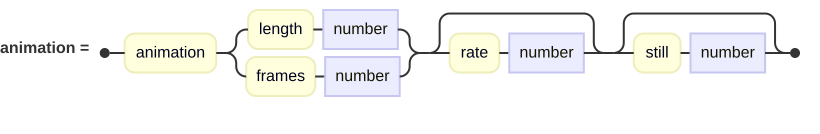
</picture>

A context's **`animation`** says how long the scene runs: **`length`** in seconds, or **`frames`** outright,
at a **`rate`** of so many frames a second — 30 unless it says, or unless the command line's `-r` does.
**`still`** names the frame that stands for the animation as a single picture, the first unless it says;
it must be one of the animation's own frames, from nought to the last, or the scene is refused.
Frame *n*'s time is *n* over the rate, so the first frame is at time nought and the last a frame short of the
length: a loop lasting exactly the length plays round without a doubled frame.

The length and the rate are worked out before anything else in the scene, since every frame's time hangs on
them, so they are numbers — or arithmetic on the renderer's own names — and not names the scene sets.

Rendered as it stands, an animation writes **every frame, each to a file of its own** carrying its number:
asked for `cradle.png`, it writes `cradle-0000000.png`, `cradle-0000001.png` and so on.  Asked for a movie, it
writes **one file** of all of them instead, each frame developed exactly as a still would be:

| | |
| --- | --- |
| **`.webp`** | The one to reach for.  Every color kept, frames timed to the thousandth of a second, looping for ever, and small: lossy, at a high quality. |
| **`.gif`** | Opens anywhere, looping for ever, but in one palette of 256 colors chosen for the whole movie, every frame dithered in it so that gradients do not band, and timed in hundredths of a second, so 30 frames a second plays at 33. |
| **`.mp4`** | A video, H.264, for anything that plays video rather than images.  It is written by **ffmpeg**, which must be on the path: without it the render is refused at once, before a frame is rendered, saying so.  A scene that is no animation makes a video of its one frame. |

A WebP's or GIF's frames are kept until the last is done, so a long one is better made small: 400 by 300 is
plenty to see a thing move.  An MP4's go to ffmpeg as they are rendered, so it may be as long and as large as
you like.

The command line chooses frames, too:

| Option | What it renders |
| --- | --- |
| `--frames 0-143` | That run of frames, each numbered — or, asked for a movie, a movie of them.  `--frames 7` is a run of one, numbered as in any run: `cradle-0000007.png`. |
| `-m 48`, `--frame 48` | Frame 48 alone, as a still at its time, written where it was asked to be. |
| `--still` | The frame the animation names as its still, as a still.  A scene that is no animation renders as it always does, so a gallery of stills is rendered with `--still` whatever each scene is. |
| `-r 60`, `--frame-rate 60` | Every frame at that rate rather than the scene's. |

A scene that is no animation can still be asked for a frame: `time` is then the frame over the rate, and
nought without one.

Asked for `--stats`, each frame reports its own figures once it is done, never the sum of the frames
before it.

### Time in the Scene

`time` and `frame` are names like any other, so anything an expression can say can follow them:

```
cube { rotate Y time * 90 }                         // a quarter turn a second
point light { location [0, 4, 0]  color White * (0.5 + 0.5 * sin(time * π)) }
camera { location [8 * cos(time / 3), 3, 8 * sin(time / 3)]  look at [0, 1, 0] }
background ClearMorningFrom(time * 6)               // the sun coming round
```

They reach everywhere a scene's own names do — into the scene's functions and primitives, and into a library's,
since a library is carried out among the names of the scene importing it.  A scene that names something `time`
or `frame` for itself is free to; its own name wins.

(`sin` and `cos` take radians, whatever the context says of angles.)

**Whatever is drawn at random stays put.**  `random` is [keyed](scene-files.md#making-things-differ-from-one-another), and a field picks
what stands where by the place, so a frame agrees with the one before it and nothing scattered crawls.

### Keys

<picture>
  <source media="(prefers-color-scheme: dark)" srcset="images/animation/keysClause-dark.svg">
  <source media="(prefers-color-scheme: light)" srcset="images/animation/keysClause.svg">
  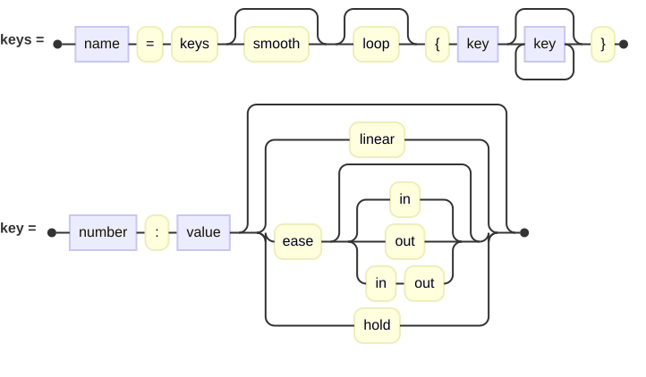
</picture>

Arithmetic on `time` is fine for a steady turn.  For a thing that goes somewhere, waits, and comes back, it is
easier to say where it is when, and let the renderer work out the way between.  **`keys`** does that: each key
a time, a colon and a value, and the whole named and called with the time, as a function is:

```
Lift = keys {
    0: [0, 0, 0]
    1.5: [0, 2, 0] ease in out
    4: [3, 2, 0]
    5: [3, 2, 0]
    6: [0, 0, 0] hold
}

cube { translate Lift(time) }
```

Before the first key the value is the first's, and after the last the last's.  A value may be a number, a
tuple, a point or vector, or a `color`, and every key's must be the same kind as the first's; each part goes
its own way between them.

How a value comes to a key from the key before is said after it:

| | |
| --- | --- |
| *(nothing)*, `linear` | At an even pace. |
| `ease in` | Slowly at first, faster and faster. |
| `ease out` | Slowing as it arrives. |
| `ease`, `ease in out` | Slowly at both ends. |
| `hold` | Not at all until the key, and then all at once. |

**`keys smooth`** passes through every key with no stop at any of them, its pace carried on from one to the next
(a Catmull-Rom curve, measured in time so that keys unevenly spaced still pass evenly); its keys take no
easing, being eased already.  **`keys loop`** begins again once the last key is reached, so a cycle written
once runs for ever: make the last key's value the first's, and it runs round without a jump.  Both together
are `keys smooth loop`, whose pace runs on round the seam as well: the last key and the first are taken as
one place, passed through on the way from the key before the last to the key after the first, so it goes
round without a kink as well as without a jump.

A swing is two keys — out, slowing to a stop at the top, and back faster and faster:

```
Swing = keys loop { 0: 0  0.375: 32 ease out  0.75: 0 ease in }
```

That is a swing as it looks; one that strikes something, or is struck, is better left to [gravity](#tethers).

### Along a Spline

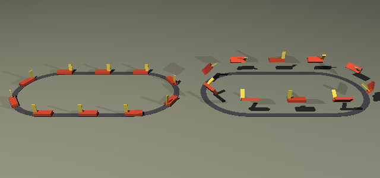

A thing that goes somewhere along a way is put **`along`** a spline.  A spline is
[written as a sweep's is](advanced-surfaces.md#sweep), and named so that what runs along it can say so:

```
Oval = spline {
    move to -6, 0, -6
    line to 6, 0, -6
    curve 9.314, 0, -6, 12, 0, -3.314 to 12, 0, 0
    ...
}

object Car(4.4) { along Oval by time * 12 }
object LightPlane(8) { along Oval at time / 10 banked  translate Y 30 }
```

<picture>
  <source media="(prefers-color-scheme: dark)" srcset="images/animation/alongClause-dark.svg">
  <source media="(prefers-color-scheme: light)" srcset="images/animation/alongClause.svg">
  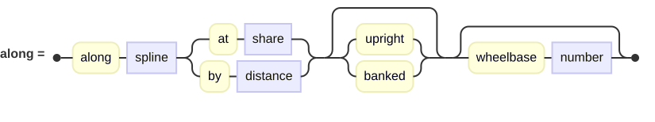
</picture>

`along` is a transform, written among the others and applied in its turn: it stands the thing's origin on the
spline and turns its **+X the way the spline runs** — the way the vehicles, the trains and the aircraft are all
built to face — its +Y up and its +Z to its left.  **`at`** says how far along as a share of the spline's length,
**`by`** as a distance.  A spline is followed by distance, not by how its curves were drawn, so a thing going
`by time * 12` goes twelve units a second, on the straights and round the bends alike.  **A spline that ends where
it began is a loop**, and a distance past its end begins round it again, as does one before its start; any other
spline holds a thing at its ends.

Which way is up:

- **`upright`**, unless said: the world's up, as near as the spline lets it be.  A thing climbing a slope pitches
  with it but never rolls — a car, a train, someone walking.
- **`banked`**: the way a rider would feel to be up, leaning into a bend as a turning aircraft does or a banked
  track is laid — by the arctangent of the speed squared over the radius and gravity, which is to say not at all
  on a straight and further the faster and tighter the bend.  The speed is how fast the place along is changing
  with the time, so a thing standing still does not lean.  Gravity is taken to be 9.81, so a banked scene is
  written in meters and seconds, as the libraries are.

**`wheelbase w`** stands a thing on two places `w` apart rather than one: a rigid vehicle rides on its end axles,
so round a bend both ends are on the line, its middle a little inside it and its heading from one end to the other.
Stood by its middle, an engine on a tight curve has its ends swung off the rails.  `a-model-railway` in the gallery
runs an engine and its tender round an oval this way, each `by` its own distance along the one spline.

Three functions ask a spline the same questions, for what is not put along it — most often a camera riding the
spline or watching something that does:

```
camera {
    location pointAlong(Oval, time / 10)
    look at pointAlong(Oval, time / 10 + 0.02)
}
```

| | |
| --- | --- |
| `length(spline)` | How long it is. |
| `pointAlong(spline, share)` | The place that share of its length along it. |
| `headingAlong(spline, share)` | The way it runs there, of unit length. |

A sweep is carried along a spline by its name, too: `spline Oval` in place of one written out.  The trains
library's `TrackAlong(spline)` lays rails, sleepers and ballast along one so that a train has something to run on.

A field and a piece of text have an `along` of their own, which lays their copies or letters along a path; to move
either along a spline, put it in a group and move the group.

### Bodies

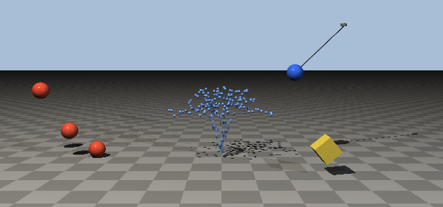

A thing that falls, bounces, rolls or swings is best not told where to be at all.  Given a **`body`**, it is moved
by what pushes it — gravity, the air, what it strikes and what it is tied to — from where it stands at time nought:

```
plane { }

sphere {
    scale 0.15
    translate [0, 1.5, 0]
    body { bounce 0.6 }
}
```

That ball falls a meter and a half to the ground, comes back up about a third as far, then a third of that again,
and is soon lying still.  Bodies are worked out in meters, kilograms and seconds, as the libraries are built.

<picture>
  <source media="(prefers-color-scheme: dark)" srcset="images/animation/bodyClause-dark.svg">
  <source media="(prefers-color-scheme: light)" srcset="images/animation/bodyClause.svg">
  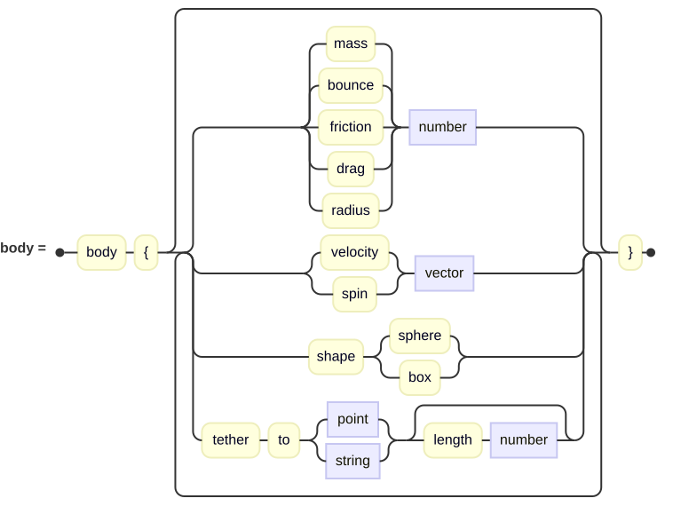
</picture>

Everything a body does not say is worked out for it:

| | |
| --- | --- |
| `mass` | In kilograms; unless said, what water filling it would weigh.  Mass matters when bodies strike one another or are tied together, and to how much the air holds one back: a heavy ball and a light one fall alike but for the air. |
| `velocity` | How fast it is moving at time nought, and which way, in meters a second. |
| `spin` | How fast it is turning at time nought, about each axis, in degrees a second (or radians, if the scene's [angles](context.md#angles) are). |
| `bounce` | How much of its speed into what it strikes it keeps coming away: nought falls dead, one bounces as high as it fell.  0.5 unless said; two bodies striking each other keep the average of their two. |
| `friction` | How hard it grips what it slides or rolls on: nought slides as on ice.  0.5 unless said; two bodies grip by the square root of their two multiplied. |
| `drag` | How much of the air's drag on a thing of its size and shape it feels: one, unless said, for all of it, and nought for none. |
| `shape` | `sphere` or `box`: whether it strikes the scene as a ball or as its own box.  A box if it is a cube, a ball otherwise. |
| `radius` | The radius of the ball it strikes things as; unless said, half its box's longest side, which for a ball is its own.  A box strikes other bodies as the ball round it. |

**A body moves about its own origin.**  Where its transforms put its origin at time nought is where it starts, and
that is the place it turns about, so a thing made a body is drawn about its own middle and put where it starts by
its transforms.  Drawn at `[0, 2, 0]` inside a group and the group made a body, a ball would turn about a place two
meters below it.

**A body stands at the top of the scene**, not inside a group: it is moved in the scene's own space, which a group,
moved or shared, would carry it out of.  One inside a group, or inside a CSG, is refused.

**What a body strikes is the rest of the scene** — the ground, walls, steps, a cradle's frame — standing where it
stands at the frame's time, as though it had stood there all along: something keyed to move does not knock a body
aside.  Bodies strike one another, too, always as balls, whatever their shape.  A ball looks for the scene in
fourteen ways round it, enough for floors, walls, slopes and steps — a ball on a slope stands on it and rolls
down it, as a ball does — though something thinner than the ball, such as a wire, can slip between them; a box
finds it by its eight corners, landing on one, tipping and coming to rest on a face, held there by every corner
that touches.  **A body that has stayed nearly still for a fifth of a second falls
asleep**, and stands quite still until something strikes it or a string pulls it: without that, a die on felt
settled and then turned slowly where it lay, a degree or two a second, for as long as it was watched.
`gallery/Local/animation/a-throw-of-dice.igl` throws two dice into a felt tray.

**Bodies do not lie on one another.**  They are meant to strike, bounce, roll and come to rest on the scene, and to
strike each other as they meet.  A pile of them settles poorly, each meeting the others as a ball, and nothing here
is soft: no cloth, no rope that bends between its ends, no water.

**Gravity and the wind** are said in the context:

```
context { gravity [0, -1.62, 0]  wind [4, 0, 1] }
```

**`gravity`** is how it pulls: 9.81 meters a second each second, downward, unless said — the Moon's 1.62 above.
**`wind`** is how the air moves, still unless said: every body is dragged toward moving with it, a light one more
than a heavy one.  (A thing put [`along`](#along-a-spline) a spline and `banked` leans by 9.81 whatever gravity is
said.)

**The world is worked out from time nought for every frame**, so a frame is the same whether it is rendered alone
or in a run — and a late frame costs more than an early one.  A body is blurred along its way through the frame
when the [shutter](#motion-blur-from-time) is open, as anything that follows the time is.

### Tethers

A body may be tied by a string, **`tether to`** a place that stands still or to another body by its name:

```
sphere {
    named 'top'
    scale 0.1
    translate [0.6, 1.4, 0]
    body { tether to [0, 2, 0] }
}

sphere {
    scale 0.1
    translate [1.2, 0.8, 0]
    body { tether to 'top' }
}
```

Those two make a double pendulum, let go together.  A string is as long as the distance between its ends at time
nought, unless **`length`** says, and it pulls but never pushes: a body may come nearer its pin, as a ball swung
over the top does, but never further away.  A body may have as many strings as it likes.  A string must be
longer than nothing, so a body that starts on what it is tied to says its `length`, and falls until the
string is taut; and two bodies of one name are refused, since a string tied to it would not know which.

**A tied body is turned by its strings**, so whatever is drawn with it turns as they do — and by nothing
else: struck off its middle, it is pushed as though struck through it, none of the knock spent turning it.  A
string drawn with the ball, from its middle to the pin, stays pointing at the pin as it swings; with two, as each
of a Newton's cradle's balls hangs, the ball keeps its face to both.  `gallery/Local/animation/newtons-cradle.igl`
is built so: five bodies, each on two strings, the first let go from the side, its strike passed along the row by
the balls themselves.

### Swarms

<picture>
  <source media="(prefers-color-scheme: dark)" srcset="images/animation/swarmClause-dark.svg">
  <source media="(prefers-color-scheme: light)" srcset="images/animation/swarmClause.svg">
  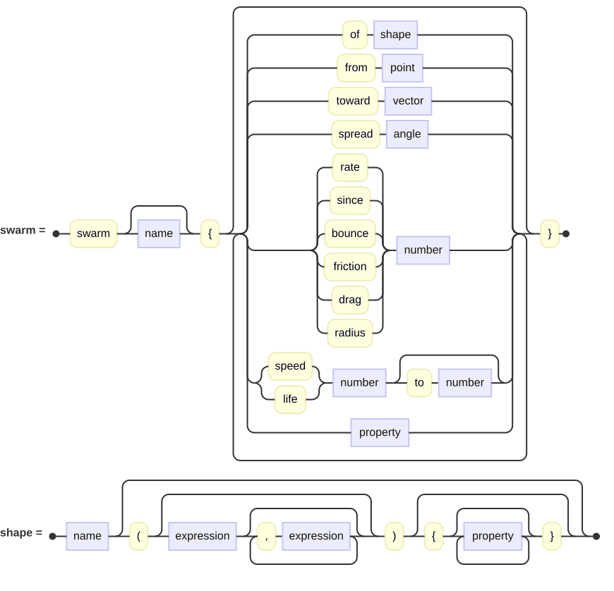
</picture>

Sparks, a fountain's water, falling leaves and snow are too many to be bodies each.  A **`swarm`** throws copies of
one thing from a place, a few at a time, each falling under gravity, dragged by the air and bouncing off the scene
until its life is up:

```
Drop = sphere { scale 0.025  material { pigment color [0.45, 0.65, 0.95] } }

swarm {
    of Drop
    from [0, 0.05, 0]
    spread 15
    speed 4.5 to 5
    rate 200
    life 1.6
}
```

| | |
| --- | --- |
| `of` | The thing every copy is, by its name or a primitive's call; required.  Every copy is that one thing in another place, so thousands cost little more than one — and so a thing that cannot be shared among places, one that glows, holds a medium, moves of itself, or holds a joint that aims or reaches, a mark or a span, is refused. |
| `from` | Where copies are thrown from, in the swarm's own space: its origin unless said. |
| `within` | A shape to throw copies from within instead, by name or by a call of a primitive, in the swarm's own space: each copy sets off from a place of its own inside it.  See below. |
| `toward` | The way they are thrown: up, unless said. |
| `spread` | How far from that way a copy may be thrown, an angle; evenly over every way within it.  Nought, unless said, throws them all one way. |
| `speed` | How fast, in meters a second: `speed a to b` anywhere between the two, a copy at a time.  One unless said. |
| `rate` | How many copies a second, the first at time nought.  50 unless said. |
| `since` | When it began throwing, in seconds: nought unless said, and before nought for one already in full flow when the animation begins — a fountain running, a fire long alight.  Copies whose life was up before the frame are not even looked at, so a swarm long in flow costs no more than one just begun. |
| `life` | How long a copy lasts, in seconds, `life a to b` as a speed is; once it is up the copy is gone.  Two unless said. |
| `spin` | How fast a copy tumbles as it flies, an angle a second, `spin a to b` as a speed is: each from a turn of its own, about a way of its own.  Nought unless said.  See below. |
| `falls at` | How fast a copy comes down in still air, in meters a second, `falls at a to b` as a speed is: the drag on it is whatever holds it to that.  Unless said, the drag on a ball its size. |
| `bounce`, `friction`, `drag` | As a body's, though a copy keeps only 0.3 of its speed into what it strikes unless said. |
| `radius` | The radius of the ball a copy strikes things as; unless said, half its box's longest side, as a body's. |

The swarm's transforms move the place it throws from and the way, with its other properties as a group's.  Every
copy's way, speed and life are drawn from the swarm's [seed](scene-files.md#making-things-differ-from-one-another)
and the copy's own number, so the fortieth copy thrown is the same copy in every frame, wherever its flight has
taken it.  Copies strike the scene but neither one another nor the scene's bodies — which is what lets there be
thousands — and a swarm stands at the top of the scene, as a body does.  Nor can a swarm be placed against
anything — `on`, `under`, `left of` and the rest are refused — since it is filled only once placing is done,
and would be empty when placed; its own transforms say where it stands.

**A swarm stands still while it throws.**  Every copy is worked out as though thrown from where the swarm stands
at the frame's time, not where it stood when the copy was thrown, so a swarm that moved -- a `motion { }` of its
own, or transforms that follow the time -- would carry every copy in flight along with it, as one piece, rather
than leave a trail behind it.  So one that moves is refused rather than drawn wrong: sparks from something moving,
or a hose swung about, are not yet something a swarm can make.

**A swarm thrown from `within` a shape** sets each copy off from a place of its own inside it — snow from a cloud,
leaves from a crown, sparks from a fire's heart — found by drawing places in the shape's box until one falls inside,
the same for the same copy in every frame.  The shape is not in the scene; it only says where.  A copy passes
whatever lies inside the shape with it and meets the scene only once it has left, so leaves let go among a crown's
leaves fall clear of them rather than coming to rest on the first they touch.  A shape must be closed, as a crown or
a fracture's solid must.

**A copy that spins tumbles as it flies** and, once it has come to rest on something, stops turning and settles over
a moment onto its broadest side: a leaf lies flat on the lawn rather than on whatever edge it landed on.  A thing
no thinner one way than the others, a ball or a die, lies as it landed.  It turns about its own origin, so draw it
about its middle, as a body is.  `falls at` is what makes a leaf a leaf: anything as light for its size as a leaf
or a snowflake falls a meter or two a second, where the drag on a ball its size would drop it like a stone.

```
Crown = sphere { scale [4, 2.4, 4]  translate Y 6.4 }

swarm {
    of FallenLeaf('oak', 'autumn', 3)
    within Crown
    speed 0
    rate 5
    life 60
    spin 60 to 300
    falls at 0.9 to 1.6
    bounce 0
}
```

`gallery/Local/animation/a-fall-of-leaves.igl` lets an oak's leaves go so, on a light wind, onto a lawn already
strewn with them; `FallenLeaf` is the [`trees`](libraries.md#trees) library's leaf on its own.

A copy striking water lies on it, as on anything else, so a fountain's drops are given lives that end as they come
down to the pool: thrown at one speed within a few degrees, they all fall back within a few thousandths of a second
of one another.  `gallery/Local/animation/a-garden-fountain.igl` is built so, and runs `since -2`, so its jet is in
full flow from the first frame and its movie loops with no seam.

### Joints

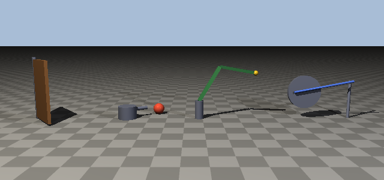

A thing built of parts that turn on one another — a door on its hinge, a wheel on its axle, a lamp's arms — is
built of **`joint`**s.  A joint is a group that turns about a place in it:

```
joint {
    axis Y  angle time * 60  limits 0 to 50
    cube { scale [0.55, 0.8, 0.04]  translate [0.55, 0.85, 0] }
    translate [-4.1, 0, 0]
}
```

That door swings about its hinge at sixty degrees a second until it is fifty degrees open, and stands there.

<picture>
  <source media="(prefers-color-scheme: dark)" srcset="images/animation/jointClause-dark.svg">
  <source media="(prefers-color-scheme: light)" srcset="images/animation/jointClause.svg">
  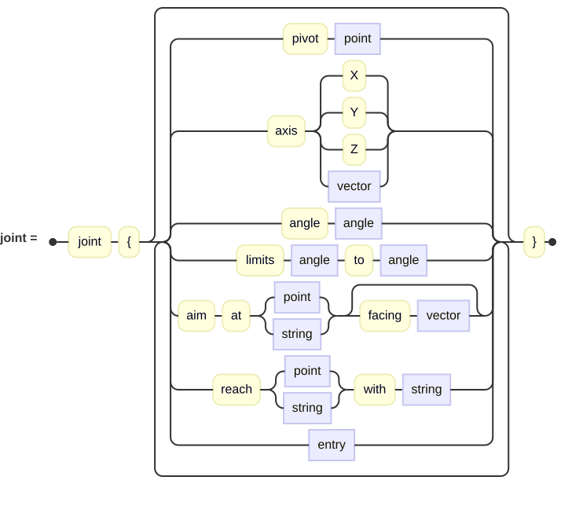
</picture>

| | |
| --- | --- |
| `pivot` | The place it turns about, in its own space: its origin unless said. |
| `axis` | What it turns about, through the pivot: `X`, `Y`, `Z` or any direction.  A joint with no axis is a ball joint: it turns freely, any way at all, as an `aim` or a reach asks, by the least turn that serves; asked by neither, it does not turn. |
| `angle` | How far it is turned about its axis.  Nought unless said; with no axis, it turns nothing. |
| `limits a to b` | The least and the most it may be turned, as a hinge stops at its frame or an elbow at straight.  Whatever turns it — its angle, an aim or a reach — is held between the two.  On a joint with no axis they hold nothing back. |
| `aim at` | A place, or the name of a thing, to turn toward.  See below. |
| `facing` | Which of its own ways is turned to face what it aims at: +X unless said. |
| `reach ... with` | A place, or the name of a thing, for a thing inside it to reach.  See below. |

Everything else a joint holds is what a group may: surfaces, other joints, lights, transforms.  **Its turn comes
first**, in its own space, and its transforms then put it where it stands, wherever in the block either is written,
so a joint is drawn about its pivot and placed as anything else is.  A joint turned in terms of the time is a
placement that follows the time, and is [blurred](#motion-blur-from-time) through the frame as one.

**A joint inside a joint is carried round by it**, as a forearm is by the upper arm, and turns on it about its own
pivot.  A wheel with a crank pin standing out of it is a joint holding the pin; turn the wheel and the pin goes round.

#### Aiming

**`aim at`** turns a joint until its `facing` points at a place, or at a thing by its name: about its axis by the
least turn that brings its facing round toward it, within its limits; with no axis, by the least turn that points
its facing straight at it.  A thing is aimed at by where its own origin stands — where its transforms put it — and
it may stand anywhere: in another group, placed by another, or a [body](#bodies) falling.

```
sphere { named 'ball'  scale 0.16  translate [cos(time * 120), 0.16, sin(time * 120)] }

joint {
    axis Y  aim at 'ball'
    cylinder { min Y 0  max Y 0.35  scale [0.25, 1, 0.25] }
    cylinder { min Y 0  max Y 0.6  scale [0.05, 1, 0.05]  rotate Z -90  translate Y 0.24 }
}
```

That turret turns about its upright to keep its barrel — along +X — on the ball going round it.  An aim is
worked out once everything stands where it will, and again at every instant the shutter is open, so a joint aiming
at something that moves blurs with it.

#### Reaching

**`reach`** turns a joint and the joints inside it, each about its own axis and within its own limits — or, for one
with no axis, freely, by the least turn that swings the tip toward the place — so that the
thing named after **`with`** — inside it, most often a mark at the tip — comes as near the place as they can bring
it:

```
joint {
    pivot [0, 0.5, 0]  axis Z  angle 60  limits -90 to 120
    reach point Bead with 'tip'
    cube { scale [0.55, 0.05, 0.05]  translate [0.55, 0.5, 0] }
    joint {
        pivot [1.1, 0.5, 0]  axis Z  angle -90  limits -160 to 0
        cube { scale [0.5, 0.04, 0.04]  translate [1.6, 0.5, 0] }
        mark 'tip' at [2.1, 0.5, 0]
    }
}
```

The shoulder and the elbow are each turned in turn, from the tip inward, to swing the tip round toward the bead,
and that again and again until it comes no nearer.  **Where the joints start is which way they bend**: an arm can
reach most places two ways, elbow up and elbow down, and it bends the way its `angle`s start it — here the elbow
up — while its limits keep it from bending the way a real one cannot.  A place beyond the arm's length finds it
pointing straight out toward it.  A joint that reaches may be inside one that aims: the `indoor-lights` library's
`Anglepoise` turns its turret to face the place lit, reaches with its two arms to hang its head over it, and turns
the head at the wrist to look at it.

#### Marks and Spans

A **`mark`** is a named place on a thing, standing among a group's or a joint's entries and carried wherever they
go.  It is not seen and casts no shadow; it is there to be aimed at, reached with, or spanned between.

<picture>
  <source media="(prefers-color-scheme: dark)" srcset="images/animation/markClause-dark.svg">
  <source media="(prefers-color-scheme: light)" srcset="images/animation/markClause.svg">
  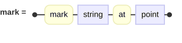
</picture>

A **`span`** stands any surface between two named places: its origin at the first and its +X running toward the
second, its +Y as near its holder's up as that allows.  **`stretched`**, it is scaled along X by the distance
between them, so a thing one long along X runs from one to the other however far apart they are — a spring, a
strut, a cable.  Unstretched, it keeps its own length and only turns to point from the one to the other, as a rod
of the right length does between the pins it joins.

<picture>
  <source media="(prefers-color-scheme: dark)" srcset="images/animation/spanClause-dark.svg">
  <source media="(prefers-color-scheme: light)" srcset="images/animation/spanClause.svg">
  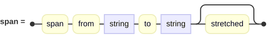
</picture>

```
group {
    joint {
        axis Z  angle time * -180
        cylinder { min Y -0.05  max Y 0.05  scale [0.45, 1, 0.45]  rotate X 90 }
        mark 'pin' at [0.3, 0, -0.1]
    }
    mark 'post' at [1.3, 0.3, -0.1]
    cylinder {
        min Y 0  max Y 1  scale [0.03, 1, 0.03]  rotate Z -90
        span from 'pin' to 'post' stretched
    }
}
```

The strut's own transforms come first — a cylinder one long, laid along X — and the span then stands it from the
pin to the post, at every instant the shutter is open.  Spans are worked out after every joint has turned, so a
thing spanned between parts of a machine follows wherever the machine puts them: the `trains` library's
coupling rods are spanned between the drivers' crank pins, and its main rod between the crosshead and a pin.

**A name means the nearest thing of that name**: the one that shares the most of the groups round whatever is
asking.  So a primitive may name its marks plainly, and each of two engines' rods finds its own engine's pins; two
things of a name, neither nearer than the other, are refused, as is a name nothing has.

**A thing holding a joint that aims or reaches, a mark or a span stands in one place only.**  A shape used in many
places is ordinarily built once and [shared](scene-files.md#things-of-your-own) between them, but each of these
must be worked out where it actually stands, so whatever holds one is built for each place it is used, a field's
copies included; a swarm, whose copies can only be shared, refuses one.  A joint that only turns by its angle is
shared as anything else.

`gallery/Local/animation/an-engine-under-way.igl` drives a locomotive round a curve by how far it has run, its
wheels turning and its rods driving; `gallery/Local/animation/a-lamp-at-work.igl` moves only the place a desk lamp
is to light, and the lamp does the rest.

### Motion Blur from Time

A camera whose [shutter](cameras.md#motion-blur) is open catches what moves while it is: **a placement that
follows the time is blurred along its own way through the frame**, as far as the shutter is open — at `shutter
1` across the whole frame, at `0.5` half of it, as a film camera's half-turned shutter does.  The way need not
be straight: a ball on a swing smears along its arc, fastest at the bottom and sharp at the top where it stops.
Nothing in the scene says so but the shutter, and a placement that does not follow the time is left sharp.

A placement follows the time when its transforms are written in terms of it — directly, or by handing it to a
function or to keys, as `translate Lift(time)` does.  A value worked out from the time beforehand and named,
`x = time * 2` and then `translate X x`, is taken at the frame's own instant, and is not blurred.  Only
placement is blurred: a shape that changes with the time is taken at the frame's instant, and a camera that
moves is not blurred by its own motion.  A [`motion { }`](cameras.md#motion-blur) said outright works as it always
did, and is laid over the timed one.  A scene that names a `time` of its own means its own by it, not the frame's,
so nothing is blurred through that.

A thing that moves and is [placed against another](transforms.md#placing-one-thing-against-another) — `on 'table'`
and the rest — is placed by everything it covers while the shutter is open, and moves from there as it was written
to: a ball placed `on 'table'` that moves downward through the frame is set so that the lowest it comes rests on
the table.

Bodies and a swarm's copies are blurred along their ways through the frame too, since the world is worked out on
through it as far as the shutter is open.

### What It Costs

Every frame is the whole scene, carried out and prepared again from the start — grown trees grown, grammars
derived, the scene's acceleration built — and then rendered, so an animation costs its frames times a still,
near enough.  The cradle above is about sixteen seconds a frame at 400 by 300 and 115 frames to its five swings,
half an hour in all.

Bodies and swarms add their world, worked out again from time nought for each frame, so a late frame's costs more
than an early one's: the cradle's five balls take half a second to work out two seconds of swinging and a second
for four.  Beside the rendering that is small, but a swarm of thousands or a long animation of many bodies grows
with the square of its length.

A WebP's or GIF's frames are kept in memory until it is written, which is the other reason to make one small; an
MP4's are not.
