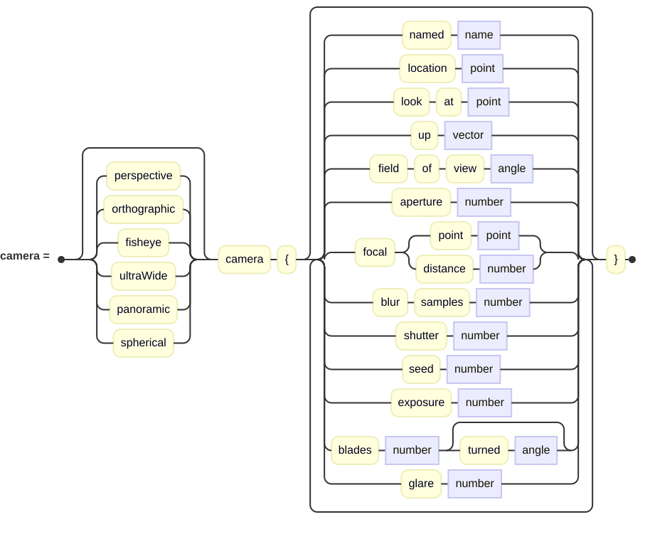
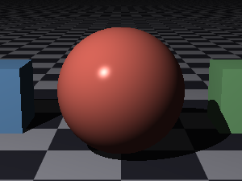
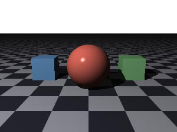
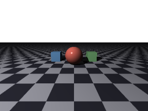
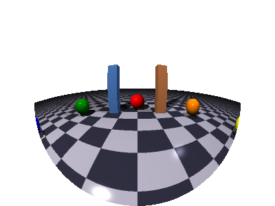

## Cameras

The camera is where the picture is taken from.  Every scene needs one; a scene with no camera
has no point of view to render from and is refused.  A scene may hold several, which is how a
file offers a choice of viewpoints — see
[Scenes and Cameras](scene-files.md#scenes-and-cameras) for how more than one is named and
chosen.  This chapter is about a single camera and everything you can say about it.

<picture>
  <source media="(prefers-color-scheme: dark)" srcset="images/cameras/cameraClause-dark.svg">
  <source media="(prefers-color-scheme: light)" srcset="images/cameras/cameraClause.svg">
  
</picture>

The properties fall into five groups: where the camera stands and what it looks at, how much
of the world it takes in, the two that cost extra rays — the lens and the shutter — how
much of the light it takes, and the character its lens gives the picture.

### Placing a Camera

```
camera {
    location [0, 2.5, -7]
    look at [0, 1, 0]
}
```

`location` is where the camera stands and `look at` is the point it is aimed at.  Between
them, they settle everything about the view except which way is up and how wide it is.

`up` gives the direction the top of the image should point, and defaults to `[0, 1, 0]`.  It
does not have to be perpendicular to the way the camera looks; only the part of it that is
gets used, so an approximate up vector works.  Change it to roll the camera:

```
camera {
    location [0, 2.5, -7]
    look at [0, 1, 0]
    up [0.2, 1, 0]      // tipped a little to one side
}
```

There is one arrangement to avoid: an `up` that points along the direction of view.  With
nothing left over after the parallel part is removed, there is no "up" to be had, and the camera
says so rather than taking a picture.  Looking straight down, give an `up` of `[0, 0, 1]` rather than
`[0, 1, 0]` — the light tests in this repository do exactly that.  The tracer defines some
useful vectors of `Up`, `Down`, `Left`, `Right`, `In` and `Out` that give you the usual
things you might want to choose from.

### Field of View

How much of the world the camera takes in, as an angle.





Those three are the same scene from the same place but with different fields of view — 30°,
60° and 100°.  The camera has not moved; only how much it takes in has changed.

```
camera {
    location [0, 2.5, -7]
    look at [0, 1, 0]
    field of view 45
}
```

The angle is read in whatever unit the [context block](context.md#angles) names, degrees by default.  If
you don't specify it, the field of view defaults to 50°, which sits in the range — roughly
40° to 60° — that usually looks most natural; a fair bit wider than that starts to exaggerate
the scene, and a fair bit narrower starts to flatten it.

A narrow angle does more than crop.  It flattens the picture — near and far things come out
closer in apparent size — while a wide one exaggerates depth and bows straight lines near the
edges.  Moving the camera closer and narrowing the angle are therefore *not* interchangeable,
even though both make the subject bigger.

The angle is measured across the wider of the image's two dimensions.

The three examples are in [`docs/examples/cameras/`](examples/cameras/).

### Depth of Field

By default, the camera is a pinhole: every ray leaves a single point, so everything is in
focus at every distance.  No real lens behaves that way.  Giving the camera an `aperture`
makes it gather light across a disc instead, so only what lies at the focal distance stays
sharp.

```
camera {
    location [1.6, 3.4, -7.5]
    look at [-0.97, 0.09, 1.5]
    aperture 0.25
    focal point [-0.2, 0.9, 1.5]
    blur samples 32
}
```

| Property | What it means |
| --- | --- |
| `aperture` | The **radius** of the lens, in the scene's own units.  Zero is a pinhole. |
| `focal point` | A point in space — an `[x, y, z]` — at which focus is sharpest. |
| `focal distance` | How far ahead the plane of sharp focus lies. |
| `blur samples` | How many places across the lens each ray is taken from. |
| `seed` | The seed the lens's scatter is drawn from. |

The aperture models a real lens, so how much a thing blurs follows from where it stands.
Wider means shallower depth of field.

Specify where the focus lies with either `focal point` or `focal distance`.  `focal point`
is exactly that — a point in space, written as coordinates, where focus should be sharpest:

```
focal point [-0.2, 0.9, 1.5]
```

The point doesn't need to lie on a surface, but you'll want it near, or even in the middle
of, the surface you want to be in the sharpest focus.  The camera then works out for itself how
far ahead the point lies, so the focus stays on it even if the camera later moves.
`focal distance` instead states that distance outright — a single number — for when that's the
easier way.  Said neither way, the camera focuses on whatever it was aimed at.

Two things worth knowing.  **Blur samples alone do nothing without an aperture** — there is
no width to gather across, so such a camera stays on the single-ray path rather than firing
the same ray many times over.  And the cost is real: 32 samples means at least 32 rays per
pixel, more with antialiasing on top.

`gallery/Local/cameras/focal-blur.igl` is a scene built around this.

### Motion Blur

The shutter is the other half of the same idea.  By default, every ray is fired at the same
(logical) instant in time, so a thing crossing the frame is drawn as sharply as one standing
still.  Let the shutter stay open and whatever moves while it is open comes out smeared along
its path.

```
camera {
    shutter 1
    blur samples 32
}

sphere {
    translate [-2.4, 0.5, 0]
    motion { translate [0.55, 0, 0] }
}
```

`shutter` is how much of a surface's motion is caught while the shutter is open: at `1` a
moving thing runs the whole of its motion, at `0.5` it gets half way, and at `0` — the
default — nothing smears however it is set moving.

What actually moves is a property of the *surface*, not the camera; `motion { }` takes the
same transforms a surface is placed with.  In a frame of an [animation](animation.md#motion-blur-from-time), a
surface placed in terms of `time` moves through the frame by itself, and the shutter blurs it along its way
with no `motion` said at all.  That is covered under
[Setting a Surface Moving](transforms.md#setting-a-surface-moving).  Keeping the two apart means a scene
can leave its motions in place and simply shut the shutter to get a still picture out.

**What a moving thing is painted with moves with it.**  Its pattern is read where the thing stands at
each instant the shutter catches, so the squares of a checkered ball crossing the frame smear along its
path with the ball, rather than the ball sliding under a pattern that stays put.

The lens and the shutter **share one set of samples**, so asking for both costs no more rays
than asking for either.  `blur samples` sets the count for both.

`gallery/Local/cameras/motion-blur.igl` is a scene built around this.

### Exposure

A camera takes the light a scene gives it as it stands, unless it is told to take more of it
or less.  `exposure` says by how many stops: each one doubles the light, and a stop below
nought halves it.

```
camera {
    exposure 1.5
}
```

It is a photographer's answer to a scene that is too dark or too bright as a whole -- a room
lit by a candle, a sun many times brighter than white -- and it is both easier and truer than
relighting the scene: every lamp, glow and sky keeps its say against the others, and only the
picture's brightness moves.  The anti-aliasing tells samples apart as the exposed picture will
show them, so a dark scene exposed up is looked at as closely as a bright one would be.
`--exposure` on the command line takes the place of every camera's own.

What becomes of light brighter than white once it is exposed is the context's
[film curve](context.md#film-curve).

### Blades

A real lens is closed down by blades, so its opening is a polygon rather than a circle, and
whatever is out of focus takes the opening's shape: a point of light far behind the focus
blurs into a hexagon rather than a disc.

```
camera {
    aperture 0.15
    focal distance 4
    blades 6 turned 15
}
```

`blades` is how many, from 3 to 32, and the optional `turned` how far they are turned, in the
scene's angles.  None, the default, is a round opening.  The same blades shape the camera's
[glare](#glare).

### Glare

Light through an opening does not keep to a point.  It spreads into the pattern the opening's
own shape makes: a round opening's bright disc and its faint rings, and a polygon's the same
with a ray thrown out square to each of its edges -- the star round a street lamp in a
photograph.  Six blades make six rays; an odd number makes twice as many.

```
camera {
    blades 6
    glare 0.2
}
```

`glare` is the share of all the light that is spread this way, from nought, the default, to
one; the rest stays where it fell, and nothing is added or lost but what spreads past the
picture's edge.  Only light far brighter than white shows it to any extent -- a lamp, the sun
in a mirror, a glint -- which is as it is with a real lens.  The pattern is worked out exactly
from the opening's shape at each wavelength, so the rays' ends are faintly colored, and it is
the same share of any picture's width, so a larger render shows the same glare.  It is spread
over the finished picture before the [film curve](context.md#film-curve) develops it, and
costs a second or two.

`gallery/Local/cameras/lamps-at-dusk.igl` puts the blades and the glare together: far lights
blurred into the opening's shape, and a bare bulb throwing out its rays.

### A Lens's Character

A real lens is not a perfect one, and the ways it falls short are much of what makes a picture look
photographed rather than computed.  Three are offered here, each off unless asked for, and each a
perspective camera's own: another sort of camera says so and goes on without them.

```
camera {
    aperture 0.08
    focal distance 1.2
    vignetting 0.8
    distortion 0.06
    chromatic aberration 0.002
}
```

#### Vignetting

Every lens lets less light reach the corners of the picture than its middle.  Light reaching a
place off the axis comes at a slant, from further off, and through an opening seen foreshortened,
and together those take the fourth power of the cosine of the angle off the axis: most of a stop at
the corners of a fifty-degree view, and much more at a wide one.  `vignetting` says how much of
that the lens loses, from nought, the default, to one, all of it; real lenses are made to lose less,
so a half or so looks like one.

With the lens open, there is more to it.  Seen from a corner of the picture, the opening is cut off
on one side by the barrel in front of it, and what is left is a cat's eye: a highlight out of focus
there takes that shape instead of the opening's, longer round the middle of the picture than toward
it, and the corners darken further, as a fast lens's do wide open.  The barrel is taken to be as wide
as the opening, standing off it at a corner by the vignetting times its radius.

#### Distortion

A lens bows straight lines.  A wide-angle lens squeezes more of the world into its edges than a
pinhole would, so lines that miss the middle bow outward — barrel distortion — and a long lens does
the opposite, pincushion.  `distortion` is how much: more than nought for barrel, less for pincushion,
the stretch at the picture's corners, which grows as the square of the way there from the middle.  The
middle stays as it was, and the `field of view` is still the middle's.  It is worked into the direction
each pixel's ray is sent, so nothing is resampled and nothing softened.  A few hundredths is what a
real lens has; past a third the other way the corners would fold back over themselves, so that is
refused.

#### Chromatic aberration

A lens's glass bends blue further than red, so it draws the red picture a little larger than the
blue.  At the middle nothing differs; toward the corners the two have drawn apart, so a bright edge
there shows a red fringe on one side and a blue one on the other.  `chromatic aberration` is how far
apart they are at the corners, as a share of the picture's half-diagonal, so it means the same at any
size: 0.002 is about a pixel at the corner of a picture 800 wide.  The red picture is drawn larger by
half of it and the blue smaller by half, green standing between them.  It is done to the finished
picture, before the [glare](#glare), since a ray carries all three colors at once.  The other sort of
color fringe, the purple edge of something out of focus, is not offered.

`gallery/Local/cameras/through-an-old-lens.igl` has all three: a game of chess by string lights, the
lanterns out of focus behind it round in the middle and cat's eyes toward the sides, the board's near
edge bowed, and the lanterns toward the corners fringed.

### Projections

Every camera so far has been a **perspective** camera — the ordinary sort, the one a pinhole
gives, where the world shrinks with distance.  It is what a camera is unless a scene asks for
another kind, which it does with a word before `camera`, the way a light's sort is named by the
word before `light`:

```
fisheye camera {
    location [0, 3, 0]
    look at [0, 1, 8]
    field of view 180
}
```



| Projection | What it is |
| --- | --- |
| *(none)* or `perspective` | The ordinary view, where the world shrinks with distance. |
| `orthographic` | A parallel view: nothing shrinks with distance, as a technical drawing. |
| `fisheye` | A circular, very wide view, up to and past a half-circle across. |
| `ultraWide` | A rectangular wide-angle view, with less corner stretch than a wide perspective. |
| `panoramic` | A cylindrical view, for a wide horizontal sweep, keeping uprights upright. |
| `spherical` | The whole sphere at once — every direction — for an environment map. |

**Orthographic** throws perspective away: two things of a size come out the same size however
far apart they lie, which is what makes it right for technical and isometric looks.  It has no
field of view of its own, so it borrows the perspective one — the view is made as wide as a
perspective camera of that field of view would see at the distance the camera is focused on,
usually what it looks at — so a scene may switch between the two and keep its subject the same
size.

**Fisheye** maps how far a pixel lies from the middle to the angle its ray leaves at, so straight
lines bow and the world curves away to the edges.  Its `field of view` is the angle across the
whole circle, and may be `180` or more.  The circle is fitted to the shorter side of the image,
and the corners outside it are left to the background.

**Ultra-wide** is the rectangular cousin of the fisheye: it fills the whole frame rather than a
circle, with less of the corner stretch a very wide perspective has.  Its `field of view` is the
angle across the width.

**Panoramic** is a cylinder: the width wraps around as a wide horizontal sweep — its `field of
view` is how far around, and may be well past what a perspective camera could show — while the
height stays a straight, upright projection, so the world's uprights do not lean the way a very
wide perspective makes them.

**Spherical** shows the whole sphere unrolled onto the rectangle: the width a complete
360-degree turn, the height a 180-degree half turn from straight down to straight up.  It is
what an environment map wants, so it always shows everything and takes no field of view.  It
reads best in an image twice as wide as it is tall.

Only the perspective and orthographic cameras have a flat lens to gather across, so only they can
be given an [aperture](#depth-of-field) for depth of field.  A curved camera — fisheye,
ultra-wide, panoramic or spherical — warns that its aperture does nothing and renders as a
pinhole.  The [shutter](#motion-blur) works on every projection, so any of them may be set
moving.

The scene in the picture above is `gallery/Local/cameras/fisheye.igl`; changing the word before
`camera` in it is the quickest way to see one world through each of the projections.
