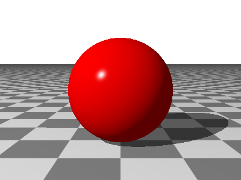

## Getting Started

### Installing and Building

The ray tracer is a .NET program and needs the .NET 10 SDK or later, which you can get from
[Microsoft](https://dotnet.microsoft.com/download).  Nothing else is required beyond the handful of Nuget hosted libraries it
needs.  The geometry, the lighting and the image itself are all worked out on your own machine.
When a scene requires something that lives elsewhere, the renderer will go and get it.  Right
now, that's only fonts and images.

A font not already in the [font catalog](fonts.md) is pulled from Google Fonts and stored,
locally on your computer.  So, it is fetched once and is local from then on.  An image given
as a web address rather than a file — the source of an [image pigment](pigments-and-patterns.md) or a
[height field](advanced-surfaces.md), say — is **not** locally stored: it is held in memory for the run that
needs it, and downloaded again the next time you render.  Naming the same address twice in
one scene costs one download, but rendering that scene ten times costs ten.  If that matters,
fetch the image yourself and point the scene at the local copy.

If a scene references only files and fonts you already have on your computer, it can be
rendered entirely offline.

Right now, you'll need to build the executable yourself.  To do that, clone the repository
and use the `dotnet` command to build it:

```bash
dotnet build
```

That produces both the renderer and its test suite.  To satisfy yourself that the build is
sound:

```bash
dotnet test
```

### Running the Executable

If you run the executable with just the `--help` option,

```bash
RayTracer --help
```

you'll see the list of supported commands.  You can then ask for help on a specific command
like this:

```bash
RayTracer help render
```

> **A note on the commands in this documentation.**  Every example is written as `RayTracer`,
> as though the program had been published and put on your path.  If you are working from a
> clone and haven't built the executable in a visible place, run it through the SDK and include
> `--` between `dotnet`'s arguments and the ray tracer's own:
>
> ```bash
> dotnet run -- -i scene.igl
> ```
>
> The two are interchangeable everywhere in these chapters.

### Rendering a Scene

Rendering is what the program does unless told otherwise, so the `render` verb may be left
off.  These two are the same:

```bash
RayTracer -i scene.igl
RayTracer render -i scene.igl
```

The input file is the only thing you **must** supply.  With nothing else, the renderer writes a
PNG beside the scene file, named after it, at 800 by 600 — or at whatever size the scene
asked for, as the next section explains.

There are scenes to try under `gallery/`, in addition to the example pictures in this
documentation:

```bash
RayTracer -i gallery/challenge-book/chapter-16/csg.igl
```

### Command Line Options

#### How a setting is decided

Many settings can be given in two places — here on the command line, or in the scene itself,
mostly in its [context block](context.md).  Where both could apply, the same rule applies every
time:

1. what the command line says, if it says anything;
2. otherwise what the scene asked for;
3. otherwise the built-in default.

So a scene can fix how it wants to be rendered and still be overridden for a quick look at
something, and passing no options at all renders it the way it asked to be.  These settings work
this way:

| On the command line | In the scene |
| --- | --- |
| `-w`, `-h` | `width`, `height` in the context block |
| `-a` | `antialiasing depth` and `antialiasing threshold` |
| `-c` | `color depth` |
| `-g` | `gamma` |
| `--white-balance` | `white balance` |
| `--film-curve` | `film curve` |
| `--exposure` | each camera's own `exposure` |
| `-r` | the `rate` of the context's `animation` |
| `--scene`, `--camera` | the file's `render` command |

**The switches only work one way.**  `--no-gamma`, `--no-shadows`, `--grayscale` and `--spectral`
turn their setting on (or, for gamma, off) whatever the scene says, and leaving them out leaves
the scene's choice standing.  None of them can undo what a scene asked for, though: a scene whose
context block says `no shadows`, `no gamma`, `grayscale` or `spectral` is rendered that way
however it is run, since there is no option to say you want shadows after all.

Everything else is said in only one of the two places.  The output paths, the chattiness, the
progress style, `--stats`, and which frames of an animation to render (`-m`, `--frames`,
`--still`) are the command line's alone.  The scanner, the angle units, the `info` block, the
sample counts, bounced light, caustics, the trace depth, the ambient scale, gravity and wind,
and how long an animation runs are the scene's alone.

#### Where the image goes

| Option | What it does |
| --- | --- |
| `-i`, `--input-file` | The scene to render.  The only required option. |
| `-o`, `--output-file` | The file to write.  The format is taken from the extension. |
| `-d`, `--output-dir` | The directory to write into, keeping the scene's own name. |
| `-e`, `--output-extension` | Keep the scene's name but write this format instead. |

`--output-file` and `--output-extension` are two ways of saying the same thing, so give one
or the other and not both.  If you don't specify `--output-dir`, it will default to the
directory where the input file sits.

A PNG, JPEG or any other picture format is written as a picture, for a screen.  Where a picture
is partly clear — the soft edge of something against a [transparent background](scene-files.md#background)
— each pixel keeps its own color, and its alpha says how much of the pixel it covers, which is
what anything laying the picture over another expects.  An OpenEXR (`.exr`), Radiance (`.hdr`)
or portable float map (`.pfm`) file is written as the light itself: no [gamma](context.md#gamma)
curve, nothing cut off at white, and every value kept to the format's own precision rather than
to eight bits -- for an image to be graded or developed elsewhere, or lit by in another scene.
What transparency such a file holds it holds premultiplied, its colors already scaled by their
alpha, as OpenEXR's own convention has it.

#### Which scene, and which camera

| Option | What it does |
| --- | --- |
| `--scene` | The scene to render, when the file defines more than one. |
| `--camera` | The camera to render with, when the scene defines more than one. |

A file that defines several scenes or cameras normally ends with a [`render`
command](scene-files.md#the-render-command) saying which to use.  These two options say the same
thing from the command line, and take precedence over the file — so one file can be rendered
from any of its cameras, or as any of its scenes, without editing it.  A camera name is looked
for within the chosen scene, so two scenes may each have a camera of the same name.

#### How big, and how good

| Option | Default | What it does |
| --- | --- | --- |
| `-w`, `--width` | the scene's, or 800 | The image width, in pixels. |
| `-h`, `--height` | the scene's, or 600 | The image height, in pixels. |
| `-a`, `--antialias` | the scene's, or off | Anti-aliasing; see below. |
| `-c`, `--bits-per-channel` | the scene's, or 8 | How many bits each color channel gets in the file; `8` or `16`. |

Antialiasing is written either as `off`, or as `adaptive` with a depth: `adaptive:5`, or
just `5`, which means the same.  `adaptive` alone means `adaptive:5`.

A scene may also ask for antialiasing itself, with
[`antialiasing depth`](context.md#anti-aliasing) in its context block, and one that needs it
should — this flag then overrules whatever it asked for, and saying nothing leaves it alone.
A scene whose antialiasing lives only in the command line that once rendered it has not really
recorded it.

The adaptive sampler fires five rays per pixel in the pattern of the pips on the "five" side
of a die.  Where the corners disagree with the center by enough to notice, it splits that
corner and looks closer.  This repeats down to the depth you allow.  A pixel in the middle
of a flat expanse costs five rays; one on the edge of something costs more, which is where
the extra rays are worth paying for.

**"By enough to notice" is a number, and you may say what it is** — a third part after the
depth, as `adaptive:3:0.35`, written with a point whatever your locale.  It is how far apart two
samples must be before the sampler subdivides, and it defaults to `0.1`.  The distance is the
differences in red, green and blue, and in how opaque the two are, added together, each taken
as the picture will show it, from nought to one — so black beside white is 3 apart, and a gray
beside one a shade paler a few hundredths.  The threshold may be anything above nought, up to
one.

That default is cautious, and on a scene with a lot of fine detail it is worth raising.
Measured on a sea of isosurface waves at 300×225:

| | time | samples per pixel | difference from `0.1` |
| --- | --- | --- | --- |
| `adaptive:3` | 3m 18s | 16.86 | — |
| `adaptive:3:0.2` | 2m 06s | 10.86 | mean 0.14/255, 0.11% of pixels by more than 8 |
| `adaptive:3:0.35` | 1m 30s | 7.83 | mean 0.24/255, 0.35% of pixels by more than 8 |

Two and a fifth times faster for a mean difference of a quarter of one level in 255, on a
scene where the two pictures cannot be told apart side by side.  The dial is worth knowing
about before waiting out a long render at the default.

Raise it too far and anti-aliasing quietly stops happening at all but the starkest edges: at
`1` a corner must differ from the center by more than a whole channel's range, all told, before
it is looked at more closely, and anything above that is refused.

#### Color and light

| Option | What it does |
| --- | --- |
| `-g`, `--gamma` | Write with a plain gamma power instead of the sRGB curve: more than 0, and no more than 5. |
| `--no-gamma` | Write the light as it stands, with no curve at all. |
| `--grayscale` | Render in shades of gray. |
| `--spectral` | Carry light [wavelength by wavelength](context.md#spectral-light). |
| `--white-balance` | Balance the picture for lamps of a given [temperature](context.md#white-balance). |
| `--exposure` | Expose every camera by this many [stops](cameras.md#exposure). |
| `--film-curve` | Develop the picture by this [film curve](context.md#film-curve): `soft`, `neutral`, `agx` or `none`. |
| `--no-shadows` | Let nothing cast a shadow. |

#### Animation

| Option | Default | What it does |
| --- | --- | --- |
| `-r`, `--frame-rate` | the scene's, or 30 | Frames per second, for an [animation](animation.md). |
| `-m`, `--frame` | | Render one frame of an animation alone, as a still at its time. |
| `--frames` | | Render a run of an animation's frames, as `0-143`. |
| `--still` | | Render an animation as the one frame it names as its still. |

#### Chattiness

`-l`, `--output-level` takes `quiet`, `normal`, `chatty` or `verbose` — or just their first
letters, in any case you like.  `normal` draws a progress bar; `quiet` says nothing until
the render finishes or something goes wrong, and draws no bar.  What is asked for by name still
comes: the `tool` style's lines and the `--stats` report, both below.

`-p`, `--progress` chooses how progress is reported, and takes `bar`, `tool` or `none` —
abbreviations and any capitalization are fine here too.

`bar` is the default and is what the ray tracer has always done: one line, redrawn in place,
with a bar and an estimate of the time left, appearing only once a render has gone on longer
than two seconds.

`tool` is for when something other than a person is watching.  It writes whole lines of
`key=value` text, with no color and no cursor movement, one every two seconds:

```
start elapsed=0.0 setup=2.14 pixels=0/480000 samples=0 sceneRays=0
progress elapsed=2.0 pixels=4188/480000 done=0.0087 eta=227.2 samples=4188 sceneRays=39264
done elapsed=2767.0 pixels=480000/480000 done=1.0000 eta=0.0 samples=480000 sceneRays=8846000
statistics pixels=480000 samples=480000 primaryRays=480000 sceneRays=8846000 samplesPerPixel=1.00 sceneRaysPerSample=18.43
```

`elapsed` is the render's own time, and `setup` on the opening line is everything before it —
loading, parsing the scene file, and building its geometry.

The bar is invisible through a pipe — it is drawn by walking the cursor back over its own
line — so a program watching one has nothing to go on but the age of the process, and cannot
tell a slow render from a stuck one.  These lines come on the clock rather than at fractions
of the way through, which is what makes that distinction readable: a render that has wedged
stops producing lines, while one that is merely slow goes on producing them with the counts
barely moving.

The `statistics` line at the end is worth a word, since it answers *where did the time go*.
`samplesPerPixel` is anti-aliasing's appetite: `1.00` means none was asked for, `5.00` means
the adaptive sampler never needed to subdivide, and a large number means it subdivided nearly
everywhere.  `sceneRaysPerSample` is what shading each of those samples cost — every shadow
ray each light sample needed, every reflection and refraction, and every step through a
participating medium.  A scene taking far longer than expected is nearly always doing one of
those two things far more than expected.

`none` reports nothing at all.

`--stats` asks for a report of what the render cost and what its scene held, laid out to read,
once the render finishes, whatever the progress style.  Here is the gallery's Standard Orbit:

```
Statistics for standard-orbit.igl

  Image       2732 x 2064, 5,638,848 pixels
  Samples     29,342,445, 5.20 a pixel
  Rays        57,283,229, 1.95 a sample, 29,342,445 of them from the camera
  Rendering   4 minutes and 34.2 seconds, 208,948 rays a second

  Surfaces    402, of 8 kinds
      cube       181
      cylinder    60
      extrusion   51
      tube        43  (50 pieces)
      lathe       32
      sphere      28
      torus        4
      egg          3
  Combined    35 unions, 66 intersections and 21 differences
  Lights      2: 2 point lights
```

The first part is the counts the `statistics` line gives, with the time the rendering itself took.
The second counts the scene.  A surface is counted as the kind it was written as: a plain group is
not counted, though everything in it is; a kind built from pieces of its own — a height field, text,
a tube, a sweep, a ribbon or an L-system — counts once, with the number of pieces it took alongside,
since that is what it costs to trace; and a field counts once, and its copies too.  Unions,
intersections and differences count as they were written, a shape shared between instances counts
wherever it is shown, with a line saying which shapes were shown more than once, and the lights are
counted by kind.

`tool` keeps its one `statistics` line either way, for the program reading it, and
`-l quiet --stats` prints the report and nothing else.

### Your First Scene

A scene needs three things: something to look with, something to look at, and something to
light it by.  If you leave out the light you get a black picture, which is the most common
first surprise.

Put this in `first.igl`:

```
// Where we are looking from, and at.
camera {
    location [0, 1.5, -5]
    look at [0, 1, 0]
}

// A lamp, up and to the left.  Leave this out and the picture comes back black.
point light {
    location [-10, 10, -10]
    color White
}

// The ground.  A plane with no transform lies flat at the origin.
plane {
    material {
        pigment checker { White, Gray30 }
    }
}

// And something to look at since an empty floor is boring.  A sphere is written as though
// it sat at the origin with a radius of one, then moved where it is wanted.
sphere {
    material {
        pigment color Red
        specular 0.9
        shininess 200
    }
    translate [0, 1, 0]
}
```

Then:

```bash
RayTracer -i first.igl
```



This example is also here: [`docs/examples/getting-started/first.igl`](examples/getting-started/first.igl), if you would
rather render it than retype or copy/paste it.

Several things there are worth pointing out, and each has a chapter of its own later.

The sphere is written as though it were at the origin with a radius of one, and then moved
where it is wanted.  Every surface works this way: it has a natural size and place, and
[transforms](transforms.md) carry it from there to wherever it belongs.  `translate` is one
of those; there are others, and they may be stacked.

`White`, `Gray30` and `Red` are named colors the renderer knows already, and there are a
great many of them.  A name may hold a different value for each type it is used as, so
`Turquoise` can be both a color and an index of refraction without the two colliding; which
one is meant is settled by where you write it.  [Scene Files](scene-files.md) covers this in more detail.

`specular` and `shininess` say what the sphere's surface does to the light: the size and
strength of its highlight.  They belong to its [material](materials.md), along with everything else
about how it is colored and lit, including what a translucent interior does to the light
passing through.

The floor's color comes from a `checker` pattern rather than a single color.  Patterns are
functions of position, and [pigments](pigments-and-patterns.md) are how a surface samples them.

Nothing in this scene says how large the image should be, what antialiasing to use, or
whether to correct gamma.  Those can be given on the command line, as above, or written into
the scene itself so it always renders the same way — that is what the [context block](context.md)
is for.
