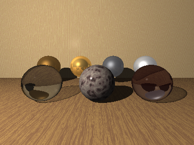

## Using Libraries

A **library** is a file of ready-made, named definitions — materials, pigments, interiors and
the colors and numbers they lean on — that a scene may draw from without carrying the
definitions itself.  A scene reaches into one with `import`:

```
import 'golds' { Gold3CMaterial }

sphere { material Gold3CMaterial }
```

Where [`include`](scene-files.md#including-other-files) brings in everything a file has, an
`import` brings in only the names you list and leaves the rest of the library out of scope —
which matters, because a library may hold a hundred materials and a scene will almost never
want more than a few.  The `import` statement itself is covered in
[Scene Files](scene-files.md#importing-from-a-library); this chapter is about the `libraries`
verb, which makes, lists and removes the libraries you import from.

The one you are most likely to want holds the textures POV-Ray ships with, converted and
brought across:



Every material in that scene — the woods, the metals, the glass and the stone — came from a
library and was named, not written.  The whole scene is
`gallery/POVRay/library-textures.igl`.

### Libraries That Come With It

Some libraries ship with the ray tracer.  They are not there until you ask for them:

```bash
dotnet run -- libraries --install
```

That copies them into your library set, and says which it wrote.  It is a thing to ask for rather than
something that happens the first time you render, because writing into your home directory unbidden is
a surprise that is hard to undo — and because a verb can be run again after an update, which a
once-only step at first run cannot.

**A library you already have is left alone.**  If a name is taken, the install keeps yours and says so;
`--overwrite` replaces it.  So a sky you have tuned to your liking survives a new release of the ray
tracer, and the shipped ones are a starting point rather than something imposed.

**Add `--dry-run` to find out first.**  It says which libraries would be installed, which would be
replaced and which kept, and writes nothing — so `--install --overwrite --dry-run` answers the one
question worth asking before an overwrite: what of yours it would replace.

#### Daylight

The first of them was `daylight`, and it exists because the sky in this ray tracer is a real
one — it works out the color of every part of the dome from the way air scatters sunlight.  That is
what makes it look right, and it is also what makes it awkward, because the numbers it wants are the
ones nobody can guess.  Nobody knows what turbidity they want.  Everybody knows what a clear morning
looks like.

```
import 'daylight' { GoldenHour, GoldenHourLight }

background GoldenHour
light GoldenHourLight
```

| | |
| --- | --- |
| `ClearMorning` | Mid-morning, sun well up, air washed clean. |
| `ClearNoon` | Overhead and unforgiving; shadows fall almost straight down. |
| `ClearAfternoon` | Mid to late afternoon, sun well down but nowhere near going. |
| `LateAfternoon` | Later still: shadows long, but an hour short of turning gold. |
| `SoftAfternoon` | The same hour with more in the air, and a softer edge to every shadow. |
| `GoldenHour` | An hour before sunset, long shadows and a warmth in the light. |
| `Sunset` | The sun on the horizon, most of its light gone red on the way. |
| `HazyAfternoon` | Hot and thick, every edge softened and the blue washed out. |
| `WinterSun` | Low and cold, bright without being warm. |
| `Overcast` | Flat and shadowless, made rather than derived — see below. |
| `Dusk` | After the sun has gone, what light there is coming from everywhere. |

**Each is two names, and you want both.**  A sky is what you look at; the light it casts is a separate
thing, and taking one without the other gives a picture that disagrees with itself — a scene with no
sky light quietly keeps the flat `ambient` guess that a sky light exists to replace.  So every
`GoldenHour` has a `GoldenHourLight` beside it.

**They may be adjusted where they are used**, the same as any named thing, so a name is a starting
point and not a straitjacket:

```
light GoldenHourLight { samples 64 }
```

**Two of them are not physical skies at all.**  `Overcast` and `Dusk` are gradients, because a real sky
with the sun taken out of it is not the same thing as a cloudy one: cloud spreads the sun's light
across the whole dome rather than hiding it, so the honest way to get an overcast day is to paint one.

**Every one of these skies that has a sun has it on the `+Z` side.**  That is worth knowing before you
place a camera, because the consequence is invisible until you render: a wall, a row of buildings or a
face of anything that points toward `-Z` is in shade under all nine of them, and a camera sitting out
at `-Z` looking back — which is the usual place to put one — sees the shaded side of everything.  The picture
comes out a silhouette, and nothing in it says why.

The sun's direction is worked out from its `elevation` and `azimuth`, and the azimuth runs the way a
compass does with `-Z` for north:

| Azimuth | The sun lies toward |
| --- | --- |
| `0` | `-Z` |
| `90` | `+X` |
| `180` | `+Z` |
| `270` | `-X` |

The stock azimuths run from `110` to `268`, which is the half of the compass between `+X` and `-X`
passing through `+Z` — morning on one side, evening on the other, and none of them behind you.

**So each sky also comes as a `…From(azimuth)`, and that is the one to reach for.**

```
import 'daylight' { ClearAfternoonFrom, ClearAfternoonLight }

background ClearAfternoonFrom(40)
light ClearAfternoonLight
```

The reason there is a whole second set of names is worth stating, because it is a real distinction and
not a convenience.  Elevation is the hour, turbidity is the air and brightness is the exposure — all
three are properties of the *day*, and belong to a sky's name.  Azimuth is not: it is a property of the
**composition**, set by which way the subject faces and where the camera stands.  Welding it into a name
means the name only serves scenes that happen to face the right way, and since every stock azimuth here
faces `+Z` while the [buildings](#buildings) face `-Z` and the [vehicles](#vehicles) and
[trains](#trains) face `+X`, that was every scene in the gallery.  They all wrote their own skies
instead, which is what this section used to advise — and the library stopped growing as a result.
`ClearAfternoon` and `SoftAfternoon` are two skies that came back out of those hand-written ones.

**Which azimuth?**  Point it at the face you want lit and swing it thirty or forty degrees off, so the
light rakes across the subject rather than flattening it.  For something facing `-Z` that is an azimuth
around `30` to `50`; for something facing `+X`, subtract ninety.  A sun directly behind the camera lights
everything and models nothing.

`Overcast` and `Dusk` have no `…From` because they have no sun in them; there is nothing for an azimuth
to mean.  And writing a sky out by hand is of course still there when you want an hour the library does
not have:

```
MyMorning = pigment physical sky { sun elevation 30  sun azimuth 20  turbidity 2.2  brightness 3 }
```

#### Trees

```
import 'trees' { Elm }

object Elm(9)
object Elm(7, 'autumn')          { translate X 12 }
object Elm(8, 'winter', 4)       { translate X -12 }
```

| | |
| --- | --- |
| `Elm` | Reaching, the limbs sweeping up and out into a crown wider at the top. |
| `Oak` | Heavy and broad, its crown in clumps on long limbs thrown sideways. |
| `Birch` | Slender, pale-barked, dividing into finer twigs than the others. |
| `Maple` | Rounded and full, and the biggest leaves here — which is what makes its autumn read from further off than the others. |
| `Beech` | A broad dome on a short, smooth gray trunk. |
| `Poplar` | The narrow one: a column to the ground, its limbs held close to the leader, for a windbreak or an avenue. |
| `Aspen` | Tall and narrow too, but a slender pale trunk under an oval crown. |
| `Willow` | Curtains of foliage hanging from arching limbs. |
| `Fir` | A conifer: a cone of drooping boughs to the ground.  Evergreen, so spring, summer and autumn are the same tree — but ask one for winter and snow lies on its shoots. |
| `Pine` | The other conifer, and the other way round: a long clear trunk with the whole crown at the top.  A fir is a cone to the ground; a pine sheds its lower branches as it grows. |
| `Snag` | A dead tree, standing.  Bare in every season, because that is what dead means. |
| `Palm` | A bare leaning trunk with the whole of its foliage in one fountain at the top. |
| `FallenLeaf` | One leaf off a tree, for a swarm to throw down or a lawn to be strewn with. |

Three numbers, of which only the first is required: **how tall**, **what time of year**, and **which
tree of that kind**.

`FallenLeaf(species = 'oak', season = 'autumn', variant = 1)` takes the species first instead (`'oak'`,
`'birch'`, `'maple'` and the rest) and is **one leaf the size a leaf is**, its color turned by the season
and the variant: the tree's own leaves are drawn several times larger, so that a crown reads from across a
field, and a leaf that size on a lawn reads as a dinner plate.  It lies across X and Y, thinnest along Z, and is
drawn about its middle, so a [swarm](animation.md#swarms) tumbles it about its middle and lays it flat when it
lands; laid on the ground by a field, give it `rotate X 90`.

**Height is what you would measure** — `Elm(9)` stands about nine units high.  That is worth saying
because the obvious alternative is for the number to mean the trunk, and then nobody can picture it.

**The season is a word**: `'summer'`, `'autumn'` (or `'fall'`), `'winter'`, or anything else for
spring.  A winter tree has no leaves at all and shows the shape they were hanging on.

Four of them say nothing with it, or nearly, and each for its own reason.  A `Palm` sheds and grows
fronds the year round rather than by the calendar; a `Snag` is dead, and dead is bare in January and
July alike; and a `Fir` and a `Pine` do what an evergreen does, which is three seasons the same and
snow in the fourth.  They all take the word anyway, so a scene that sets its season in one place can
hand it to everything.

**Every tree here but the palm is grown, not built.**  Each is given room — a crown of a few
overlapping balls placed by the variant, or for a fir a cone — and a [grown tree](advanced-surfaces.md#grown-tree)
fills it by drawing its twigs toward points scattered through it.  No two forks divide alike, branches
crowd where the crown is full and stretch where it is thin, and the outline is the room.  What makes one
species another is that room and how far its points reach: an oak's reach far, so a few long limbs sweep
out through clumps; a birch's barely at all, so it divides finely.  A willow hangs its leaves from its
twigs in strands; a fir's and a pine's are needled shoots, which take snow on top.  The palm is still
built, because a palm never branches — there is nothing in one trunk and a fountain of fronds for a
crown of points to grow.

Until 2026-10-22 the others were built too: a limb, and three smaller limbs on its end, all the way
down, every fork dividing the way every other fork did.  Next to grown trees they read as diagrams of
trees, which is why they went.

**The variant is which tree of that kind you want.**  The same numbers always grow the same tree, down
to the last twig — today, next year, and in every frame of an animation.  Change it and you get a
different tree of the same species, which is what a row of them needs, since three identical elms read
as a diagram rather than a hedge:

```
for tree in [0, 5] {
    object Elm(8 + random(tree) * 3, 'summer', tree) { translate X tree * 7 - 17 }
}
```

The library keeps its own workings.  A scene that imports `Elm` does not also inherit the dozen
functions and primitives an elm is grown from — see
[Importing from a library](scene-files.md#importing-from-a-library) for the rule, and for the one
exception: the barks are materials, and a material is looked up where it is *used*, so `TreeElmBark`
and its siblings do arrive.  They carry the prefix so they will not collide with anything of yours.

#### Undergrowth

```
import 'undergrowth' { Grass, Boxwood, Lavender }

Lawn = path { move to -5, -5  line to 5, -5  line to 5, 5  line to -5, 5  close }

object Grass(Lawn)
object Boxwood(1.2, 'winter')    { translate X 3 }
object Lavender(0.8, 'summer', 4) { translate X -3 }
```

The `trees` library gives a scene its trees and leaves them standing on a flat green plane.  This one
is the rest of it — the grass underfoot and the shrubs between, which is most of what separates a
picture of some trees from a picture of somewhere.

| | |
| --- | --- |
| `Grass` | An area of it, filling any outline you draw. |
| `Tuft` | One clump on its own, for putting somewhere in particular. |
| `Boxwood` | A dense clipped dome, grown as the trees are: twigs filling a dome from a short stem, each ending in a spray of small leaves.  Evergreen, so like the fir it takes snow rather than ignoring winter. |
| `Bramble` | Arching canes with leaves along them; berries in autumn, bare canes in winter. |
| `Lavender` | A mound of fine stems, in flower through the summer and cut back by winter. |
| `Fern` | Fronds rising from one crown and arching over.  A woodland floor without them reads as a lawn under trees. |
| `Reed` | Tall stiff blades and a seed head, for a margin or a ditch.  `Reeds` fills an outline with them. |
| `Stalk` | One stalk of wheat with its ear.  `Wheat` fills an outline with them, in drills. |
| `Wildflower` | A stem, a nodding ring of petals and a heart.  The tint is a color you hand it. |

**The first three arguments mean what they mean everywhere else** — how big, what time of year, and
which one of that kind — so a scene that has planted an autumn stand can plant autumn undergrowth
beneath it without learning a second set of habits.  Only the first is ever required.  For `Grass`
"how big" is an outline rather than a number, since an area has a shape as well as a size.

**A square is the wrong shape surprisingly often**, and for a long while the choice was a square or a
circle.  Anything laid against anything else — a verge along a road, a roundabout's island, the ground
a building does not stand on — had a patch overhanging its neighbor at the corners or leaving bare
ground short of it, and for a square no size does neither: its corners are always 1.41 times its
half-width out from the middle.  So `Grass` takes the shape it is to fill.

The outline is read on the X/Z plane, and holes in it are holes in the grass — which is how you keep a
sward off a scree, or off the footings of a building.

The obvious repair, before this, was to intersect a square patch with something, and that does not work
at all.  A patch of any size is hundreds of separate tufts, and a `CsgSurface` — unlike a `Group` — has
no bounded traversal for a shadow query, so every shadow ray walks every tuft with no distance pruning
whatever.  Under a sky light a modest patch had not finished rendering after **ten minutes**.  Deciding
each tuft as it is placed costs nothing, which is what a `field` does.

**What a season does differs by plant**, as it does in a garden.  Grass goes tawny and then to pale
straw, and lies down as well as changing color.  A bramble turns, fruits, and finally stands as bare
canes.  Lavender flowers, fades, and is cut back.  A boxwood is evergreen and does what the fir does:
three of its four seasons look alike, and in winter it takes snow.

**Height is the setting that matters most**, and not for the reason you would guess.  A blade of grass
is about a fortieth of its length across, which is right — and it means ankle-high grass seen from
across a field has blades a third of a pixel wide.  A blade thinner than its pixel does not draw as a
blade; it draws as a speck, and a field of specks draws as wire wool.  Knee-high grass in the same
picture reads immediately, and costs *less*, since taller tufts stand further apart.  If a patch looks
like static, make it taller before you make it denser.

**Grass is the one thing here that can make a scene slow**, and it is worth saying so plainly rather
than leaving it to be discovered.  A blade is a ribbon of four patches, a tuft is ten blades, and an
area of it is a tuft every fifth of a unit in both directions — so a lawn eight units square stands
about sixteen hundred tufts.  Two things make that affordable.  **Eight tufts are built, and every
place stands one of them**, turned any way and sized up or down by a quarter, so a lawn of any size
costs eight tufts to make: a patch twenty units square sets up thirteen times faster and in under a
third of the memory than when every tuft was built its own, and looks the same.  And a group arranges
its own children into a hierarchy, so a ray that reaches the ground asks about a handful of boxes
rather than every tuft in the patch.  `Reeds`, `Wheat` and `Scree` are built the same way.

A [sky light](materials.md) is the other half of any grass bill.  It works by looking at the dome from
many directions at every point it lights, and every one of those looks has to get out through the
grass, so the sample count is most of the render time in a scene like that.  Turning it down where it
is used costs less than it sounds — grass has no large flat surface for the grain to show on.

`Grass` takes two more numbers after the usual three — **how tall** its tufts stand, 0.3 unless said, and
**how thickly**, 1 unless said — and they come *after* rather than among them precisely so the first
three keep their meaning:

```
object Grass(Lawn, 'summer', 1, 0.3, 0.5)  // half the density: a quarter as many tufts
```

The tufts stand about 0.63 of their height apart, over the density, so halving the last one quarters the
count, since the tufts thin out in both directions at once.  Grass seen from across a field does not
need what grass seen from a foot away needs.  `Reeds` and `Wheat` take the same two, at a height of 1.8
and 1.1 unless said.

**Three of these fill an outline, and the jitter is what tells them apart.**  `Grass` and `Reeds` want
most of a cell of it, because a lattice is the one thing that gives an area of either away.  `Wheat`
wants almost none: a crop is *drilled*, and the rows are the whole look of one.  The same clause, at
opposite ends of its range.

```
Verge = path { move to -9, -1  line to 9, -1  line to 9, 2  line to -9, 2  close }
Drill = path { move to -9, 4  line to 9, 4  line to 9, 16  line to -9, 16  close }

object Reeds(Verge, 'summer', 3, 1.7)
object Wheat(Drill, 'summer', 5, 1.1)
```

**A wildflower takes a color rather than a season**, which is the one place this library breaks its own
habit.  It has to: the point of a bank of them is that no two are the same, and that means the tint
comes from the copy's own number — so a `field` of them reads
[`index in n`](advanced-surfaces.md#field) and hands the number on to whatever mixes the color.

```
primitive Bloom(n) -> group {
    return group { object Wildflower(0.3 + random(n, 1) * 0.2,
                                     [0.5 + random(n, 2) * 0.4, 0.3, 0.4 + random(n, 3) * 0.5], n) }
}

field { of Bloom(n)  within Verge  spacing 0.4  jitter 0.9  index in n }
```

#### Rocks

```
import 'rocks' { Boulder, Scree }

Slope = path { move to -3, 1  line to 3, 1  line to 3, 7  line to -3, 7  close }

object Boulder(1.2)
object Scree(Slope, 'winter')
```

The other two libraries grow things.  This one is what they grow among, and it is the last thing a
piece of ground needs before it stops looking swept.

| | |
| --- | --- |
| `Boulder` | One big weathered stone, lumpy all over.  The expensive one — see below. |
| `Cobble` | A smaller stone with flat faces, knocked off something bigger.  Cheap. |
| `Scree` | An area of cobbles, thrown down thickly, filling any outline you draw. |
| `MossyBoulder` | A boulder with moss on its top and down its shaded side, in patches. |
| `MossyCobble` | A cobble capped with moss. |
| `DryStoneWall` | A wall of stones laid without mortar, battered in toward its coping of stones on edge. |
| `Rubble` | A heap of broken stone, whole stones tumbled on one another. |

**The season does one thing here, and it is winter.**  A rock is not deciduous, so three seasons of
the four are the same stone; in winter snow lies on top of it, as it gathers on the fir and the
boxwood.  That is all the word does, and it is asked for anyway so a scene that sets its season in one
place gets rock agreeing with the grass around it.

**There are two kinds of stone for a reason.**  A rock is a shape problem before it is anything else:
what gives one away instantly is a silhouette that is too regular.  A sphere reads as a ball from
every angle and no amount of coloring the surface repairs it, because the outline is what the eye
checks.

So a `Boulder` is an [isosurface](advanced-surfaces.md#isosurface) — a ball with noise subtracted from
its radius, which gives an outline irregular in the way stone is.  That is the real thing at the real
price: an isosurface is *marched* along the ray rather than solved for, and sixty-four of them
measured about twenty times what sixty-four spheres cost.  A `Cobble` is a sphere with flat faces cut
off it by a couple of turned cubes — all analytic, nothing marched — which reads as broken stone
rather than weathered stone, and measured about four times a sphere rather than twenty.

That is the same division `undergrowth` makes between `Tuft` and `Grass`: the careful expensive one
for the few you look at, the cheap one for the many you do not.  A picture wants some of each.

**The moss is [hair](advanced-surfaces.md#hair)**, grown over the stone where it faces up and in
patches that differ from one variant to the next: a centimeter and a half of it, its fronds thicker than
real ones and fewer, so that it covers the stone as a cushion does without costing millions of strands.
The mossy two take a fourth argument, the way the stone's shaded side faces, which the moss creeps
furthest down — `[0, 0, 1]` unless said, so the side away from a camera looking along +Z.  A stone mossed
evenly all over reads as a stone painted green, which is why the patches are there.  In winter the snow
lies on top of the moss rather than the moss growing through it.

Growing the moss costs a few seconds a boulder, the most of it marching lines through the isosurface to
find where it grows; a cobble is quicker.

**`Scree` fills an outline, exactly as `Grass` does**, and for the same reason: stone runs out where a
slope runs out, not along a line at right angles to another line.  Draw the outline for a heap and
draw a hole in the grass to match, a little smaller, and the stones run in under the grass at the
edge instead of leaving a bare ring between them.

So its first argument is the outline rather than a size, and like `Grass` it takes two more after the
usual three: **how big a stone is**, roughly how far across, 0.3 unless said — each place stands one from
about half that to a third over it — and **how thickly they lie**, 1 unless said.  The stones stand a
stone and a quarter apart over the density, so `Scree(Slope, 'summer', 1, 0.3, 2)` lays four times as
many.

##### What makes a shape into stone

The shape argument above cuts both ways.  A good outline does not save a bad material: these rocks had
the right silhouette from the start and still read as pale plastic, and it took three separate faults
to fix.

**The color map's stops have to sit where the pattern's values actually fall.**  It is natural to
write a map from nought to one, and quite wrong for `granite`, which is a sum of six octaves of
`|0.5 − noise|`.  Measured over sixty thousand points it runs **0.017 to 0.684, mean 0.232, with 99.2%
of it below 0.5** — so stops at 0.0, 0.5 and 1.0 squeezed every stone into the gap between the first
two colors.  An intended spread of 0.26 to 0.49 arrived as 0.28 to 0.36: a third of the contrast that
was written, and all of it in the pale middle.  Each rock came out a single flat tone, which is most of
what made them look like putty.  The stops now sit at granite's 1st, 25th, 50th, 75th and 95th
percentiles, and the speckle arrives.

**Stone is darker than it seems it should be.**  Dry granite returns about a fifth of the light that
falls on it, and basalt less; the old middle tone of 0.32 was concrete.  Under a warm sky a too-bright
gray does not read as pale stone but as pale *plastic*, and it takes the sun's color with it — which is
where the yellow cast came from.

**A gathered highlight is the strongest plastic cue there is.**  `specular 0.10` at `shininess 22` is a
soft collected sheen, and a collected sheen sliding across a smoothly shaded form says *coated*.  Stone
scatters off a surface rough far below the scale of anything modeled, so what comes back is broad and
dim: `specular 0.03` at `shininess 9`.  The ambient came down with it, from 0.16 to 0.06 — a sixth of
the light arriving from nowhere in particular was lifting the crevices to the same tone as the faces,
flattening the very shading that says *rough*.

**`DryStoneWall(length, height, season, variant)` and `Rubble(size, season, variant)` are stone that
has been worked by hand, or brought down.**  Both are a [fracture](advanced-surfaces.md#fracture): a
solid broken into pieces, every stone the part of it nearest one seed, so the stones fit together as
laid stone does, each worn round at its edges and turned a degree or two.  A wall is broken stretched
along its length, so its stones lie in rough courses, lengthwise, as a waller lays them; it leans in on
itself from a foot wider than its top, and is capped with a row of stones set on edge across it.  Its
height is to the top of that coping.  Between its faces is a dark hearting of small stone: without it
the wall is a sieve, daylight showing through every joint, and its joints came out pale where they
should be the darkest thing on it.  A heap of rubble is broken *whole* — never cut by the mound it
fills, but made of the stones whose middles fall inside it — so its outline is whole stones lying where
they fell rather than a smooth mound cracked.  Both are laid from four stones, gray, buff, blue-gray
and brown, each in a grain of its own; both take snow in winter.

#### Fire

```
import 'fire' { Campfire }

object Campfire(1.4) { translate [3, 0, -2] }
```

| | |
| --- | --- |
| `Flame` | One flame on its own.  The first number is how tall it stands. |
| `Campfire` | Logs, coals between them, and flames over the lot.  The number is how far across. |
| `Torch` | A shaft with a flame at the top of it. |
| `Embers` | Coals with no flame left, for a fire going out. |

**These take two numbers, not three.**  Everything else in these libraries takes a season second, and
fire does not, because fire does not have one.  A word taken and ignored is worse than a word not
asked for: it says the library thought about the question when it did not.

##### What makes a pile of tubes into a fire

**A fire is built, and how it is built shows.**  The logs here lie two across the bed with four leaning
in over them, bases out on the ground and tips gathered above the middle.  The first version made a
*starburst*: each log was a vertical tube with its base at the origin, tilted and then swung round, and
rotating about the origin holds the base still while the tip swings out — so six logs came out with
their ends meeting in the middle and their far ends radiating like the spokes of a wheel, lying only
28° off the ground besides.  A leaning log is the other way about, so each is now given its two ends
directly rather than rotated into place: it says what is meant, and it cannot swing the wrong end.

**Bark, not a flat brown.**  A log of one uniform color is a dowel — nothing about its surface says
wood, so the eye reads the shape alone, and the shape of a tube is a tube.  The bark is a
[`crackle`](pigments-and-patterns.md#continuous-patterns) pigment, which is a web of cracks between cells and
therefore exactly the right pattern, with its stops set at crackle's own percentiles rather than spread
over nought to one.  Scale matters more than it looks: at cells a third of the log's diameter it read
as a pineapple, and a log wants twenty or thirty cells round its circumference.

**And the coals have to be above the ground.**  `FireBed` is a slab in the *floor* of its shell — its
density only rises above nought in the bottom sixth — so a shell that is scaled flat and then lifted by
half of that scale puts the whole glowing part underground.  `Embers` did exactly that, and rendered
faithfully as unlit dirt.  Being a slab, it is also thin, and what a medium gives back is emission
times density times the distance a ray travels through it: a coal bed crossed in a tenth of a unit
needs several times the density of a flame crossed in three tenths, or it comes out too faint to find.

**Put a fire in a scene and the scene is lit.**  There is nothing to place beside it and nothing to
keep in step: the stuff a flame is made of gives off light where it is, and that light falls on the
ground, casts shadows, and carries the flame's own color with it — see
[a surface that gives light](surfaces.md#a-surface-that-gives-light).

That was not always so.  Until it was, every fire needed a lamp written beside it and moved with it,
and this library shipped `CampfireLight` and three siblings for the purpose.  **They are gone.**  A
scene that used them should delete the line.

**How bright a fire is, is not a setting.**  It follows from what the flame is made of and how big it
is, falling away as the square of the distance.  If a fire lights too much of a picture, the honest fix
is a smaller fire.

**A flame is a medium, so it is walked along**, and what it costs is how many places along each
crossing the renderer stops to ask.  That is scene-wide and the library cannot set it:

```
context { medium samples 120 }
```

Sixty does for a flame across a room; a hundred and twenty for one filling the frame.  Below about
forty a flame goes banded, and the bands are the steps of the walk showing through.

**Two glowing volumes may overlap; three may not.**  Each shell a ray crosses spends one of the four
refractions the renderer allows unless a scene asks for more with a
[`trace depth`](context.md#trace-depth), and a ray that runs out comes back black wherever the stuff
inside is thin.  That is why a campfire here is one shell whose density describes the coals and all
three flames together, rather than four shells stacked — which is also cheaper, since a ray crosses one boundary
instead of eight.

#### Buildings

```
import 'buildings' { House, Row, Tower }

object House(4)
object Row(5, 'winter')       { translate X 12 }
object Tower(14, 'summer', 3) { translate X -14 }
```

| | |
| --- | --- |
| `House` | One dwelling: plinth, brick walls, a boarded gable, a roof, a doorway and windows. |
| `Row` | Several houses joined shoulder to shoulder, as a terrace. |
| `Tower` | A taller block, bay after bay, with a parapet rather than a roof. |
| `Terrace` | Shops with flats over them, each its own height, brick, roof and paint — [built by rules](#built-by-rules). |
| `Apartments` | A block of flats over a base of banded stone, with balconies — built by rules. |
| `Chapel` | A nave and a tower with a clock, a belfry and a spire, in dressed stone — built by rules. |

The three numbers mean what they mean everywhere else — **how big**, **what time of year**, and **which
one of that kind** — and only the first is required.  For a `Row` the first number is **how many
houses**, since a terrace is counted rather than measured, and so it is for a `Terrace`, in shops.  For
`Apartments` it is **how many floors**, and a `Chapel` takes none at all.

**These face `-Z`**, which is the way a camera written the usual way is looking.  The windows, the door
and the sills are all on that face; the other three sides are wall.  Turn a building with `rotate Y` to
put its front where you want it.

**The season puts snow on the roofs**, and does nothing else, which is the whole of what winter does to
a building seen from outside.  A building is not deciduous; it takes the word so that a scene setting
its season once gets roofs that agree with its ground.

##### What makes a box into a building

This library exists because of a scene that failed at it.  `a-block-of-buildings` in the gallery raises
eleven towers out of one loop, and says of itself that they are *boxes with lights on, not
architecture*.  Four things do most of the difference, and all four are cheap:

**A plinth.**  A wall that meets the ground in a line reads as a sheet standing on grass.  A course at
the bottom, a little proud of the wall and a little lighter, is how a building sits down.

**Depth in the window.**  A rectangle of dark paint on a wall is a picture of a window.  What reads is
the *reveal*: glass set back, a frame standing proud around it, and a sill that overhangs and throws a
small shadow.

**An overhang.**  Eaves that reach past the wall lay a shadow line along the top of the facade.
Without it a roof looks glued on; with it the roof is clearly above and the wall clearly below.

**A top that is not a cut.**  A gable, or a parapet standing above the roof line.  A box ended flat at
the top is the strongest single tell that a thing is a box — which is why a `Tower` gets a parapet, and
why in winter its snow lies *across* that parapet rather than down inside it.  Snow inside a parapet is
invisible from any camera standing on the ground, and a season that cannot be seen is a word taken and
ignored.

**A wall made of something, and not all of the same something.**  A house wears brick — one of three, a
yellow stock, a red or a gray, picked by its variant along with everything else — and its gable is
boarded and painted above it.  That is what houses do, and it also puts a change of texture exactly
where the wall stops, which does more for the top of a facade than either material does alone.  A
`Tower` gets neither; a block in render or concrete is what a block is, and it keeps the two kinds of
building apart.

Both of those are patterns on a wall, and patterns on walls have traps in them.

**[A pattern is worked out in the surface's own
space](pigments-and-patterns.md#patterns-live-in-the-surfaces-space).**  A wall is a cube scaled
differently on all three axes, so a pattern laid on plainly comes out stretched by whatever those
numbers were — long flat bricks on the front and short tall ones on the end.  Dividing the scale back
out is what gives bricks of one size, and it is why the library's brick and boarding both have to be
told the wall they are going on.

**In a `union` or an `intersection`, the space that counts is the *leaf* the ray actually met**, not the
shape you wrote the material on.  A gable is an `intersection` of a turned cube with a thin one, and
sizing a pattern for the intersection rather than for the thin cube inside it gave bricks two and a half
times too long, plainly coarser than the wall below.  This is also why the boarding is written on the
thin cube alone and the sloping edges get flat paint: those edges belong to the *turned* cube, so boards
read in its space would run at forty-five degrees.

**`brick` lays joints in all three directions.**  A wall's face has one constant coordinate, so that
face either misses the joints running that way or lands squarely in one — and landing in one turns
*every other course of the whole face* to mortar, because those joints are staggered by course.  Worth
measuring rather than trusting: driving a house wall into its depth joints on purpose took the face from
twenty-two percent mortar to sixty-one.

What no amount of care will do is turn a corner.  Real brickwork toothes at a quoin, alternate courses
reaching round; a pattern is a lattice cut by the wall's faces, so courses line up in height all the way
round a house and the bond does not interlock where two walls meet.  At the distance a building is seen
from that is invisible, and it is the reason to reach for a pattern here rather than for geometry.

**A distant brick wall fades rather than bands.**  A lattice pattern — brick, checker, hexagons and their
kind — is averaged over the patch of surface each ray covers, so once a brick course falls below a pixel the
wall comes back as the mix of brick and mortar it is made of.  Sampled at a single point, as patterns were
when this library was first written, the lattice beat against the sample spacing and a distant terrace came
back covered in broad *curved* bands, which antialiasing could not average away and the adaptive sampler
subdivided at great cost; the remedy then was to stand houses close.  Now a wall may stand as far off as the
picture wants.

For the boarding the useful trick is that `linear Y gradient` is a **sawtooth** — it climbs from nought
to one over each unit and starts again — so one unit is one board and the color map is a cross-section
of it: bright at the proud bottom edge, receding up the face, dark in the last tenth where the board
above laps over.  The drop back to nought *is* the board line, and there is nothing to smooth out.

##### Built by rules

```
import 'buildings' { Terrace, Apartments, Chapel }

object Terrace(4)
object Apartments(5, 'winter') { translate X 30 }
object Chapel('summer', 2)      { translate X -28 }
```

The first three are put together a part at a time, every window placed by arithmetic.  These three are
not: each is a [shape grammar](advanced-surfaces.md#shape-grammar), a set of rules that divide a box into a
building — a lot raised into a mass, the mass into its faces, a face into floors, a floor into bays, a bay
into wall round a window — so a longer terrace has more shops rather than wider ones, a taller block more
floors, and the variant picks among the ways each rule may go: which shops are gabled and which flat
behind a parapet, how many floors each has, its brick and its paint, which side its door is on; whether a
block has balconies on every bay, every other one or none; which corner a chapel's tower stands at.  They
are measured in **meters**, as the vehicles and roads are, a floor three and a shop four and a half, and
they stand like the others: middle over the origin, front toward `-Z`.  The `a-high-street` scene in the
gallery is a street of them.

What the rules buy over arithmetic is **depth**.  A window is not stuck on a wall: its bay is split round
an opening and the opening set back into the wall, so every window has a reveal and throws a shadow down
one side; lintels, sills and string courses stand proud of the brick; a cornice reaches out over each
shopfront; balconies lay their railings' shadows down the face below.

**Their brick never lands in a joint.**  A grammar fills its parts with boxes in the building's own space,
so the brick runs on unbroken from one bay to the next — and so it is laid in meters, unscaled, a real
brick's 215 by 65 millimeters.  But a grammar's faces lie wherever its rules put them, so the trap above —
a face in a joint plane, every other course turned to mortar — cannot be dodged by shifting the pattern.
These bricks are a hundred meters deep instead, their depth joints fifty meters off, and a wall facing X
wears them turned a quarter: every face shows courses and brick ends, and none is ever in a joint.

**Winter is `weather { snow }`**, which lays snow whole over everything flat enough to hold it — the
roofs, the sills, the copings and the cornices — rather than slabs of white placed on each roof by hand.

#### Plans

Buildings that turn a corner, rather than buildings that are boxes.  A **wing** is one rectangular
block with its own ridge; a **plan** is a list of wings, and the library raises the building from it.

```
import 'plans' { Plan, NoDoor, FaceFront }

object Plan(list(
    //  wide  tall  deep  turn      x      z  door
    list( 3.4,  4.4,  5.6,    0,     0,     0, FaceFront),
    list( 3.0,  3.9,  4.6,   90,   3.0,   1.4, NoDoor)
))
```

| | |
| --- | --- |
| `Plan` | A whole building, from a list of wings. |
| `Wing` | One block of it: walls, gables, a roof, and windows wherever the plan leaves daylight. |
| `FaceFront`, `FaceBack` | The two gable ends, at `-Z` and `+Z` in the wing's own axes. |
| `FaceLeft`, `FaceRight` | The two long eaves sides, at `-X` and `+X`. |
| `NoDoor` | For a wing with no way in of its own. |

`Plan(wings, season, variant)`, and only the list is required.

**A wing is seven numbers in a list**, which is what makes a plan a table you can read down.  `wide`
is gable to gable, `deep` runs with the ridge, and `tall` is to the eaves with the ridge above them;
the sizes are the whole block, not half of it.  `turn` is degrees about `Y`, so a wing turned `90` has
its ridge running east and west.  `x` and `z` are where its middle stands.  `door` names the one face
the way in goes on, or `NoDoor`.

There is deliberately nothing here for two wings, three wings and so on.  The count belongs to the
plan rather than to the library, and a [list](scene-files.md#lists) is what lets it.

##### The windows are measured, not declared

Windows belong where there is daylight, and a wall buried in the wing next door must not have any.
Union two of [`buildings`](#buildings)' houses and the geometry comes out right while the windows
stare into the join — which is what this library exists to fix.

It fixes it by **asking**.  Every window, before it is placed, works out where its two ends stand in
the world, a hair proud of their wall, and asks the plan whether either of those spots is inside
another wing.  If either is, the window is left out.  So a wall that is half swallowed keeps the
windows on the half that shows and loses only the ones at the join, which is what a real building does
and what a whole-wall rule cannot do.

**Both ends, rather than the middle.**  A window is half a window wide either side of its middle, so a
wing whose flank runs out from under an opening leaves that opening half swallowed — and asking about
the middle alone answers *yes* or *no* to a question whose real answer is *partly*.  Asking at both
ends turns partly into no, and that is the difference between a clean inside corner and half a window
growing out of a wall.

**And a hair proud of the wall, rather than out past the sill.**  Standing off the wall at all is what
makes a wall built flat against the next wing count as buried; asked on the wall itself it would be a
coin toss.  But standing off by the whole depth of the sill asks about a spot the window does not
reach, and passes exactly the window whose glass is buried and whose sill just clears the wing next
door.

The test is a **plan view** and says nothing about height: a wing swallows whatever stands in it,
whether or not it is tall enough to.  That is the conservative way round — a window left out is a bare
wall, a window left in is a window looking into masonry.

`gallery/Local/towns/the-house-that-grew.igl` is this working: a house of five wings, with the
comparison spelled out in its own comments — break the plan into five plans of one wing each and the
half windows come back, sliced open and hanging in the join.

The **door** is taken as written rather than measured.  A door is a decision about how a building is
entered, and a plan that asks for one in a buried wall is better answered with a door in a strange
place than with a house that silently has no way in.

##### Why wings, and not any outline you like

Given any outline, the walls are easy: an [extrusion](advanced-surfaces.md#extrusion) of the
plan, with a second run nested inside it, is a wall of real thickness and costs nothing to write.

It is the **roof** that is hard.  A pitched roof over an arbitrary polygon means computing its
straight skeleton, which is a real algorithm and an unforgiving one.  Two gabled wings crossing need
none of it: the union of their two prisms **is** the valley, exactly and for free.  And since a
building that turns a corner is built as wings and drawn as wings, nothing is given up by saying so.

#### Vehicles

```
import 'vehicles' { Car, Van, Truck }

object Car(4.4)
object Van(5.6, 'winter')      { translate X 9 }
object Truck(8.5, 'summer', 3) { translate X -11 }
```

| | |
| --- | --- |
| `Car` | A saloon: rounded body, a glasshouse under a painted roof, four wheels in cut arches. |
| `Van` | A cab with a box behind it, taller than it is wide, and higher off the ground. |
| `Truck` | A cab and a flat bed with a load on it, on six wheels. |

**The first number is a length, not a height.**  That is how a vehicle is described — a car is four and a
half meters long, not one and a half tall — and everything else here that goes somewhere is described the
same way: the [vessels](#vessels), the [trains](#trains), the [aircraft](#aircraft), the
[spacecraft](#spacecraft) and the [Enterprise](#enterprise) all take a length first too.  The other two
numbers mean what they always mean, and only the length is required.

**These face `+X`**, so a vehicle drives to the right in a camera looking the usual way, and a street
running left to right needs no turning at all.  `rotate Y 180` sends one the other way.

**The season lays snow on whatever is flat and facing up** — roof, bonnet, boot, the top of a van's box
— and does nothing else.  A street whose houses are white-roofed while its cars are not is a street
that has quietly stopped making sense.

##### What makes a shape into something built

The buildings and the vehicles were both made of as few surfaces as would carry the shape, and shape
was never quite the problem: what they lacked was the small stuff that **projects or recesses**.  That
distinction is the whole of this pass.  A detail painted flat onto a wall does nothing at the angles a
street is actually seen from; a detail that stands out a hand's width catches the light on one side and
throws a shadow on the other, and it is those two edges that say a thing was *built* rather than
molded.

On a house that meant a **chimney** tall enough to stand clear of the ridge with a cap slab on it
(there was one before, whose top cleared the roof by a tenth of its height and read as a wart), a
**ridge cap** along the join of the two slopes, a **gutter** under each eave with a **downpipe** to the
ground, and a **doorway** rather than a door: a surround up both sides, a head across the top, and a
step at the foot.  The downpipe is the cheapest of them and possibly the most valuable — one vertical
line on a face otherwise made of horizontal courses, and the eye finds it at any distance.

On a vehicle it meant **wing mirrors** above all.  Everything else on a car lies flush or recessed —
lamps, plates, a grille all color the face without changing its outline — and a mirror is the one
thing that breaks the line of the body.  A body with an unbroken line reads as a pressed-metal toy
however well it is painted.  Then a **grille** with bars in a sunken recess, since a nose of paint and
two lamps reads as blank, **number plates**, and an **exhaust** off center at the back, because they
never come out of the middle.

##### What makes a box into a car

The same question [the buildings](#buildings) ask, with a different answer:

**Rounded edges, and this one is not optional.**  A shape with corners never reads as a vehicle, at any
size, from any angle.  Every body panel here is a
[superellipsoid](surfaces.md#superellipsoid) held down at about a fifth — a box with its edges taken
off.  This alone does more than the other three together.

**Wheels cut into arches, not bolted to a flat side.**  The arches are cylinders taken out of the body
with a `difference`, so a wheel stands in a hole rather than against a wall.  A wheel touching a flat
slab is a toy, and no amount of tire detail repairs it.

**The glass must be capped with paint.**  A glasshouse whose top is glass reads as a suitcase left on
the roof.  What turns it into a cabin is a painted roof panel a shade *wider* than the glass, so the
glass is only ever seen as a band beneath it.

**Gloss.**  A building is matte and a vehicle is not, and the highlight sliding along a wing is most of
what says *painted metal*.  Drop these to a building's `specular 0.05` and the shape stops reading long
before the color does.

**The clear coat and the glass follow [Fresnel](materials.md#fresnel).**  Lacquer gives back about five
percent of what meets it square-on and far more at a graze, so a roof seen from above shows its paint and a
flank seen along the street carries the sky.  Glass does the same from four percent: dark looked into,
bright looked across.  The [trains](#trains), [aircraft](#aircraft), [vessels](#vessels) and
[windows and doors](#windows-and-doors) are finished the same way, and their bare and brushed metals —
satin steel, alloy, foil — are real [metals](materials.md#metals), [rough](materials.md#roughness), so what
they mirror is blurred.

#### Vessels

```
import 'vessels' { Sailboat, Trawler, Submarine }

object Sailboat(10)
object Trawler(22)   { translate Z 30 }
object Submarine(70) { translate Z -60 }
```

| | |
| --- | --- |
| `Sailboat` | A sloop: hull, fin keel, coachroof, mast and two sails. |
| `Trawler` | A working boat: hull, bulwarks, wheelhouse and a derrick. |
| `Submarine` | A teardrop hull, a sail, diving planes and a rudder. |
| `VesselWhite`, `VesselBlue`, `VesselGreen` | Topsides paint. |
| `VesselAntifoul` | What a hull is below the waterline. |

**The first number is a length**, as it is for the [vehicles](#vehicles) and for the same reason: a boat
is a thirty-footer or a sixty-meter trawler, never so many meters tall.  These are in **meters** and
they **face `+X`**, like the vehicles and the [trains](#trains).

There is no season, and the second number is **which one of that kind**, which for a `Sailboat` or a
`Trawler` is the paint on its topsides: white, blue or green (`0`, `1`, `2`).  A `Submarine` takes a
variant too and does nothing with it — it is the one dark steel whatever is asked — so that a call written
for one vessel serves for any of them.

##### The waterline is `y = 0`, and that is the whole of the convention

Every other library here stands its pieces on the ground: a chair's feet are at nought, a building's
footings are at nought.  A vessel has no such face.  What it has instead is a **waterline** — the level
it floats at — and that is what sits at nought, so a boat dropped at the origin floats correctly on a
[`Water`](#water) surface laid at the origin, with no draft to look up and subtract.

The consequence is that **a good deal of each of these is below `y = 0`**, which is the opposite of
everything else in these libraries.  It is worth knowing before you wonder why a vessel on a plane at
nought is buried to its deck.  It is not buried.  That is where the water goes.

##### What makes a solid into a hull

A hull is the one shape these libraries had not tried, and none of the obvious surfaces is it.

**A superellipsoid cannot do it**, which is a surprise, because it is what every road vehicle here is
made of.  Its `east` exponent shapes the waterline plane, and pushing that above one to get a pointed
bow pinches the *sides* in at the same time, because the exponent cannot tell the ends from the middle.
What comes out is a four-pointed star, full at forty-five degrees and hollow amidships, which is the
opposite of a hull in every particular.

**Two ellipsoids crossing are.**  Take two long ellipsoids, push them apart sideways, and keep only what
both contain: the overlap is a lens, pointed where they cross at the ends and fullest where they are
furthest apart amidships.  That is a hull's waterline plan exactly, and how far apart they sit is how
full the ends are — one number doing the job a table of offsets does in a real drawing.  A third
ellipsoid lying fore and aft gives the keel its rocker; a box takes the deck off level and cuts the
transom.  Four surfaces and one intersection is a hull.

**The bulwarks are the same hull cut twice.**  A hull stopped level at the deck is a launch; what you
stand behind in a sea is a wall carried up all round, and its plan has to follow the hull's own curve
rather than being a box set on top.  Taking a slightly smaller copy of the hull out of a slightly taller
one leaves a ring of exactly the right shape without any of it being drawn twice.

##### A sail bellies, which is why it is a patch

Three flat triangles will draw a sloop's rig and from a mile off they are honest enough.  But a sail
is the one part of a boat that is only ever the shape the wind is making, and a flat one reads as
card — so each is a bicubic [`patch`](surfaces.md#patch) with its four interior control points pushed
to leeward.  The twelve on the edges stay where the corners put them, so the luff still runs straight
up the mast and the foot still lies along the boom while the middle bags out between them.

**Its head is a short edge rather than a point.**  A patch is a quadrilateral by nature, so the
obvious way to get a triangle is to put all four control points of the top row on the masthead.  A
real mainsail does not come to a point either — it ends in a headboard a foot or so across, which is
what the halyard pulls on — and giving the top row that width keeps the patch a genuine quadrilateral
rather than a degenerate one.

These were flat triangles for a while, because a bellied patch rendered with pinholes of sky through
the cloth.  That turned out to be the patch's own dicing and not anything the sail was doing; see
[the patch](surfaces.md#patch) for what it was and what fixed it.

##### A submarine is far thinner than it looks in a photograph

Seventy meters by fifteen across is an airship.  A boat that length is about seven wide — a tenth of its
length, not a quarter — and the first attempt here used 0.115 of the length as the *radius* and came out
as a blimp.  It is also three shapes and not one: a single ellipsoid stretched to length has its
greatest girth exactly amidships and tapers from there to both ends, which is a fish.  A real boat has a
parallel middle body with a blunt bow on one end and a long fine run to the screw on the other, so it is
a cylinder between two unequal ellipsoids, each sized to meet the cylinder at full girth so the joins do
not show as rings.

#### Water

```
import 'water' { Water, SeaWater }

object Water(700, 900, 'breezy') { material SeaWater  translate Z 300 }
```

| | |
| --- | --- |
| `Water` | A body of water lying in X/Z with its rest level at `y = 0`, centered on the origin. |
| `SeaWater` | Deep water: dark, blue-green, mostly a mirror. |
| `LakeWater` | Fresh water over a bed near enough to see, letting more through. |
| `PoolWater` | Clear water in a tiled pool, almost entirely a window. |
| `WaterCrest(state)` | How far the water of a state can rise above its rest level: what to add to `y` to stand something on it rather than in it. |

**The surface comes without a material, and you must give it one.**  What a body of water looks like is
mostly its material, so shipping the surface with one would be shipping the half that matters least.
This is the same bargain [the skies](#daylight) strike: take both halves or the picture disagrees with
itself.

The states run `glassy`, `calm`, `breezy`, `choppy`, `rough`.  Each sets two things — how steep the
swell is and how far apart the crests run, which between them say how tall it stands.  **The crests get longer as
well as taller**, which is what makes a rough sea read as *large*: waves that grow taller without
growing longer look like a scale model of themselves.

`Water(across, along, state, variant)` takes its extent in X and Z.  **Make it larger than the picture
needs.**  Enlarging costs almost nothing — an ocean reaching the horizon measured 1.5 seconds against
1.4 for a pond, because a ray finds the surface just as quickly either way — while a box cut too small
ends in a straight edge in mid-water, which reads as a cliff.  `variant` shifts every wave train's
phase, so two bodies of water in one scene are not the same water twice.

##### What makes a surface into water

**The waves are really there.**  This is a [`swells`](surfaces.md#swells) surface, so the silhouette
against the horizon is as rough as the middle of the picture, the shadows are wave-shaped, and what the
water refracts is bent by the slope it actually has.  A
[`normal` block](materials.md#roughening-the-surface) on a flat plane gets a similar look head-on for
far less work, and gives itself away at exactly the place a seascape is looking: at the horizon a flat
plane is still a straight line.

**The shape is water's own, and it is no longer tuned.**  Each piece of water travels in a *circle* as
a wave passes, so it bunches up under a crest and spreads out under a trough.  The crests draw up and
the troughs flatten out because of that, and the crests lean into the direction they travel for the
same reason — one cause, not three effects to be dialed in separately.

This library used to say all three by hand: a `crest` for height, a `sharpness` that raised a rectified
sine to a power, and a `lean` that sheared the field sideways by its own height.  Each had to be found
by eye, and the sharpening had a flaw that could not be tuned out — **a number near nought raised to a
power is much nearer nought over a broad stretch**, so sharpening a crest necessarily flattened the
trough with it, and at `rough` the troughs came out as dead-flat leaf-shaped patches that read as a
fault in the renderer.  Mixing two thirds sharpened with one third plain held that at bay.  None of it
is needed now.

**One number says how rough the water is**: `steepness`, the height of a wave against how far apart its
crests are.  Real waves break at about 0.45; a trochoid closes to a cusp at 1.0, steeper than the sea
ever gets.  The five trains a body of water carries are set from it, falling from the swell's own
steepness to under a third of it — a real sea is closer to *equally* steep at every scale, and the
first attempt here let the ripples fall away as fast as their length, which left a sea of bare rolling
swell far smoother than the sine water it replaced.

**The budget is what tells this apart from a sum of sines.**  The trains must add to less than one, or
the water would fold over itself and there would no longer be a single height at a place.  The sine
water this replaces added to **1.068** — steeper than water can actually be, which a sine allows only
because it has no breaking point to run into.  These add to 0.775 at their roughest, and no further:
the surface gets dearer to draw the nearer the total comes to one, since what it prunes with loosens
as `1 / (1 - steepness)`.

**It is faster than the sines were**, which is not what anyone would guess of a surface that has to
solve for its own shape.  A field written as a sum of sines is bounded by walking its expression tree;
a surface that knows what it is can say where the water could possibly reach in closed form.  The same
scene at 400×300:

| state | as sines | as swells |
|---|---|---|
| `glassy` | 1.48s | **0.70s** |
| `calm` | 2.24s | **1.08s** |
| `breezy` | 2.79s | **1.47s** |
| `choppy` | 3.83s | **2.18s** |
| `rough` | 3.89s | **3.07s** |

**It still wants anti-aliasing, and that is the bill for the waves being real.**  Real detail at a
distance aliases.  At one sample a pixel, water going away from the camera turns to gray mush near the
horizon, because each pixel is averaging some normals that mirror the sky and some that look down into
the dark, and the average of those is neither.  On the `choppy` scene above at `-a adaptive:3`: **93
seconds against 2.18**.  That multiple is worse than the sine water's, because a truer crest is sharper
and gives the sampler more to find — but the wall-clock is better all the same, since the same setting
cost the sines **135 seconds**.

**Give it something to reflect.**  Water is mostly a mirror, and a mirror in an empty room shows an
empty room — a flat background color makes water look like paint whatever else is right about it.  A
gradient will do; one of [the skies](#daylight) does it better.

**What this still will not do.**  A wave that actually *breaks* — a crest folding over into a tube — is
past where this can go.  Turning the shape round to ask what stands at a place needs there to be one
answer, and past a steepness of one there is more than one.  The cusp at 1.0 is the nearest it comes.

#### Cloth

```
import 'cloth' { Flag, Canvas }

object Flag(1.8, 1.1, 'wind') { material Canvas  translate [0, 1.6, 0] }
```

| | |
| --- | --- |
| `Flag` | Held along its left edge, free at the other three, folds growing outward. |
| `Banner` | Held along its top edge and hanging; also what to reach for for a curtain. |
| `Sheet` | A loose horizontal cloth: a sheet, the top of a tablecloth, a tarpaulin. |
| `SheetRise` | How high a `Sheet`'s ripples stand, for putting something down on top of one. |
| `Canvas` | Heavy cotton duck, almost entirely matte. |
| `Silk` | Light enough to see a little light through, with a sheen. |
| `Cotton` | Plain sheeting, matte and pale — for when the cloth is not the subject. |

The states run `still`, `breeze`, `wind`, `gale`, and each sets three things: how deep the folds are,
how many of them there are, and how far they lean as they cross the cloth. **The lean is what stops
it reading as corrugated iron** — folds that run straight and parallel are what a roofing sheet does,
not what cloth does.

**How deep the folds go is a fraction of the cloth's short side, not a distance.** That is what lets a
hand flag and a stadium banner both look right without being told which they are; waves that grow
deeper without growing longer look like a scale model of themselves, which is the same trap
[water](#water) sets.

Each takes its size in scene units, then a state and a `variant`. The variant moves the folds along,
so two flags flying on the same day are not the same flag twice.

**Each is built where it is held**, so nothing has to be lined up by hand: a `Flag`'s held edge runs
up the Y axis from the origin with the cloth reaching along +X, so a mast is a cylinder at the origin
and nothing else; a `Banner` hangs from the origin along +X, so a beam to hang it from is where you
put it.

**A `Sheet`'s lowest point is at `y = 0`, not its middle**, so it is laid on a table by translating it
to the table's top and nothing more. A ripple written the obvious way swings equally either side of
nought, and half of a cloth laid that way is *inside* whatever it is lying on — which shows as the
table coming through the cloth in patches. `SheetRise(across, along, state)` gives how high the
ripples reach above that, for standing something on the cloth.

##### What makes a surface into cloth

**The folds are really there.** Each of these is a [`parametric`](advanced-surfaces.md#parametric)
surface, so the wave is in the geometry: the edge against the sky undulates, the shadow it throws is
fold-shaped, and a light behind it falls on the folds it actually has. A
[`normal` block](materials.md#roughening-the-surface) on a flat rectangle gets a similar look head-on
and gives itself away at the silhouette, which is where the eye goes first.

**Cloth is lit from both sides, and that is worth having rather than working around.** These surfaces
enclose nothing, so a sun behind a flag lights the face you are looking at. That is what thin fabric
does, and it is most of what separates a flag from a painted sheet of metal.

**What is not here is cloth that knows what it is lying on.** A tablecloth draped over a table takes
its shape from the table, and nothing here looks at the scene around it. `Sheet` will sit on a flat
top convincingly; a cloth falling over the *edge* of something, or caught on a corner, is not a wave
and this library does not pretend otherwise.

#### Fur

```
import 'fur' { ShagRug, Wool }

object ShagRug(60, 40, Wool)
```

Fur, fleece and pile you can name.  [Hair](advanced-surfaces.md#hair) grows on any surface from a few
numbers, and nobody knows which numbers make a shag rug; everybody knows what one looks like.

| | |
| --- | --- |
| `ShagRug` | Long, loose pile, two inches of it, curling and lying every which way.  Its length and width, then a finish. |
| `PlushRug` | Short, dense, upright pile, cut level.  Its length and width, then a finish. |
| `Sheepskin` | A hide the shape of the sheep it came from, its long fleece falling in curling locks.  Its length, then a finish. |
| `TeddyBear` | A teddy bear sitting up, facing -Z.  His height, then his `coat` and `muzzle`. |
| `Wool`, `Mohair`, `Fleece` | Pale fibers, from nearly matte wool to mohair that shines. |
| `Straw`, `Moss`, `Bristle`, `Plush` | Thatch, a mossy cushion, a brush, a soft toy. |
| `FurBlack`, `FurBrown`, `FurTawny`, `FurRed`, `FurCream`, `FurWhite`, `FurGray` | Natural fur, colored by its melanin. |

**Everything is in inches**, as the [furniture](#furniture) is, so a rug goes beside a sofa at the size
on its label, and a scene in meters scales both by the same `Inch = 0.0254`.  A finish carries no size,
and dresses hair of any length.

**A finish is the hair's own material**, for a hair block's `material`, and its `roughness` is how
blurred the strands' highlights are.  The rugs and the sheepskin are made of their finish as well, as a
rug's backing is woven of its yarn: pale pile passes much of the light falling on it down to whatever it
grows from, which sends back only as much as its color says, so pale pile on a dark backing comes out
gray.

**The teddy bear's fur takes its color from what he is made of**, so a bear of another color is two
materials: `coat` for most of him and `muzzle` for his muzzle and the pads of his paws.  Keep them matte —
`specular 0` — since fur shows its skin between the strands, and a glossy skin shines through like a
plastic toy under a fuzz.

**Strands here are thicker than real ones, and fewer.**  A real rug has a hundred fibers where these have
one; drawn that fine there would be millions to a rug, each showing as no more than the share of a pixel
it covers.  Fewer, thicker strands of the same color lying the same way look the same for a small part
of the cost — a rug is about a hundred and fifty thousand of them.

#### Outdoor Lights

```
import 'outdoor-lights' { StreetLamp, WallLantern, BollardLight }

object StreetLamp(5)                    // dark
object StreetLamp(5, 'summer', 2, 1)    // burning
```

| | |
| --- | --- |
| `StreetLamp` | A column with a lantern on it: a period one, or a modern cobra head. |
| `WallLantern` | A lantern on a bracket, for the wall of a building. |
| `BollardLight` | A knee-high post with a lit band, for a path or a forecourt. |

The first three numbers mean what they mean everywhere — **how tall**, **what time of year**, and **which
one of that kind** — except that a `WallLantern` takes the season and does nothing with it: winter caps a
`StreetLamp`'s lantern and a `BollardLight`'s top with snow, and leaves the wall lantern as it is.  The
season is there so that a scene handing every fitting the same three numbers can hand them to this one
too.  There is a fourth here, and it is the interesting one.

##### `lit` is off by default, and that is arithmetic

A lamp lights a scene the way [`fire`](#fire)'s flames do: an emissive `medium` inside a shell, marked
`gives light`.  That is the honest way to do it, because the thing you can see and the thing doing the
lighting are then the same object and cannot disagree.

It is also **eleven times the cost of a point light** — one lamp took 2.49 million scene rays against a
point light's 218 thousand on the same scene, and four lamps took 9.65 million.  It scales with how many
are *burning*.  Most scenes with street lamps in them are daylight scenes where the lamps are off, and
those should pay nothing, so an unlit lamp is only geometry.

##### Brightness is free; smoothness is not

Two knobs, and it is worth knowing which does what, because guessing gets it backwards.

**Density is the brightness, and it costs nothing.**  Measured on the ground under a five-meter lamp:

| density | ground (of 255) | render time |
| --- | --- | --- |
| ×2,000 | 61.6 | 12.5s |
| ×10,000 | 128.1 | 12.1s |
| ×50,000 | 244.3 | 12.0s |

There is no ceiling — it climbs until the ground blows out — and the time does not move, because density
is a number in a function.  The numbers therefore get large and look alarming, and large numbers are
free.  The library ships ×6000, which lights a house front across a pavement rather than just a pool of
ground under the column.

**The light is linear in that number; what you see is not.**  This is worth keeping straight, because the
table above looks like a square root and this section used to say it was one.  A volume light delivers
emission times the amount of emitting stuff over the inverse square, and the amount of stuff *is* the
density — there is no square root in it.  What bends the curve is the picture's
[output curve](context.md#gamma): unless a scene says `no gamma`, light is encoded for the screen by the
sRGB curve, which over most of its range is close to a 1/2.2 power — 0.45, near enough a square root to
pass for one — and the brightest of it is eased further by the [film curve](context.md#film-curve).

Measured over four doublings of the density, on the same scene rendered both ways (under the plain 2.2
power that was the output curve when this was written; the sRGB curve bends it much the same way):

| | exponent |
| --- | --- |
| `no gamma` | 0.75 → 0.86 → 0.92 → **0.93**, converging on 1 |
| corrected (the default) | 0.38 → 0.40 → 0.42 → **0.43**, converging on 1/2.2 |

So for an ordinary corrected picture the rule of thumb is sound — five times the number buys about twice
the light.  Just do not carry it into a scene that has turned gamma off, where the number does exactly
what it says.

**`samples` is not a second brightness knob.**  Tripling it from 24 to 72 moved that same measurement
from 61.6 to 59.1 — nothing, within the noise it exists to reduce — and tripled the render time.  It buys
smoothness; only density buys light.

##### Why these glow rather than carry a light

A fitting could carry a real light now: a `group` may hold [lights of its own](lights.md#lights-on-things),
set out wherever the group is placed, and `indoor-lights`' `Anglepoise` does exactly that, a glowing
filament that lights nothing and a spotlight in the head doing the real work.  These street fittings stay
emissive because the thing you see glowing and the thing doing the lighting are then one object and cannot
disagree, and because a lamp at the end of a street is seen as much as it lights.  A scene that wants a
hard-edged key light from one is free to put a light in it.

One consequence worth expecting: an emissive globe is an **area** source, so its shadows are soft.  That
is more truthful than a point light's hard edge, and it does mean a lamp-lit scene looks gentler than a
studio one.

##### Turn the ambient down, and check what it was worth

Every material carries an `ambient` — the fraction of its own color it shows with no light on it, standing
in for bounced light the renderer does not trace.  In a daylight scene that is a small, sensible fudge.  In
a scene lit by these lamps it is competing with the thing you built, so a night scene should say so:

```
context { scale ambient by 0 }
```

That reaches every material at once, including the ones a library named for itself, which a scene has no
other way to touch — see [The Context Block](context.md#ambient).

Then measure what it was actually worth, because the guess is usually wrong.  In
`gallery/Local/towns/a-street-after-dark.igl` the answer is: almost nothing.  Of what lights the house
fronts, the lamps are about 98%, the sky light about 2%, and every material's own ambient a little over
half of one percent.  The reading that sent me looking was the opposite of that, and it came of removing
the sky light and finding the picture got *brighter* — which it does, but for an unrelated reason.  A scene
with no sky light in it gives every material that never mentions ambient 0.1 rather than 0, and that flip
gains more than losing the sky costs.  Change one thing at a time.

##### A lantern has to be mostly glass

The period `StreetLamp` was a single tapered `lathe` first, which is a handsome shape and completely
opaque — the globe sat inside it and the light had nowhere to go, so a *lit* lamp rendered as a dark blob
on a pole.  It is now a base, a cap and four corner posts, with the glass left as the gap between them.
The same trap waits for any fitting built as a solid of revolution.

And an unlit fitting needs pale glass, not dark.  A globe left dark reads as a hole in the lamp, which is
the commonest way an unlit fixture goes wrong.

##### The white lamp is a glow, and sodium is not

The modern white lamp glows at 5000 K, which on the default daylight balance is a faintly warm white.
The sodium lamp stays a color, and for a reason: sodium does not glow because it is hot.  It gives off
light at one narrow yellow line, so no temperature describes it, and naming one would light the street
with the wrong kind of light in a [spectral](context.md#spectral-light) render.

#### Street Furniture

```
import 'street-furniture' { Bench, LitterBin, Bollard, Railing, PostBox, BusShelter, CycleStand }

object Bench(1.8)                { translate [0, 0, 5] }
object LitterBin(1.0, 'winter')  { translate [3, 0, 5] }
object Railing(9.0)              { translate [0, 0, 3.6] }
```

| | |
| --- | --- |
| `Bench` | Slatted seat on cast ends, for a pavement or a park. |
| `LitterBin` | A bin on a post, or a tapered drum on the ground. |
| `Bollard` | A short post that stops a car and not a person. |
| `Railing` | A run of pedestrian guard rail, posts and bars. |
| `PostBox` | A pillar box, or a smaller wall-mounted one. |
| `BusShelter` | A roof, three glazed sides and a bench under it. |
| `CycleStand` | A hoop to lean a bicycle against. |

The first number is a **length** for the things that run along a pavement — `Bench`, `Railing`,
`BusShelter` — and a **height** for the things that stand on it.  The two after it are the usual pair,
what time of year and which one of that kind.

This is what goes on a pavement after [`roads`](#roads) has built one and [`outdoor-lights`](#outdoor-lights)
has lit it, and it is the difference between a street that has been modeled and one that looks lived in.

##### Everything with a front faces `-Z`

A bench, a shelter and a post box all have fronts, and they point the way a
[window](#windows-and-doors) does.  So the *far* pavement of a street running along X is the cheap side
to furnish — everything faces the road, and the camera, with no rotation — while the near pavement wants
`rotate Y 180` on every piece.  A bollard, a bin and a cycle stand have no front and do not care.

##### Scale a lathe across and up separately

A turned shape — a bin, a bollard, a pillar box — is a `lathe` whose path is drawn to a radius of one and
whatever height it needs.  Scaling that **uniformly** ties the thing's width to its height, and street
furniture is exactly the family where that is wrong: a bin, a bollard and a post are each about the same
width whatever height you ask for.  A meter-tall bin scaled uniformly came out **840 across**, which is a
water butt, and a bollard came out **780**, which is a stump.  Real ones are about 450 and 200.

```
scale [height * 0.225, height * 0.424, height * 0.225]
```

##### An aperture has to be a hole

A litter bin's opening and a post box's slot are cut with a `difference` against a box rather than
painted on with a darker pigment.  A dark rectangle on the front of a red drum reads as a *label*; a hole
reads as a slot, because it has an edge that catches the light on one side and not the other.  It costs
one subtraction on a shape that is a dozen segments to begin with.

##### What a shelter's glass number actually decides

`StreetGlass` is 0.74 through, slightly green and slightly reflective.  It is worth saying what that
number is *not* for, because the obvious guess is wrong and this section first said it: a clearer panel
does **not** render as a hole.  Measured against a dark object standing behind the shelter, the panel
reads 39.7 at 0.74 and 48.1 at 0.95, and stripping its specular and its reflection as well only reaches
50.4 — against 90.1 for the open sky beside it.  `filter` goes on tinting whatever crosses the glass, so
the panel stays visible however clear you make it.

What the number decides is **how much a shelter dims what is behind it**, which is a composition choice.
0.74 is a panel you read the street through rather than one you look past.

##### Snow settles on the horizontal and nowhere else

`'winter'` puts a cap on a bench's slats, a bin's lid, the flat of a bollard, the crown of a pillar box
and the top of a wall box, a railing's top rail, and a shelter's roof.  The `CycleStand` gets none, and
deliberately: it is a round tube 70 across, which in life holds a line of snow about a pencil wide, and
modeling that is a lot of geometry to put where nobody will look.  Getting this wrong in either
direction — snow down the sides of a bollard, or a shelter roof left bare — is what makes a snowy render
look dusted with icing sugar rather than snowed on.

#### Indoor Lights

```
import 'indoor-lights' { TableLamp, FloorLamp, Pendant, Sconce, Anglepoise }

object TableLamp(0.55)                        // lit, unlike a street lamp
object FloorLamp(1.65, 2)  { translate X 2 }
object Pendant(0.85)       { translate Y 2.6 }
object Anglepoise([0.3, 0.76, 0.2])           // a desk lamp, reaching over to light that place
```

| | |
| --- | --- |
| `TableLamp` | A base with a shade on it, for a table or a sideboard. |
| `FloorLamp` | The same light on a stem, standing on the floor. |
| `Pendant` | A shade or an opal globe on a flex, hanging from the ceiling. |
| `Sconce` | A bowl against a wall, throwing its light up it. |
| `Anglepoise` | A sprung desk lamp on two arms, reaching over and turning its head to light a place. |

The first number is a size and the second is which one of that kind — but there is **no season**, so
`variant` is the *second* number here where the outdoor fittings take it third.  Nothing indoors knows
what month it is, and a parameter that never means anything is worse than one that is missing.

`Anglepoise` is the exception, and its first number is **the place it is to light**, with its height over
that place after it.  Stood where it is put, the lamp turns its turret to face the place, reaches with its two
arms — thirty centimeters each, from pivot to pivot — until its head hangs that height over it, and turns its
head at the wrist to look at it; the spotlight is in the head, so the pool of light lands there.  A place out of
reach finds the arms straight out toward it, and the elbow will not bend further than a real one does.  The
springs at the foot are stretched between the turret and the lower arm.  These are
[joints](animation.md#joints), so a lamp handed a place that moves follows it: `a-lamp-at-work` in the gallery
moves only the place, from a book to a pad and back.  Its variant is the enamel (0 red, 1 black, 2 cream), and
it is lit differently from the others: by a tungsten spotlight in the head, with a small glowing filament that
lights nothing, rather than by the shared bulb, so it costs what a spotlight does.

##### `lit` is on by default, which is the opposite of outdoors

[`outdoor-lights`](#outdoor-lights) ships its lamps dark because most scenes with a street lamp in them
are daylight scenes where the lamp is off and should cost nothing.  Indoors that runs backwards: a room
is a room because something in it is lit, and an interior with every fitting dark is not a scene of a
room at night, it is a scene of nothing at all.

It costs the same eleven times a point light, and it still scales with how many are burning, so light a
room with one or two and leave the rest as dark glass.

##### A bulb is a bulb, whatever it is screwed into

Every fitting here uses the **same** bulb — one radius, written down once — rather than one scaled to
its own size, and that is not tidiness.  What a volume light delivers goes as the *volume* of the
emitting stuff, so a bulb sized as a fraction of its fitting makes a floor lamp several times a table
lamp and a pendant several times again, from the very same density.  The first cut of this library did
exactly that, and the pendant and the sconce blew out while the table lamp sat at a third of them.

The compensation is exact, if you ever need it: hold `density × radius³` constant and the light
delivered does not move.  Measured on a wall with the three pairings ×52,000 at 0.030, ×15,400 at 0.045
and ×6,500 at 0.060, it read 22.2, 21.8 and 21.7.

##### The shade is the whole difficulty, and it is not what you would guess

A lantern's problem is that it must be mostly *glass* — build one as a solid of revolution and the globe
sits inside something opaque, lighting nothing.  A lampshade is that problem asking for the opposite
answer, because a shade is *supposed* to block the light sideways.  It is open top and bottom, and what
a table lamp really does is throw two cones, one at the ceiling and one at the table.

So a shade here is a real open-ended `conic` with a translucent material.  `transparency` is how much
crosses it and `interior { filter }` is what color that comes out, and a shadow ray obeys both.
Measured on a wall beside a lamp, it is exactly linear: 0.07, 0.18 and 0.40 gave 1.95, 4.95 and 10.92,
while the wall *above* held at 64.2 throughout — the up-cone leaves by the open top and does not care
what the linen does.

**What `transparency` does not do is make the shade glow**, which is the obvious guess and is wrong.
Set the linen to 0.001 — opaque in all but name — and the shade still reads 220 of 255.  An open surface
is lit from *either* side here, so the bulb inside lights the shade and what you see from outside is
that shading, not the bulb through it.  That is a gift rather than a nuisance: the glow costs nothing
and is not a knob, so `transparency` can be chosen purely for how much light should reach the room.

The same fact is why a `Pendant`'s opal globe works at all.  A globe *encloses* its bulb, so every ray
out of it crosses the glass; it lights the room because opal is translucent and a shadow ray is dimmed
rather than stopped.  Build the same globe out of anything opaque and the fitting goes dark.

##### A ring around a shade has to be narrower than the shade

The floor lamp wore a gallery ring at its waist, at `height * 0.105`, where the shade measures about
0.135 across — so it hooped straight out through the linen and rendered as a bright wire laid across
the middle of the lamp.  It is a finial on top now.  Anything wrapped around a tapered surface has to be
measured against that surface *at that height*, not against the widest part of it.

##### The bulbs glow at 2800 K, so balance the camera for them

Every fitting's bulb is a [glow](lights.md#color-temperature) at a tungsten filament's real
temperature, 2800 K, or 5800 K for the cool variant.  The variants run in fours: 0 is brass under linen,
1 steel under linen and 2 bronze under a dark shade, each with a tungsten bulb, and 3 is steel under linen
with the cool one — so a fitting left at its default is warm, and a daylight-colored lamp is asked for as
variant 3.  A filament really is that orange: left on the
default balance, which is daylight's, a room lit by these comes out deeply orange, the way a photograph
taken on daylight film does.  What a room looks like to someone standing in it is a camera balanced
for its bulbs:

```
context { white balance 3300 }
```

A little above the bulbs' own temperature, so the room stays warm rather than turning neutral.  It is
what `gallery/Local/interiors/a-room-after-dark.igl` does.  A cool-variant fitting in that room comes
out distinctly blue, as a daylight-colored lamp in a tungsten-lit room really does.

#### Windows and Doors

```
import 'windows' { Sash, Casement, Shutters }
import 'doors'   { Door, GlazedDoor, DoubleDoor, Fanlight }

object Sash(0.30, 0.46, 0.14)  { translate [-1.9, 1.05, -0.14] }
object Door(0.28, 0.62, 0.14)  { translate [0, 0.64, -0.14] }
```

| | |
| --- | --- |
| `Sash` | Two sashes stacked, with a meeting rail across and glazing bars up each. |
| `Casement` | Side-hung leaves either side of a mullion, with a transom near the head. |
| `Shutters` | A pair of louvered leaves, to flank a window that is already there. |
| `Door` | A paneled leaf, with a surround up both sides, a head across and a step at the foot. |
| `GlazedDoor` | The same, with the upper panels replaced by glass and a bar across it. |
| `DoubleDoor` | Two leaves meeting on a center stile. |
| `Fanlight` | A light over a doorway, to sit above one already there. |

**These are placed with their middle on the face of the wall**, so a wall built as a cube scaled
`[wide, tall, deep]` takes an opening at `translate [across, up, -deep]` and needs no arithmetic beyond
that.  **All three numbers are half-sizes**, matching that cube — which is not the convention the rest of
these libraries use, and is this way because every part of an opening is placed relative to a wall built
the same way.

After the three sizes come the usual two, **what time of year** and **which one of that kind**.  Winter
lays snow on a window's sill and a door's step.  The variant picks the paint: a window's frame is white,
cream or green (`0`, `1`, `2`), a door's leaf black, red, blue or green (`0` to `3`).  `Shutters` and
`Fanlight` take both and do nothing with either — the shutters are always the one green and the fanlight
is glass in a stone surround — so that a wall handing its season and variant to every opening in it can
hand them to these as well.

**A sash or a casement can be broken.**  Each takes a last number, how many of its panes are smashed: a
sash has twelve, a casement three, and which ones go is set by the variant — `Sash(0.30, 0.46, 0.14,
'summer', 1, 3)` has three panes out of twelve broken.  Each is a [fracture](advanced-surfaces.md#fracture)
of its pane, struck at a point of its own and shattered round a hole in rings and spokes, each shard
turned a degree or two so it catches the light its own way — which is how a broken pane is seen at all,
since glass this dark is black in its cracks either way — and the dark of the room behind shows through
the hole rather than the wall the glass is set in.  Nought, or left off, and the window is whole, and
exactly the window it always was.

**[`buildings`](#buildings) imports both of them**, which is what these libraries are chiefly for: a
`House` and a `Tower` now differ in their *openings* as well as their proportions, and a scene can put the
same sash into a wall it built itself.  That was impossible until recently — a library could not import
another, and the choice was between a copy of every window inside `buildings` and a house that could not
have one.

##### The depths have to stack in order

This is the whole difficulty of an opening, and it went wrong in both directions before it came right.

`-Z` is outward, so the wall's face is `z = 0` and **anything at positive Z is buried inside the wall**.
Working outward from there:

| | span | |
| --- | --- | --- |
| glass | −0.30d … +0.20d | deepest, seen through the opening |
| glazing bars | −0.68d … −0.32d | recessed in the reveal, in front of the glass |
| frame, panels | −0.72d … −0.52d | on the face |
| surround, sill | −1.0d … +1.0d | standing proud of everything |

Put the glass in front of the bars and it hides every one of them — a sash renders as a single blank
sheet.  Put it at positive Z instead and the wall hides the glass, so the window renders as an empty hole.
Both of those look like the geometry is missing rather than misplaced, which is what makes them hard to
diagnose from the picture alone.

**And a glazed door needs a hole, not merely fewer panels.**  Leaving the upper panels off changes
nothing, because the leaf is a solid slab standing in front of wherever the glass goes: the door comes
out looking exactly like a paneled one with a plain top half.  It takes a `difference` to make a real
opening, and the reveal that leaves is what makes the glass read as set *into* the door.

##### What makes a hole in a wall into a window

The [buildings](#buildings) library says an opening needs glass set back, a frame standing proud, and a
sill that overhangs and throws a shadow.  All of that still holds.  What these libraries add is the
fourth thing, which only matters once a camera comes close:

**An opening is divided.**  A single sheet of glass reads as a shop window at best and a mirror at worst;
a flat door leaf reads as a painted rectangle.  What says *window* is the bars across it, and what says
*door* is a raised panel — because a pane and a panel are each about a fixed size in the world, so how
many of them there are tells the eye how big the wall behind them is.  A wall with one enormous pane has
no size at all.

#### Roads

```
import 'roads' { Road, Curb, Pavement }

object Road(80, 7)
object Curb(80)        { translate Z 3.5 }
object Pavement(80, 3) { translate Z 5.2 }
```

| | |
| --- | --- |
| `Road` | A carriageway: cambered, worn where the wheels run, with a line down the middle. |
| `Curb` | A curb run, for the edge of a carriageway. |
| `Pavement` | A footway in slabs, for behind the curb. |
| `CrazyPaving` | A garden path of flagstones of every shape, laid in mortar. |
| `Junction` | The mouth where a side road opens off a main one. |
| `CurbCorner` | A quarter circle of curb, for the corner where two roads meet. |
| `Crossing` | A zebra, laid on a carriageway of the same width. |
| `Crossroads` | Where two roads cross, with a stop line across each side arm. |
| `Roundabout` | An island with a carriageway round it. |
| `CurbArc` | A curb along part of a circle, for where a ring has to be broken. |
| `CurbRing` | A whole circle of curb, for a roundabout's island. |
| `ParkingLot` | A rectangle of asphalt with bays marked on it. |

**The first two numbers are a length and a width**, because a road is the one thing in these libraries
that genuinely has two sizes and no sensible ratio between them — though a `Curb` has only the length,
and the curved curbs take a radius instead (a ring which way it faces as well, and an arc where it starts
and how far it sweeps besides).  The two after them mean what they always mean, **what time of year**
and **which one of that kind**; a `Crossing` takes only the season.

**These run along `X`**, like the [vehicles](#vehicles) and the [trains](#trains).

**The road surface is `y = 0`** and everything else hangs below it, which is exactly where `vehicles`
puts the bottom of its tires — so a car dropped on a road at the same origin stands on it.  It does mean
a `plane` at `y = 0` is the wrong ground for a street: put the verge a little lower, around `-0.12`, and
let the curb stand out of it.

The variant picks the surface, and here that is a bigger choice than a color: `0` is new asphalt, nearly
black; `1` is worn asphalt, grayed and cracked; `2` is concrete, pale and laid in bays.  A `Curb` and a
`Pavement` take a variant and do nothing with it — curb stone is curb stone and a slab is a slab, whatever
the carriageway beside them is laid in — and so do `CurbArc`, `CurbCorner` and `CurbRing`, which hand
theirs on to `Curb`.  It is there so that a street can hand the same season and variant to every piece
of it.

**`CrazyPaving` is the exception to both**: a garden path rather than a street, it lies on the ground at
`y = 0` with its top five centimeters up, and its variant only lays its stones afresh.  It is a slab
broken flat by a [fracture](advanced-surfaces.md#fracture), every joint running straight down to the
mortar the stones are laid in, each stone worn at its edges, set a shade off level and in a grain of its
own, in buff, gray and a warmer stone with some rose in it.  After rain it is wet; in winter snow lies
along its edges, where nobody walks.

The season is `'summer'` or `'winter'`, which lays snow along the crown and banks it in the channels — or
**`'wet'`, the street after rain**.  `'wet'` is this library's alone: the others take a season they do not
know as their own default, so a rainy scene gives the road pieces `'wet'` and everything else the season
the rain fell in.

```
object Road(70, 7, 'wet', 1)
object Curb(70, 'wet', 1)          { translate Z 3.5 }
object Pavement(70, 3.2, 'wet', 1) { translate Z 5.3 }
```

##### After rain

**A wet road is a darker road under a film of water.**  The water soaks into the surface and darkens it —
wet asphalt returns little more than half the light dry asphalt does — and lies on top as a sheet that
mirrors what is above it, by [Fresnel](materials.md#fresnel): two percent square-on, as water always does,
and nearly all of it at a graze.  So a wet street seen along its length is bright with sky and lamps, and
one seen from above is merely dark.

**The film is not a mirror everywhere.**  Over open asphalt it is thin and follows the grain, so what it
mirrors is [blurred](materials.md#roughness); in the wheel tracks, polished smooth and worn a little
hollow, it pools and the reflection comes back nearly sharp; in the channels it is a stream.  So a wet road
shows its tracks as two long bright streaks and its channels as ribbons, which is what a road after rain
actually looks like.

**It is dear.**  Every wet surface but the curb is rough, so it looks in `reflection samples` directions
at every point, and at night each of those lands on something the lamps light.
`gallery/Local/towns/a-street-after-rain.igl` sets `reflection samples 8` in its context, which halves the
cost, and with the sampler is still plenty for reflections already blurred into streaks.

##### What makes a slab into a road

A road is the flattest thing in any of these scenes, so it has the least to work with.

**Camber.**  A road is crowned so water runs off it, by about one part in forty — far too little to see
directly, and most of what stops a carriageway reading as a sheet of paper, because the crown catches
light differently from the channels.

**Wheel tracks.**  Traffic polishes two bands in each lane and leaves the crown, the lane middles and the
channels matte.  This is the strongest cue that a road is *used*, and it wants to be a **small**
difference over a wide band: giving the tracks three times the surround's specular reads as two stripes
painted down the road.

**Dirt at the edges.**  Nothing sweeps the last half meter against a curb.  A road the same color from
edge to edge reads as newly laid whatever its surface says.

**Asphalt is much darker than it looks.**  New asphalt returns about a twentieth of the light falling on
it, which is darker than almost anyone mixes it — and the [rocks](#rocks) lesson applies exactly.

##### The surface is `parallelogram`s, and that is not a saving

This is the part worth reading if you are going to build anything long and thin.

A pattern is [worked out in the surface's own space](pigments-and-patterns.md#patterns-live-in-the-surfaces-space).
A strip of carriageway built as a cube scaled `[30, 0.06, 0.25]` therefore stretches its granite thirty
times along the road and squashes it to a quarter across — the first version of this rendered long
longitudinal streaks and not one crack anywhere.  A [`parallelogram`](surfaces.md#parallelogram) is given
a corner and two edge vectors and carries **no transform at all**, so its pattern is in world
coordinates.  That also makes the cracks run continuously across the strip seams, which compensating a
cube's scale would not.

**Each strip is tilted rather than laid flat.**  A parallelogram takes edge *vectors*, so giving the
second one a `Y` component puts the strip on the camber's slope and lets consecutive strips meet exactly.
Flat strips leave a vertical step at every seam and neither way of hiding one works: butting them shows
the dark build-up through the step, and overlapping them by a centimeter turns the higher edge into a lip
that casts a thin shadow down the road.

**A joint is a gap, not a line laid on top.**  Concrete is laid in bays, so the wearing course is laid in
bays with a gap between them and the build-up shows through.  A dark cube across the road cannot do it —
a cube is flat and the road is crowned, so it sits *under* the surface across most of the width and pokes
out only near the channels.  Asphalt gets one bay the length of the road and a gap of nothing, so the
same loop serves both.

##### Cracks are the rare end of `crackle`, and where that end is matters twice

`crackle` climbs from nought at its seed points towards the cell walls, so darkening only near the top
paints the walls and leaves a sparse net of lines over an even surface.  Spread the same map evenly over
nought to one and the whole road becomes dark crazy paving.  But the top is lower and narrower than it
looks, and this went wrong in both directions before it came right:

- Measured over sixty thousand points, crackle's 95th percentile is **0.508** and its 99th is **0.666**.
  Dark tones at 0.68 and 0.82 are therefore *past the end of the distribution*, and rendered a road with
  no cracks in it at all.
- Moved to 0.56, they picked out only crackle's **vertices**, where three cells meet, and rendered as
  scattered dots.  Whole walls need a wider band: 0.46 is about the 91st percentile.
- And the cells have to be small.  The top few percent of crackle is a *ring* around every wall, so at
  55 cm cells those rings render as dark blobs; only at 20 cm do they read as cracking.

##### Joining two roads

**A junction is a piece of main road, not a shape of its own.**  The main road's camber runs straight
through it and the side road ramps up to meet it, which is what a real side turning does — the
alternative is to invent a surface draining both ways at once, and then neither road's channel lines up
with it.  So `Junction` is the same carriageway with the markings left off, because markings stop at a
junction, and a scene lays road either side of it:

```
object Road(30, 7)     { translate X -19 }
object Junction(7, 8)
object Road(30, 7)     { translate X  19 }
```

**`CurbCorner`'s origin is its center of curvature, not the corner.**  This is the one thing here that is
easy to get wrong.  For a pavement corner at `(cx, cz)` with road on its `+X` and `+Z` sides, the center
sits a radius *diagonally inside* the pavement at `(cx - r, cz - r)`, and the arc meets the straight runs
at `(cx - r, cz)` and `(cx, cz - r)` — so those runs stop a radius short of the corner.  Put the origin on
the corner itself and the arc swings away into the pavement, leaving a gap at both ends.

Two straight curbs mitered at a right angle look like a drawing; a radius looks like a street.  It is a
loop of short straight `Curb` runs turned around the arc, and the turn that points each face outward is
`-90 - a`: a `Curb` runs along X with its face looking towards `-Z`, and under `rotate Y θ` that face
lands on `(-sin θ, 0, -cos θ)`, which equals the outward normal `(cos a, 0, sin a)` exactly there.

**A crossing's bars run along the road, not across it**, which surprises people who have not looked
lately — you walk across a zebra *between* its stripes.  That turns out to be the geometry the
carriageway is already built from, so a bar is one strip of it painted, and picks up the camber for free
by being tilted exactly as the strip beneath it.

##### Crossings of two roads, and roundabouts

`Crossroads` is a `Junction` with two arms instead of one, and adds the thing that makes a crossing of
two roads read as a junction rather than as a hole where the markings stop: a **stop line** across each
side arm.  Its deck reaches a corner radius past the side road on each side, so there is carriageway under
the four rounded corners.

Those corners have to be written out rather than looped, and it is worth saying why, because a loop is the
obvious thing to reach for.  For a main road of width `w` crossing a side road of width `v` with radius
`r`, the four centers are at `(±(v/2 + r), ±(w/2 + r))` — and unless the two roads happen to be the same
width those are *not* symmetric under a quarter turn, so rotating one placement by ninety degrees does not
land on the next.

`Roundabout` is the island plus the circulating carriageway.  The carriageway is `disc`s, which is the same
trick the straight road plays with `parallelogram`s: a disc takes a center, a normal and a radius, and an
`inner radius` makes it an annulus — so it carries no transform and its pattern is in world coordinates
rather than stretched round the ring.  Three concentric annuli give the worn band where traffic actually
circulates, and since they are flat and share their radii exactly they abut with no seam at all.

**It is flat, and that is deliberate.**  A real roundabout has a crossfall and there is no honest way to
put one here: a disc is planar by definition, and stacking concentric rings at descending heights brings
back exactly the vertical-step seams the straight road had to be tilted to avoid — and a disc, unlike a
parallelogram, cannot be tilted without becoming an ellipse.  A crossfall over six meters is fifteen
centimeters, which is worth less than a ring of dark seams.

**There is no curb round the outside of it**, because a roundabout's outer curb is broken at every entry
and a full ring lays curb straight across each approach, walling the roads off.  Teaching the primitive
about arms would mean telling it how many, how wide and at what angles, and it would still be wrong for
the roundabout whose arms are not evenly spaced.  So the scene lays `CurbArc`s between its own entries,
the same division of labor `Junction` uses:

```
object Roundabout(4.5, 6)
for arm in [0, 3] {
    object CurbArc(10.5, 21 + arm * 90, 48, 1)
}
```

`CurbArc`'s `facing` is `0` for a face pointing away from the center — an island, with the road outside —
and `1` for a face pointing towards it, with the road inside.  `CurbCorner` is this over ninety degrees
and `CurbRing` over the whole circle, and both are *calls* to it rather than second copies of the loop:
they started as copies, drifted immediately, and a test that renders a corner against a ninety-degree arc
and compares them pixel for pixel caught it on its first run.

One more thing about arcs.  **The segment count goes as the square root of the radius, not the radius.**
The gap a chord leaves is `r · (1 − cos(turn/2))`, so holding that fixed makes the segment angle scale as
one over root `r`.  A rule linear in the radius over-segments a big arc and under-segments a small one —
and the small one is where it shows, since a tight corner is what a camera gets close to.  At four
segments per unit of radius a four-and-a-half meter island came out visibly polygonal: twenty-degree
segments bulge nearly seven centimeters off the circle, which is half a curb's width.

##### Parking

`ParkingLot(width, depth)` is a rectangle of asphalt with two rows of bays against its long edges and an
aisle between them.  Bays are 2.5 m wide and 5 m deep, which is what a bay is, and the count comes from
the width rather than the other way about — so a lot is whatever size the scene needs and the bays divide
it evenly.

One thing to watch: the bay depth is `depth * 0.42` up to a limit of five meters, so a **shallow lot gets
shallow bays** and a car parked in one hangs out the back of it.  Nine meters deep gives 3.8 m bays, which
a 4.4 m car overhangs by more than half a meter; fourteen gives the full five.

##### Winter on a road is not winter on a roof

**The traffic clears the tracks and nothing clears the rest.**  So snow lies along the crown, where no
wheel runs, and banks up in the channels where it is thrown.  A road under snow with a clean unbroken
white surface is a road nobody has driven since it fell.

#### Trains

```
import 'trains' { Locomotive, Tender, Track }

object Track(60)
object Locomotive(11.6)
object Tender(8.05) { translate X -10.35 }
```

| | |
| --- | --- |
| `Locomotive` | A Great Western 4-6-0: coned boiler, copper-capped chimney, three coupled drivers on rods. |
| `Tender` | The six-wheeled tender that runs behind it, coal heaped above the coping. |
| `Track` | A length of line: rails on sleepers on ballast, at standard gauge. |
| `TrackAlong` | The same line laid along a [spline](animation.md#along-a-spline), round whatever curves it is drawn with. |

**The first number is a length**, as it is for the road [vehicles](#vehicles) and for the same reason —
an engine is described by how long it is, not how tall.  For `Track` it is how much line you want, and
`TrackAlong` takes the spline to lay it along instead.  The other two numbers mean what they mean
everywhere, **what time of year** and **which one of that kind**, but only the season does anything here.
There is one engine and one tender, so `Locomotive` and `Tender` take a variant and ignore it: it is
there so that a call reads like any other library's, and so that the distance run, which comes after it,
is always the fourth number.  `Track` and `TrackAlong` take a season and nothing after it, and ignore that
too — a line in winter is drawn as bare as one in summer.

**These face `+X`**, like the road vehicles, so an engine runs to the right in a camera looking the usual
way and a line laid left to right needs no turning — and so an engine put [`along`](animation.md#along-a-spline)
a spline runs the way the spline does.  On a curve, give it a `wheelbase`, so that it rides on its end axles
with both on the rails, and put the tender at the engine's distance less the length between their middles:

```
import 'trains' { Locomotive, Tender, TrackAlong }

Bend = spline {
    move to -20, 0, -20
    line to 0, 0, -20
    curve 11.05, 0, -20, 20, 0, -11.05 to 20, 0, 0
}

object TrackAlong(Bend)
object Locomotive(11.6) { along Bend by 20  wheelbase 7 }
object Tender(8.05)     { along Bend by 20 - 10.35  wheelbase 4.5 }
```

The rails and the ballast are sweeps of their own cross-sections along the spline, and the sleepers are
spaced evenly along it, so that a loop's last meets its first with no gap.  `a-model-railway` in the
gallery runs a train round an oval of it.

**The last number is how far it has run**, nought unless said, and it is what sets an engine in motion.
Every wheel is a [`joint`](animation.md#joints) turned by that distance over its own radius, the crank pins
turn with the drivers they stand in, the crosshead slides to wherever the main rod's length puts it, and the
rods are [`span`s](animation.md#marks-and-spans) between marks on what they join — so the rods rise, fall and
swing because the pins went round.  Hand it the distance its `along … by` is handed and the wheels roll rather
than slide:

```
object Locomotive(11.6, 'summer', 1, Run) { along Bend by Run  wheelbase 7 }
object Tender(8.05, 'summer', 1, Run - 10.35) { along Bend by Run - 10.35  wheelbase 4.5 }
```

The distance is a number by the time the engine has it, so the wheels are taken at the frame's instant rather
than blurred through it.  Keep a train slow enough that a wheel turns less than half a spoke a frame, or the
spokes seem to stand or run backward, as they do on film: the bogie's twelve spokes on wheels of 0.457 m allow
3.6 meters a second at thirty frames a second.  `an-engine-under-way` in the gallery is shot from a camera car
keeping pace, at 2.8.

**Rail top is `y = 0`.**  Everything the engine is made of is measured up from the rail it stands on, and
the sleepers and ballast hang below.  An engine and a length of track therefore drop into a scene at the
same origin and simply fit — but it means a `plane` at `y = 0` is the wrong floor for a railway.  Put the
ground a little lower, around `-0.64`, and let the bed stand out of it.

What it is a model of is 5972 *Olton Hall* in the crimson she was painted for the films, with the
nameplates she wears there.  The dimensions are the prototype's, to the nearest fraction that matters:
six-foot drivers, a coupled wheelbase of fifteen feet six, standard gauge, thirteen feet from rail to
chimney top.  They are written in **meters**, by the same trick the [brick](#buildings) uses with inches
— one line fixes how long a meter is for this engine and everything after it is a real measurement, so
changing the length keeps the proportions without turning every number into a fraction of a fraction.

##### What makes a box into a locomotive

Five things, and the first two are worth more than the rest together.

**Spokes.**  A locomotive wheel is mostly air, and a solid disc reads as a toy at any size.  The rim is a
`difference` of two cylinders and the spokes are a `for` loop of thin bars turned about the axis, twenty
to a driver.  What that buys is not only the wheel: it is the striped *shadow*, and the daylight coming
through the frames under the boiler.

**Rods.**  Spoked wheels alone still read as a cart.  What says *engine* is the coupling rod tying all
three drivers together and the main rod reaching back from the cylinder, because those are the only parts
whose whole purpose is that the thing moves.  They are [`tube`s](advanced-surfaces.md#tube) of their true
length, flattened along one axis, since a rod is forged flat and a round one reads as plumbing, and each is
spanned between the marks it joins, so it goes wherever they have gone.

**A boiler that tapers.**  This is the Great Western signature and it is nearly free: one
[`lathe`](advanced-surfaces.md#lathe) turns the barrel as a single revolved profile.  A parallel boiler is
a tube; a coned one is a locomotive.  It has to be the *paint* that is turned, though — sleeving a
straight crimson cylinder over a tapered lathe throws the taper away and leaves a sausage.

**No dome.**  Almost every other engine has a steam dome standing on the barrel and a Great Western taper
boiler does not, because the regulator is in the smokebox.  Leaving it off only works if it is deliberate:
the boiler top runs clean from the chimney to the safety valve, and that clean line is most of what makes
the class recognizable.

**Copper and brass, in two places only.**  The chimney cap and the safety valve bonnet.  Everything else
bright on the engine is lining, and lining is thin.  Put polish anywhere else and it stops looking like a
locomotive and starts looking like a fairground ride.

##### The bed is the railway

At any distance a railway *is* two bright threads on a dark bed, and the bed is worth as much care as the
engine standing on it.

**A rail is two colors.**  The head is wiped bright by every wheel that passes and the web below it rusts.
Painted one color the whole line vanishes into the ballast it sits on.

**The ballast is one extruded trapezoid**, wide at the bottom and narrower at the top, with each top corner
taken off by a `quad`.  It began as two flattened cubes stacked one on the other, which gives a stepped
profile no heap of stones has.  Its top sits far enough below the sleeper tops to leave them about half
proud — at a tenth proud, which is where it started, the bed reads as a slab with planks laid on it rather
than as stone packed around them.

**Gravel wants a pattern with cells in it**, not a noise, and which way round to map it is the whole
question.  [`crackle`](pigments-and-patterns.md#continuous-patterns) is nought at its seed points and
climbs towards the cell walls, so the seeds are the middles of the stones and the walls are the gaps
between them.  Mapped dark-to-light in the obvious direction that paints the *gaps* pale, and a bed of
crushed rock comes out as a white net drawn over dark ground — a mosaic, not gravel.  It wants the other
way about: pale at nought where a stone face catches the light, dark at the top where the shadows are.

And the stops are percentiles, not an even spread.  Measured over sixty thousand points, crackle runs 0 to
1 but its median is **0.158** and only a hundredth of it is above **0.666**, so an even map leaves
practically the whole bed in its darkest two tones.  This is the same trap the [rocks](#rocks) fell into,
and the reason to measure a pattern before mapping it.

##### Winter on an engine is not winter on a house

The season had to be thought about here rather than copied.  **A boiler in steam is hot**, so nothing lies
on the barrel, the smokebox or the chimney.  What carries snow is everything the fire never reaches: the
buffer beam, the front platform, the cab roof and the tender.  An engine caught in snow with a white
boiler is an engine nobody has lit, which is a different picture from the one a winter scene wants.

#### Chess

```
import 'chess' { Pawn, Rook, Knight, Bishop, Queen, King, Board, ChessAt, Ivory, Ebony }

object Board(8)
object King(1.0, Ivory) { translate [ChessAt(8, 4), 0, ChessAt(8, 0)] }
object Pawn(1.0, Ebony) { translate [ChessAt(8, 3), 0, ChessAt(8, 6)] }
```

| | |
| --- | --- |
| `Pawn` | A ball on a collar. |
| `Rook` | A tower, its battlements cut out of it afterwards. |
| `Knight` | The horse's head — the one piece that is not turned. |
| `Bishop` | A miter, with the slit cut in its face. |
| `Queen` | A coronet of points. |
| `King` | The tallest, carrying a cross. |
| `Board` | Squares, a border, and nothing else. |
| `ChessAt` | Where a square's middle is, along one axis. |

**The first number is the set's scale, not the piece's height.**  `King(1.0)` is a king one unit tall
and `Pawn(1.0)` is the pawn that belongs beside it — about half that.  Each piece carries its own
proportion, so a whole set is one number repeated and the men come out in the relation to each other
that a real set has.  Asking for each piece's own height instead would mean a scene had to know all
six ratios to lay out a board that looked right.  The proportions are a Staunton set's: taking the
king as 1, the queen is 0.83, the bishop 0.74, the rook 0.68, the knight 0.66 and the pawn 0.50.

**A square is 0.57 of a king, and `Board` is drawn at the scale the pieces are.**  So a set written
at `size 1.0` stands on `Board(8)` without either being scaled: the squares come out 0.57 across,
which keeps a rank of eight pawns from touching, and a king's 0.47 base has room in the middle of
one.  The board's top is at `y = 0`, so a piece translated onto a square needs no height worked out.

##### The color is an argument, and deliberately not a block on the call

Either would work:

```
object Pawn(1.0, Ebony)                  // this
object Pawn(1.0) { material { ... } }    // or this
```

and the difference is that the second one cannot be *shared*.  A call carrying its own material block
is built afresh every time, because the block is laid over whatever the call made; a material handed
in as an argument is part of what identifies the call, so the sixteen pawns of a game are built once
and stood in sixteen places.

**That is a claim about building and not about speed, and on a turned piece it buys nothing
measurable.**  Thirty-two pawns drawn both ways came out pixel for pixel identical and within the
noise of each other — 0.456, 0.476, 0.457 seconds against 0.498, 0.460, 0.442 — because a pawn is two
lathes and building one costs nothing worth saving.  Where it tells is the knight, which is a blob and
a swept mesh rather than a turning.

##### Every piece stands on the same foot, at its own size

The turned foot is one shape, drawn once at the size a king uses, and **scaled per piece rather than
used at one size**.  A real set does not give every man the same base: the smaller the piece the wider
its foot in proportion, because a pawn wants the same stability out of less height.  Taking base
diameter over height, a Staunton king is 0.47 and a pawn 0.68.  One foot at one size makes the king
look spindly or the pawn look bloated, depending which you drew it for.

##### The knight is the one that is not turned

Five of the six are outlines on a lathe, which is what a chessman is: a thing made by turning.  The
knight is a horse's head, and a head is not a solid of revolution.  It is a **blob** — the neck and
skull as overlapping spheres and cylinders whose fields add — with the ears turned separately and a
**sweep** laid along the crest for the mane.

Three shapes were tried for the head before the blob, and each failed for a reason worth knowing.
A **tube** cannot do it: a tube's radius is one number per station, so its face and jaw lines are
forced to mirror each other about the spine, and a horse's are nothing alike — the face is concave
where the jaw below it is convex and much deeper.  An **extrusion** cannot do it either: it carries
one flat outline straight through, so the piece reads as a slab with a rim however the silhouette is
drawn.  A blob is the shape that has neither constraint, because the fields simply add and the jaw
owes the top of the head nothing.

**The mane's spline is fixed geometry and scales bodily with the rest.**  It was measured off this
particular neck and this particular skull — the tube's back edge offset by its own radius, then the
blob's crest found by marching rays out from the head until the field crossed its threshold — so its
control points describe one horse.  That is the right answer for a chess piece, whose proportions
should not change with its size, but it means the head cannot be re-proportioned by changing a number.

#### Furniture

```
import 'furniture' {
    DiningTable, DiningChair, Armchair, Sofa, Bookcase, KitchenRun, Bed, FurnitureWalnut
}

object DiningTable(60)                       // five feet, and thirty inches to the top
object DiningTable(36, 36, FurnitureWalnut)  // a square one, in walnut
object DiningChair() { translate Z 26 }      // one to sit at it on, facing the table
object Armchair()                            // a chair is its own size
object Sofa(78)                              // and a sofa is six and a half feet of one
object Bookcase(36, 60)                      // three feet across, five up, and full of books
object KitchenRun(96, 2)                     // eight feet, with a sink in the third unit
object Bed(60)                               // a queen; 38 is a twin and 76 a king
```

| | |
| --- | --- |
| `DiningTable` | A table to eat at: top, apron and four legs. |
| `DiningChair` | One to sit at it on. |
| `LowTable` | The low one in front of a sofa. |
| `Sideboard` | A carcass on short legs, to stand against a wall. |
| `Armchair` | A seat, a back, two arms and four feet. |
| `Sofa` | The armchair, gone long, with cushions. |
| `Bookcase` | Sides, shelves, and as many books as fit. |
| `Desk` | A table to work at, with a pedestal of drawers under one end. |
| `KitchenRun` | A length of base cabinets under one continuous counter. |
| `WallCabinets` | The ones that hang over it. |
| `Range` | A cooker, flush with the counter. |
| `Refrigerator` | The tallest thing in a kitchen. |
| `Bed` | Frame, headboard, mattress, cover and two pillows. |
| `Wardrobe` | A tall carcass with two doors and a cornice. |
| `Dresser` | A chest of drawers. |
| `Nightstand` | The little one beside the bed. |
| `FurnitureStone` | A counter. |
| `FurnitureSteel` | What the appliances are. |
| `FurnitureOak` | The pale, open-grained wood most furniture in a room is. |
| `FurnitureWalnut` | Darker, for a piece meant to sit apart from the rest. |
| `FurnitureLinen` | What a chair is covered in. |

**It is written in inches.**  The [trains](#trains) are in meters and the [brick](#buildings) is in
inches, for the same reason both times: a thing with real dimensions should be written in the units it
is actually sold in, so the numbers can be checked against a tape measure rather than against each
other.  Furniture is sold in inches — a sixty-inch table, a seventy-two-inch sofa — so that is what
these take.  A room comes out a hundred and forty-four units across, which is twelve feet, and reads
as such.

**A piece stands on `y = 0` and grows upward**, so it drops onto a floor at the origin without a height
to work out, the same as the [street furniture](#street-furniture) does.

**The wood is finished in satin varnish**, [rough](materials.md#roughness) and following Fresnel, so a
tabletop seen across a room carries a soft sheen of the window and one seen from above shows its grain.
The steel is brushed, carrying a blurred picture of the room, and the stone counter is polished.  The
satin costs: a rough surface looks in sixteen directions, and a kitchen of wooden cabinets renders about
four times as slowly as it did with a plain highlight.  A draft can say `context { reflection samples 4 }`
to make it cheap and grainy.

##### The height does not follow the first number

Everywhere else in these libraries the first argument scales the whole thing.  Here it is the size of
the **top**, and the height is whatever that kind of furniture is.  A table twice as long is not twice
as tall — it is a table for more people, at the same thirty inches as every other table, because the
people are the same size.

Getting this wrong is what makes a rendered room feel like a doll's house without anyone being able to
say why.  The heights are the real ones and they are worth knowing, because they are not guesses: a
dining table and a desk are both **thirty inches**, a low table is **eighteen**, a sideboard is
**thirty-two**, and a chair seat is **seventeen**, which is the height of the back of a knee.

The one exception is the dining chair, whose seat is at **eighteen** — a chair you eat at is drawn up
to a thirty-inch table and a chair you sit back in is not.  An inch is the whole difference between
them and it is the right inch.  The bookcase is the other exception, and the opposite one: its height
*is* an argument, because a bookcase is the only thing in a room built to the wall it stands against
rather than to the person using it.

##### Scale the library into the scene, not the scene into the library

Every scene in the gallery that uses this library was written before it, in its own units — the chess
scene counts in kings, the lamp-lit room in meters, the candle scenes in units of five and a half
inches.  None of them was converted.  Each says what an inch is worth and scales the furniture by it:

```
Inch = 0.0254                                        // this scene counts in meters
object Sideboard(48, Oak) { scale Inch  translate [1.35, 0, 1.95] }
```

**That is the way round to do it, and not merely the lazy one.**  A scene's unit is load-bearing
wherever the scene has a number that is *per unit* — a light's `fade distance`, a medium's absorption
and scattering, a `medium samples` count walking a shade.  Converting a scene to suit a library
rescales all of those silently, and the picture that comes back is lit differently for no reason the
file admits to.  The candle scenes are the clear case: their whole subject is how far one flame's
light reaches, and `fade distance 0.7` means nothing once the units move under it.

##### A material handed in is read in the primitive's space

Each piece takes its material as an argument, for the reason [the chess men do](#chess): a call
carrying its own material *block* cannot be shared, and one handed a material as an argument can.

But there is a second thing about it, and it costs a render to find.  **A pattern in that material is
evaluated in the primitive's own space, not the scene's** — so a wood grain written to fall every 0.22
of a scene unit must be restated in inches before it is passed in, and its ring axis, which sat in the
desktop when the desktop was the plane `y = 0`, must be lifted to thirty where the desk's top actually
is.  Left alone the old numbers still render.  They just render a desk with almost no grain on it.

##### Which way the grain lies, and where its axis sits

A `wood` pattern is rings about an axis, so any face square to that axis shows them as circles — end
grain.  Furniture is cut with the grain along the length of a piece, so the rings want to run along
`X`, and **the axis is `Z` with the radius taken in `X`–`Y`, so turning them along `X` takes a
`rotate Y 90` and nothing else will do it.**  Stretching `X` instead — `scale [120, 0.5, 0.5]`, which
looks as though it ought to lie the rings down along `X` — only makes them enormously elongated
ellipses that are still about `Z`.  It is worth saying because the wrong version *renders*: it is
wood-colored, it has a hint of figure in it, and there is nothing in the picture that says it is not
wood.  Measured against the grain it replaced, it had 60% of its contrast.

**And the axis is lifted to `y = 26`, which is the one number in the library that is not a
dimension.**  Left on the origin it runs along the floor, and a tabletop is then twenty-nine inches off
it — so the surface crosses the rings almost tangentially and the grain arrives stretched into bands
inches apart, which reads as a stain rather than as wood.  Lifted to twenty-six the axis runs through
the pieces themselves: near the middle of a sideboard, just under a table's top.  That is where a
flat-sawn board's cathedral figure comes from — the arch a plank shows when the saw passed close to
the heart of the log — and it is the difference between a table that is brown and a table that is
wooden.

##### The chair is superellipsoids and everything else is cubes

A table really is made of boards with square arrises, so boxes are the honest shape for one.  Stuffing
has no sharp edge anywhere on it, and a chair drawn in cubes reads as a crate with a cushion on it
however well proportioned it is.  So the armchair's base, back and arms are `superellipsoid`s with
small exponents — 0.25 on the base and back, 0.38 on the arms, an arm being the roundest part of a
chair — while its feet stay cubes.

Two things go wrong on the way, and both are about what rounding takes away:

**Parts that abut must be made to overlap.**  Two cubes meeting face to face are joined; two
superellipsoids are not, because each curves away from the corner it shares.  An arm resting exactly on
the seat floats, with daylight under it.  The back and both arms reach three inches *below* the seat's
top face; only their tops are where the chair's outline needs them.

**The base is a block, not a slab on legs.**  Drawn as a thin seat floating between two arms, an
armchair reads as three separate boards and the eye looks straight through where the upholstery should
be.  A chair is a solid thing with a seat on top of it, and the feet only lift it off the floor.

##### A kitchen is a run, not a set of pieces

Everywhere else in this library a call gives you one thing you could carry.  `KitchenRun` gives you a
length of wall, because that is what a kitchen is sold and fitted as — and because a counter is the
one surface in a house that is deliberately continuous.  Units butt up under a single slab and the
joins are meant not to show.  Asking for cabinets one at a time and laying a counter over them is how
a kitchen is *built*, but it puts the scene author in the business of making the seams line up, and
the first seam that does not is the one thing in the render that says this is not a kitchen.

The standard heights are standard everywhere and worth not guessing at: a counter is **thirty-six
inches** and **twenty-four deep**, wall cabinets hang with their bottoms **eighteen inches above it**
— fifty-four off the floor — and are **twelve deep**, so you can stand at the counter without meeting
them.  A range sits flush at thirty-six.

`KitchenRun`'s second argument is which unit holds the sink, counting from the left from zero, or `-1`
for a run without one.  The counter is a `difference` either way: **a `group` holding an `if` is a
legal thing to subtract and an empty one subtracts nothing**, so the run does not need two spellings
of its counter for the two cases.  Note that only *surfaces* may stand inside an `if` — a material, a
transform or a name belongs to the group around it.

##### A metal shows nothing of its own

`FurnitureSteel` started out a light gray, which is roughly what stainless looks like to the eye.
Under a working light it went to white and took every edge on the appliance with it: the door lines,
the handles and the oven front all disappeared into one blank panel.

**What it mirrors is what makes it metal, not its color.**  It is a real [metal](materials.md#metals)
now, `metal 'iron'` brushed, which shows nothing of its own and gets all its brightness from what it
mirrors.  That is also the only reason an appliance is recognizable across a room — it carries a dim,
distorted picture of that room on its door.  Every bare metal in the libraries is a real one: R2's
aluminum dome and chrome, the instruments' hardware and strings, a door's brass, a car's chrome, a
locomotive's copper and brass, a lamp's cast alloy.

##### A door reveal has to be deep enough to cast a shadow

The same lesson in a different place.  Cabinet fronts stand proud of their carcass and the gaps
between them are what say there is more than one door; at first those gaps were 0.8 inches and a
run of four units rendered as a single wooden slab.  The gap has to be wide enough, and the front
proud enough, to put a shadow line in it — and the light has to come from the side, because a kitchen
lit from overhead has no shadow in any of its reveals and reads as a painted wall.

##### The bed's mattress is white and only the cover takes the cloth

Drawn all one material — which is what passing `cloth` for the whole bed gives you — a made bed comes
back as a single rounded slab with two lumps at one end.  The cover is there; it is just the same
color as what it lies on, so nothing in the picture says the bed is made rather than bare.  Bedding is
white anyway, and it is the one place in this library where a fixed material is more right than an
argument.

`Bed`'s arguments are `(wide, cloth, coat)`, the same order every upholstered piece here uses, and it
is worth reading twice: handed a walnut as the second, a bed renders perfectly happily with a plank
for a coverlet.  The mattress's exponents are also small — 0.16, not the 0.28 the first attempt used,
which came out rounded like something inflatable.  A mattress is a box whose edges have been softened.

The width is the mattress size — 38 is a twin, 54 a full, 60 a queen, 76 a king — and the length is
eighty whichever you ask for, because a bed is made longer only for taller people and not for wider
ones.  The mattress top is at **twenty-five**, and the nightstand is **twenty-five** too: the one
dimension in this library taken from another piece rather than from a person, so that what is on it
can be reached from the bed without sitting up.

##### A wardrobe needs a cornice and a bookcase does not

A carcass that stops dead at its top edge looks unfinished at seventy-two inches in a way it does not
at a sideboard's thirty-two, because the top is above the eye and what you see is the underside of
nothing.  The overhang is what makes it read as a wardrobe rather than as a very tall cupboard.

##### A chair's back posts are its back legs

In one piece, from the floor to the top rail.  That is how a chair is actually made, and it is the
only way it holds together in a render: back legs that stop under the seat, with a separate back stood
on top of them, read as a stool with a board behind it.  The eye picks the join up even where it
cannot see it, because nothing else in a room has that break in it.

##### What a sofa needs that an armchair does not is cushions

An armchair's seat is one cushion's worth wide, so a single upholstered block reads as one.  Stretch
that block to six and a half feet and it reads as a bench with padding on it — there is nothing in it
to say how many people it is for.  The cushions say so, and it is the **gaps between them** that do
the saying, which is why they are separate shapes with real gaps rather than lines cut into one.  The
count follows the length: `floor(long / 30)`, with two as the floor.

Everything else about the sofa is the armchair at another length — the same seat at seventeen, the
same arms at twenty-four, the same back at thirty-one.  A sofa is not a taller chair; it is a wider
one.

##### A bookcase's shelves are counted, not measured

A shelf wants about a foot over it, so the count is what divides into the height and the spacing is
whatever that leaves.  Asking for a fixed twelve inches instead leaves a short remainder under the lid
on almost every height, and a bookcase with one stunted shelf at the top looks like a mistake, because
it is one.

The books are one cube each, stood at an even pitch with uneven widths, so the gaps come out irregular
without anything having to work out where one book ends and the next begins.  Their heights and colors
come from `random` rather than from arithmetic on the index, because arithmetic on an index repeats,
and a repeat down a shelf is the one thing that says at a glance these are not books.

The third number, `books`, says whether there are any — it is a switch, not a count: `1`, the default,
or anything above nought fills every shelf, and `0` leaves the case empty, as `Bookcase(36, 60, 0)`.  The
wood comes after it, so a walnut case of books is `Bookcase(36, 60, 1, FurnitureWalnut)`.

##### Everything with a front faces `+Z`, and getting that wrong is invisible

The sideboard, the bookcase, the wardrobe, the kitchen run and its wall cabinets are all carcasses with
a front and a blank back, and all are built facing `+Z` — so a piece standing against a wall that is
*also* at `+Z` needs `rotate Y 180`.  The bed follows the same rule from the other end: its headboard
is its back, at `-Z`, so the wall goes behind it.  Left out, the fronts face the plaster and the room
gets the back.

This shipped, in two scenes, and it is worth saying why it survived a review: **it does not look
wrong.**  A backwards sideboard is not upside down or floating or the wrong color; it is a plain
wooden panel where the piece's only detail should have been, and a plain wooden panel is exactly what
a great deal of furniture looks like.  Nothing in the picture says anything is missing.  The check is
to go and find the detail you know you drew, rather than to look for something out of place.

##### A leg is placed by picking the corner apart, not by turning it

The obvious way to put four legs under a top is to draw one and turn it about `Y` through four
quarters.  **That works only for a square top.**  A quarter turn swaps the two extents, so on a table
longer than it is wide it puts two legs out past the ends and two in under the middle.  Every piece
here picks the corner apart instead, which does not care what shape the top is:

```
for corner in [0, 3] {
    cube {
        scale [1.375, 12.5, 1.375]
        translate [(corner % 2 * 2 - 1) * (long / 2 - 3.375), 12.5,
                   (floor(corner / 2) * 2 - 1) * (across / 2 - 3.375)]
    }
}
```

This was invisible for as long as both test tables were square.

##### A sky light does nothing in a room with a ceiling

Worth knowing before you furnish a room and wonder why it looks flat.  A [sky light](#daylight) samples
the hemisphere, and from a point on a floor indoors almost every one of those samples ends on plaster —
so it costs its samples on every pixel and returns nothing.  The `the-morning-room` scene was written
with one for two drafts.  Measured on its back wall, out of 166:

| what was taken away | wall |
| --- | --- |
| nothing | 166.2 |
| the `sky light` | 165.9 |
| that, and the sky background too | 152.0 |
| the window instead | 76.0 |

The window is worth 90 of it, the sun the sky background infers for itself is worth 14, and **the sky
light is worth 0.3, which is nothing.**  What lights a room is a window: an area light standing in the
opening, turned into the room.  Give it more than three steps — nine samples cut a wide penumbra into
hard-edged bands that cross the plaster and look for all the world like stray geometry.

##### The apron is worth the two cubes it costs

The apron is the rail under a dining table's top that the legs are joined to, set in from the edge.  A
top on four legs with nothing between them reads as a trestle, and the gap under the edge is the first
thing the eye uses to tell a table from a board laid across supports.  The low table deliberately has
none: it is meant to be seen under, and a rail there would close it up.

#### Aircraft

```
import 'aircraft' { Airliner, LightPlane, Helicopter }

object Airliner(40)
object LightPlane(8)  { translate Z 40 }
object Helicopter(14) { translate Z -40 }
```

| | |
| --- | --- |
| `Airliner` | Swept wings, two engines on pylons, a fin and a tailplane, and a row of windows. |
| `LightPlane` | High wing on a strut, a propeller, and fixed gear. |
| `Helicopter` | A cabin, a tail boom, a main rotor and a tail rotor, on skids. |
| `AircraftWhite`, `AircraftBlue`, `AircraftRed` | Liveries. |
| `AircraftMetal`, `AircraftGlass`, `AircraftTire` | The rest of it. |

**The first number is a length**, as it is for the [vehicles](#vehicles) and the
[vessels](#vessels) — a forty-meter airliner, not one thirteen meters tall.  These are in **meters**
and they **face `+X`**.

There is no season.  For an `Airliner` or a `LightPlane` the second number is **the gear** — `1` unless
said, which puts the wheels down, and `0`, which takes them away — and the third is **which one of that
kind**, the livery: white, blue or red (`0`, `1`, `2`), so `Airliner(40, 0, 2)` is a red airliner in the
air.  A light plane's gear is fixed, as a trainer's is, but it takes the number all the same, and `0`
leaves its wheels off.  A `Helicopter` stands on skids and has no gear to raise, so its second number is
the livery.

##### The wheels are on `y = 0`, even when the wheels are not there

The [vessels](#vessels) put their waterline at nought because a hull has no face it rests on.  An
airplane does have one, so it is back to the usual convention: the wheels are at nought, like a
chair's feet.

**And it stays at nought with the gear up.**  A gear of `0` takes the legs away and leaves everything else
exactly where it was, so a scene can put an aircraft on a runway, raise the gear, and fly it by
translating in `Y` alone.  Retracting the gear by *lowering* the aircraft onto its belly is the other
way to read it, and it would mean every flying scene had to know a number it should not have to care
about.

##### A wing is thin, swept, and made of two panels

The first instinct is to make a wing you can see.  A real one is a couple of percent of its own chord
in thickness, and anything comfortably visible edge-on reads as a plank.  Thin, swept, and with a few
degrees of dihedral — the upward cant that makes the pair a shallow V rather than a crossbar — and the
shape is right before any detail is on it.

**The taper is worth two panels.**  A constant-chord wing is a board.  An inner panel with a wide chord
and an outer one with a narrow one reads as a taper, which is what the eye is looking for — and
because **both are rooted at the same place** and the outer one carries a shade more sweep, its tip
ends up further back and further out on its own.  No arithmetic about where the first panel ended.

##### Mirror the panel; do not also negate its angles

A panel is built on `+Z` and the left one is mirrored with `scale [1, 1, -1]`.  Folding the side into
the angles as well — `rotate Y (-side * sweep)` *and* then mirroring — negates the sweep twice, so one
wing rakes back and the other rakes **forward**.

It is worth knowing because of how well it hides.  The airplane looks like an airplane from almost
every angle; it is only from above that the wings read as a Z rather than a V, and a swept wing seen
in three-quarter view looks swept whichever way it actually goes.  I found it by rendering a plan
view for a different reason.

##### The numbers that are not what they feel like

**An airliner has to stand tall enough for an engine to fit under the wing.**  At 0.062 of its length
to the fuselage axis — about what a 737 really sits at — a nacelle slung under a low wing ends up
*below the ground*, and the pylons hang over nothing.  Real 737s are that low and solve it by
flattening the nacelle; a library is better off standing a little taller and keeping its shapes
honest.

**A helicopter's rotor is wider than the aircraft is long.**  A JetRanger is a shade over eleven
meters nose to tail and its rotor is over ten across.  Drawn from instinct the cabin comes out far too
big — at 0.155 of the length it was four meters wide on a fourteen-meter aircraft — and the blades
look stubby when they are in fact the right length.  Shrinking the cabin is what fixes the rotor.

##### Two things that read as nothing at all

**Glass has to sit above the axis.**  Sized to the fuselage and centered on it, a canopy wraps all the
way round and reads as a band of paint.  Held to the upper half and let out a shade wider than the
skin, the same shape reads as a windscreen with side windows behind it.

**A high wing needs a strut that reaches.**  Tilted a token few degrees it lies flat under the wing,
joining nothing to nothing: the wing still floats and the strut reads as a rod somebody left there.
It has to run from the bottom of the fuselage out to half span, at whatever angle that takes.

And the windows are what make an airliner an airliner rather than a missile.  One row down the side
gives the fuselage a scale nothing else does — without them a tube with wings could be four meters
long or forty, and the eye has no way to tell.

#### Spacecraft

```
import 'spacecraft' { Shuttle, Satellite }

object Shuttle(37)
object Satellite(6) { translate [0, 0, 60] }
```

| | |
| --- | --- |
| `Shuttle` | An orbiter: double-delta wing, a fin, three engines and a black belly. |
| `Satellite` | A bus, two solar wings and a dish. |
| `SpacecraftTile`, `SpacecraftBelly`, `SpacecraftHull` | What they are made of. |
| `SpacecraftGlow`, `SpacecraftEmber` | And what glows. |

**The first number is a length**, in **meters**, facing **`+X`**, like the [vehicles](#vehicles), the
[vessels](#vessels) and the [aircraft](#aircraft).  Both take a variant after it and do nothing with
it — there is one orbiter and one satellite, each in its own materials — so that a call written the way
the other libraries' calls are written serves for these too.

##### The origin is the middle of the craft, and that is the third answer

Every library here has had to say where nought is.  Furniture stands on the floor, so its feet are at
nought.  A [vessel](#vessels) has no face it rests on, so its **waterline** is.  An
[aircraft](#aircraft) does have one, so it is back to the wheels.

**A spacecraft rests on nothing and floats in nothing.**  There is no ground under it and no surface
through it; the only thing it really has is an attitude.  So the origin is the craft's own middle, on
its centerline, and what that buys is that `rotate` turns it about itself.  Put the datum anywhere
else and every roll swings the craft through an arc as well as turning it, and a scene that wants one
tumbling has to undo the swing by hand.

##### One light and no fill

This is the real difference from every other library here, and it is a lighting problem rather than a
modeling one.  On the ground, half of what you see is light that has bounced — off the road, off a
wall, off a sky that is itself a lamp the size of the world.  In orbit there is a sun and there is
black, and a shape that reads perfectly well on a runway can go to an unreadable silhouette.

So these carry a **higher `ambient` than anything else in these libraries**, which is a cheat and is
worth naming as one: it stands in for the light a real spacecraft gets from the planet under it, which
is not nothing — earthshine is bright enough to read by.

**And a glow is a material, not a light.**  An engine bell or a window reads as lit from inside if it
carries a bright color at `ambient 1`.  Making it a real emitter costs a medium and buys nothing at
this distance, for the reason the [outdoor lights](#outdoor-lights) give.  It also owes nothing to
where the sun is, which is the point: an engine that dims when the craft turns away from the light is
an engine that is not lit.

##### A nose is an ellipsoid, not a superellipsoid

A superellipsoid is the right shape for almost everything else in these libraries because it is a box
with its edges taken off — and that is exactly what makes it wrong for a nose.  It keeps its section
all the way to its ends, so a nose built from one is a rounded cylinder butted against a rounded
cylinder, and reads as two lumps in a row rather than one body that tapers.  An ellipsoid narrows to
its ends, which is what a nose does.

##### An extrusion's thin axis is `Y`, and the scale happens before the turn

A delta wing is one extrusion and not two swept panels: a delta's leading and trailing edges meet at
the tip, and no amount of sweep on a constant-chord plate gets there.

An extrusion's path lies in `X`–`Z` and it grows along `Y`, so **a plate on edge is scaled thin in `Y`
and then stood up** with `rotate X -90`.  Scaling the third number instead looks right — the plate does
end up thin in `Z` — and makes it a slab as thick as the ship is long.

**And a leaned plate does not reach as far up as it is tall.**  Two turns about `X` compose into one,
so a plate leaned out at forty-eight degrees keeps only cos(48) of its height and spends the rest going
outward.  A strut built to reach something above it and leaned stops short of it, ending in mid-air
under what it was supposed to be holding up.

The ship that used to be part of this library now has one of her own, built in far more detail:
see [Enterprise](#enterprise).

#### Enterprise

```
import 'enterprise' { Enterprise }

object Enterprise(289) { rotate Y 30 }
```

| | |
| --- | --- |
| `Enterprise` | The starship from the original series: saucer, dorsal, secondary hull, pylons and nacelles. |
| `EnterpriseSaucer`, `EnterpriseSecondaryHull` | Her two halves, in the plans' own frame. |
| `EnterpriseNacelle`, `EnterpriseImpulseEngines` | Two of the parts they are built from. |

She keeps the [spacecraft](#spacecraft)'s conventions: **the first number is a length**, in
**meters**, she **faces `+X`**, and her origin is **her own middle**, so she turns about herself and
stands beside a shuttle at the right size.  289 is the published figure, and `long` scales her whole.
The second number, `variant`, is there for the same uniformity and does nothing.

##### Built from the plans, and from the model where they disagree

Every part was traced from Franz Joseph's *Star Trek Blueprints* (1975), his Booklet of General
Plans: the saucer's profile, cutaway, top and bottom views, the secondary hull's profile, top, bottom
and rear views and the cutaway of its nose, the dorsal's section, the pylon, and the nacelle's
profile, top and bottom.  The traced outlines are fitted, not eyeballed -- the secondary hull's body
lands within about a hundredth of a unit of the drawn outline from the deflector housings to the
hangar doors -- and each part was checked by laying the drawing over an orthographic render of it.

**Where the plans and the studio model disagree, the model wins.**  The model is the
[Star Trek Starship Enterprise Studio Model](https://airandspace.si.edu/collection-objects/model-starship-enterprise-television-show-star-trek/nasm_A19740668000)
(A19740668000, gift of Paramount Pictures Inc.) in the Smithsonian's National Air and Space Museum,
and its photographs were matched by fitting a camera to each one on points of the ship, so a detail
seen only in a photograph lands where the photograph puts it.  From them come:

- the recess the control reactor stands in (the plans draw none), the reactor itself, the
  intercoolers' height, the webs that close them, and the vents;
- the hood round the hangar doors -- a shell of even thickness -- the ribbed doors, the light above
  them and the dark wall they stand against;
- the homing beacon's size and its green, the strip it stands at the end of (FJ draws only its edges)
  and the red lamp on it, and the lights along the hangar deck's edge;
- the grilles along the pylons, the vents in the side tabs, the panel under each nacelle, the hatch
  under the fantail, the darker rib on the saucer, the four lighted panels on top of it, and the
  landing gear doors underneath;
- which windows are lit, the forward group of windows round the saucer's rim, the gold strip in
  each arc of windows under it, and the windows the plans leave out: round ports under the saucer and
  on its rim, and a small dark one either side;
- where the markings differ from FJ's, their size and place: the registration under the saucer, and
  the pennants and registrations on the nacelles.

##### A material on the object paints the hull, and only the hull

The plating has no material of its own, so it takes what the scene gives the object -- and every part
that names its own color keeps it: the deflector's orange, the copper of the inner cups and the
antenna, the bronze of the Bussard domes, the sensor domes, the darker gray of the rib on the saucer,
the gold of the strips under it, the dark of the unlit windows, and the matte gray of the vanes, the
reactor's recess, the vents, the grooves, the nacelles' hoods, the pylons' grilles, the tabs' vents and
the wall behind the hangar doors.

```
import 'enterprise' { Enterprise }

object Enterprise(289) {
    material { pigment [0.80, 0.81, 0.80]  ambient 0.22 }
}
```

Unpainted, she is the renderer's default gray, 0.40, which shows as 0.66 with gamma on.  Over a planet
with one sun, give her a little more `ambient` than that or a dim fill from below, for the
[spacecraft](#spacecraft)'s reason: in orbit, the side away from the sun has nothing falling on it but
the light off the world below.

##### Her markings survive a repaint

Her name and registration on the saucer, the registration under it, the name along the keel, the
pennants on the hull and the nacelles with their registrations, and the outlines of the doors,
panels and hatches are [decals](materials.md#decals), held in a material that inherits --
`material inherited { decal { .. } }` -- so a material on the object repaints the plating and leaves
every marking where it is.

The lettering is set in "Federation Starfleet Hull 23rd", a face whose own name table credits it as
AmarilloUSAF, (c) 1994 Tom C. Lai: shareware, whose terms prohibit passing it on, so it is not part of
this repository.  To letter her in it, import a copy of your own into the font catalog:

```bash
RayTracer fonts --import 'Federation Starfleet Hull 23rd' path/to/Federation_Starfleet_Hull_23rd.ttf
```

Without it the lettering [falls back](fonts.md#falling-back-to-another-font) to Orbitron, which Google
Fonts carries and the renderer fetches for itself.  Orbitron is the wider of the two, so the lines run
a little longer in it.

##### A glow counts the lights

The impulse ports, the homing beacon, the bow light, the running lights above and below, the lighted
panels, the red lamp on the strip, the hangar's light, the lights along its deck and the lit windows are
materials at `ambient 1`, and each shows its own color under one white light.  **Every light adds its
own ambient**, in proportion to its color, so a second light at full strength makes a glow twice as
bright -- and a pale glow goes to white -- while a dim fill adds only a little.  The lit windows glow
a yellow warm white, as the studio model's photograph.

##### Her own frame

The parts are written in the plans' units with **`+X` aft**, the saucer's axis on `Y` and its rim at
`y = 0`; in those units the saucer is 12.625 across and the ship 29.61 long.  `Enterprise` turns her
about, moves her middle to the origin and scales her to meters, so a scene that wants the whole ship
never sees that frame.  It is there for a scene that wants one part on its own:
`object EnterpriseNacelle` is a nacelle with its axis on `X` and the pylon's chord at its origin.

#### Droids

```
import 'droids' { R2D2 }

object R2D2(3, 30) { scale 0.0254 }
```

| | |
| --- | --- |
| `R2D2` | The astromech droid: dome, body, the two outer legs, and the center leg and foot. |
| `R2Dome`, `R2Body` | His dome, with its panels, radar eye and fixtures, and his body with its panels, vents, arms and ports. |
| `R2Leg`, `R2Foot` | An outer leg, `side` one for his left and minus one for his right, and a foot. |

**He is written in inches, and a scene unit is an inch**, the way the [furniture](#furniture) is: every
published figure for him is in inches, so the numbers in the library can be checked against them
directly.  A scene in meters scales him by `0.0254`, as the example does.  **He stands on `y = 0` and
faces `-Z`**, his left on `+X`, and stands 43 tall to the top of his dome.

**`legs` is two or three.**  On two he stands upright with his center foot tucked up under him.  On
three his body tips back eighteen degrees about his shoulders, his outer legs lean fifteen the other way
about the pivots in their feet, and his center leg runs out until its foot stands flat on the ground just
ahead of the other two -- worked out from the tilt, so all three feet are always on the ground.
**`dome` turns his dome**, in the scene's unit of angle; positive turns it to his right, as `rotate Y`
would.  **`weathered` is how long he has been out**, from 0, as clean as the day he was finished, to 1:
grime in his panel seams and round his fittings, sand settled on whatever faces up and kicked up over
his feet and lower legs, and the white and blue worn through to the aluminum on his edges.  It is his own
materials [weathered](materials.md#weathering-a-model) where they are; `object R2D2(2, 0, 0.6)` is a few
days in the desert.

##### Built from the drawings, and from photographs where they disagree

His masses come from published measurements -- the dome 18.25 across, the legs 31 tall, the whole of
him 42.5 to 43 -- and the proportions they leave open from a front elevation, the 1977 production
drawings' side elevation and a five-view drawing of the finished droid, each laid over an orthographic
render of the model.  His details come from photographs, of the finished droid and of a fan-made one,
each matched by fitting the camera that took it to things the model already has right -- his dome's
stripe and the ring of its top panels -- so a panel seen only in a photograph lands where the
photograph puts it.  Where the drawings and the finished droid disagree, the finished droid wins.  None
of them is reproduced here.

Everything is modeled rather than painted on: the dome's panels are separate pieces with seams round
them, the body's panels are grooves cut into it, and the vents, arms, coin slots and returns, the
power couplers, the octagonal ports, the radar eye's coated lens, the holoprojectors and the logic
displays, the shoulders' hubs, the legs' brackets, pistons and grooves, the booster covers, the ankle
cylinders, the hoses and the feet with their paneled sides, plates and slotted soles are all geometry.  That is what lets him be
looked at from anywhere, and it is also what he costs: about a minute for an 800 x 600 picture of him
filling the frame under an area light.

##### Lit from behind, he needs a rim

His white is a gloss paint, so from the front with the light behind him it shows only a sliver of edge.
`gallery/Local/showcase/tatooine.igl`, with two suns low behind him, lights him for that the way a
photographer would: the suns' light given again a little stronger, and a spotlight behind him narrowed
to his dome and shoulders with a steep `fade` so that its cone dies before reaching the sand beyond him.

#### Instruments

```
import 'instruments' { AcousticGuitar, ElectricGuitar, BassGuitar }

object AcousticGuitar() { translate X -18  scale 0.0254 }
object ElectricGuitar() { scale 0.0254 }
object BassGuitar() { translate X 18  scale 0.0254 }
```

| | |
| --- | --- |
| `AcousticGuitar` | A steel-string acoustic with a cutaway: a Grand Performance body, a 14-fret neck on a 25.4 in scale, a pin bridge, a tortoiseshell guard and a label inside.  `maker` is what the label says, `'Hand Made'` unless you say. |
| `ElectricGuitar` | A solid body with two cutaways: a bolt-on maple neck on a 25.5 in scale, three single-coil pickups under a white guard, and a vibrato bridge.  `finish` is the body's material, `GuitarTeal` unless you say. |
| `BassGuitar` | Its partner, on a 34 in scale: one pickup, a bridge of four barrel saddles and four wound strings.  `finish`, `GuitarGlossBlack` unless you say. |
| `GuitarTeal`, `GuitarGlossBlack` | The two finishes, each paint under a clear gloss coat.  Any material may be given as a `finish` instead: `object ElectricGuitar(GuitarGlossBlack)`. |
| `GuitarStand(yoke)` | A stand: a padded cradle the body rests in and a yoke `yoke` up -- 27 unless you say -- holding the neck.  A guitar in it leans back `GuitarStandLean` degrees and stands `GuitarStandRise` up, as below. |

**They are written in inches, and a scene unit is an inch**, the way the [furniture](#furniture) and the
[droids](#droids) are, so the numbers in the library can be checked against the published figures
directly; a scene in meters scales them by `0.0254`, as the example does.  **A guitar stands on its end pin
or strap button, on `y = 0`, neck up, with its top facing `-Z`** and its bass side toward `-X` -- the way
one stands on a stand, facing the room.  The acoustic stands 40.6 tall, the electric 38.3 and the bass 45.

A guitar in its stand, the two turned and placed as one:

```
import 'instruments' { ElectricGuitar, GuitarStand, GuitarStandLean, GuitarStandRise }

group {
    object GuitarStand()
    object ElectricGuitar() { rotate X GuitarStandLean  translate Y GuitarStandRise }
    rotate Y -10
    scale 0.0254
}
```

##### What they are built from

The acoustic's outline is traced from a photograph of its front taken square on, scaled by its lower
bout, and its heel's fittings placed from one of its back; the dealers' figures for the same model give
the rest, and they agree with the photograph to within a few hundredths of an inch -- the 14th fret of a
25.4 in scale lands on the body's end, where a 14-fret neck joins it.  The electric and the bass are
drawn to the published dimensions of the generic double cutaway, with no one maker's outline.  Neither
photograph is reproduced here.

Everything a close look finds is modeled: every fret, curved to its board's radius; the inlaid dots and the
rosette; the bridge, its saddle slanted for intonation and its pins; the strings running on from the
saddle round the tuners' posts; the tuners' bushings, gears and buttons; the electric's three-ply guard,
its black middle ply showing as a line at the edge; the pickups' pole pieces, the knobs, the switch, the jack
on the rim, the strap buttons -- the acoustic's on its heel, beside the heel's cap -- and the neck plate's
screws.  The bodies' edges are [rounded extrusions](advanced-surfaces.md#extrusion).

**The strings are wires**: [strands](advanced-surfaces.md#strand) whose material is metal, so each is as
fine as its gauge and still holds together across a picture.  An acoustic's four lower strings are
phosphor bronze wound over steel and its two highest plain steel; the electric's lower three are wound
nickel; all four of the bass's are wound.  A wound string is [brushed](materials.md#brushed-metal) round
itself, which is what its winding does to the light.

**The rounded bodies are what they cost**: under two point lights and with antialiasing, an acoustic
filling a 600 x 800 picture takes about fifteen seconds, and the three side by side in a 900 x 700 one
about a minute and a half.
`gallery/Local/interiors/three-guitars.igl` leans all three against a wall in the light from a window.

##### The drums

```
import 'instruments' { DrumKit, DrumSparkle }

Gold = material DrumSparkle([0.7, 0.52, 0.18])

object DrumKit() { scale 0.0254 }
object DrumKit(Gold) { translate X 80  scale 0.0254 }
```

Each drum, cymbal and stand is a piece of its own, made to whatever sizes it is asked for, and `DrumKit`
sets out a five-piece kit from them.

| | |
| --- | --- |
| `DrumKit` | A five-piece kit: a 22 x 18 bass drum with a 10 x 8 and a 12 x 9 tom on it, a 14 x 5.5 snare, a 16 x 16 floor tom, 14 in hi-hats, an 18 in crash and a 20 in ride, the pedal and the throne.  `finish` is the shells' wrap, `DrumRedSparkle` unless you say. |
| `Drum(diameter, depth, lugs, finish)` | A tom: its shell, a coated head over a clear one, a triple-flanged hoop on each and its lugs. |
| `SnareDrum(diameter, depth, finish)` | Ten lugs, a strainer and its butt plate, and twenty wires across the bottom head. |
| `FloorTom(diameter, depth, top, finish)` | Eight lugs and three legs, its batter head `top` above the floor. |
| `BassDrum(diameter, depth, finish)` | On its side on the floor, its front head toward `-Z` with a port in it, wooden hoops with claws and T-rods, and two spurs. |
| `Cymbal(diameter)` | Turned bronze, its edge on `y = 0` and its bell up, its grooves running round it. |
| `CymbalOnStand(diameter, height, tilt)` | A cymbal on a stand, its seat `height` up, tilted `tilt` toward the drummer. |
| `HiHat(diameter, height)` | The pair on their stand and pedal, the lower one on the stand's cup at `height`. |
| `SnareStand(height, diameter)`, `DrumThrone(height)`, `DrumPedal(center)` | The rest of the hardware. |
| `DrumSparkle(hue)`, `DrumRedSparkle` | The sparkle wrap, in any color, and in red. |

A drum's axis is upright with its batter head on top and its middle at the origin, so it can be stood
or hung anywhere; everything else stands on `y = 0`.  **The kit faces the audience at `-Z`**, its
drummer behind it at `+Z` on the throne; his left is `+X`, so the hi-hat is on the right as you face
the kit.  It is about 62 across, 48 from front to back and 53 tall to the top of its crash.

**The sparkle is glitter under a clear coat**: metal flakes, each tilted its own way by a fine
[normal](materials.md#roughening-the-surface), so each catches a lamp from an angle of its own.  It is
what makes a shell glitter, and it is also what makes one costly: detail that fine has antialiasing
look again at nearly every pixel of a shell, so a close look at three toms took about eight minutes at
900 x 400.

##### The grand piano

```
import 'instruments' { GrandPiano, PianoBench }

group {
    object GrandPiano()
    object PianoBench() { translate Z -17 }
    scale 0.0254
}
object GrandPiano(0) { translate X 70  scale 0.0254 }
```

| | |
| --- | --- |
| `GrandPiano(lid)` | A six-foot grand, 58.7 across and 73.2 long, its lid raised `lid` degrees on its prop -- 38 unless you say, the long prop -- or at 0 closed, its front flap lying flat. |
| `PianoBench(height)` | The pianist's bench: an adjustable artist's bench, a padded leather cushion 22.5 across and 14 deep on an ebony frame, its seat `height` up -- 19.5 unless you say.  It stands in the piano's own frame, so `translate Z -17` puts it where a pianist sits, and whatever then moves the piano moves it too. |

**It stands with its keyboard's front edge along `z = 0` and the pianist in front of it at `-Z`**, so its
spine, the bass side, is on his left at `-X`, its tail toward `+Z`, and its lid, hinged along the spine,
opens on the bentside.  Its outline is drawn to a Yamaha C3X's published size, 149 x 186 cm; the keys to a
6.48 in octave, 48.1 across, with the black keys in their twos and threes a little off the lines between
the white ones.

**With its lid up it is meant to be looked into.**  Under the lid are the soundboard and the gold iron plate
over it, open in five places, and over that all 234 strings: one copper-wound string to each of the lowest
ten notes and two to each of the next ten, all twenty overstrung across the tenor, and three plain steel
strings to every note above.  Each runs from its tuning pin at the front to a hitch pin two inches or so
inside the rim, wherever that falls, so the strings shorten toward the treble as the bentside sweeps in.  The
hammers stand under them in a slot across the plate's front, and a damper rests on every note below the top
twenty-one.

##### The keyboard

```
import 'instruments' { StageKeyboard, KeyboardStand, KeyboardBench }

group {
    object KeyboardStand() { translate Z 6.5 }
    object StageKeyboard() { translate Y 26 }
    object KeyboardBench() { translate Z -16 }
    scale 0.0254
}
object StageKeyboard(88) { translate [60, 26, 0]  scale 0.0254 }
```

| | |
| --- | --- |
| `StageKeyboard(keys)` | A stage keyboard of 61 keys unless you say -- or 73, 76 or 88, each beginning on its proper note -- in a black body with brushed aluminum end cheeks, its pitch and modulation wheels left of the keys, and on the slope behind them two rows of knobs, a lit display, buttons and a row of lit ones. |
| `KeyboardStand(height)` | Its stand: a single X of black steel, a foot along the floor under each leg and an arm at each top, padded where the keyboard lies, `height` up -- 26 unless you say. |
| `KeyboardBench(height)` | A padded vinyl bench on X legs, its seat `height` up -- 20 unless you say. |

**The keyboard stands in a piano's own frame**: its keys' front edge along `z = 0`, its player in front of
it at `-Z`, its bottom on `y = 0`.  On its stand it goes up the stand's height, and the stand goes under
its middle, 6.5 back; the bench goes 16 in front of the keys, as the example does.  A 61-key keyboard is 41.7
across and an 88-key one 56.5.

##### The speakers

```
import 'instruments' { SpeakerStack }

object SpeakerStack() { rotate Y -4  scale 0.0254  translate X -2.3 }
object SpeakerStack() { rotate Y 4  scale 0.0254  translate X 2.3 }
```

| | |
| --- | --- |
| `SpeakerStack` | A stage's speaker stack: a subwoofer with an 18 in driver, and on it a full-range cabinet with a 15 in woofer under a horn, both in black textured vinyl with steel corners. |

It stands on `y = 0` with its front toward `-Z`, 24 across -- its steel corners standing 0.4 proud either
side -- 26 deep and 64 tall.  The drivers are there to
be seen rather than behind a grille: each a steel frame, a rubber surround, a cone sunk back into the
cabinet and a dust cap, and the horn's mouth flaring back to its throat.  Two of them, toed in a little
toward the middle of the house, frame a stage in `gallery/Local/showcase/before-the-show.igl`.

#### Eagle

```
import 'eagle' { Eagle }

object Eagle() { rotate Y 30 }
```

| | |
| --- | --- |
| `Eagle` | The transporter of Moonbase Alpha, from *Space: 1999*: the command module, the spine, the fore and aft sections with their leg pods and landing legs, the four main engines, and the pod slung under the spine. |
| `EagleLaunchPad` | A launch pad of Moonbase Alpha: its flight deck, the elevator's cross in it ringed by landing lights, the flight control complex with the travel tube's terminal on it, the boarding tube, the travel tube on its pylons, and the service platform with its antenna. |
| `EagleLegTravel`, `EagleLength`, `EagleFullLength` | The numbers a landing is keyed by: how far the legs run out, at the drawings' size, the drawings' length and the length it is grown to. |

`Eagle(length, pod, extension, stowed)` takes a length, a name and two numbers, every one of them optional.

**The first is its length**, in **meters**: 30.48, a hundred feet, unless you say.  It **faces `+X`**,
port toward `+Z`, and the middle of its length is over `x = 0`, as the [spacecraft](#spacecraft) do -- but
it **stands on `y = 0`**, on the soles of its landing pads, since an Eagle is a thing that lands as well as
one that flies.

**The second is the pod slung under its spine**, by name:

- `'transporter'`, unless you say: the passenger module, a sliding door in either side and a door in either end;
- `'rescue'`: the same module, banded red;
- `'vip'`: the same module, painted orange, its sliding doors white but for the hourglass panel on each;
- `'laboratory'`: the science pod, its airlocks standing out to either side;
- `'freighter'`: a cargo pallet, black hazard stripes across its end blocks;
- `'none'`: nothing, the bare spine -- as any name it does not know is.

**The third is how far its legs are run out**, from 0, standing with its weight on their shock struts,
to 1, hanging free in flight with its pads 0.197 lower: `EagleLegTravel`, 0.15 at the drawings' size, and
grown with it.  The knee link behind each strut folds and opens to follow, solved as
[joints](animation.md#joints).  **The fourth is how far they are stowed**, from 0, out, to 1, drawn up
into their pods, each pad filling the cutout in its pod's underside, the faces cut back on its four wings
lying in the pod's lower slopes.

```
import 'eagle' { Eagle }

object Eagle(30.48, 'laboratory', 1, 1) { translate Y 12 }
```

##### A hundred feet, because the drawings' size is too small for a person

No size was ever given on screen.  The particulars on Geoffrey Mandel's general layout give one, 76 ft
(23.16 m), and at that size the passenger module's ceiling, by his own figure, is 1.54 m.  The cutaway of
its internal arrangement stands a crewman beside the craft about a thirtieth of its length tall, which makes
a six-foot man of an Eagle about 30.4 m long.  So the library draws it at the particulars' size, which every
measurement on the drawings can be checked against, and grows it to a hundred feet unless a scene says
otherwise: the ceiling then comes to 2.03 m and the sliding doors to 2.6.  `object Eagle(23.16)` is the
particulars' craft.

##### Built from the drawings, and from the studio models where they say nothing

The skeleton is Mandel's general layout of 1977 (Technical Schema TS-1075A): an outboard profile, the bow
and the stern, and a top plan, with scales and the particulars -- 23.16 m long, 9.2 m across the leg
pods, 4.26 m high, the passenger module 8.15 m long and 4.55 m wide.  Its three sheets agree with one
another to a sixth of a percent, and where they disagree in a detail the view that sees it end on wins.
The command module's panels and grooves, the leg pods' shape and the sections' bracing are from Briedis's
and Munro's drawings of the studio model, the inside of the engines' bells from the SpaceCraft sheet's
stern view, and the pods other than the passenger module from photographs of the studio models.  None of
them is reproduced here.

Everything is modeled rather than painted on:

- the command module's four windows are recesses, flat across and upright, cut into an egg whose panels
  are separated by grooves with rounded lips;
- the leg pods are octagonal all the way round, a square top and bottom sloping to a band whose outer
  face carries the thrusters;
- the sections' cross bracing leans in along the top and along the bottom, so that each is an octagon seen
  end on;
- the legs are struts, pistons and links, and stow;
- the engines' bells are shells with grooves round them and five nozzles inside each, behind which their
  tanks and the frame of paired struts between them stand;
- the passenger module's ribbed panels and door are recesses, its window panel stands proud with a
  bullnose along its eave, and each end of it, and of each section facing it, has a door: a trapezoid of
  eight triangular recesses.

The markings are [decals](materials.md#decals): the Moonbase Alpha emblem on the command module, the
passenger module and the laboratory pod, the leg pods' black crosses, the spine's red bands, the tanks'
orange bars, the checks round the spheres between the tanks, the rescue Eagle's bands, the VIP Eagle's
orange and the freighter's stripes.  The emblem is traced from a drawing of it, its white a plaque and its black the deep blue the
models carry.

All of this is what it costs: about three seconds to build each Eagle before the first ray, two of them the
command module's ninety-seven swept grooves, and the same again for every Eagle called with different
numbers.  Eagles called with the same numbers are built once and [shared](scene-files.md#one-shape-many-places).

##### Landing one on its pad

```
import 'eagle' { Eagle, EagleLaunchPad, EagleLegTravel, EagleLength, EagleFullLength }

Height = keys { 0: 12  4: 0 ease in out }
Legs = keys { 0: 1  4: 1  4.5: 0 ease out }
Tube = keys { 0: 0  5: 0  7: 1 ease in out }
Hang = EagleLegTravel * EagleFullLength / EagleLength

object EagleLaunchPad(Tube(time))
object Eagle(EagleFullLength, 'transporter', Legs(time)) {
    rotate Y 180
    translate [-0.1875, 4.6 + Height(time) + Hang * Legs(time), 0]
}
```

It comes down with its legs hanging free, touches at four seconds, and in the next half a second its
legs take its weight: as `extension` runs from 1 to 0 the struts run in, and the craft is lowered by
exactly what they ran in, `EagleLegTravel` grown to its length, so that its pads stay where they touched.
Then the boarding tube runs out to its side.

**The pad is written in meters too, east along `+X` and north along `+Z`**, about its own middle, on the
ground at `y = 0`; its deck stands 4.6 up.  It comes from a schematic of one at 1:762 with scales in feet
and meters.  An Eagle lands on the cross's east-to-west bar with a side to the boarding tube, which is to
the north.  **Its door is not at its middle**: its pod hangs 0.1875 aft of it, at its usual length, so nose
west, starboard to the tube, it stands at `x = -0.1875`, as above, and nose east, port to the tube, at
`0.1875`.  `EagleLaunchPad`'s number is how far the tube's cab is run out, from 0, drawn back into its
housing, to 1, its face against the bullnose along the eave of such an Eagle's pod -- the furthest out its
side reaches within the cab's height -- and its door square with the Eagle's.  Both are worked out for an
Eagle of the usual length: one longer or shorter has its door elsewhere and its side nearer or further, and
the cab runs into it or stops short of it.

The landing lights glow by [`emission`](materials.md#emission), so they read the same in sunlight and in
shadow.

`gallery/Local/animation/an-eagle-lands.igl` is a landing on the floor of the crater Plato, where the
series put the base, lit as the Moon is: one hard sun low over the rim, a black sky with the Earth in it,
and nothing but a faint earthshine in the shadows.  Its ground is NASA's elevation model of the Moon, made
into two height maps that are not part of the repository; the scene says where the data is to be had and
how the maps are made from it.

### Where Libraries Live

Libraries live under your home directory, at `.rayTracer/Libraries`, beside the
[font catalog](fonts.md#the-font-catalog) — the two are the same sort of thing: material the
ray tracer keeps for itself rather than material a scene supplies.  The directory is shared
across every scene you render, so a library need only be added once.

A library is a plain `.igl` file of `Name = definition` assignments, so you can open one and
read it like any other scene file.  A scene may also keep a library of its own right beside
it: a name is looked for next to the scene first and among the shared libraries second, with
or without the `.igl` on the end.  Looking beside the scene first means a scene can carry a
small library of its own, or put one in front of a shared one under the same name.

A library may hold anything that leaves a name behind — a value, a material, a surface, and since
scenes gained a language of their own, a [function or a primitive](scene-files.md#things-of-your-own)
as well.  It keeps its own workings: what a library writes for itself stays in the library, and only
the names a scene asks for cross over.  See
[Importing from a library](scene-files.md#importing-from-a-library) for what that means and where the
line falls.

A hand-written library is nothing more than named definitions in a file:

```
// mine.igl — a small library of my own.
Copper = material {
    pigment color [0.72, 0.45, 0.2]
    specular 0.8  shininess 120  reflective 0.3
}
Jade = material {
    pigment color [0.2, 0.6, 0.45]
    specular 0.4  shininess 60
}
```

A scene sitting beside it imports from it exactly as it would from a shared one:

```
import 'mine' { Copper, Jade }
```

### Seeing What You Have

```bash
RayTracer libraries --list
```

```
/Users/you/.rayTracer/Libraries
  Library   Definitions  Source
  --------  -----------  ----------------------
   finish             8  POV-Ray's finish.inc
   glass            138  POV-Ray's glass.inc
   golds             82  POV-Ray's golds.inc
   metals           125  POV-Ray's metals.inc
   skies              7  POV-Ray's skies.inc
   stars              6  POV-Ray's stars.inc
  stones1            87  POV-Ray's stones1.inc
  stones2            16  POV-Ray's stones2.inc
  textures           97  POV-Ray's textures.inc
   woods             46  POV-Ray's woods.inc
```

The first column is the name a scene imports by, the second is how much the library holds, and
the third is where a converted library came from — a library of your own has nothing there to
say.

### Adding a Library of Your Own

A library of your own — a file like `mine.igl` above — can be installed for every scene to
share, rather than kept beside one scene, by importing it:

```bash
RayTracer libraries --import mine.igl
```

This copies the file into the library directory under its own name, so `mine.igl` becomes the
library `mine`.  Before it copies anything it reads the file through, so a file that will not
parse is turned away here rather than the first time a scene reaches for it.

A library may hold **only definitions** — `Name = …` assignments, functions and primitives — and the
imports they lean on, as `buildings` takes its windows from `windows`.  A file that also carries a
surface, a camera, a light or a `render` command is refused, since an import is meant to bring
across named definitions and nothing else; anything else would be dragged into every scene that
imported it.  Use `--dry-run` to check a file and see what it would bring without writing
anything, and `--overwrite` to replace a library of the same name that is already there.

### Bringing POV-Ray's Textures Across

POV-Ray ships a large collection of finishes, metals, glasses, stones and woods in its
`include` directory, and `--import` can convert them all at once when you add `--povray`:

```bash
RayTracer libraries --import /path/to/povray/include --povray
```

`--povray` says the thing being imported is a whole POV-Ray distribution to convert rather than
one `.igl` file to copy, so `--import` is pointed at the `include` directory of a distribution —
the one holding `glass.inc`, `metals.inc` and the rest.  From a stock distribution it writes ten
libraries holding a little over six hundred definitions, and reports what each became:

```
  Library    Materials  Pigments  Interiors  Values
  ---------  ---------  --------  ---------  ------
  woods             34        12          0       0
  golds             55         0          0      27
  metals           105         0          0      20
  glass             17         0         13     108
  stones1           83         0          0       4
  ...
```

The exact counts depend on which distribution you point it at.  A **material** is a full
surface finish; a **pigment** is a color or pattern on its own; an **interior** carries the
index of refraction that makes glass bend light; and the **values** are the named colors and
numbers the rest lean on.

#### Names

POV-Ray marks what a thing is with a prefix, and the converter says it in a word at the end
instead: `T_Gold_3C` comes across as `Gold3CMaterial`, `P_Silver1` as `Silver1Color`,
`I_Glass3` as `Glass3Interior`.  Each definition carries POV-Ray's own name in a comment right
above it, so you can find a thing by either name:

```
// T_Gold_1A
Gold1AMaterial = material {
    // ...
}
```

#### What does not come across

Not everything can be converted — POV-Ray's include files contain macros and constructs with
no simple equivalent here — and the verb says what it had to leave behind, grouped by reason so
that one cause standing for dozens of definitions reads as one line rather than a long list.
Each is reported with its count and an example; the reasons themselves are in plain words, like
these:

```
  This is not something a library can hold.
  A gradient runs between axes, which we cannot express.
  Only the bottom layer's finish came across; the ray tracer has one finish for a surface.
```

`--details` lists every affected definition instead of the counts.  Two of POV-Ray's files,
`colors.inc` and `consts.inc`, are read only for the names they define and are never written
out as libraries of their own.  `ior.inc` is left out on purpose: its indices of refraction are
worth having, but they are already available as
[named indices](materials.md#transparency-and-interiors) — `ior Glass`, `ior Diamond` and the
rest — with no import at all, and a second copy under different names would be a trap rather
than a convenience.

#### Names in more than one library

A few names are declared by more than one library — POV-Ray defines some metal finishes in both
`golds` and `metals`, and defines glass in both `glass` and `textures` — and the verb points
these out at the end, naming each one and where it comes from.  A scene that imports from only
one of the two is unaffected; the warning is there for the scene that reaches into both, since
it gets whichever was read last.

#### Trying it first, and doing it again

`--dry-run` converts and reports without writing anything, so you can see what you would get
before any of it lands on disk:

```bash
RayTracer libraries --import /path/to/povray/include --povray --dry-run
```

Importing will not quietly replace libraries already there; pass `--overwrite` when replacing
them is what you mean:

```bash
RayTracer libraries --import /path/to/povray/include --povray --overwrite
```

One thing to know: a fresh import does not remove libraries it no longer produces.  If a later
version of the ray tracer stops generating one, the old file stays until you take it out
yourself.

### Using an Imported Definition

An imported material is a material like any other, so it can be worn as it is or
[adjusted](materials.md#naming-and-reusing) on the way — named, then followed by a block
saying what to change:

```
import 'golds' { Gold3CMaterial }
import 'glass' { Glass3Material, Glass3Interior }

sphere {
    material Gold3CMaterial { reflective 0.6 }
    translate [-1.5, 1, 0]
}
sphere {
    material Glass3Material { interior Glass3Interior { clarity 7 } }
    translate [1.5, 1, 0]
}
```

Because an import brings in only what you name, the two interiors and dozens of other glasses
that `glass` also holds stay out of the way.

### Removing a Library

```bash
RayTracer libraries --remove golds
```

The name may be given with or without the `.igl`.  This only removes the library file; a scene
that still imports from it will fail to find it the next time it is rendered.  With `--dry-run` it
checks that the library is there and removes nothing.

### FontAwesome Icons

The `libraries` verb also keeps the [FontAwesome](https://fontawesome.com) icons a scene can use
as [2D paths](advanced-surfaces.md#icons).  Download a FontAwesome zip and install it once:

```bash
RayTracer libraries --fa-zip fontawesome-free.zip
```

This copies the zip in beside the libraries, as the ray tracer's own, so every scene can read its
icons.  Install it exactly as downloaded — there is no need to unpack it, and the folder the
download wraps everything in does not matter.  The file must be a FontAwesome zip — one holding an
`svgs` folder of icon outlines — and installing a new one replaces the one before it.  A path then
names an icon as `style:name`, or just `name` for the `regular` style; see
[Icons](advanced-surfaces.md#icons).

### A note on the command names

Most of these have a short form as well — `-i` for `--import`, `-p` for `--povray`, and
`-l`, `-r`, `-o`, `-d`, `-n` for the rest; only `--install` and `--fa-zip` have none — so converting
a POV-Ray distribution is often written:

```bash
RayTracer libraries -i /path/to/povray/include -p
```
