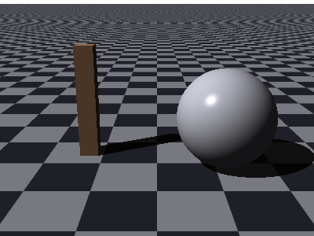
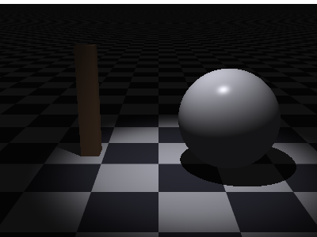
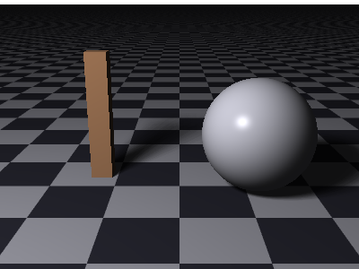
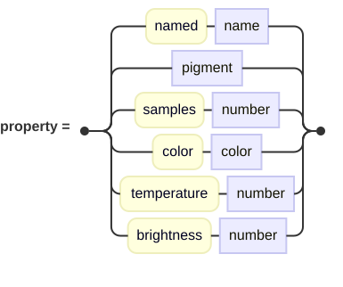
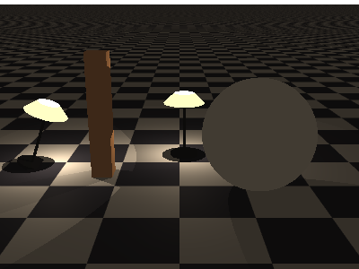

## Lights

A scene with no lights renders black, but for its background and whatever glows of its own — a
material's [`emission`](materials.md#emission), a medium that glows.  Even a surface with an ambient
term needs a light present before that term counts for anything, since each light lends it that share
of itself — so a light is one of the three things every scene needs.

There are five sorts:

- a [point light](#point-lights), a lamp at a place, shining every way;
- a [distant light](#distant-lights), a sun, coming from the same direction everywhere;
- a [spotlight](#spotlights), a lamp throwing a cone;
- an [area light](#area-lights), a lit rectangle, which casts soft shadows;
- a [sky light](#sky-lights), light arriving from every direction at once, as outdoors.

One more thing lights a scene without being written as a light: a glowing volume — a flame, the glow
of a lantern — that says it [gives light](surfaces.md#a-surface-that-gives-light).  They differ in
where a point being lit should look to find the light, how much of the light is aimed that way, and
from how many places it is looked at: a point light, a sun and a spotlight from one, an area light
from a grid across its face, a sky light from many directions and a glow from many places within it.
Everything else about shading is the same for all of them.

<picture>
  <source media="(prefers-color-scheme: dark)" srcset="images/lights/lightClause-dark.svg">
  <source media="(prefers-color-scheme: light)" srcset="images/lights/lightClause.svg">
  
</picture>

A bare `light` means the same thing as `point light`.  Both are accepted.  The shipped
examples all write `point light` so that they say which sort they mean.

Any number of lights, of any sort, may share a scene and their contributions add.

All light types carry a color.  If you don't specify one, `White` is the default.  A light may
instead be given the [temperature](#color-temperature) of something glowing, and either way a
`brightness` to multiply it by, which is 1 unless said.  A light that stands somewhere — a point,
spot or area light — may also [fade with distance](#fading-with-distance), and may
[stand on a thing](#lights-on-things) and go wherever it goes.

### Point Lights

A lamp at a place, shining equally in every direction.  This is the light to reach for unless
you have a reason not to.

<picture>
  <source media="(prefers-color-scheme: dark)" srcset="images/lights/pointLight-dark.svg">
  <source media="(prefers-color-scheme: light)" srcset="images/lights/pointLight.svg">
  
</picture>

```
point light {
    location [-4, 6, -5]
    color White
}
```


A point light with no `location` stands at the origin.

Note the shadows: point lights cast very sharp shadows.  If you want softer, more realistic
shadows, given that nothing in the world casts a shadow that hard, you'll want the
[area light](#area-lights).

The complete example is [`docs/examples/lights/point-light.igl`](examples/lights/point-light.igl).

### Distant Lights

When the source of light is far enough away, like the sun, the light rays become essentially
parallel, rather than splaying out from a point.  Such distant lights are aimed with a direction
instead of being placed at a location.

<picture>
  <source media="(prefers-color-scheme: dark)" srcset="images/lights/distantLight-dark.svg">
  <source media="(prefers-color-scheme: light)" srcset="images/lights/distantLight.svg">
  
</picture>

```
distant light {
    direction [1, -1.2, 0.5]
    color White
}
```



The direction notes the way the light *travels*, so a sun overhead is written `[0, -1, 0]`
(or `Down`) — pointing down, the way its rays go.  That is also the direction a distant light
given none shines in.

Two things follow from the rays being parallel.  Shadows are all cast in the same direction
and stay the same width however far they are thrown.  Also, a flat surface facing the light
is lit evenly across the whole of itself, since every part of it faces the light at the same
angle.

The complete example is [`docs/examples/lights/distant-light.igl`](examples/lights/distant-light.igl).

### Spotlights

A cone of light: bright within an inner angle, dark outside an outer one, and easing between
the two.  It lays a pool of light with a soft rim.

<picture>
  <source media="(prefers-color-scheme: dark)" srcset="images/lights/spotLight-dark.svg">
  <source media="(prefers-color-scheme: light)" srcset="images/lights/spotLight.svg">
  
</picture>

```
spot light {
    location [0, 7, -1]
    point at [0.6, 0, 0]
    radius 14
    falloff 26
    tightness 8
    color White
}
```



| Property | Default | What it means |
| --- | --- | --- |
| `location` | the origin | Where the lamp stands. |
| `point at` | the origin | What it is aimed at.  The cone's axis runs from the one to the other. |
| `radius` | 0 | The half-angle of the fully lit inner cone.  At 0 there is no evenly lit core: the light is brightest on the axis and eases off everywhere away from it. |
| `falloff` | 30° | The half-angle beyond which nothing is lit at all. |
| `tightness` | 0 | How hard the light gathers toward the axis.  At 0 it is spread evenly across the cone. |

`radius` and `falloff` are angles, so whether you write them in degrees or radians depends on
what the [context block](context.md#angles) says, as for every other angle a scene writes.  These
examples set `angles are degrees`, which is the default.  A falloff left unsaid is thirty degrees
whichever unit the scene writes in.  (Until October 2026 the two were read in degrees even in a scene
that said `angles are radians`.)

Between `radius` and `falloff` the light eases off along a cubic curve.  Setting `falloff`
equal to `radius` gives a hard-edged pool; leaving a wide gap between them gives a very
gradual one.

Note in the picture that the post and the far floor are almost black.  Outside the cone
nothing arrives, so what you see there is the ambient term alone.  A dim second light is the
usual remedy, and the gallery scenes do exactly that.

The complete example is [`docs/examples/lights/spot-light.igl`](examples/lights/spot-light.igl).

### Area Lights

A lit rectangle rather than a point or direction.  This is the light that casts a shadow
with a soft edge, and, like a sky light, it costs a shadow ray for each place it is looked at
from rather than a single one.

<picture>
  <source media="(prefers-color-scheme: dark)" srcset="images/lights/areaLight-dark.svg">
  <source media="(prefers-color-scheme: light)" srcset="images/lights/areaLight.svg">
  
</picture>

```
area light {
    location [-4, 6, -5]
    axisU [2.5, 0, 0]
    axisV [0, 0, 2.5]
    steps 8
    color White
}
```



Compare that with the point light at the top of this chapter, which stands in the same place:
the post's shadow no longer snaps from lit to dark but fades through a band of gray.  Along
the edge of a shadow, a spot on the floor can see part of the lit rectangle past the blocker
while the rest of it is hidden, and it is lit by just that fraction.  That band is the
penumbra.

| Property | Default | What it means |
| --- | --- | --- |
| `location` | the origin | The center of the lit rectangle. |
| `axisU`, `axisV` | `[1, 0, 0]`, `[0, 0, 1]` | The two edges, given as **full** edge vectors rather than half. |
| `steps` | 4 | The grid across the face, both ways at once. |
| `uSteps`, `vSteps` | 4 each | The grid each way separately, when it should not be square. |
| `seed` | 0 | The seed the scatter is drawn from. |
| `no jitter` | scattered | Sample the middle of each square instead of a place scattered within it. |

The light is looked at once per grid square and the results averaged, so `steps 8` costs 64
shadow rays for every point it lights, and the four steps given unless said cost 16.  That is the
price of a soft shadow, and the reason to ask for one only where you want it.  Too few steps show
as banding across the penumbra rather than smooth shading.

Each sample stands in its own square of the face, scattered about within it to break up that
banding, so every sample lies on the face the light was given and the light is the size it says
whatever its steps.  (POV-Ray spaces its samples from edge to edge and then scatters them, so its
lights reach past their sides — by a third at four steps; this renderer did the same until October
2026.)  The scatter is fixed rather than drawn afresh, so a render repeats exactly from one run to
the next.  `seed` changes the pattern; `no jitter` turns the scatter off altogether and samples the
middle of each square.  A single step along an edge puts every sample on the face's middle line that
way, so a light of `steps 1` is looked at from its center alone.

A useful thing to know: the nearer a blocker sits to the surface it shadows, the tighter its
penumbra.  A tall post's shadow is therefore crisp at the foot and blurred at the tip, which
is exactly how a real soft shadow reads — see `gallery/Local/lights/area-light.igl` for a scene built
around that.

The complete example is [`docs/examples/lights/area-light.igl`](examples/lights/area-light.igl).

### Color Temperature

Most real lamps are hot things glowing — a filament, a flame, the sun — and the color of that glow
is set by nothing but how hot it is.  A light may say that rather than a color:

```
point light {
    location [0, 3, 0]
    temperature 2700
}
```

The temperature is in kelvin.  Some to go by:

| Kelvin | What glows at about that temperature |
| --- | --- |
| 1900 | A candle flame. |
| 2700 | A household bulb, the warm white of a living room at night. |
| 3200 | A tungsten studio lamp. |
| 4000 | A cool white lamp. |
| 5500 | Noon sunlight — white, in this renderer. |
| 6500 | Overcast daylight, a little blue. |
| 10000 | Light from a clear blue sky. |

White is about 5500 K here, not the 6500 a computer screen calls white: this renderer counts light of
the same strength at every wavelength as white, which is how a film balanced for daylight sees, and
that is where such light falls.  Below it lights warm toward orange and red; above it they cool toward
blue.

A light given a temperature is scaled so that its **brightest channel is one**, the way a color written
out by hand would be, so it never washes a lit wall out to a different hue.  That makes a warm light
dimmer than a white one at the same strength, and **`brightness`** is how to make up the difference:

```
point light {
    location [0, 3, 0]
    temperature 2700
    brightness 1.6
}
```

`brightness` multiplies whatever light the light gives, a `color` as well as a `temperature`, so it is
also simply a way to turn a light up or down without rewriting its color.  If a light is given both a
color and a temperature, the temperature wins.

In a [spectral](context.md#spectral-light) render a light given a temperature lights the scene with
the glow itself, wavelength by wavelength, rather than with a spectrum guessed from its color.  A glow
is a smooth slope from red down to blue, and the guess for an orange is a smooth curve too, so the two
come out close — within a percent or so on most paints — but the glow is what the light really is.
The larger difference is the one any spectral render makes: a warm lamp on a blue paint keeps more of
the paint's blue than red, green and blue arithmetic allows.

### Fading With Distance

Light spreads.  A lamp throwing out a certain amount of it scatters that over a sphere which grows as
it goes, so what falls on a square inch at ten feet is a **quarter** of what falls on one at five.
That is why a candle lights the book held near it and leaves the far wall dark.

By default no light here does that: a light of `1` makes a white surface come back at `1` whether it
stands a foot away or a hundred.  That is perfectly good for a sun, and quite wrong for a candle.

```
point light {
    location [0, 1.74, 0]
    color [1.35, 0.86, 0.44]
    fade distance 0.7
}
```

`fade distance` names **where the light is worth what its color says**.  At that distance it delivers
its color exactly; twice as far it delivers a quarter as much, three times as far a ninth.  Nearer
than that it is simply left alone rather than allowed to grow without bound — the true law runs to
infinity at no distance at all, and a real flame is not a point in any case.

`fade power` changes how quickly it thins past that distance.  Two is the default and is what light
actually does; `1` dims more gently than the world does and `0` not at all, both being there for when
a scene wants a look rather than the truth.

**Only lights that stand somewhere may fade** — point, spot and area.  A distant light and a sky light
are infinitely far off, so nothing in a scene is meaningfully nearer to them than anything else and
there would be nothing for a distance to measure against.

Two things worth knowing when using it:

- **A medium fades with it.** Haze lit by a fading lamp glows near the lamp and goes dark away from
  it, which is what makes a visible glow around a flame rather than an even fog through the whole
  room.  Without fading, a medium is lit equally at every distance and simply tints everything.
- **Say nothing and nothing changes.** A scene that never writes `fade distance` renders exactly as it
  did before this existed, bit for bit.

### Sky Lights

Light arriving from every direction at once, which is what the outdoors is.

<picture>
  <source media="(prefers-color-scheme: dark)" srcset="images/lights/skyLight-dark.svg">
  <source media="(prefers-color-scheme: light)" srcset="images/lights/skyLight.svg">
  
</picture>

Every other light here is *somewhere* — a lamp at a point, the sun in one direction, a panel with a
face. A sky light is nowhere in particular and everywhere at once:

```
sky light { }
```

That is the whole of it in the ordinary case. With no pigment of its own it carries the scene's
[`background`](scene-files.md#background), so **the sky you look at is the sky that lights you** — which
is what an environment map means, and what the background already is, being painted on a sphere of
radius one infinitely far off.

| Property | Default | What it does |
| --- | --- | --- |
| `pigment` | the scene's `background` | The sky it carries, read by direction. |
| `color` | White | Multiplies the sky rather than replacing it, so it may be dimmed or tinted whole. |
| `samples` | 32 | How many directions the sky is looked at from. |

**A surface facing an open sky reads as bright as the sky, times its `diffuse`.** That is the rule to
hold on to when choosing a sky: a white sky over a white floor of diffuse 0.9 gives 0.9, and a sky of
`[0.3, 0.4, 0.6]` lights things about a third as strongly.

**It shadows itself, and that is the point.** A sky light is sampled over directions, and a direction
with something in the way delivers nothing — so a point that can only see a sliver of sky gets a sliver
of light. A niche is darker than an open field, and a sphere resting on a floor has a soft darkening
where the two meet, for the same reason real ones do. No other light in this renderer produces that,
because no other one comes from everywhere.

**A shiny surface shines with the sky it faces.** Each sample gives a smooth surface the highlight of
the piece of sky it looks at, in that piece's color and as bright as it is: a blue sky gives a blue sheen,
and a photographed sky's sun a sun-colored glint.

**It replaces `ambient`, and takes ambient's default with it.** The [ambient
term](materials.md#ambient-diffuse-and-specular) is a fudge: a flat amount added everywhere, shadow or
no shadow, standing in for the light bounced about the scene, which this renderer follows only when a
scene [asks it to](context.md#bounced-light). A sky light is the real
thing that fudge was imitating. So **a scene with a sky light gives every material an ambient of 0
rather than the usual 0.1**, unless the material names its own — which it still may, since a sky light
is not bounced light off the walls and there are scenes that want a little of both.

**It lights media too**, without being asked. A cloud or a haze gathers from every light in the scene,
so a sky light illuminates them — and for a cloud that matters more than anything else here, real ones
being lit mostly by sky. A place inside a medium faces no particular way, so it takes its sky samples
over the whole sphere rather than a half.

On cost: one shadow ray per sample per surface hit, like an area light. Unlike the light gathered by
[multiple scattering](scene-files.md#multiple-scattering), though, this is the *kind* case for sampling
— a sky is large and smooth, so there is no needle to find and tens of samples settle it rather than
thousands.

#### A Photograph of the Sky

**A picture of a real place can light a scene**, sun and all — which is the most direct road there is
to a scene lit the way the world is lit. Use a high-dynamic-range photograph of the whole sky, an
equirectangular `.hdr` or `.exr` such as the free ones at Poly Haven, as the background, and let the sky
light carry it:

```
background image 'https://dl.polyhaven.org/file/ph-assets/HDRIs/hdr/2k/kloofendal_48d_partly_cloudy_puresky_2k.hdr'
sky light { samples 64 }
```

Such a file holds the light itself, the sun included at its real strength — often tens of thousands of
times the sky around it — so nothing need be added to stand in for the sun, and its shadows fall where
the photograph's sun stands. Turn the picture to move the sun round the scene:
`background image '…' { rotate Y 120 }`.

**A sky that is a picture is not smooth**, and is looked at differently. Its sun is a disc a few texels
across that carries most of its light, and spreading samples evenly over the sky would almost never find
it. So half of a picture's samples are picked by where its light is and half evenly, and each is counted
by how likely either way was to pick it: the sun is found by the first half, the broad sky settled by the
second. What a modest count costs is grain, which halves each time the samples double: at 64 samples a
sunlit surface strays from point to point by about two percent, at 128 by about one. A cloudy sky wants
more than a clear one, its clouds being bright patches the samples must find as well as the sun.

A picture's sun also reaches a [rough](materials.md#roughness) surface two ways — through the sky light's
samples and through the surface's own blurred reflection — and is shared between them, as a
glowing volume is (see [Roughness](materials.md#roughness)), so the sun's smear on a rough surface comes out smooth
rather than as glitter.

One thing to know if a scene has both a sky light and an unbounded
[medium](scene-files.md#filling-that-space): the sky is infinitely far off, so an endless absorbing
medium extinguishes it completely, exactly as it does a `distant light`. That is the right answer to the
question as asked — an infinitely deep fog really does hide the sky — and the remedy is the same, which
is to give the fog a surface to fill.

#### Through a Window

**Indoors, a sky light finds next to nothing.**  It looks at the sky in its few dozen directions from every
place it lights, and from the middle of a floor a window is a fiftieth of the sky the floor could see: of
twenty-four directions, half of one goes through the window and the rest end on plaster.  Worse, a smooth
sky is looked at in the same directions from every place, so each direction that does go through throws
the window's shape across the room, and the room is lit by a scatter of hard-edged windows.  More samples
soften them, slowly: in a test room with one window, a thousand still left faint streaks, at fifteen times
the time two dozen took.

**Mark the openings as portals, and it looks in through them.**  Any surface may say
[`portal`](surfaces.md#portal), and the cube a window is cut out of a wall with is the natural one to mark:

```
difference {
    cube { scale [3, 1.5, 3] }
    cube { scale [2.8, 1.3, 2.8] }
    cube { scale [0.2, 0.6, 0.5]  translate [-2.9, 0.2, 0]  portal }
}

sky light { }
```

Then, from any place that sees the sky through an opening, three in four of the sky's directions go through
one -- picked by the light of the sky beyond each, so a photograph's sun is found through a window as it is
found in the open -- and the rest are spread as they would be anywhere.  In that test room, twenty-four
samples then strayed from the right answer a tenth as far as twenty-four did without, and twice as far as a
thousand did, in a twelfth of the thousand's time (a third more than twenty-four without).  Each direction is
counted by how likely either way was to pick it, so **nothing hangs on the portals being all the sky there
is**: a door left unmarked, a place outside the room on the wrong side of a wall, is still lit rightly, only
less smoothly.  Places that see the sky through no opening are looked at exactly as they always were.

Nothing need be said about which way an opening faces; which side of it the sky is on is found by looking.
The sun of a [physical sky](pigments-and-patterns.md#a-physical-sky) is a light of its own and finds the
windows by itself — the portals are for the rest of the sky, the fill that comes in at every window.  And a
sky looked at through portals is shared with a [rough](materials.md#roughness) surface's reflection, as a
photograph's is, so a window's smear on a satin floor is smooth.  The gallery's
[A Room by Daylight](../gallery/Local/interiors/a-room-by-daylight.igl) is a room lit this way, by an
afternoon sky and its sun through three windows, with [bounced light](context.md#bounced-light) carrying
the sun's patches round the room.

### Lights on Things

A lamp is a thing, and its light belongs to it: set the lamp on a table and the light goes with it,
knock it askew and the light leans.  So a light may be written inside a `group`, in the group's own
space, and it stands, turns and grows with the group — wherever the group is put, by a transform, by
[`atop`](transforms.md#placing-one-thing-against-another) and its kind, by a [field](advanced-surfaces.md#field), or
inside whatever holds the group in turn.

```
primitive Lamp() -> group {
    return group {
        cylinder { min Y 0  max Y 1.22  scale [0.03, 1, 0.03] }
        sphere { scale 0.08  translate Y 1.3  material { pigment White  ambient 1  diffuse 0 } }
        conic { min Y 1  max Y 2  open  scale 0.22  rotate X 180  translate Y 1.62 }
        point light { location [0, 1.3, 0]  fade distance 1.2 }
    }
}

object Lamp() { translate [0.1, 0, 1.7] }
object Lamp() { rotate Z -20  translate [-3.1, 0, 1.1] }
```



The complete example is [`docs/examples/lights/lamps.igl`](examples/lights/lamps.igl).

- **Point lights, spotlights and area lights** may stand on things: a lamp's location, a spotlight's
  `point at` and an area light's sides all go through the group's transform, so a spotlight in a lamp's
  head aims wherever the head is turned.  A `fade distance` written in the group grows and shrinks with
  it, as everything else written there does.  A distant light or a sky light is infinitely far off, so
  there is nothing for standing on something to mean, and either is refused.
- **Every lamp gets its own light.**  A primitive called twice, or a field of a hundred street lamps,
  shares one built lamp among its places, and its light becomes a light at each of them.
- **What closes round a light does not shadow it.**  The glowing ball drawn for a bulb would otherwise
  put the whole room in its shadow; light leaves a real bulb through its glass.  Only the closed surfaces
  of the light's own group that surround it are left out — a shade open at its ends still shadows the
  light, which is what throws a lamp's light down in a pool and up in a fan, and a closed box around the
  lamp that is not part of it still shuts its light in.
- **A light on something moving goes with it.**  Set a group moving while the
  [shutter](cameras.md#motion-blur) is open and its light moves through the exposure with it, so the
  light it casts and the shadows it throws blur as the lamp does.
- **A light may stand in a loop or a choice** inside a group, so a row of lights is one line; a loop at
  a scene's top level may set out lights as well as surfaces.

A light on a thing is an ordinary light once the scene is built, and costs what any light of its sort
costs: each lit point looks toward every light, so a street of a hundred lit lamps is a hundred lights.
That is still far cheaper than a lamp lit by a glowing [medium](surfaces.md#a-surface-that-gives-light), which
looks toward every part of the glow.

The [Reading Corner](../gallery/Local/lights/a-reading-corner.igl) is a room lit by two lamps carrying
their own lights.  [A Bar After Hours](../gallery/Local/lights/a-bar-after-hours.igl) has no lamp at all:
in a scene that follows [bounced light](context.md#bounced-light), whatever glows of its own lights the room,
and there its neon signs and a strip of LEDs are the only light there is.
