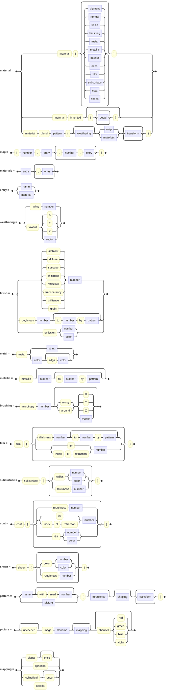
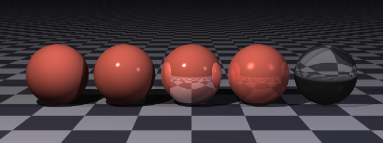
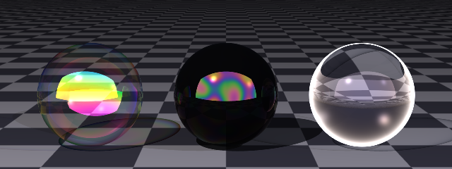
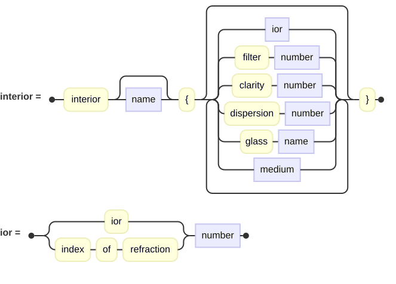
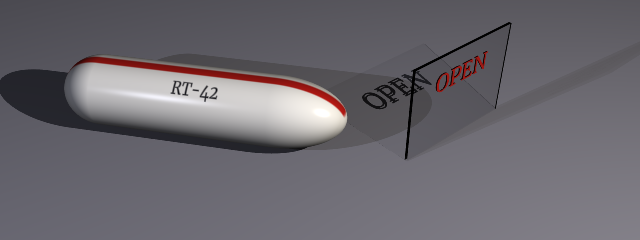
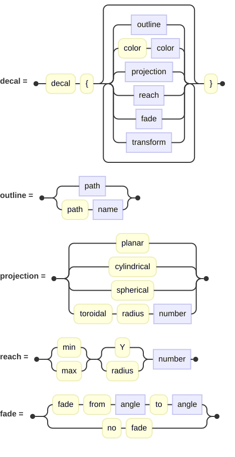
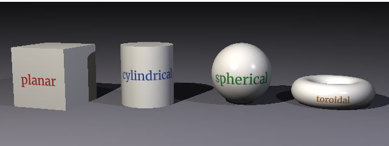

## Materials

A material says how a surface takes the light: what color it is, how glossy, whether it
mirrors its surroundings, and whether light passes through it at all.

<picture>
  <source media="(prefers-color-scheme: dark)" srcset="images/materials/materialClause-dark.svg">
  <source media="(prefers-color-scheme: light)" srcset="images/materials/materialClause.svg">
  
</picture>



Five spheres of the same color, differing only in their material: matte, glossy, reflective,
metallic and glass.  The scene is
[`docs/examples/materials/finishes.igl`](examples/materials/finishes.igl).

Every surface has a material whether you give it one or not.  The default is a white, fairly
glossy plastic — which is what an unadorned `sphere { }` looks like.

### The Color

Where a surface gets its color is the [pigment](pigments-and-patterns.md), and it has a
chapter of its own.  For now, the two forms you will use most:

```
pigment color Red                   // one color all over
pigment checker { White, Gray30 }   // a pattern
```

### The Finish

The rest of the material describes how light behaves when it arrives.

| Term | Default | What it does |
| --- | --- | --- |
| `ambient` | 0.1 | How lit the surface is regardless of any light reaching it. |
| `emission` | none | Light the surface gives off of its own, tinted by its color; see [Emission](#emission). |
| `diffuse` | 0.9 | How much it takes from light striking it square-on. |
| `specular` | 0.9 | The strength of the highlight. |
| `shininess` | 200 | How tight that highlight is. |
| `reflective` | 0 | How much of its surroundings it mirrors. |
| `fresnel` | off | Mirrors more at a slant, as every real surface does. |
| `roughness` | 0 | Blurs what it mirrors and spreads its highlight, from 0 (a mirror) to 1 (matte). |
| `anisotropy` | 0 | Brushes a rough surface, its highlight streaking across the grooves; `along` a direction or `around` an axis.  See [Brushed metal](#brushed-metal). |
| `transparency` | 0 | How much light passes through it. |
| `metallic` | 0 | Whether the highlight takes the surface's color. |
| `film` | none | A film thinner than light's wavelength — a soap bubble, oil on water — that colors what is mirrored; see [Thin films](#thin-films). |
| `subsurface` | none | Light that goes in, wanders under the surface and comes out elsewhere — wax, marble, skin, a leaf; see [Light under the surface](#light-under-the-surface). |
| `coat` | none | A clear coat over the surface — lacquer, varnish, a glaze — that mirrors by its own index; see [A clear coat](#a-clear-coat). |
| `sheen` | none | The soft shine of cloth toward a graze — velvet, satin, felt; see [Cloth](#cloth). |
| `melanin` | none | For hair only: colors it as natural hair is colored; see [How hair is lit](advanced-surfaces.md#how-hair-is-lit). |
| `brilliance` | 1 | How sharply the diffuse term falls off toward the edges. |
| `grain` | 0 | Roughens the diffuse falloff. |

#### Ambient, diffuse and specular

These three are the heart of how light is determined, and they add up to what you see.

**`ambient`** stands in for light that has bounced around the scene rather than arriving
straight from a lamp.  Unless a scene asks for [bounced light](context.md#bounced-light), this
renderer does not trace those bounces, so the ambient term is the fudge that keeps shadows from
being perfectly black.  It is the one term a shadow does not take
away — which is also why a surface in deep shadow still shows a little of its color.

Raise it and the surface looks flat and self-lit; drop it to zero and anything unlit goes
completely black.

A scene may turn every material's ambient up or down at once with
`context { scale ambient by ... }`, which is how a scene lit by lamps of its own gets out from
under a fudge sized for daylight — including the ambient named by materials it imported from a
library.  See [The Context Block](context.md#ambient).

#### Emission

**`emission`** is light a surface gives off of its own -- a bulb's glass, a lit window, a lampshade
with a lamp inside, a painted sun -- and the surface's color tints it:

```
material { pigment [1, 0.94, 0.82]  emission 3  diffuse 0 }        // a bulb
material { pigment White  emission kelvin(2700) * 0.5 }               // glowing the color of lamplight
```

A number is a white glow of that strength; a color, such as `kelvin(T)` times a strength, a glow of its own
color.  It is not ambient, though for a long time ambient was what made things glow.  Ambient is lent by
the lamps -- each shows the surface by that share of its light, whether that light reaches it or not --
and stands in for bounced light, so a scene that asks for bounced light drops it altogether, even where a
material names its own.  Emission is the surface's own, the same with any lamps or none, and in a scene
that follows bounced light it lights what is near it: a glowing lampshade lights the wall beside it.  A
surface that stands for a light already in the scene -- the bulb round a lamp, a painted sun's disc set
out with `no shadow` -- is passed by bounced light, as by a shadow, so its glow is not counted twice.

**`diffuse`** is the ordinary business of a surface catching light: brightest where it faces
the light square-on, falling away as it turns aside.  This is what gives a sphere its
roundness.

**`specular` and `shininess`** are the highlight — the bright spot where the surface reflects
the light source directly.  `specular` is how bright, `shininess` is how tight:

```
specular 0        // no highlight: chalk, unglazed clay, paper
specular 0.9      // a highlight
shininess 20      // broad and soft
shininess 300     // small and hard, like polished glass
```

A common mistake is to reach for `reflective` when you wanted a highlight.  A highlight costs
nothing and shows the *light*; a reflection is a whole extra ray and shows the *scene*.

#### Reflective

How much of the surroundings the surface mirrors, from 0 to 1.

```
material {
    pigment color [0.75, 0.35, 0.3]
    reflective 0.5
}
```

Reflections are traced, so they cost time, and they are limited in depth — a ray bounces only
so many times before the renderer gives up, which is what keeps two facing mirrors from
running forever.

#### Fresnel

Left alone, a surface mirrors the same share of its surroundings from every angle.  No real
one does.  Varnish, paint, plastic and still water give back a few percent of the light meeting
them square-on and nearly all of it at a graze.  That is why a polished floor is dark at your feet
and a mirror toward the far wall, and why a wet road shines toward the horizon.  `fresnel` turns
that on:

```
material {
    pigment color [0.30, 0.16, 0.08]
    reflective 0.04
    fresnel
}
```

With it, `reflective` is how much is mirrored square-on, and the share climbs from there toward
all of it as the surface is seen more and more edge-on.  Most of the climb comes late: the share
has barely moved at sixty degrees from square-on and is past a half by eighty-five.  It follows
Schlick's approximation to Fresnel's equations, which transparent surfaces already follow.

`gallery/Local/materials/fresnel.igl` lays the same polished floor down twice, with it and without.

What a surface mirrors never reaches its pigment, so the color it shows of its own is turned down
by as much.  Square-on that is only the few percent it mirrors; at a graze it is nearly all of
it, and the surface stops being a colored thing with a reflection on it and becomes a mirror.
The highlight is left as it is.

The square-on share is small for anything that is not a metal, and much the same from one
material to the next:

| Surface | `reflective` |
| --- | --- |
| Water | 0.02 |
| Glass, plastic, paint, varnish, lacquer | 0.04 |
| Diamond | 0.17 |
| Iron, chrome | 0.55 |
| Gold, copper | 0.6 to 0.95, best colored with `metallic` |
| Aluminum, silver | 0.9 to 0.95 |

A `reflective` value chosen for a surface without `fresnel` is usually far too high with it.
Such values were set to give a surface some gloss head-on, and with `fresnel` the edges supply
that gloss themselves.  A transparent surface already shares its light between what it mirrors
and what it lets through by its index of refraction, so `fresnel` changes nothing there.  Nor
does it change a surface that mirrors nothing.

#### Roughness

A real surface is never quite a mirror.  Polished wood, satin paint, brushed metal and wet
asphalt all mirror their surroundings, but blurred, and the blur is what tells the eye what the
surface is made of.  `roughness` says how much:

```
material {
    pigment color [0.30, 0.16, 0.08]
    roughness 0.2
}
```

It runs from 0, a perfect mirror, to 1, which is matte.  It is the same scale every physically
based renderer and material library uses, so a value read off a chart means here what it means
there:

| Surface | `roughness` |
| --- | --- |
| Glass, chrome, still water | 0 to 0.05 |
| Car paint, lacquer, polished stone | 0.05 to 0.15 |
| Polished wood, wet asphalt, glossy plastic | 0.15 to 0.3 |
| Satin paint, brushed metal | 0.3 to 0.5 |
| Eggshell, unfinished wood | 0.5 to 0.7 |
| Chalk, dry asphalt, paper | 0.7 to 1 |

**A rough surface is one finish rather than two.**  A highlight is only the reflection of a lamp,
and a rough surface blurs the lamp exactly as it blurs everything else it mirrors.  So its
highlight is worked out from its roughness too, and `specular` and `shininess` have no say in it.
How much it mirrors is `reflective`, square-on, and it always follows [Fresnel](#fresnel), rising
toward a graze, whether it says `fresnel` or not.  A rough surface that names no `reflective` is
given 0.04, what nearly everything that is not a metal gives back square-on, so that `roughness`
alone makes a satin finish.  Metals want their own, much higher, from the table above, and
`metallic` to color it.  Rough glass works out what it mirrors from its own index of refraction, so
one that names no `reflective` is given all of that.

**Lamps a ray can meet are shared fairly.**  A lamp at a point, a panel or the sun gives a rough
surface a highlight, since no ray could ever find it.  The sky and a glowing lantern or flame are
things a ray *can* meet, and they show in the blur as well; counted both ways, their light would be
counted twice.  The sky is left to the blur, which finds something so large and smooth easily -- unless
it is a [photograph](lights.md#a-photograph-of-the-sky), whose sun is as small and bright as any lantern,
and which is shared the way a lantern is, direction by direction.  A glowing volume is shared between the two, place by place, by how likely each was to find it: a
satin surface takes the lantern mostly from its own samples, smoothly, and a near-mirror mostly from
what it mirrors, sharply.  Left to the blur alone, a small bright lantern on a wet road comes out as
glitter; shared, it is a smooth streak, at no extra cost.  A glowing volume inside a shell that bends
light — glass with an index of its own — cannot be shared this way and is left to the blur.

**An area light shows as one patch.**  An area light is lit from a few places across its face, and
in a surface of little roughness the highlight of each place would be a dot, the window in a satin
floor a grid of them.  So each place's highlight is spread over its own share of the face, and the
window is one soft patch, giving the same light in all.  It is softer than a true mirror image, and
dimmer in the middle; for a crisp window in a near-mirror, put something there for it to mirror, a
panel glowing by its `emission`.  A lamp that is a point is a point, and is left alone.

**Rough reflections cost more than sharp ones**, because a blur is found by looking in many
directions and averaging: sixteen, unless the scene asks for a different number with
[`reflection samples`](context.md#rough-reflections).  Only the first rough surface along a ray
spreads it, so the cost does not multiply between two rough surfaces facing each other.

**What a rough surface shows of a mirror is shaded as rough as the surface.**  A car's gloss paint
mirrors a lantern sharply; seen in a wet road, that lantern can only be found by chance by the road's
blurred reflection, and the road under the car comes out sprinkled with glitter.  So a smooth surface
met in a rough one's reflection — paint, polished stone, chrome, clear glass — is shaded there as if
it were as rough as the surface showing it, and the lantern in it is shared fairly, as above.  It
blurs the mirror only where the rough surface already blurs it, by about as much again, which is hard
to see; looked at directly, a mirror is a mirror.  A transparent shell with the surroundings' own
index, such as a lantern's, bends nothing and is left alone.

`gallery/Local/materials/roughness.igl` shows five roughnesses side by side, in gold and in plastic.

#### Brushed metal

Brushing a metal, or turning it on a lathe, leaves grooves.  Along a groove the surface is nearly
flat, and across it the surface rises and falls, so it mirrors a lamp as a streak square to the
brushing rather than as a round spot: a long highlight down a brushed steel panel, and a bright
line running out from the middle of a turned pan bottom or a record.  `anisotropy` says how much,
and which way the grooves run:

```
material {
    pigment color [0.62, 0.63, 0.66]
    metallic reflective 0.85  roughness 0.35
    anisotropy 0.8 along X
}
```

It runs from 0, alike every way, to 1, where the surface is about a third as rough along the
grooves as across them.  The `roughness` stays the average, so a value from the chart above still
means what it says.  The grooves run `along` a direction, `X`, `Y`, `Z` or any vector, or `around`
an axis, as circles:

```
material {
    pigment color [0.62, 0.63, 0.66]
    metallic reflective 0.85  roughness 0.35
    anisotropy 0.9 around Y
}
```

Both are in the surface's own space, as a pattern is, so the grooves turn and stretch with the
surface, and `around` circles the middle of that space; a direction that leaves the surface is laid
flat on it.  Left unsaid, the grooves run along X.  Only a rough, opaque surface is brushed: glass
frosts alike every way.

`gallery/Local/materials/brushed-steel.igl` sets a turned pan lid, a brushed box and a turned canister
under small lamps.

#### Frosted Glass

Roughness on something that lets light through blurs what is seen *through* it as well as what it
mirrors, and that is frosted glass:

```
material {
    pigment White
    transparency 1
    roughness 0.3
    interior { ior 1.5 }
}
```

Each of its facets bends the light by Snell's law, so what lies behind is spread into a blur, more
of one the rougher the glass and the further off the thing behind it is.  How much each facet
mirrors and how much it lets through is settled facet by facet, by the glass's own index, so a
frosted bottle's rim turns bright and mirror-like where it is seen edge-on.  Its glints stay as
bright as any rough surface's; letting the rest of the light through takes nothing from them.

**A lamp behind frosted glass glows through it**, softly, where it stands — the frosted globe round
a bulb, the frosted window at night.  Behind clear glass a lamp at a point shows nothing, since no
ray could ever find it; frosted glass spreads its light toward the eye.  The glow is worked out at
the last of the glass between the lamp and the eye — the far face of a pane — so a pane's two faces
are each counted once.  The near face aims at the lamp through the glass as well as spreading its
rays, so the glow comes out smooth rather than glittering at its edges.  A lamp found any other way
— after its light has turned back inside the glass, or through a second pane — is left to the rays
alone, and can glitter a little.  A glowing volume behind frosted glass is shared between its own
glow and what the glass's rays find, as one in front of a rough surface is; behind a pane whose
faces are both rough, a small bright one can still come out a little grainy, the blur of the near
face being found by the glass's sixteen directions.

Glass that spreads colors bends each band through a facet of its own, so a frosted prism blurs its
rainbow without costing more than a clear one.  Shadows cast by frosted glass are as they were —
colored by the glass's `filter`, not blurred.

**Frosting needs an index.**  It is the bending at each facet that blurs, so a rough surface between
two substances of the same index — a thin open sheet, say, which has no inside to bend into — lets
light straight through.  Give the glass a body and an `ior`.

`gallery/Local/materials/frosted-glass.igl` shows four panes from clear to deeply frosted.

#### Metallic

Ordinarily a highlight is the color of the *light*: a white lamp on a red ball gives a white
highlight.  Metals do not behave that way — their highlights take the color of the metal.
`metallic` switches that on:

```
material {
    pigment color [0.75, 0.35, 0.3]
    specular 0.9
    shininess 60
    metallic 1
    reflective 0.4
}
```

Written bare, `metallic` means fully metallic; give it a number between 0 and 1 to blend.
Gold, copper and brass all want this, and all want a reflection too — a metal that mirrors
nothing looks like painted plastic.

#### A clear coat

A car's paint, a varnished table, a glazed pot: each is a color under a layer of clear lacquer,
and the lacquer has a surface of its own.  It mirrors as glass does, four percent square-on and
nearly all of it at a graze, and everything beneath it is seen through it.  `coat` puts one over a
material:

```
material {
    pigment color [0.55, 0.04, 0.05]
    coat { }
}
```

The rest of the material is what lies beneath the coat: here, a red paint.  The coat mirrors the
room by its own index of refraction and shows a lamp as a small, sharp glint.  The paint shows
through it, charged for crossing the coat on the way in and again on the way out, so it is a little
darker square-on and gives way to the mirror at a graze.  A coat takes the place of the surface's
own highlight: `specular` and `shininess` are not used beneath one, since a lamp's mirror image is
the coat's.

Anything else the material says it mirrors, it mirrors beneath the coat.  Metallic paint is metal
flakes under lacquer, a rough, metallic mirror beneath a smooth coat:

```
material {
    pigment color [0.20, 0.32, 0.55]
    metallic reflective 0.6  roughness 0.35
    coat { }
}
```

A coat may say three things, and all of them may be left out:

| Entry | Default | What it does |
| --- | --- | --- |
| `roughness` | 0 | How rough the coat's own surface is: 0 is a mirror, an eggshell varnish perhaps 0.2. |
| `ior` | 1.5 | Its index of refraction (or `index of refraction`); lacquer and varnish are about glass's. |
| `tint` | clear | The color it gives what lies beneath it seen square-on, as amber varnish or candy paint does.  At a slant it is deeper, the light crossing more of the coat. |

A smooth coat mirrors in one direction, as a mirror does.  But a lamp no ray can meet, a point, spot
or area light, would show in a truly flat coat not at all, so its highlights come from facets a
twentieth rough: a small, bright glint.  An area light shows in lacquer as one soft patch, as it
does in any surface of little roughness (see [Roughness](#roughness)); for a crisp window, put
something there for the coat to mirror, a panel glowing by its `emission`.  A rough coat costs what any rough surface does,
looking in `reflection samples` directions.

`gallery/Local/materials/lacquer-and-varnish.igl` sets a lacquered teapot, a ball in metallic paint
and a jar in eggshell glaze on a varnished table.

A coat goes over something opaque.  On glass, which it would only make more glass of, it is left
out, and a material may have a film or a coat but not both.  What it leaves out is the light turned
back and forth between the coat's underside and the paint, which deepens a real lacquered color a
little.

#### Cloth

Velvet, satin, felt and the nap of a rug shine in a way nothing hard does.  The fibers stand out of
the weave, so a cloth catches the light where it is seen and lit edge-on: velvet glows round its
folds and darkens where it faces you, and satin shows a pale shine along every edge that turns away.
`sheen` gives a surface that shine:

```
material {
    pigment color [0.35, 0.03, 0.06]
    specular 0
    sheen { color [0.9, 0.55, 0.6]  roughness 0.4 }
}
```

The `color` is what the fibers give back, which need not be the cloth's: satin's sheen is pale over
a deep color, and velvet's is often its own color brightened.  The `roughness` runs from just above
0, a narrow shine right at the edge, to 1, a felt's broad glow; left out it is 0.5.  Both may be
left out, and `sheen { }` is a white sheen.  The rest of the material is the cloth beneath, and it
shows less by as much as the sheen gives back, so a cloth with a bright sheen is darker where it
faces the light.  A cloth usually wants `specular 0`: its shine is the sheen's.

The shine is strongest with the light behind the eye and both low to the cloth, as at the rim of a
velvet cushion.  It comes from the lamps, and from a sky light, but not from light bounced onto the
cloth or gathered by caustics, which reach only the weave.  A sheen goes on something opaque, and a
material with one may have no film or coat.

`gallery/Local/materials/velvet-and-satin.igl` shows a velvet cushion, a fold of satin and a felt ball.

#### Thin films

A soap bubble, oil on a puddle, the coating on a camera lens: each is a film thinner than the
waves of light themselves, and each mirrors colors that are in none of what it is made of.  Light
is mirrored twice, once off the film's outer face and once off its inner one, and the two
reflections leave together.  Where one has fallen behind the other by a whole number of waves they
add, and where by half a wave they cancel.  How far behind it falls depends on how thick the film is
and how slantwise the light crosses it, measured against each color's own wavelength, so a film
mirrors some colors and turns others away, and the colors run round as the angle changes.

```
material {
    pigment White  ambient 0  diffuse 0
    transparency 1
    film { thickness 450 }
}
```



A soap bubble, oil on a black ball, and a glass ball with a lens's coating, each mirroring a broad
bright panel behind the camera.  The scene is
[`docs/examples/materials/thin-films.igl`](examples/materials/thin-films.igl).

`thickness` is in nanometers.  Visible light runs from about 380 nm, violet, to 780 nm, red, and a
film shows colors from about 100 nm to 1000 nm thick, brightest and plainest in the first few
hundred.  Thinner, it mirrors less and less of anything: a soap film just before it bursts is so
thin that it shows black.  Thicker, its colors come closer and closer together along the spectrum
until they run into white, which is why a thick pane of glass shows no colors at all.

`ior` is the film's own index of refraction, and is soapy water's, 1.33, unless said.  What lies
beneath the film is whatever the material is made of, by the index of refraction of its
[interior](#transparency-and-interiors).  A bubble is clear and holds nothing but air, which is an
interior's default, so it bends nothing that passes through it.

The film works out what it mirrors for itself, from those indices and the angle, so a material with
a film does not use `reflective` or `fresnel`.  It mirrors a few percent square-on, more at a slant,
and nearly everything at a graze, as Fresnel's equations say any face does — with the colors on
top.  What it does not mirror goes on: into the surface's own color, if it is opaque, or through
it, if it is clear.  So what comes through a film is the complement of what it mirrors, and a
bubble's shadow is faintly tinted the opposite way to its reflection.  The highlight takes the
film's color too, and is kept whole on a surface that is clear, as it is on
[frosted glass](#frosted-glass): it is light the film mirrors, which letting light through takes
none of.  How bright it is is still `specular`'s to say.

A real film is seldom the same thickness everywhere.  A bubble drains, thin at the top and thicker
below, and swirls as it does; oil spreads thin toward its edges.  So a thickness may run from one to
another by a pattern, as a field's sizes may:

```
film { thickness 800 to 150 by linear Y bouncing gradient { turbulence 0.6  scale 2.2  translate Y -1.1 } }
```

The pattern's value of nought gives the first thickness and one the second, so this bubble is 800 nm
thick at its foot and 150 at its crown.  The gradient bounces rather than starting over at each end,
since turbulence carries a pattern past its ends, and one that started over would tear the film
into seams where its thickness jumped.  The pattern is read in the surface's own space, as a pigment
is, so a pattern written for a unit sphere fits a unit bubble however large the bubble is scaled.

| Film | `ior` | `thickness` |
| --- | --- | --- |
| Soap | 1.33 | 100 to 1000 |
| Oil on water | 1.47 | 100 to 600 |
| A lens's coating, magnesium fluoride | 1.38 | about 100, a quarter of a green wave |
| Titanium dioxide, as on pearlescent paint and mica | 2.4 | 50 to 400 |

A film is worked out over the spectrum, band by band, in both kinds of render.  A
[spectral](context.md#spectral-light) one carries the bands on and so gets each color of what
the film mirrors exactly; one in red, green and blue turns the film's colors into those three at
once.  Under white light the two agree.  A film is smooth by nature, its colors coming of that, so a
material with one may not also be rough.

A light that a ray can meet — the sky, a glowing volume — gives a film no highlight, since a film
always mirrors and the light already shows in what it mirrors.  A lamp, a sun or an area light, which
no ray meets, gives one as usual.

`gallery/Local/materials/soap-bubbles.igl` blows bubbles in a garden, and is as much about how to
light a film as about the film: a film mirrors only a few percent, so it needs something bright to
mirror and something dark to be seen against.

#### Light under the surface

Wax, marble, jade, milk and skin are not lit where the light lands.  Light goes into them, is
turned over and over by what they are made of, and comes out again somewhere else -- so a candle
glows round its rim, a lit ear goes red, and the shadowed side of a marble bust is never quite
dark.  A surface says it is made of such stuff with `subsurface`, and how far the light travels
inside it before it is turned:

```
material {
    pigment [0.92, 0.82, 0.62]
    specular 0.3  shininess 40
    subsurface { radius [0.5, 0.25, 0.12] }
}
```

**The pigment is still the color it shows**, times its `diffuse`, as for any other surface: lit
evenly, a deep piece of it looks that color whatever the radius.  The renderer works out what
the stuff must be made of to show it.  **The radius is how soft it is**, in the scene's own
units: the distance light goes on average between turns.  Small next to the thing, and the
surface looks nearly matte, with its edges and dents only a little softened; as large as the
thing itself, and it is a jelly that glows right through.  It may be one distance, or one for
each of red, green and blue -- skin carries red furthest, which is why it glows red where it is
thin.  The rest of the material is the surface's coat: its highlight, its `reflective` and
`fresnel` and `roughness`, are as they always are, and the light under it is what the coat
does not mirror.

What the renderer does is follow the light's path backwards: from where the eye meets the
surface, a walk goes in, travels a distance, is turned every way alike, and goes on so until it
comes out again, and the surface is lit there as a matte one would be.  Many walks are taken at
each place and averaged:

```
context { subsurface samples 128 }
```

The usual number is 64.  Too few shows as grain, colored where each color travels its own
distance; more is smoother and costs more on every pixel of the surface.  Anti-aliasing adds to
it, as it does to [rough reflections](context.md#rough-reflections).

**A sheet has no inside**, so a leaf, a sheet of paper or a lampshade is walked through as a
slab as thick as it says it is:

```
material {
    pigment [0.30, 0.55, 0.12]
    subsurface { radius 0.0004  thickness 0.0003 }
}
```

Lit from in front, a sheet shows what wanders back out of it; with the sun behind it, what
wanders through -- which is how a leaf glows against the light.  A thickness left out is taken
to be the radius.  What a sheet lets through falls away as it grows thicker than its radius,
and faster the darker it is: at three times the radius a pale sheet still lets through more than
a quarter of the light behind it and a dark one a twelfth, and at ten times a pale one a
fifteenth and a dark one none.  A closed shape has no need of a thickness: its walks find their
own way out, through its far side where it is thin.

`gallery/Local/materials/wax-marble-and-jade.igl` shows a candle lit by its own flame beside marble and
jade, and `gallery/Local/materials/leaves-against-the-sun.igl` a twig of leaves with the sun behind them.

Two things are approximate.  Light bounced onto the surface from elsewhere, when a scene asks
for [bounced light](context.md#bounced-light), and light gathered onto it by
[caustics](context.md#caustics), are taken where they land, as a matte surface takes them,
rather than walked.  And the stuff turns light every way alike, where skin, say, sends most of
it on ahead.  A surface that lets light through, or one seen from inside, is lit as before.

#### Brilliance and grain

Two adjustments to how the diffuse term falls off.  `brilliance` above 1 makes a surface hold
its brightness further round toward its edge before falling away, which is how a polished
metal reads; `grain` roughens that falloff, for a surface that is not perfectly smooth.  Both
are worth leaving alone until a surface does not look quite right in a way you can name.

### Transparency and Interiors

Making a surface see-through takes two things: how much light gets past it, and what it is
made of.

```
material {
    pigment color White
    specular 0.9
    shininess 300
    transparency 0.95
    reflective 0.1
    interior { ior 1.5 }
}
```

`transparency` is the *how-much*, from 0 to 1.  The `interior` block is the *what-it's-made-of*:

<picture>
  <source media="(prefers-color-scheme: dark)" srcset="images/materials/interiorClause-dark.svg">
  <source media="(prefers-color-scheme: light)" srcset="images/materials/interiorClause.svg">
  
</picture>

| Property | Default | What it does |
| --- | --- | --- |
| `ior` | 1 (vacuum) | The index of refraction: how sharply light bends entering it. |
| `filter` | 0 | How much the substance colors what passes through. |
| `clarity` | infinite | How far light travels through it before fading. |
| `dispersion` | none | How much it spreads colors, as an Abbe number; see [Dispersion](#dispersion). |
| `glass` | none | A real optical glass by name, bringing its own index at every wavelength. |

`ior` may also be written out as `index of refraction`, which reads better in a scene meant to
be shown to someone else.

Glass is about 1.5, water about 1.33, diamond about 2.4.  But you need not remember any of
them, because they already have names:

```
interior { ior Glass }
interior { ior Water }
interior { ior Diamond }
```

Those names live alongside the color names, and a few are both.  `Turquoise` is a color *and*
an index of refraction, and which one is meant is settled by where you write it — see
[Variables](scene-files.md#a-name-holds-one-value-per-type).

An index on its own does not bend anything, though: what bends a ray is the *ratio* between the
two sides of the surface it crosses.  The other side is the space the scene sits in, which is a
vacuum unless the scene says otherwise with
[`environment ior`](scene-files.md#the-space-between-things).  So a glass marble in water bends
light far less than the same marble in air, the glass being unchanged.

**`clarity`** is how far light gets through the substance before it is absorbed.  Left alone
it is infinite, so a thick piece of glass is as clear as a thin one — which is not how glass
behaves.  Set it and thickness starts to matter, which is what makes a solid glass object look
solid rather than like a soap bubble.

**`filter`** colors what passes through, so a green bottle casts a green light on the table
beneath it.  Note that transparency and filter are different questions: transparency is *how
much* gets through, filter is *what color* it comes out.

#### Dispersion

Real glass bends blue light a little more than red.  It is why a prism splits white light into a
rainbow and why a cut diamond throws flashes of color.  A substance can be told to do it in either
of two ways:

```
interior { ior Diamond  dispersion 55 }
interior { glass 'SF11' }
```

**`dispersion`** is the Abbe number glass catalogs give, and it reads backwards from what you might
expect: the *lower* the number, the more the colors spread.  Crown glass is about 60, flint about
35, diamond about 55, water about 56; anything under 30 is a very dense flint, and the rainbow
gets wide.  The index you give is the one at the middle of the visible range, and the rest follows
from the two numbers.

**`glass`** names a real optical glass, measured at every wavelength rather than described by two
numbers: `'BK7'`, the everyday crown glass of lenses and windows; `'FK51A'`, a fluor crown that
hardly spreads colors at all; `'BAF10'` and `'LASF9'`, dense glasses that bend light hard; and
`'SF5'`, `'SF10'` and `'SF11'`, the heavy flints a prism is made from when the rainbow is the
point.  A glass brings its own index, so there is no `ior` to give with it.  The measurements are
from [refractiveindex.info](https://refractiveindex.info).

Dispersion only shows in a [spectral](context.md#spectral-light) render.  In red, green and blue
every color bends alike, by the index at the middle of the range, so a scene renders as it would
without it.  A spectral ray that crosses into such a substance splits into one ray per band, each
going its own way; that costs more wherever there is dispersive glass in view, and nothing
anywhere else.

What dispersion shows is what an eye looking through the glass sees: edges fringed with color, and a
bright slit drawn out into a full spectrum —
`gallery/Local/materials/a-rainbow-through-a-prism.igl` is built around that.  What it does not show
is the rainbow a prism casts on a wall when a beam is shone through it.  That is a caustic, light
carried forward from a lamp, through the glass, onto a surface, and this renderer traces backward
from the eye: when a point on the wall asks whether it can see the lamp, the question goes in a
straight line and does not bend through the glass.

### Filling a Surface

An interior may also hold a `medium`: not what the boundary is made of, but what fills the space
inside it.  It is the same thing that can fill a scene's
[surroundings](scene-files.md#filling-that-space), bounded by the surface rather than running on
forever, and it takes the same three properties.

```
sphere {
    material {
        pigment White
        ambient 0  diffuse 0  transparency 1
        interior {
            medium {
                emission [1.35, 0.72, 0.2]
                absorption [0.55, 0.85, 1.4]
            }
        }
    }
}
```

That is a ball of glowing gas.  It is brighter through the middle, where a ray crosses more of it,
and oranger there too, since the longer path absorbs proportionally more blue.  Nothing about the
sphere itself is visible: the pigment shows nothing, being fully transmitting, so every bit of what
is seen came from what is inside.

Two things follow from a medium being *inside* something.  The surface has to let light through —
a ray that cannot get in never crosses what is in there, exactly as with `clarity`.  And being
bounded, such a medium may emit without absorbing; its light stops at the far wall.

A medium inside a surface may [scatter](scene-files.md#scattering) as well, in which case it gathers
light from the scene's lamps just as one filling the surroundings does — so a glass globe of smoke
lights up where a lamp shines into it.

**Whatever stands inside is seen and lit through what fills it.**  A log inside a flame is seen through
as much of the flame as lies in front of it, glow and all, and a flower set in tinted glass through as
much of the glass as lies between; and a lamp lights the log through as much of the flame as lies
between the log and the flame's edge.  Until this was so, anything opaque inside a glowing shell cut the
glow in front of it out of the picture entirely.  A shadow is still dimmed only by a medium, not by
`clarity`, which no shadow anywhere takes account of.

`clarity` and a medium overlap on purpose rather than one replacing the other.  Clarity is the
one-number form of the same idea, and stays the easier thing to reach for when fading with depth is
all a surface needs.  A medium is the richer form: it fades color by color, and it can glow.  A
surface may carry both, in which case both are charged, there being nothing odd about two things
absorbing light in the same place.

### Roughening the Surface

A `normal` block tilts the surface normal from point to point, so a smooth surface catches the
light as though it were rough — without adding any geometry.

```
material {
    pigment color [0.72, 0.70, 0.66]
    normal granite { depth 0.5  scale 0.4 }
    specular 0.5
    shininess 40
}
```

It takes any of the [patterns](pigments-and-patterns.md), with `depth` saying how strongly to
tilt.  It is written beside the pigment rather than inside it because the two are different
concepts: a marble's veins and the roughness of its surface have nothing to do with
one another, and each wants its own scale.

Because it only tilts the normal, the surface's *outline* stays perfectly smooth.  A rough
sphere still has a circular silhouette.  For roughness that shows on the edge you need real
geometry.

`gallery/Local/materials/normals.igl` shows the range of it.

### Blending Materials

A pattern may choose between whole materials, not only between colors: clean paint where a surface is
open and grime in its crevices, bare metal on its worn edges, rust where it faces the weather.  The finish
changes with the color, as it must, since grime is matte where the paint was glossy and worn paint bares a
shiny metal:

```
Paint = material { pigment [0.86, 0.86, 0.84]  specular 0.4  shininess 60  reflective 0.04  fresnel }
Grime = material { pigment [0.22, 0.17, 0.11]  specular 0  roughness 0.9 }

material blend crevices {
    radius 0.12
    [0.15, Paint, 0.5, Grime]
}
```

`material blend` takes a pattern, and whatever the pattern says of itself, then a map of values and
materials, as a pigment's map has values and colors, and then the pattern's transforms.  Below the first
value the first material is whole, above the last the last; between two, the surface is shaded with a
material part way between them, every number of its finish -- `diffuse`, `specular`, `reflective`,
`roughness`, `metallic` and the rest -- mixed in proportion, and its color mixed too.  What cannot be
mixed, a coat, a sheen, a film, an interior, decals, is the nearer material's.  The materials may be named
or written out in full, and either may be a blend itself, which is how grime gets a broken edge:

```
material blend crevices {
    radius 0.12
    [0.15, Paint,
     0.5, material blend granite { [0.3, Grime, 0.6, Paint]  scale 0.05 }]
}
```

A pattern that picks among a fixed number of things picks a material outright: `material blend checker
{ Slate, Marble }` is a floor of two stones.

The blend is settled where a ray meets the surface.  Whatever asks a surface for its material without
meeting it there -- a shadow ray finding whether it is transparent, a photon -- is given the first
material, so a blend's materials should agree on whether they let light through.

### Weathering a Model

A model fresh from its maker is clean everywhere; one that has been out is not, and the dirt is not
spread evenly.  It gathers in the seams, sand settles on whatever faces up and is kicked up over the feet,
and the paint wears through on the edges.  `weather` says so of a whole group or object at once:

```
object R2D2(2, 0) {
    weather {
        grime 0.6
        dust 0.5
        wear 0.3 to R2Aluminum
        splash 12
        radius 0.25
    }
}
```

| Entry | What it does |
| --- | --- |
| `grime g [color c]` | Dirt in crevices, seams and corners, from 0 to 1: the part's own color most of the way to the grime's, a dark brown unless said, and matte. |
| `dust d [color c]` | Dust or sand on whatever faces up, from 0 to 1: sandy and matte. |
| `wear w [to <material>]` | Wear on the edges, from 0 to 1, baring the material named -- the metal under the paint -- or else the part's own, paler and smoother, as handling polishes it. |
| `splash h [color c]` | Dirt kicked up from the ground, as high as `h` in the model's own units above its own `y = 0`, thickest at the ground. |
| `radius r` | How far about a place grime and wear are looked for, in the units the parts stand in: 0.25 unless said. |

**Every part is weathered from its own material**, so nothing about the model has to be written again:
each part's material becomes a [blend](#blending-materials) of itself and what the weather makes of it,
by the [patterns that say where weather gathers](pigments-and-patterns.md#where-weather-gathers), each
coming on more widely the more of it there is, and each with an edge broken by noise, as real dirt's is.
An amount of nought adds nothing at all, so `weather { }`, or any weather of nothing, leaves a model
exactly as it was.

**A part's weather is the nearest it is given**: its own, or its group's, and so on out.  A shape shared
in many places is weathered by the weather of the instance it is met through, so one object may stand
weathered in one place and clean in another.

`gallery/Local/materials/out-in-the-weather.igl` shows two droids, one fresh and one after a few days in
the desert.

### Naming and Reusing

A material may be assigned to a variable and reused like any other value:

```
brass = material {
    pigment color [0.78, 0.57, 0.11]
    specular 0.9
    shininess 60
    metallic 1
    reflective 0.4
}

sphere { material brass  translate [-2, 1, 0] }
cube   { material brass  translate [ 2, 1, 0] }
```

A material variable may also be referenced and adjusted, which is what makes the
[libraries](libraries.md) useful — you can import a texture and change just its
reflectance:

```
import 'golds' { Gold3CMaterial }

sphere {
    material Gold3CMaterial {
        reflective 0.6
    }
}
```

### Materials on a Group or CSG

A material given to a [group](surfaces.md#groups) or [csg](surfaces.md#combining-surfaces)
is handed down to every child that does not have one of its own:

```
group {
    material { pigment color [0.8, 0.7, 0.5] }

    cube { scale [1, 0.1, 1]  translate [0, 2, 0] }
    cylinder { min Y 0  max Y 2  scale [0.15, 1, 0.15] }

    // This one keeps its own.
    sphere { material { pigment color Red }  translate [0, 2.4, 0] }
}
```

This saves a great deal of repetition in anything built of many pieces, and it is how a whole
assembly gets one consistent look.

### Decals

A decal is a marking painted over the pigment: inside an outline it is one color, and outside
it the surface keeps its own.  Registration numbers, stripes, lettering on a sign, a logo on a
hull — anything flat that is painted on rather than built.



A stripe and a registration painted across a body made of three parts, and lettering painted on
a pane of clear glass, which shows again in its shadow.  The scene is
[`docs/examples/materials/decals.igl`](examples/materials/decals.igl).

<picture>
  <source media="(prefers-color-scheme: dark)" srcset="images/materials/decalClause-dark.svg">
  <source media="(prefers-color-scheme: light)" srcset="images/materials/decalClause.svg">
  
</picture>

```
material {
    pigment color White

    decal {
        path { text { text 'RT-42'  font 'Merriweather' } }
        color [0.08, 0.08, 0.1]
        planar
        min Y 0  max Y 1
        scale 0.3
        translate [0.4, 0, -0.4]
    }
}
```

The outline is any [path](advanced-surfaces.md#paths) — lines and curves, an SVG, an icon or a
run of text — written out in place or named.  The projection says how it is carried onto the
surface, and the reach says how far it goes.  The transforms place the decal: scale it, turn it
to face another way, and move it to where it belongs.

#### Projections



Each projection labeled with its own name.  The scene is
[`docs/examples/materials/decal-projections.igl`](examples/materials/decal-projections.igl).

A decal has the same four projections an [image map](pigments-and-patterns.md#image-pigments)
has.  `planar` is what you get if you name none.

| Projection | How the outline is laid on | Its reach is measured |
| --- | --- | --- |
| `planar` | Flat in the decal's X–Z plane, as a path is for an extrusion, and carried straight down its Y axis onto whatever it meets. | along Y, with `min Y` and `max Y` |
| `cylindrical` | Wrapped around the decal's Y axis: across runs around the axis, and up runs along it. | out from the axis, with `min radius` and `max radius` |
| `spherical` | Wrapped over a sphere about the decal's origin: across runs along the equator, and up runs along a meridian. | out from the center, likewise |
| `toroidal radius` *R* | Wrapped over a ring of radius *R* about the decal's Y axis: across runs around the ring, and up runs around the tube. | out from the ring, likewise |

The wrapped projections measure across and up as lengths along the surface, at the point's own
distance from the axis, center or ring.  So an outline lands at its true size whatever the radius
of what it is wrapped on — a word two units wide is two units of arc on a thin cylinder and on a
fat one alike — and you never have to say that radius, except for the ring of a `toroidal` one,
which, like a torus's own, has to be given.  Each is centered on the decal's +X side, reading left
to right as seen from outside, with up toward +Y; turn the decal to put it somewhere else.

#### Reach

**The reach is required.**  A projection goes on forever, so without one a decal on the top of
something would come out on the bottom as well, backwards, and a wrapped one would paint every
surface in its path however near or far.  Set it to take in the face you want painted and nothing
beyond it.

A planar decal's reach is measured along its projection from where it is placed; a wrapped one's
is how far out from its axis, center or ring.  Both are in the units of the surface the decal is
on, and so is a toroidal decal's ring: a `scale` written in the decal sizes the outline, and
leaves them alone.

Several decals may be written in one material.  They are painted in the order they are written,
each on top of those before it.  A color with an alpha below 1 lets the surface show through.

**A decal is placed in the space of the surface whose material it is in.**  That is not the
same as a pattern.  A material on a group is handed down to each part, and a pattern is read in
the space of whichever part the ray met — so a scaled part shows its pattern scaled.  A decal
written on the group is read in the group's space on every part of it, which is what lets one
stripe run straight across a cylinder and the two squashed spheres capping it.  It also means
that a decal written on a scaled shape is read before that scale, the same as a pattern is.  On
`sphere { scale 1.5 }`, the sphere in its own space still has a radius of 1, so 1 is the radius
its decal's reach must take in.  To place a decal in the units you built in, put the material on
a group around the shape.

The edge of a decal stays crisp at any distance, without needing antialiasing to find it, since
the outline is drawn rather than looked up in an image.

Paint on glass stops the light, and casts a shadow, provided the glass is clear by way of its
pigment — `pigment color [1, 1, 1, 0]` — rather than its `transparency`.  A surface's
`transparency` lets light through whatever its color says, paint included.

#### Fading

A decal fades out where the surface turns away from it.  It is carried straight along its
projection, so on a face it meets at a steep slant — a planar decal on the side of a box, or a
cylindrical one on the end of a can — it would otherwise be smeared out across that face, and a
reach cannot help when the face stands inside it, as a box's sides stand inside the reach of
paint on its top.  So a decal is at full strength until the surface turns 60° from square to its
projection, and gone by 75°, fading smoothly in between: paint over a rounded edge thins away
round the curve, and stops short of a wall.  For a wrapped decal, square means facing straight
out from its axis, center or ring.  Like the rest of a decal, the angle is measured in the space
of the surface the material is written on.

Both angles may be moved, and the fade may be turned off:

```
fade from 30 to 45     // full strength to 30°, gone by 45°
fade from 45 to 45     // a clean cut at 45°
no fade                // paint every face the reach takes in, however it is turned
```

The angles are in the scene's own units, as a `rotate` is, and lie between 0 (square on) and
90 (edge on).  Turning the fade off is for a decal that is meant to wrap a sharp corner, where the
smear down the far face is the point.

#### Markings that survive a repaint

A part that has a material of its own is passed over when a group hands its material down —
which is what lets one part of an assembly keep its color while the rest is painted together.  It
also means that markings written in a part's material would stop that part being repainted from
outside: a model in a library could carry its lettering, or let a scene choose its paint, but not
both.

`material inherited` with decals in it is the way to have both:

```
EnterpriseSaucer = union {
    material inherited {
        decal { path { text { text 'NCC-1701'  font 'Federation Starfleet Hull 23rd', 'Orbitron' } }
                color [0.06, 0.06, 0.07]  planar  min Y 0  max Y 0.6  scale 1.35 }
    }
    lathe { … }
    …
}

object Enterprise(289) {
    material { pigment color [0.78, 0.79, 0.80] }    // repaints the hull, lettering and all
}
```

On its own, `material inherited` gives a surface no material, so it takes whatever is handed down to
it.  With decals, it takes whatever is handed down *and paints its decals on top*.  Each decal is
still read in the space of the surface it was written on, and if the material handed down has decals
of its own, those stay where they were and the inherited ones go over them.  Handed nothing at all,
the surface is given what any surface with no material is given, with its decals on top.

Only decals may be written in an inherited material: its color and finish come from above, so a
pigment or a finish written in one would be thrown away, and is refused instead.
