## Pigments and Patterns

A pigment is where a surface gets its color.  The simplest is one color everywhere, but a
pigment can just as easily be a checkerboard, a slab of marble, a photograph, or several of
those combined together.

<picture>
  <source media="(prefers-color-scheme: dark)" srcset="images/pigments/pigmentClause-dark.svg">
  <source media="(prefers-color-scheme: light)" srcset="images/pigments/pigmentClause.svg">
  
</picture>

A pigment lives inside a [material](materials.md), and every material has one whether you
write it or not; the default is plain white.

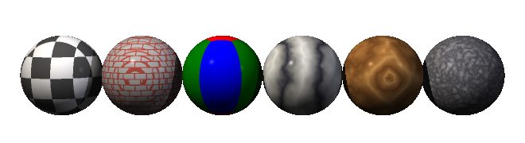

Six patterns on the same ball under the same light: checker, brick, hexagon, marble, wood and
granite.  The scene is
[`docs/examples/pigments/patterns.igl`](examples/pigments/patterns.igl).

### Solid Color

The everyday case:

```
pigment color Red
pigment color [0.8, 0.3, 0.25]
```

The word `color` may be left off when what follows is unambiguous, so `pigment Red` means the
same thing.  Writing it is the clearer habit.

### Patterns

A pattern is a function of position.  For each intersection point the renderer finds, the
surface's pattern hands back either a number or a choice among colors, and the pigment
turns that into the color at that point.

<picture>
  <source media="(prefers-color-scheme: dark)" srcset="images/pigments/patternClause-dark.svg">
  <source media="(prefers-color-scheme: light)" srcset="images/pigments/patternClause.svg">
  
</picture>

That "either" is the important division, and it decides how you write a pattern.

#### Discrete patterns

These pick among a fixed number of sub-patterns (yes, patterns can be nexted).  You give
exactly as many as the pattern needs, separated by commas:

| Pattern | Colors |
| --- | --- |
| `checker` | 2 |
| `linear stripes`, `cylindrical stripes`, `spherical stripes` | 2 |
| `brick` | 2 |
| `hexagon` | 3 |
| `square` | 4 |
| `cubic` | 6 |
| `triangular` | 6 |

```
pigment checker { White, Gray30 }
pigment hexagon { Red, Green, Blue }
pigment linear X stripes { Red, Blue }
```

Give the wrong number and the render stops and says so.

**Seen from far off, one pixel takes in several cells at once**, and shows them mixed by how much
of its patch each covers rather than whichever one its ray happened to strike — which is what
keeps a distant checkerboard from breaking up into moiré.  A pattern picking between two pigments
mixes the two.  One picking among three or more — `hexagon`, `square`, `cubic`, `triangular` —
mixes each pigment by its own share of the patch, so a patch that is half the first color and half
the third shows those two, and never the second, which lies between them only in the list.

A plain color is simply the simplest sub-pattern there is, so anywhere one of these entries may
take a color, it may take a whole pattern instead:

```
pigment checker {
    color [0.85, 0.4, 0.35],
    marble {
        turbulence 0.5
        [0, [0.35, 0.35, 0.4], 1, [0.95, 0.95, 0.92]]
        scale 0.7
    }
    scale 0.45
}
```

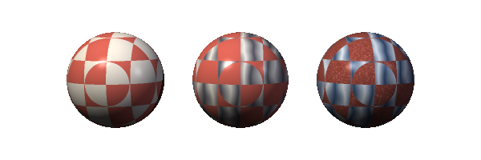

A checker of two plain colors, a checker with marble in one of its squares, and a checker with
a pattern in both.  Each nested pattern keeps its own scale and turbulence, so the two need
have nothing to do with one another.  The scene is
[`docs/examples/pigments/nested.igl`](examples/pigments/nested.igl).

`brick` takes two extra settings, which may be written before or after the colors:

```
pigment brick {
    brick size [0.5, 0.25, 0.25]
    mortar size 0.04
    color [0.7, 0.3, 0.25], Gray70
}
```

#### Continuous patterns

These produce a number rather than a choice, so instead of a list of colors you give a *color
map*: pairs of a position and the color at that position, in square brackets.

| Pattern | What it looks like |
| --- | --- |
| `linear gradient`, `cylindrical gradient`, `spherical gradient` | A smooth ramp. |
| `marble` | Veins running through stone: up its map and back down again, unless another wave is said. |
| `wood` | Growth rings. |
| `granite` | Fine speckle, noise at every scale. |
| `agate` | Wandering bands. |
| `bozo` | Broad, smooth noise. |
| `crackle` | A web of cracks between cells. |
| `dents`, `wrinkles` | Noise meant chiefly for roughening. |
| `leopard` | Spots. |
| `ripples`, `waves` | Rings spreading from scattered sources. |
| `radial` | The angle about the Y axis. |
| `planar`, `spherical`, `cylindrical`, `boxed` | Distance from a plane, point, axis or box. |
| `flop` | Not a place at all: the angle the surface is seen at; see [A color that shifts with the angle](#a-color-that-shifts-with-the-angle). |
| `image` | A picture: its gray, or one of its channels; see [A picture as a pattern](#a-picture-as-a-pattern). |

```
pigment marble {
    [0, [0.2, 0.2, 0.24], 0.4, [0.6, 0.6, 0.58], 1, [0.9, 0.9, 0.88]]
}
```

The map reads as position, color, position, color, and so on.  Positions run from 0 to 1, and
the color between two entries is blended from them.  A map need not stop at 1; whatever the
pattern hands back is wrapped, which is exactly what turns a marching value into repeated
veins.  `marble`'s value is a coordinate marching along X, and it runs a
[`triangle` wave](#shaping-the-value) unless told otherwise, as POV-Ray's does: up the map and back
down, so a map whose two ends differ meets itself at every turn rather than snapping from its end
to its start in a hard seam down every vein.  Say `ramp wave` for the sawtooth.

Adding `banded` before the opening bracket turns the blending off, so each entry holds until
the next rather than fading into it.

#### Adding a bounce

`gradient` may be written `bouncing`, which makes it run up and back down again rather than
snapping from the end of the map to its start:

```
pigment linear bouncing gradient { [0, Red, 1, Blue] }
```

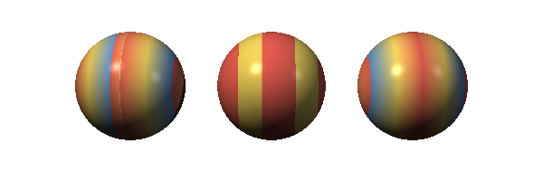

The same three-color map read three ways: blended, which is the default; `banded`, which holds
each color until the next; and `bouncing`, which runs the map up and back down so there is no
seam where it would otherwise wrap.  The scene is
[`docs/examples/pigments/maps.igl`](examples/pigments/maps.igl).

#### A color that shifts with the angle

Some car paints are deep blue seen from one side and dark green from the other, running through teal
between, and a body's curves carry a single panel through the whole of it at once.  `flop` is the pattern
for that: its value is not a matter of *where* on the surface a point is, but of the angle it is seen at.

```
material {
    pigment flop { [0, [0.05, 0.10, 0.55], 0.5, [0.03, 0.30, 0.32], 1, [0.04, 0.32, 0.08]] }
    specular 0.6  shininess 120
    reflective 0.12  fresnel
}
```

**The angle is measured against the light**: it is the angle between the way to the eye and the way the
light mirrors off the surface, as a share of a half turn — nought looking straight along the reflection, a
half looking square to it.  It nears one only where the eye and the reflection point opposite ways along
the surface, which for a place lit from above it happens only at a graze, the eye low on the light's own
side; an eye standing where the light is reads twice its angle from square-on, so nought square-on and a
half at 45 degrees.  That is what makes the two sides of a panel differ — seen from the far side of the
light, the eye looks along its reflection; seen from the light's own side, it does not — which measuring
the eye alone could never tell apart.  So the color is worked out afresh for every light, each
contributing its own, and a sky light's every sample with them.  Painters call the color seen away from
square-on the *flop*, whence the name.

Where no particular light is being shaded for — the tint a transparent surface gives what passes through
it, or a metal's reflection — the light is taken to be at the eye, so the value is twice the eye's angle
from square-on, as a share of a half turn: the map's start seen square-on, its middle at 45 degrees and
its end at a graze.

**A clear coat is not a second pigment.**  A pigment says what color a surface is; the gloss over a car's
paint is a reflection, which is the material's to give: `reflective` with `fresnel`, as above, and a little
`roughness` for an older finish.  It goes over any pigment, this one included.

**It shows best under one strong light.**  Lit from everywhere at once, as by a whole sky, each direction
brings its own angle and the colors average toward the middle of the map; a single window or the sun
sorts a body into one color on one side and the other on the other, which is why a car's paint shows it
best in sunshine.  [Flip-Flop Paint](../gallery/Local/materials/flip-flop-paint.igl) puts the Utah teapot in
it, lit from one window.

`flop` may stand anywhere a pattern may — inside a blend, as one entry of another pattern's map — and the
things that shape a pattern's value work on it as usual.  Its turbulence and scale do nothing, since it
does not depend on the point at all.  Unlike other patterns, its two ends are two different colors and
are never wrapped round onto each other.

`flop` paints whatever colors its map names, which is what a paint chosen from a chart wants.  The
colors of a soap bubble or of oil on water are a different thing — they come of a film's thickness and
not of any pigment, and are worked out rather than chosen; see
[Thin films](materials.md#thin-films).

#### Where weather gathers

Dirt gathers in seams, corners and grooves; paint wears through on edges and rims; dust and sand settle
on whatever faces up, and moss grows on the side away from the sun.  None of that is a matter of *where*
a point is, but of what stands round it, and three patterns ask exactly that:

| Pattern | Its value | Says of itself |
| --- | --- | --- |
| `crevices` | 0 on open ground, rising toward 1 in corners, grooves and seams | `radius r`: how far to look about the place, 0.25 unless said |
| `edges` | 0 on a flat face of a solid, rising toward 1 at its corners and rims | `radius r`: how far to look into the solid |
| `facing` | 1 facing a direction, 0.5 square to it, 0 facing away | `toward d`: the direction, in the world; up unless said |

```
material {
    pigment crevices {
        radius 0.1
        [0, [0.85, 0.82, 0.75], 0.25, [0.85, 0.82, 0.75], 0.6, [0.20, 0.15, 0.10]]
    }
}
```

**`crevices` and `edges` look about the place**, with a few dozen short rays: out from the surface for
crevices, counting how much of what they meet lies within reach, and how near; into the solid for edges,
counting how much of it they come back out of.  So a groove's floor is closed in nearly all round and
reads near one, a floor beside a wall reads a third or so close to the wall and less further off, and
open ground reads nought.  A ray that comes out of a solid through a face turned back the way the place
faces has found the far side of a sheet rather than a face round a corner, and counts for less the further
that face is turned, nothing at all for one facing straight back: so a thin panel is flat across its face
and stands out along its rim, and a ridge sharper than a right angle stands out by how sharp it is.  How
many rays is the scene's [`weathering samples`](context.md#weathering-samples).

**The reach is measured in the units of the space the shape stands in**: the scene's, for a shape in the
scene, and a model's own for a part of one, so a droid built in inches says how far its dirt reaches in
inches however the droid is later sized.  It is never the shape's own: a cube scaled into a table top does
not stretch its reach with it.  **`facing` is read in the world**, since what falls, falls the world's way.

**None of the three depends on the point**, so turbulence and a pattern's scale do nothing to them.  For a
broken edge to the grime, which real grime has, put a noisy pattern inside the map: an entry of the map
may be any pigment, a `granite` or a `bozo` of its own included.  These patterns mean something only on a
surface being shaded -- in a pigment, and in a [blend of materials](materials.md#blending-materials), which
is where weathering is usually wanted, since grime is matte and rust rough where paint was glossy.

### Turbulence

Most of the interesting patterns are dull without turbulence.  It stirs the points before the
pattern sees them, so straight bands become wandering ones:

<picture>
  <source media="(prefers-color-scheme: dark)" srcset="images/pigments/turbulenceClause-dark.svg">
  <source media="(prefers-color-scheme: light)" srcset="images/pigments/turbulenceClause.svg">
  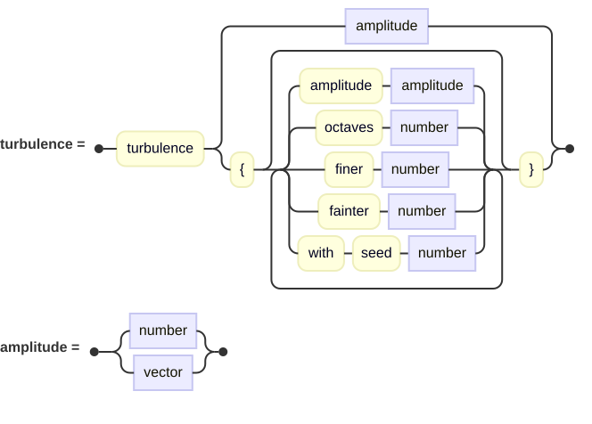
</picture>

```
pigment marble {
    turbulence { amplitude 0.6  octaves 4 }
    [0, [0.2, 0.2, 0.24], 1, [0.9, 0.9, 0.88]]
}
```

| Setting | Default | What it does |
| --- | --- | --- |
| `amplitude` | 1 | How far points are pushed about: one number for every axis, or `[x, y, z]` to give each its own. |
| `octaves` | 1 | How many layers of noise, each a scale of detail, to pile up. |
| `finer` | 2 | How much smaller each layer's detail is than the one before: POV-Ray's *lambda*. |
| `fainter` | 0.5 | How much weaker each layer is than the one before: POV-Ray's *omega*. |
| `with seed` | | Fixes the randomness, so the result repeats. |

POV-Ray piles up six octaves unless told otherwise; here it is one, so a POV-Ray scene's turbulence
that leaves its octaves unsaid wants `octaves 6` to come out as it did there.

A bare number is shorthand for the amplitude alone, everything else left at its default, which is
the common case:

```
pigment marble { turbulence 0.6  [0, Red, 1, Blue] }
```

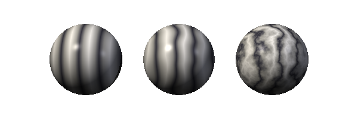

The same marble three times: no turbulence, a little, and a lot.  Without it the veins are
straight bands; with a little they wander; with a lot they break up into something much closer
to real stone.  The scene is
[`docs/examples/pigments/turbulence.igl`](examples/pigments/turbulence.igl).

Turbulence goes **before** the color map, or before the list of colors of a pattern that picks
among them.  It stirs the points a pattern is asked about rather than the pattern itself, so it
works on any pattern: a checker given some has wavering edges rather than straight ones.

Three patterns take it into their own arithmetic instead, as POV-Ray's do.  **Marble** adds the
turbulence, scaled by the X of its amplitude, to the coordinate its veins march along; **wood**
bends each ring by a wave of the turbulence scaled by its amplitude, across X and Y; and **agate**
takes only its turbulence's octaves and layers, never its amplitude, its bands being stirred by
fixed amounts of their own.  (Until October 2026 marble and wood ignored the amplitude too, so a
wood said to take `amplitude 0.25` was drawn as at one.)

### Shaping the Value

Between the pattern and the color map, the number a pattern produces can be reshaped:

| Setting | What it does |
| --- | --- |
| `frequency` | Multiplies the value, so the map repeats more often. |
| `phase` | Slides the value along, so the map starts somewhere else. |
| `<name> wave` | Bends the value along a curve. |

The frequency and phase come first, and the value is wrapped back into nought to one after them;
then the wave bends it.  With neither said the value is left exactly as the pattern gave it.
`ripples` and `waves` are the exceptions: they read the frequency and phase as how close their
rings lie and where they start, and are not wrapped again.

| Wave | What it does to the value |
| --- | --- |
| `ramp` | Nothing: the plain sawtooth, and the default for every pattern but `marble`, whose default is `triangle`. |
| `sine` | Swings smoothly about the middle of the map: starting there, reaching its end a quarter of the way through each repeat and its start at three quarters, and back to the middle at the end. |
| `triangle` | Climbs the map over the first half and comes back down over the second, so it mirrors rather than repeats. |
| `scallop` | A row of rounded arches, the map's start at each whole number and its end at each half, meeting in a cusp. |
| `cubic` | Eases into and out of both ends, lingering on each: three times the value's square less twice its cube. |
| `poly n` | The value to the power `n`, written with the power between the words: `poly 3 wave`.  Above one it lingers near the start of the map, below one near its end. |

`cubic` and `poly` bend a value from nought to one, and are meant for patterns that give one.

```
pigment bozo {
    sine wave
    frequency 2
    [0, Red, 1, Blue]
}
```

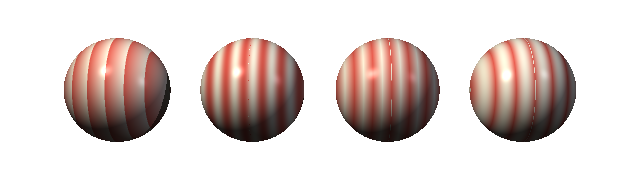

One gradient bent four ways: `ramp`, `sine`, `triangle` and `scallop`.  The pattern, the map
and the frequency are the same in all four.  A ramp snaps back at the end of each repeat; a
sine eases in and out of it; a triangle mirrors the map rather than repeating it, so there is
no snap at all.  The scene is
[`docs/examples/pigments/waves.igl`](examples/pigments/waves.igl).

Like turbulence, these are written **before** the map.

### Seeding

Any pattern that draws on randomness — `bozo`, `crackle`, `dents`, `granite`, `wrinkles` —
may be given a seed, so that the same scene renders the same way every time.  The seed goes
on the pattern name, **before** the opening brace:

```
pigment granite with seed 5 {
    [0, [0.25, 0.25, 0.28], 1, [0.85, 0.85, 0.82]]
}
```

A seed may also be put on the pigment as a whole, in which case it reaches everything inside
that has not been given one of its own — written `pigment with seed 5 granite { ... }`, and the
same before a call of a primitive making a pigment, `pigment with seed 5 Stone(0.3)`.  A pigment given by its
name is one pigment, worn by everything that names it, so it takes its seed where it is made; a seed
written before its name is refused, as is one before an image or a physical sky, which have no
noise for it to start.

Noise that is given no seed at all takes the seed of the surface wearing it, from the surface's own
[`with seed`](surfaces.md), if it has one: each surface its own, even where several wear one named
pigment.

### Patterns Live in the Surface's Space

A pattern is evaluated in the surface's own coordinates, which has two consequences worth
knowing.

**A pattern may be transformed on its own.**  Write transforms inside the pattern, after the
colors, and they move the pattern rather than the surface:

```
pigment checker {
    White, Gray30
    scale 0.4
    rotate Y 30
}
```

**Transforming the surface transforms the pattern with it.**  Squash a sphere and whatever is
painted on it squashes too.  That is usually what you want, and occasionally a nuisance — a
brushed-metal look is made exactly this way, by squashing a pattern along two axes so its
slopes all run one direction.

### Image Pigments

A pigment may be a picture.

<picture>
  <source media="(prefers-color-scheme: dark)" srcset="images/pigments/imageClause-dark.svg">
  <source media="(prefers-color-scheme: light)" srcset="images/pigments/imageClause.svg">
  
</picture>

```
pigment image 'earth.png' spherical
```

The mapping says how the flat picture is wrapped onto the surface:

| Mapping | Wraps the image…                                  |
| --- |---------------------------------------------------|
| `planar` | Flat, along one plane.                            |
| `spherical` | Around a ball, the way a world map wraps a globe. |
| `cylindrical` | Around an axis, like a label on a can.            |
| `toroidal` | Around a ring.                                    |

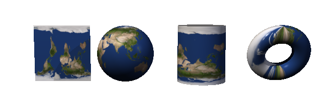

The same picture wrapped four ways, each onto the surface its mapping suits.  The scene is
[`docs/examples/pigments/image-maps.igl`](examples/pigments/image-maps.igl).

With no mapping named, the image is laid on each surface wearing it by that surface's shape: flat on a
cube, a plane, a triangle or a parallelogram, and round a sphere, a cylinder or a torus by the mapping
that suits it.  A pigment worn by several shapes — one given a name, or one on a group — is laid on each
by its own.  Any other shape needs a mapping named.

An image may be moved, turned or sized like any other pigment, in braces after it:

```
pigment image 'earth.png' spherical { rotate Y 120 }
```

The same braces take a `brightness`, written among the transforms in any order, which multiplies the
image's colors and leaves how opaque they are alone:

```
background image 'sky.hdr' { brightness 0.6  rotate Y 200 }
```

That is the one thing a photograph of the sky needs said of it: it holds light in whatever units the
camera that took it left it in, and this brings it to the scene's.  Being one number, it brightens or
dims the sky and the sun in it together.  It is 1 unless said.

`planar` and `cylindrical` may be followed by `once`, which draws the image a single time
rather than repeating it.  Without it the image tiles, so a surface larger than one unit gets
the picture over and over.  Outside an image drawn once the surface shows clear, and the image's
edge fades out over the width of a pixel rather than stopping on a texel.

On a [height field](advanced-surfaces.md#height-field), with no mapping named, an image is laid as the
field lays its heights, so a picture painted for a terrain lands pixel for pixel on the heights it was
painted for.

**An image lets light through only where its picture does**: where its alpha channel says it is less
than opaque, or past the edges of one drawn `once`.  A surface colored by an opaque picture is as
opaque as one painted a color, and may be anything such a surface may — a [metal](materials.md#metals),
coated, rough.  Until 2026-10-31 every image was taken to let light through somewhere, and a surface
colored by one could be none of those: rough, it mirrored nothing at all.

**A picture is read as the light it stands for.**  Almost every image file is written in sRGB,
whose values are not light: a mid-gray of 128 in a PNG or JPEG is about a fifth of white's light,
not half.  Each file is turned back into light by the curve it says it was written with, so a
photograph used as a pigment comes out with the colors it was taken with rather than paler.  A
Radiance (`.hdr`) or OpenEXR (`.exr`) file holds light already, including light brighter than
white, and is read as it stands -- which is what a photograph of a real sky needs, sun and all.
A scene that writes [`no gamma`](context.md#gamma) takes its colors as the values that reach the
file, and takes an image's values the same way, as they stand -- so in either kind of scene a
picture under white light comes back as itself.  An image used for a
[height field](advanced-surfaces.md#height-field) is different again: its grays are heights, and
are read exactly as the file holds them, as is a picture read as a [pattern](#a-picture-as-a-pattern).

**A pixel sees a patch of a picture, not a point of it.**  Seen from far off or at a glance, many
of an image's texels fall within one pixel, and reading just one of them beats a fine pattern
into moiré.  So an image is averaged over the patch each pixel covers, longer along the way a
surface runs away from the eye, and read smoothly between its texels when seen close up.  The
same goes for an image used as a `background`: a pixel that sees the sky sees as much of the
picture as the pixel is wide.

Worth knowing about `planar`: it maps the surface's **X and Z**, so it belongs on something
lying flat.  Put it on an upright face — where Z barely changes — and you get a single row of
the image smeared into stripes.  The panel in the picture above is the unit square in X and Z,
stood upright afterward, so the mapping still lands on it square.

The file name may be a **web address** rather than a path:

```
pigment image 'https://example.com/texture.jpg' spherical
```

A downloaded image is held in memory for the run that needs it, but it is not saved anywhere,
so it is fetched again the next time you render.  See
[Installing and Building](getting-started.md#installing-and-building).

`uncached` before `image` skips the in-memory cache as well, so the file is re-read for every
surface that names it.  You want this only when the file may change under you.

`gallery/Local/solar-system/` is built almost entirely from image pigments.

#### A picture as a pattern

A picture can do more than color a surface.  Written where a pattern goes, it is a pattern, whose
value at each place is the picture's gray there, or one of its channels: how deep a surface's bumps
run, where it is worn, how rough it is.

```
normal image 'tiles-height.png' { depth 0.4 }
material blend image 'wear.png' { [0, Paint, 1, Rust] }
roughness 0.2 to 0.7 by image 'tiles-roughness.png' { }
```

**It is read as a measurement, not as light.**  A height, a mask or a roughness is written into a
file as the number it is, not encoded the way a photograph's colors are, so a picture read as a
pattern is read exactly as the file holds it — a mid-gray of 128 is half — the way a
[height field](advanced-surfaces.md#height-field) reads its heights.  Its gray is the height field's
gray, too, so one picture can raise a terrain and mark it alike.  `channel red`, `green`, `blue` or
`alpha` reads one channel alone instead, which is how texture sets pack several maps into one file:

```
roughness 0.1 to 0.9 by image 'tiles-packed.png' channel green { }
```

It takes a mapping, and is laid on a surface, exactly as an image pigment is: flat, round, or by the
surface's own shape, and on a height field as the field lays its heights.  Read where there is no
surface, as a [field](advanced-surfaces.md#field)'s patches are, it lies flat on X and Z.  Like an
image pigment, it is averaged over the patch each pixel covers.

As a pigment, a picture followed by a map of pigments in braces is read this way and picks among
them, as any pattern's value does.  Naming a channel says it is meant so, and needs the map:

```
pigment image 'mask.png' channel red { [0, Gray20, 1, Ivory]  scale 2 }
```

`gallery/Local/materials/copper-on-luster-tiles.igl` is made of little else: tiles raised from a picture of
their heights, colored, roughened, worn and painted in gold by pictures laid over them, and a hammered copper
pot dented by a [normal map](materials.md#normal-maps).

### Blending and Layering

Two or more pigments may be combined:

<picture>
  <source media="(prefers-color-scheme: dark)" srcset="images/pigments/blendClause-dark.svg">
  <source media="(prefers-color-scheme: light)" srcset="images/pigments/blendClause.svg">
  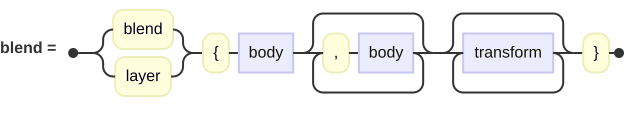
</picture>

```
pigment blend { checker { Red, Blue }, color Green }
pigment layer { color Red, checker { White, Black } }
```

`blend` averages them: every point is the mean of what each pigment would give.

`layer` stacks them instead, and **the first one written is the topmost**.  Where the upper
pigment is transparent the one beneath shows through, which is how you put a decal or a stain
over something patterned.  A fully opaque pigment written first hides everything after it, so
the transparency has to be in the upper one:

```
pigment layer {
    checker { color [0.85, 0.35, 0.3], color [1, 1, 1, 0]  scale 0.45 },
    color [0.25, 0.4, 0.8]
}
```

The checker's second color has an alpha of zero, so those squares are holes.

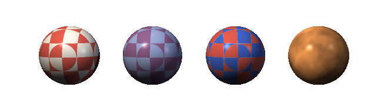

A plain checker; the same checker blended with a solid blue, which pulls every square halfway
toward it; the same checker layered over that blue, where the transparent squares let it
through untouched; and a solid color mottled.  The scene is
[`docs/examples/pigments/combining.igl`](examples/pigments/combining.igl).

### Mottling

`mottled` takes another pigment and dims it by noise, so a flat color gains an uneven,
weathered look:

<picture>
  <source media="(prefers-color-scheme: dark)" srcset="images/pigments/mottledClause-dark.svg">
  <source media="(prefers-color-scheme: light)" srcset="images/pigments/mottledClause.svg">
  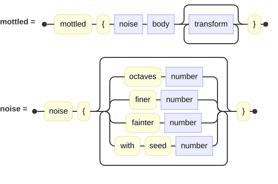
</picture>

```
pigment mottled {
    noise { octaves 3 }
    leopard {
        [0, Orange, 1, Brown]
        scale 0.5
    }
}
```

The `noise` block takes `octaves`, `finer`, `fainter` and `with seed` — the same settings
turbulence takes, minus the amplitude, since mottling dims a color rather than pushing points
about.

The rightmost ball in the picture above is a single flat color mottled, which is all it takes
to keep a large plain surface from looking painted on.

This is not the same thing as the material's `grain`, which roughens how light falls on a
surface.  Mottling varies the color itself.

### A Physical Sky

Every pigment above says what color something *is*.  This one works out what color the sky
**actually comes out**, from what the air does to sunlight:

<picture>
  <source media="(prefers-color-scheme: dark)" srcset="images/pigments/physicalSkyClause-dark.svg">
  <source media="(prefers-color-scheme: light)" srcset="images/pigments/physicalSkyClause.svg">
  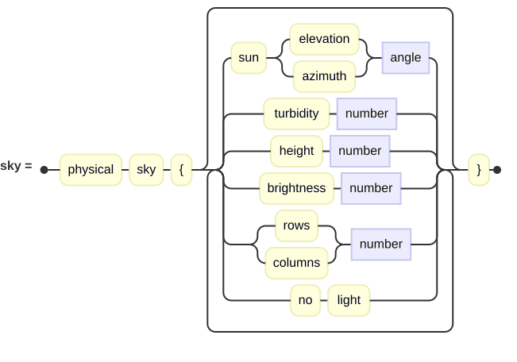
</picture>

```
background physical sky {
    sun elevation 22
    sun azimuth 35
    turbidity 2.6
    brightness 8
}
```

You say where the sun stands.  Everything else follows and none of it is a setting: the blue overhead,
the pale band at the horizon, the ring of glare around the sun, the reddening as it sets.  Those are
what falls out of air scattering short wavelengths some six times more readily than long ones, of haze
throwing light forward, and of the two thinning with height at quite different rates.

| Property | Means |
| --- | --- |
| `sun elevation` | How high the sun stands above the horizon, in degrees.  90 is overhead, 0 is on the horizon. |
| `sun azimuth` | Which way round it lies, in degrees, measured from -Z and turning toward +X. |
| `turbidity` | How hazy the air is.  1 is perfectly clean air, which happens nowhere; 2-3 is a clear day; 6 and beyond loses the horizon in white. |
| `height` | How far above sea level the scene stands, in meters.  Mostly it changes the haze, nearly all of which sits in the lowest kilometer or two -- which is why a mountain sky is a deeper, cleaner blue. |
| `brightness` | What the whole sky is multiplied by.  See below. |
| `rows`, `columns` | How finely the sky is worked out and kept.  Rarely worth touching. |

**It is a pigment, and that is the point.**  A `background` is a pigment asked about a *direction*, so
writing one thing gives you three: the camera sees the sky, a mirror reflects it, and a
[`sky light`](lights.md#sky-lights) gathers its light from it -- that last one for free, since a sky
light with no pigment of its own borrows the background.  A scene lit entirely and correctly by a real
sky is therefore two lines.

**The sun's disc is not in it.**  The sun subtends about half a degree, so a sky light sampling a sky
containing it would strike it perhaps once in fifty thousand samples, and that sample would be tens of
thousands of times brighter than its neighbours -- speckle that gets *worse* as you add samples.  If
you want a visible sun, place one: a sphere of the right size in the right direction, or a `disc`.

**The sun comes with it.**  A physical sky adds its own `distant light`, pointed the way the sun
lies and colored by what is left of the sunlight after the air it has just crossed -- which is why a
low sun arrives orange without anyone saying so.  You say *where* the sun is; what color it is
follows.  A scene wanting the sky without its sun writes `no light` inside the block:

```
background physical sky { sun elevation 30  no light }
```

You do not need that merely to add a lamp of your own -- a scene may hold as many lights as it likes,
and the sun will simply stand among them.

**More than one sun is more than one sky, blended.**  Scattering adds, so the sky of a world with two
suns is exactly the sum of two skies with one each -- and a [`blend`](#blending-and-layering) of two
physical skies, each written at twice the brightness wanted since a blend averages, is that sky.  Each
sky hangs its own sun, at the share the blend gives its sky, so the light agrees with the sky around
it:

```
background blend {
    physical sky { sun elevation 7  sun azimuth 199  turbidity 4  brightness 6 },
    physical sky { sun elevation 4.6  sun azimuth 193.5  turbidity 4  brightness 6 }
}
```

**Clouds may be layered over a sky.**  A `layer` whose top pigment is partly clear -- streaks of a
pattern, say, with alpha in its map -- shows the sky through it, and keeps the sky's suns: a layer hangs
the suns of the topmost of its pigments that has any.  `gallery/Local/showcase/tatooine.igl` does both,
two setting suns under a band of wisps.

**About `brightness`.**  It is an exposure and deliberately a single knob, because the proportions
*within* a sky, and between a sky and its sun, are what the physics settles and nothing should be able
to disturb them.  Turning it up brightens the sun by exactly as much as it brightens the sky.

At `1` the sky and its sun stand in the proportion the air actually puts them in.  Whether that is the
right *exposure* for a picture is a separate question, which a camera's [`exposure`](cameras.md#exposure)
answers for the whole picture; left to this alone, something between `2` and `4` is usually what makes a
frame read without blowing the highlights.

**What it does not follow.**  Light is followed round every turn it takes, not merely the first, which
is what keeps the shaded side of things lit and what leaves a glow in the sky after the sun is down.
The turns after the second are treated as arriving evenly from all directions, which is a real
approximation and tells most near the horizon and near the sun.  Measured against daylight as it has
actually been recorded, the diffuse share of light falling on a level surface comes out at about 7%
with the sun high and 18% with it low, against measurements in the range of 8-20%.  Ground reflection
is not followed at all, which is the largest thing still missing: a scene over snow or pale sand has a
brighter sky than this will give.

### Naming and Reusing

If you Assign a pigment to a variable, it may be used as often as you like:

```
stone = pigment granite with seed 3 {
    [0, [0.25, 0.25, 0.28], 1, [0.8, 0.8, 0.78]]
    scale 0.5
}

sphere { material { pigment stone } }
cube   { material { pigment stone }  translate [3, 0, 0] }
```

### Patterns Elsewhere

The same patterns are used by a material's [`normal` block](materials.md#roughening-the-surface),
where the pattern's value tilts the surface normal instead of choosing a color, and by a
[roughness](materials.md#roughness) or a [metalness](materials.md#metallic) that runs from one value
to another across a surface.  Everything here about turbulence, shaping, seeding and transforms
applies there too.

A scene's [`background`](scene-files.md#background) is a pigment as well, so any of these may be
a sky.  One thing is different there: a background is asked about the direction a ray was
heading rather than a point it struck, so a pattern used as a sky works in units of a sphere of
radius one — a scale of ten, which spreads a pattern over a wide floor, all but flattens a sky.
