## Reference

This chapter is the index to everything the earlier ones explain a piece at a time: the overall
shape of a scene file, every keyword the language knows, the whole grammar as a set of diagrams,
every name a scene may use without defining it, and the command line.  It is meant to be looked
things up in rather than read straight through.

### The shape of a scene file

A scene file is any number of *items*, in almost any order (the exceptions are in
[The Shape of a File](scene-files.md#the-shape-of-a-file)).  Each item is one of these:

<picture>
  <source media="(prefers-color-scheme: dark)" srcset="images/reference/sceneFile-dark.svg">
  <source media="(prefers-color-scheme: light)" srcset="images/reference/sceneFile.svg">
  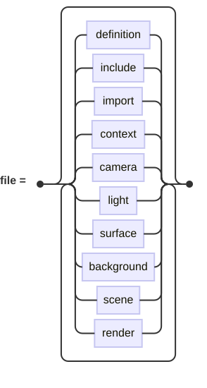
</picture>

- a **definition** — a name given to a value, surface, material, pigment or transform, for reuse ([Variables](scene-files.md#variables))
- an **include** — another file, read in place ([Including Other Files](scene-files.md#including-other-files))
- an **import** — named definitions taken from a library ([Using Libraries](libraries.md))
- a **context** block — the render-wide settings ([The Context Block](context.md#the-context-block))
- a **camera** — where the scene is viewed from ([Cameras](cameras.md#placing-a-camera))
- a **light** — a point, distant, spot or area light ([Lights](lights.md#lights))
- a **surface** — anything solid or flat the world contains ([Surfaces](surfaces.md#the-primitives))
- a **background** — the sky seen where nothing is hit ([Background](scene-files.md#background))
- a **scene** — a camera, lights and surfaces wrapped up and named ([Scenes and Cameras](scene-files.md#scenes-and-cameras))
- a **render** command — which scene and camera to draw ([The `render` Command](scene-files.md#the-render-command))

### Keyword index

Every word the language reserves, what it is for, and the chapter that explains it in full.

| Keyword | Meaning | Documented in |
| --- | --- | --- |
| `above` | Field: the lowest ground a dropped copy may stand on. | [Advanced Surfaces](advanced-surfaces.md#dropping-a-field-onto-the-ground) |
| `absorption` | Medium: how much light it takes out per unit of distance. | [Scene Files](scene-files.md#filling-that-space) |
| `accuracy` | Isosurface, parametric surface, distance surface, Julia set or swells: how closely a crossing is pinned down. | [Advanced Surfaces](advanced-surfaces.md#isosurface), [Swells](surfaces.md#swells) |
| `across` | Shape grammar: a gabled `roof` whose ridge runs along the scope's Z rather than its X. | [Advanced Surfaces](advanced-surfaces.md#shape-grammar) |
| `agate` | Pattern: turbulent, wandering bands. | [Pigments & Patterns](pigments-and-patterns.md#patterns) |
| `agx` | Context: `film curve agx`, a film's curve over the whole range. | [Context](context.md#film-curve) |
| `aim` | Joint: `aim at <place or name>`, turned about its axis to face it, within its limits. | [Aiming](animation.md#aiming) |
| `align` | Lines one edge of a surface up with the matching edge of another. | [Transforms](transforms.md#placing-one-thing-against-another) |
| `alignment` | Text layout: left/center/right justification. | [Advanced Surfaces](advanced-surfaces.md#laying-out-text) |
| `along` | Text layout: `along path` lays the text along a path rather than a straight line.  Also a field's `along <path>`, laying its copies along a path rather than filling an outline.  Material: which way a brushed surface's grooves run.  Transform: `along <spline> at|by <amount>` puts a thing on a spline, turned to run with it. | [Text along a path](advanced-surfaces.md#text-along-a-path), [Fields along a path](advanced-surfaces.md#laying-a-field-along-a-path), [Brushed metal](materials.md#brushed-metal), [Along a Spline](animation.md#along-a-spline) |
| `ambient` | Finish: color shown with no light on it; in a context block, `scale ambient by`. | [Materials](materials.md#ambient-diffuse-and-specular), [Context](context.md#ambient) |
| `amplitude` | Turbulence: how far it stirs.  Swells: how tall one train of waves is, in place of its `steepness`. | [Pigments & Patterns](pigments-and-patterns.md#turbulence), [Swells](surfaces.md#swells) |
| `and` | True when both conditions are; the same operator as `&&`.  Also joins `ignore commands and '…'` in an L-system. | [Scene Files](scene-files.md#expressions) |
| `angle` | L-system control: the turn angle.  Joint: how far it is turned about its axis. | [Advanced Surfaces](advanced-surfaces.md#l-systems), [Joints](animation.md#joints) |
| `angles` | Context: `angles are degrees`/`radians`, the unit the angles written after it are read in. | [Context](context.md#angles), [Scene Files](scene-files.md#angles-are-radians) |
| `animation` | Context: how long a scene runs as an animation, `length` seconds or `frames`, its `rate` and its `still`. | [Saying How Long](animation.md#saying-how-long) |
| `anisotropy` | Medium: which way it prefers to turn light.  Material: how much a rough surface is brushed, `anisotropy a along X` or `around Y`. | [Scene Files](scene-files.md#scattering), [Brushed metal](materials.md#brushed-metal) |
| `antialiasing` | Context: `antialiasing depth`/`threshold`. | [Context](context.md#anti-aliasing) |
| `apart` | Field: `rows <n> apart <d>`, how far apart its rows lie.  Fracture: how far its pieces are moved off. | [Advanced Surfaces](advanced-surfaces.md#laying-a-field-along-a-path), [Fracture](advanced-surfaces.md#fracture) |
| `aperture` | Camera: lens radius; larger blurs more. | [Cameras](cameras.md#depth-of-field) |
| `apply` | Context: `apply gamma`. | [Context](context.md#gamma) |
| `are` | The second word of `angles are …`. | [Context](context.md#angles) |
| `area` | An `area light` (soft-edged). | [Lights](lights.md#area-lights) |
| `around` | Material: the axis a brushed surface's grooves run round, as circles. | [Brushed metal](materials.md#brushed-metal) |
| `at` | Follows `look at`, `point at`, a tube's `radius … at`, a ribbon's or strand's `width … at`, parallelogram `at`; a blob plane's point.  `along <spline> at <share>`.  A joint's `aim at`, where a `mark` stands, and a swarm's `falls at` and when it bursts, `burst … at`. | [Cameras](cameras.md#placing-a-camera), [Ribbon](advanced-surfaces.md#ribbon), [Along a Spline](animation.md#along-a-spline) |
| `author` | Info: who made it. | [Context](context.md#image-information) |
| `axiom` | L-system: the starting string.  Shape grammar: the rule its first scope is handed to. | [Advanced Surfaces](advanced-surfaces.md#l-systems), [Shape Grammar](advanced-surfaces.md#shape-grammar) |
| `axis` | Joint: what it turns about, through its pivot: `X`, `Y`, `Z` or a direction. | [Joints](animation.md#joints) |
| `axisU` | Area light: one edge of the panel. | [Lights](lights.md#area-lights) |
| `axisV` | Area light: the other edge of the panel. | [Lights](lights.md#area-lights) |
| `azimuth` | `physical sky`: which way round the sun lies, in degrees. | [Pigments & Patterns](pigments-and-patterns.md#a-physical-sky) |
| `back` | With `align`, names the `+Z` edge. | [Transforms](transforms.md#placing-one-thing-against-another) |
| `background` | Sets the sky, a pigment, seen where no ray hits a surface. | [Scene Files](scene-files.md#background) |
| `balance` | Context: `white balance`, the temperature that comes out white. | [Context](context.md#white-balance) |
| `banded` | Pigment map qualifier: step between entries rather than blend. | [Pigments & Patterns](pigments-and-patterns.md#patterns) |
| `banked` | `along`: leaning into a bend as a rider would feel to be up, by the speed and the curvature. | [Along a Spline](animation.md#along-a-spline) |
| `baseline` | Text layout: sit the block on the first line's baseline. | [Advanced Surfaces](advanced-surfaces.md#laying-out-text) |
| `behind` | Places a surface behind another, touching. | [Transforms](transforms.md#placing-one-thing-against-another) |
| `below` | Field: the highest ground a dropped copy may stand on. | [Advanced Surfaces](advanced-surfaces.md#dropping-a-field-onto-the-ground) |
| `bilinear` | Surface: the warped quadrilateral four corners span, optionally shaded from corner normals. | [Surfaces](surfaces.md#bilinear-patch) |
| `black` | Font weight: the heaviest.  (The color is `Black`, capitalized.) | [Advanced Surfaces](advanced-surfaces.md#text) |
| `blades` | Camera: how many blades its opening is made of, shaping what is out of focus and the rays of its glare. | [Cameras](cameras.md#blades) |
| `blend` | Pigment: average several pigments together.  Material: `material blend <pattern>`, whole materials chosen and mixed by a pattern. | [Pigments & Patterns](pigments-and-patterns.md#blending-and-layering), [Blending Materials](materials.md#blending-materials) |
| `blob` | Surface: metaballs that melt together. | [Surfaces](surfaces.md#blob) |
| `blur` | Camera: `blur samples`, rays per pixel for the lens. | [Cameras](cameras.md#depth-of-field) |
| `body` | Surface: moved by gravity, the air, what it strikes and what it is tied to, from where it stands at time nought. | [Bodies](animation.md#bodies) |
| `bold` | Font weight. | [Advanced Surfaces](advanced-surfaces.md#text) |
| `bottom` | Text layout: align the block by its bottom, the last line's descender line.  Placement: `align bottom with`, its `-Y` edge level with another's. | [Advanced Surfaces](advanced-surfaces.md#laying-out-text), [Transforms](transforms.md#placing-one-thing-against-another) |
| `bounce` | Body or swarm: how much of its speed into what it strikes it keeps coming away, nought to one. | [Bodies](animation.md#bodies), [Swarms](animation.md#swarms) |
| `bounces` | Medium: how many further turns of a light's path are followed; context: `diffuse bounces`, how many times light is followed from surface to surface. | [Scene Files](scene-files.md#multiple-scattering), [Context](context.md#bounced-light) |
| `bouncing` | Pattern qualifier: a gradient that ramps up then back down. | [Pigments & Patterns](pigments-and-patterns.md#patterns) |
| `bounded` | `bounded by`: a box the renderer may use to skip the surface, and the box an isosurface or distance surface is marched inside. | [Surfaces](surfaces.md#bounding), [Advanced Surfaces](advanced-surfaces.md#isosurface) |
| `box` | Body: `shape box`, striking the scene as its own box rather than as a ball. | [Bodies](animation.md#bodies) |
| `boxed` | Pattern: nested square boxes. | [Pigments & Patterns](pigments-and-patterns.md#patterns) |
| `bozo` | Pattern: smooth value noise. | [Pigments & Patterns](pigments-and-patterns.md#patterns) |
| `brick` | Pattern: running-bond brickwork. | [Pigments & Patterns](pigments-and-patterns.md#patterns) |
| `brightness` | Light: what its color or temperature is multiplied by; `physical sky`: what the whole sky and its sun are multiplied by; an image pigment's `{ brightness b }`: what its colors are multiplied by. | [Lights](lights.md#color-temperature), [Pigments & Patterns](pigments-and-patterns.md#a-physical-sky), [Image Pigments](pigments-and-patterns.md#image-pigments) |
| `brilliance` | Finish: sharpens or softens the diffuse falloff. | [Materials](materials.md#brilliance-and-grain) |
| `burst` | Swarm: `burst <count> [at <time>] [over <time>]`, its copies thrown all at once, or evenly over a while, rather than in a steady flow. | [Swarms](animation.md#swarms) |
| `by` | Follows `bounded by`, `scale ambient by`, a hair's `facing`, a field's `picked by` and `sized … by`, a film's `thickness … to … by`, and a `for` or `over` loop's range.  `along <spline> by <distance>`.  A placement's gap or inset, `on 'x' by 0.1`.  A medium's `emission by density`. | [Surfaces](surfaces.md#bounding), [Context](context.md#ambient), [Advanced Surfaces](advanced-surfaces.md#hair), [Fields in patches](advanced-surfaces.md#fields-in-patches), [Thin films](materials.md#thin-films), [Along a Spline](animation.md#along-a-spline), [Transforms](transforms.md#placing-one-thing-against-another), [Light by Density](scene-files.md#a-medium-whose-light-follows-its-density) |
| `c` | Julia set: the quaternion the iteration adds, as four numbers. | [Surfaces](advanced-surfaces.md#julia) |
| `cache` | Context: `diffuse cache`, blending bounced light between records worked out at scattered places. | [Context](context.md#a-cache-of-bounced-light) |
| `camera` | Where the scene is viewed from. | [Cameras](cameras.md#placing-a-camera) |
| `case` | One arm of a [selection](scene-files.md#choosing-inside-a-body) in a function or primitive. | [Scene Files](scene-files.md#choosing-inside-a-body) |
| `caustics` | Context: follow light from the lamps through mirrors and glass to where it lands; a surface's `no caustics` turns none of it. | [Context](context.md#caustics), [Surfaces](surfaces.md#no-caustics) |
| `center` | Blob sphere or disc: its center.  Text layout: center the block or a line; also `no center` on a sweep. | [Blob](surfaces.md#blob), [Disc](surfaces.md#disc), [Text](advanced-surfaces.md#text), [Sweep](advanced-surfaces.md#sweep) |
| `centered` | With `on`, says what a placement's remaining directions are middled on. | [Transforms](transforms.md#placing-one-thing-against-another) |
| `checker` | Pattern: a checkerboard of two colors. | [Pigments & Patterns](pigments-and-patterns.md#patterns) |
| `choose` | Shape grammar: goes one of several ways, each as likely as its weight, the same for the same seed and place. | [Advanced Surfaces](advanced-surfaces.md#shape-grammar) |
| `clarity` | Interior: how far light travels before fading. | [Materials](materials.md#transparency-and-interiors) |
| `clip` | Height field: drop ground below a height. | [Advanced Surfaces](advanced-surfaces.md#height-field) |
| `close` | Path: join back to where the run began. | [Advanced Surfaces](advanced-surfaces.md#paths) |
| `clump` | Hair: how strongly strands gather into locks; `clump 0.6 size 20`. | [Advanced Surfaces](advanced-surfaces.md#hair) |
| `coat` | Material: a clear coat over the surface, lacquer or varnish; `roughness`, `ior` and `tint` go in it. | [A clear coat](materials.md#a-clear-coat) |
| `color` | A solid pigment, or a light's color.  Casts a tuple to a color, and is the kind a function of your own may give back, `-> color`.  Sheen: what the fibers give back.  Weather: the color of its grime, dust or splash.  Decal: its color.  Context: `color depth`, the bits each channel gets in the file. | [Materials](materials.md#the-color), [Cloth](materials.md#cloth), [Scene Files](scene-files.md#numbers-points-vectors-and-colors), [Context](context.md#color-depth-and-grayscale) |
| `columns` | `physical sky`: how many ways round the sky is worked out and kept. | [Pigments & Patterns](pigments-and-patterns.md#a-physical-sky) |
| `comb` | Hair: the direction strands lean toward. | [Advanced Surfaces](advanced-surfaces.md#hair) |
| `commands` | L-system: maps characters to turtle moves. | [Advanced Surfaces](advanced-surfaces.md#l-systems) |
| `comment` | Info: a free-form comment. | [Context](context.md#image-information) |
| `completeBranch` | L-system turtle: pop back to it. | [Advanced Surfaces](advanced-surfaces.md#l-systems) |
| `conic` | Surface: a cone or frustum. | [Surfaces](surfaces.md#cylinder-and-conic) |
| `constant` | Quadric: the equation's constant term. | [Surfaces](surfaces.md#quadric) |
| `context` | The block of render-wide settings. | [Context](context.md#angles) |
| `controls` | L-system: how the string is drawn (pipes, tubes, sizes). | [Advanced Surfaces](advanced-surfaces.md#l-systems) |
| `copyright` | Info: a copyright notice. | [Context](context.md#image-information) |
| `count` | Hair: exactly how many strands grow.  In a shape grammar's rules, how many parts a `split` or `repeat` made.  Also the `count` function, how many values a list holds. | [Advanced Surfaces](advanced-surfaces.md#hair), [Shape Grammar](advanced-surfaces.md#shape-grammar), [Lists](scene-files.md#lists) |
| `crackle` | Pattern: cracked-cell (Worley) noise. | [Pigments & Patterns](pigments-and-patterns.md#patterns) |
| `crevices` | Pattern: how closed in a place is, within a `radius` -- where dirt gathers. | [Where weather gathers](pigments-and-patterns.md#where-weather-gathers) |
| `cross` | Quadric: the coefficients of `xy`, `xz` and `yz`.  Also the `cross` function, the cross product of two vectors. | [Surfaces](surfaces.md#quadric), [Scene Files](scene-files.md#functions) |
| `crown` | Grown tree: the space it grows to fill. | [Advanced Surfaces](advanced-surfaces.md#grown-tree) |
| `csg` | Combines surfaces by a named set operation. | [Surfaces](surfaces.md#combining-surfaces) |
| `cube` | Surface: a unit cube. | [Surfaces](surfaces.md#cube) |
| `cubic` | Pattern: six pigments, one for each way out from the origin along an axis (+X, +Y, +Z, -X, -Y, -Z), as the faces of a cube round it.  Also a wave shape that eases into and out of both ends of a map. | [Pigments & Patterns](pigments-and-patterns.md#patterns), [Shaping the Value](pigments-and-patterns.md#shaping-the-value) |
| `curl` | Hair: how many turns a strand winds through; `curl 3 radius 0.02`. | [Advanced Surfaces](advanced-surfaces.md#hair) |
| `curve` | Path/spline/tube: a cubic (two control point) segment.  Context: `film curve`, how light is developed into a picture. | [Advanced Surfaces](advanced-surfaces.md#paths), [Context](context.md#film-curve) |
| `cycle` | Field: take the things it is filled with in turn rather than at random. | [Advanced Surfaces](advanced-surfaces.md#field) |
| `cylinder` | Surface: a cylinder (also a blob component). | [Surfaces](surfaces.md#cylinder-and-conic), [Blob](surfaces.md#blob) |
| `cylindrical` | Pattern/image map: value around a cylinder; also image mapping, and a decal wrapped around an axis. | [Pigments & Patterns](pigments-and-patterns.md#patterns), [Materials](materials.md#projections) |
| `decal` | A marking painted over a material's pigment, inside an outline. | [Materials](materials.md#decals) |
| `default` | The last way out of a [selection](scene-files.md#choosing-inside-a-body); required. | [Scene Files](scene-files.md#choosing-inside-a-body) |
| `degrees` | Angle unit: `angles are degrees`.  Also the postfix operator, `90 degrees`, turning an angle in degrees into the radians the functions take. | [Context](context.md#angles), [Scene Files](scene-files.md#angles-are-radians) |
| `density` | Medium: how much of the stuff there is — evenly, as a `density function`, or shaped by a [pattern](scene-files.md#shaping-a-medium-with-a-pattern).  What a medium's `emission by density` reads its map at.  Also hair: how many strands grow on each unit of area. | [Scene Files](scene-files.md#giving-a-medium-a-shape), [Hair](advanced-surfaces.md#hair), [Light by Density](scene-files.md#a-medium-whose-light-follows-its-density) |
| `dents` | Pattern: pitted noise, for a battered surface. | [Pigments & Patterns](pigments-and-patterns.md#patterns) |
| `depth` | Normal: how deep the roughening bites; also an L-system material depth; context: `trace depth`, `antialiasing depth` and `color depth`.  Saddle or swells: how far it reaches along Z.  Shape grammar: how deep a `faces` scope reaches in, and in its rules, the scope's depth. | [Materials](materials.md#roughening-the-surface), [Context](context.md#trace-depth), [Context](context.md#anti-aliasing), [Saddle](surfaces.md#saddle), [Swells](surfaces.md#swells), [Advanced Surfaces](advanced-surfaces.md#shape-grammar) |
| `description` | Info: a description. | [Context](context.md#image-information) |
| `diameter` | L-system control: the edge thickness. | [Advanced Surfaces](advanced-surfaces.md#l-systems) |
| `difference` | CSG: the first child with the rest carved out. | [Surfaces](surfaces.md#combining-surfaces) |
| `diffuse` | Finish: strength of plain matte lighting; context: `diffuse bounces`, `diffuse samples` and `diffuse cache`. | [Materials](materials.md#ambient-diffuse-and-specular), [Context](context.md#bounced-light) |
| `direction` | Distant light: the way its rays travel.  Swells: the way one train of waves runs. | [Lights](lights.md#distant-lights), [Swells](surfaces.md#swells) |
| `disc` | Shape: a flat disc, optionally with a hole. | [Surfaces](surfaces.md#disc) |
| `disclaimer` | Info: a disclaimer. | [Context](context.md#image-information) |
| `discontinuous` | Sweep/tube, or a spline given a name: the kinks between segments are meant. | [Advanced Surfaces](advanced-surfaces.md#sweep) |
| `dispersion` | Interior: how much it spreads colors, as an Abbe number. | [Materials](materials.md#dispersion) |
| `distance` | Camera: `focal distance`, how far ahead the plane of sharp focus lies.  Point, spot or area light: `fade distance`, where the light is worth its color.  Also the `distance` function, between two points. | [Cameras](cameras.md#depth-of-field), [Lights](lights.md#fading-with-distance), [Scene Files](scene-files.md#functions) |
| `distant` | A `distant light` (parallel rays, like the sun). | [Lights](lights.md#distant-lights) |
| `drag` | Body or swarm: how much of the air's drag on a thing its size and shape it feels. | [Bodies](animation.md#bodies), [Swarms](animation.md#swarms) |
| `drawLine` | L-system turtle: draw forward. | [Advanced Surfaces](advanced-surfaces.md#l-systems) |
| `droop` | Hair: how far strands sag under their own weight. | [Advanced Surfaces](advanced-surfaces.md#hair) |
| `dust` | Weather: dust or sand settled on whatever faces up. | [Weathering a Model](materials.md#weathering-a-model) |
| `ease` | Keys: the value comes to the key slowly, `ease in`, `ease out` or `ease in out`. | [Keys](animation.md#keys) |
| `east` | Superellipsoid: its east-west roundness. | [Surfaces](surfaces.md#superellipsoid) |
| `edge` | Material: after `metal` and a color, how each color fares at a slant. | [Metals](materials.md#metals) |
| `edges` | Pattern: how far a place stands out, within a `radius` -- where paint wears. | [Where weather gathers](pigments-and-patterns.md#where-weather-gathers) |
| `egg` | Surface: an egg. | [Surfaces](surfaces.md#egg) |
| `elevation` | `physical sky`: how high the sun stands above the horizon, in degrees. | [Pigments & Patterns](pigments-and-patterns.md#a-physical-sky) |
| `else` | The second way out of a [choice](scene-files.md#choosing-inside-a-body) in a function or primitive, and the other way out of an `if` where surfaces are listed; optional there.  A shape grammar's `if`, the other way. | [Scene Files](scene-files.md#choosing-inside-a-body), [Surfaces](surfaces.md#choosing-what-to-make) |
| `emission` | Medium: how much light it gives off per unit of distance, as one color, as a pigment, or `by density`, from a map read at its density.  Material: light the surface gives off of its own.  Context: `emission samples`. | [Scene Files](scene-files.md#filling-that-space), [Materials](materials.md#emission), [Context](context.md#bounced-light), [Light by Density](scene-files.md#a-medium-whose-light-follows-its-density) |
| `environment` | What is true of the space between a scene's objects: its index of refraction, and what fills it. | [Scene Files](scene-files.md#the-space-between-things) |
| `error` | Context: `diffuse cache error`, how far the cache of bounced light may stray. | [Context](context.md#a-cache-of-bounced-light) |
| `exposure` | Camera: how many stops brighter or darker it takes the light. | [Cameras](cameras.md#exposure) |
| `extrude` | Shape grammar: gives a scope a height, a lot raised into a mass. | [Advanced Surfaces](advanced-surfaces.md#shape-grammar) |
| `extrusion` | Surface: a path given thickness along Y. | [Advanced Surfaces](advanced-surfaces.md#extrusion) |
| `faces` | Shape grammar: hands on each face of a box as a scope standing on it, its Z pointing in. | [Advanced Surfaces](advanced-surfaces.md#shape-grammar) |
| `facing` | Hair: the way a surface must face for hair to grow on it; `by` sets how strictly.  Pattern: which way a surface faces in the world, `toward` a direction.  Joint: which of its ways is turned to face what it aims at. | [Advanced Surfaces](advanced-surfaces.md#hair), [Where weather gathers](pigments-and-patterns.md#where-weather-gathers), [Aiming](animation.md#aiming) |
| `factor` | L-system control: how thickness shrinks with depth. | [Advanced Surfaces](advanced-surfaces.md#l-systems) |
| `fade` | Light: `fade distance` names where the light is worth its color; `fade power` how fast it thins past there.  Decal: `fade from` … `to` … sets the angles it fades between, and `no fade` turns that off. | [Lights](lights.md#fading-with-distance), [Materials](materials.md#fading) |
| `fainter` | Turbulence/noise: dims each successive layer. | [Pigments & Patterns](pigments-and-patterns.md#turbulence) |
| `falloff` | Spotlight: the outer cone where light fades out. | [Lights](lights.md#spotlights) |
| `falls` | Swarm: `falls at <speed> [to <speed>]`, how fast a copy comes down in still air. | [Swarms](animation.md#swarms) |
| `false` | Boolean literal. | [Scene Files](scene-files.md#numbers-points-vectors-and-colors) |
| `field` | Surface: an area of the X/Z plane, given by an outline, filled with copies of one shape.  Also a camera's `field of view`. | [Advanced Surfaces](advanced-surfaces.md#field), [Cameras](cameras.md#field-of-view) |
| `file` | The second word of `object file`. | [Advanced Surfaces](advanced-surfaces.md#object-files) |
| `fill` | Shape grammar: fills a scope with a box, in the grammar's own space. | [Advanced Surfaces](advanced-surfaces.md#shape-grammar) |
| `film` | Material: a film thinner than light's wavelength — a soap bubble, oil on water — that colors what is mirrored.  Context: `film curve`, how light is developed into a picture. | [Thin films](materials.md#thin-films), [Context](context.md#film-curve) |
| `filter` | Interior: how much the substance colors light passing through. | [Materials](materials.md#transparency-and-interiors) |
| `finer` | Turbulence/noise: shrinks each successive layer. | [Pigments & Patterns](pigments-and-patterns.md#turbulence) |
| `fisheye` | Camera projection: a circular, very wide view. | [Cameras](cameras.md#projections) |
| `flat` | Fracture: broken only across X and Z, every crack running straight down. | [Advanced Surfaces](advanced-surfaces.md#fracture) |
| `flatness` | Patch: how flat before dicing stops. | [Surfaces](surfaces.md#patch) |
| `flop` | Pattern: the angle a surface is seen at, against the light's reflection, for paint whose color shifts with it. | [Pigments & Patterns](pigments-and-patterns.md#a-color-that-shifts-with-the-angle) |
| `focal` | Camera: `focal point`/`focal distance` for depth of field. | [Cameras](cameras.md#depth-of-field) |
| `font` | Text: which font face to use, or a list of them to fall back through. | [Advanced Surfaces](advanced-surfaces.md#text), [Managing Fonts](fonts.md#falling-back-to-another-font) |
| `for` | Repeats what stands in it, counting through a range. | [Surfaces](surfaces.md#repeating-things) |
| `fracture` | Surface: a solid broken into pieces, each the part of it nearest a seed. | [Advanced Surfaces](advanced-surfaces.md#fracture) |
| `frames` | Context's `animation`: how many frames it runs. | [Saying How Long](animation.md#saying-how-long) |
| `frequency` | Shaping: scales a pattern's value before the wave. | [Pigments & Patterns](pigments-and-patterns.md#shaping-the-value) |
| `fresnel` | Finish: mirror more at a slant, square-on share from `reflective`. | [Materials](materials.md#fresnel) |
| `friction` | Body or swarm: how hard it grips what it slides or rolls on. | [Bodies](animation.md#bodies), [Swarms](animation.md#swarms) |
| `frizz` | Hair: how far strands wander. | [Advanced Surfaces](advanced-surfaces.md#hair) |
| `from` | Blob cylinder: its start point; a decal's `fade from`; where a field's patches begin, `from <a> to <b>`; where a swarm throws its copies from; the first place a `span` stands between. | [Surfaces](surfaces.md#blob), [Materials](materials.md#fading), [Fields in patches](advanced-surfaces.md#fields-in-patches), [Swarms](animation.md#swarms), [Marks and Spans](animation.md#marks-and-spans) |
| `front` | With `of`, places a surface in front of another, touching; `align front with`, its `-Z` edge level with another's. | [Transforms](transforms.md#placing-one-thing-against-another) |
| `function` | Declares a function of your own.  Also an isosurface's arithmetic, and a medium's `density function`. | [Scene Files](scene-files.md#functions-of-your-own), [Advanced Surfaces](advanced-surfaces.md#isosurface), [Media](scene-files.md#giving-a-medium-a-shape) |
| `gable` | Shape grammar: a `roof` of two slopes meeting at a ridge, its gable ends in the walls. | [Advanced Surfaces](advanced-surfaces.md#shape-grammar) |
| `gables` | Shape grammar: the material of a gabled `roof`'s gable ends. | [Advanced Surfaces](advanced-surfaces.md#shape-grammar) |
| `gamma` | Context: the display gamma to correct for. | [Context](context.md#gamma) |
| `gap` | Text layout: `line gap`, the space between lines.  Fracture: how wide the cracks are. | [Advanced Surfaces](advanced-surfaces.md#text), [Fracture](advanced-surfaces.md#fracture) |
| `generations` | L-system: how many times to rewrite. | [Advanced Surfaces](advanced-surfaces.md#l-systems) |
| `generic` | `generic shape`: a flat surface from a 2D path. | [Advanced Surfaces](advanced-surfaces.md#generic-shape) |
| `gives` | Surface: `gives light`, so the glowing stuff inside it lights the scene. | [Surfaces](surfaces.md#a-surface-that-gives-light) |
| `glare` | Camera: the share of its light the opening spreads, as round a bright lamp. | [Cameras](cameras.md#glare) |
| `glass` | Interior: a real optical glass by name. | [Materials](materials.md#dispersion) |
| `gradient` | Pattern: a smooth ramp of color. | [Pigments & Patterns](pigments-and-patterns.md#patterns) |
| `grain` | Finish: adds a fine sparkle to the diffuse term. | [Materials](materials.md#brilliance-and-grain) |
| `granite` | Pattern: layered noise, like stone. | [Pigments & Patterns](pigments-and-patterns.md#patterns) |
| `gravity` | Context: how gravity pulls bodies and swarms, 9.81 meters a second each second downward unless said. | [Bodies](animation.md#bodies) |
| `grayscale` | Context: write the image without color. | [Context](context.md#color-depth-and-grayscale) |
| `grime` | Weather: dirt in crevices, seams and corners. | [Weathering a Model](materials.md#weathering-a-model) |
| `group` | Gathers surfaces, and any lights standing on them, so a transform moves them together. | [Surfaces](surfaces.md#groups), [Lights on Things](lights.md#lights-on-things) |
| `grown` | Surface: a tree grown by space colonization into the room it is given. | [Advanced Surfaces](advanced-surfaces.md#grown-tree) |
| `hair` | Grows strands over the surface it is written in. | [Advanced Surfaces](advanced-surfaces.md#hair) |
| `hanging` | Grown tree: its leaves hang plumb from the twigs rather than lying along them. | [Advanced Surfaces](advanced-surfaces.md#grown-tree) |
| `height` | Context: image height in pixels.  `physical sky`: how far above sea level the scene stands, in meters.  In a shape grammar's rules, the scope's height. | [Context](context.md#image-size), [Pigments & Patterns](pigments-and-patterns.md#a-physical-sky), [Shape Grammar](advanced-surfaces.md#shape-grammar) |
| `heightfield` | Surface: terrain, from an image or a function. | [Advanced Surfaces](advanced-surfaces.md#height-field) |
| `hexagon` | Pattern: a three-color hexagonal tiling. | [Pigments & Patterns](pigments-and-patterns.md#patterns) |
| `hip` | Shape grammar: a `roof` sloping on all four sides. | [Advanced Surfaces](advanced-surfaces.md#shape-grammar) |
| `hold` | Keys: the value waits for the key and then jumps to it. | [Keys](animation.md#keys) |
| `hole` | Fracture: how far round the point struck the pieces are gone. | [Advanced Surfaces](advanced-surfaces.md#fracture) |
| `horizontal` | Text layout: horizontal placement of the block. | [Advanced Surfaces](advanced-surfaces.md#text) |
| `hyperboloid` | Surface: a waisted surface of revolution. | [Surfaces](surfaces.md#hyperboloid) |
| `icon` | Path: a FontAwesome icon's outline. | [Advanced Surfaces](advanced-surfaces.md#paths) |
| `if` | Chooses which of two answers a [function or primitive](scene-files.md#choosing-inside-a-body) gives back, or which surfaces to make where they are listed.  In a shape grammar, which way a scope goes by what its rule sees. | [Surfaces](surfaces.md#choosing-what-to-make), [Advanced Surfaces](advanced-surfaces.md#shape-grammar) |
| `ignore` | L-system: characters or commands to skip. | [Advanced Surfaces](advanced-surfaces.md#l-systems) |
| `image` | Pigment: paint a surface from an image file.  Also where a height field takes its heights from. | [Pigments & Patterns](pigments-and-patterns.md#image-pigments), [Height Field](advanced-surfaces.md#height-field) |
| `import` | Reads named definitions from a library. | [Scene Files](scene-files.md#importing-from-a-library) |
| `in` | Follows a `for` loop's count: `for i in [0, 11]`, and a `field`'s `index`.  And a shape grammar's `repeat ... index in`.  Keys: `ease in`. | [Surfaces](surfaces.md#repeating-things) |
| `include` | Reads another file in place, as if pasted. | [Scene Files](scene-files.md#including-other-files) |
| `index` | Interior, film or coat: `index of refraction`, written out.  A `field`: `index in n` names each copy's number.  A shape grammar's `repeat`: `index in n` names each part's number. | [Materials](materials.md#transparency-and-interiors), [Thin films](materials.md#thin-films), [A clear coat](materials.md#a-clear-coat), [Advanced Surfaces](advanced-surfaces.md#field), [Advanced Surfaces](advanced-surfaces.md#shape-grammar) |
| `info` | Context: descriptive fields stored with the image. | [Context](context.md#image-information) |
| `inherited` | Material: take the material handed down from the surrounding group; with decals in a block, paint them on top of it. | [Materials](materials.md#markings-that-survive-a-repaint) |
| `inner` | Disc: `inner radius`, making a washer. | [Surfaces](surfaces.md#disc) |
| `interior` | What a surface is made of: its index of refraction and clarity.  Also what fills the space inside it. | [Materials](materials.md#transparency-and-interiors), [Scene Files](scene-files.md#the-space-between-things) |
| `intersection` | CSG: only where all children overlap. | [Surfaces](surfaces.md#combining-surfaces) |
| `ior` | Interior, film or coat: index of refraction (short form). | [Materials](materials.md#transparency-and-interiors), [Thin films](materials.md#thin-films), [A clear coat](materials.md#a-clear-coat) |
| `isosurface` | A surface made by a function of x, y and z rather than by a shape. | [Advanced Surfaces](advanced-surfaces.md#isosurface) |
| `italic` | Font style: slanted. | [Advanced Surfaces](advanced-surfaces.md#text) |
| `iterations` | Julia set: how many times the iteration is applied. | [Surfaces](advanced-surfaces.md#julia) |
| `jitter` | Area light: `no jitter` turns off sample dithering.  Field: how far a copy may stray from its grid place, as a share of the spacing. | [Lights](lights.md#area-lights), [Field](advanced-surfaces.md#field) |
| `joining` | Grown tree: the pipe model's exponent, how branches add up where they join. | [Advanced Surfaces](advanced-surfaces.md#grown-tree) |
| `joint` | Surface: a group turned about a pivot, by an angle about an axis, or to aim or reach. | [Joints](animation.md#joints) |
| `julia` | Surface: a quaternion Julia set. | [Surfaces](advanced-surfaces.md#julia) |
| `kern` | Text: one kerning pair. | [Advanced Surfaces](advanced-surfaces.md#text) |
| `kerning` | Text: a block of kerning pairs. | [Advanced Surfaces](advanced-surfaces.md#text) |
| `keys` | A value given at moments, called with the time: `Lift = keys { 0: 0  2: 3 ease out }`. | [Keys](animation.md#keys) |
| `kill` | Grown tree: how near a twig comes before a point is used up. | [Advanced Surfaces](advanced-surfaces.md#grown-tree) |
| `lathe` | Surface: a profile spun about the Y axis. | [Advanced Surfaces](advanced-surfaces.md#lathe) |
| `layer` | Pigment: stack pigments, the front ones showing through where clear. | [Pigments & Patterns](pigments-and-patterns.md#blending-and-layering) |
| `layout` | Text: alignment, positioning, line gap, and a path to lay the text along. | [Advanced Surfaces](advanced-surfaces.md#laying-out-text) |
| `leaf` | L-system or grown tree: the surface drawn for a leaf; a grown tree may name several, after commas. | [Advanced Surfaces](advanced-surfaces.md#l-systems), [Grown tree](advanced-surfaces.md#grown-tree) |
| `lean` | Hair: how far strands lean from straight out, as an angle. | [Advanced Surfaces](advanced-surfaces.md#hair) |
| `left` | Text layout: `text alignment left` and `horizontal position left`.  Placement: `left of`, beside another on its `-X` side, touching; `align left with`, its `-X` edge level with another's. | [Advanced Surfaces](advanced-surfaces.md#laying-out-text), [Transforms](transforms.md#placing-one-thing-against-another) |
| `length` | L-system control: the step length.  Also hair: how long a strand is.  Context's `animation`: how long it runs, in seconds.  A body's `tether`: how long the string is.  Also the `length` function, of a vector or a spline. | [Advanced Surfaces](advanced-surfaces.md#l-systems), [Hair](advanced-surfaces.md#hair), [Saying How Long](animation.md#saying-how-long), [Tethers](animation.md#tethers), [Scene Files](scene-files.md#functions) |
| `leopard` | Pattern: rounded spots. | [Pigments & Patterns](pigments-and-patterns.md#patterns) |
| `life` | Swarm: how long a copy lasts, in seconds, `life a to b`. | [Swarms](animation.md#swarms) |
| `light` | Font weight; also a light source, which may stand in a group.  A surface's `gives light`, and a `physical sky`'s `no light`, leaving its sun out. | [Advanced Surfaces](advanced-surfaces.md#text), [Lights](lights.md), [Lights on Things](lights.md#lights-on-things), [Surfaces](surfaces.md#a-surface-that-gives-light), [Pigments & Patterns](pigments-and-patterns.md#a-physical-sky) |
| `limits` | Joint: `limits a to b`, the least and the most it may be turned. | [Joints](animation.md#joints) |
| `line` | Path/spline: a straight segment; also `line gap` and the line scanner. | [Advanced Surfaces](advanced-surfaces.md#paths) |
| `linear` | Pattern qualifier: a `linear` stripe or gradient along an axis.  Quadric: the coefficients of `x`, `y` and `z`.  Keys: the value comes to the key at an even pace. | [Pigments & Patterns](pigments-and-patterns.md#patterns), [Surfaces](surfaces.md#quadric), [Keys](animation.md#keys) |
| `location` | Camera/light: where it sits. | [Cameras](cameras.md#placing-a-camera) |
| `look` | Camera: `look at`, the point aimed at. | [Cameras](cameras.md#placing-a-camera) |
| `loop` | Keys: begin again once the last key is reached. | [Keys](animation.md#keys) |
| `loose` | Fracture: the pieces are separate stones, each in a place of its own in its pattern. | [Advanced Surfaces](advanced-surfaces.md#fracture) |
| `lsystem` | Surface: a shape grown from an L-system. | [Advanced Surfaces](advanced-surfaces.md#l-systems) |
| `marble` | Pattern: veined, usually with turbulence; runs up its map and back down, a `triangle` wave, unless another is said. | [Pigments & Patterns](pigments-and-patterns.md#patterns) |
| `mark` | A named place on a thing, carried wherever it goes, to aim at, reach with or span between. | [Marks and Spans](animation.md#marks-and-spans) |
| `mass` | Body: its mass, in kilograms. | [Bodies](animation.md#bodies) |
| `material` | A surface's whole appearance: pigment and finish. | [Materials](materials.md#the-finish) |
| `materials` | L-system: maps characters or depths to materials.  Fracture: the materials its pieces take one of. | [Advanced Surfaces](advanced-surfaces.md#l-systems), [Fracture](advanced-surfaces.md#fracture) |
| `matrix` | Transform: a raw 4x4 matrix. | [Transforms](transforms.md#matrix) |
| `max` | Extrusion: the high Y of the solid (`max Y`); the same for a bounded cylinder, conic, paraboloid or hyperboloid, and the far end of a decal's reach (`max Y`, `max radius`).  Also `max()` in an expression. | [Advanced Surfaces](advanced-surfaces.md#extrusion), [Surfaces](surfaces.md#cylinder-and-conic), [Materials](materials.md#reach), [Functions](advanced-surfaces.md#what-a-function-may-hold) |
| `medium` | What fills a piece of space; in a context block, `medium samples` and `medium bounces`.  Also a font weight. | [Scene Files](scene-files.md#filling-that-space) |
| `melanin` | Material, for hair only: colors it as natural hair is colored — a named shade, or amounts of eumelanin and pheomelanin. | [How hair is lit](advanced-surfaces.md#how-hair-is-lit) |
| `metal` | Material: a real metal, by name (`'gold'`, `'chromium'`, ...) or by the color it mirrors, with an `edge` color for how it fares at a slant. | [Metals](materials.md#metals) |
| `metallic` | Finish: POV-Ray's tint of the highlight and of what is mirrored by the surface color. | [Materials](materials.md#metallic) |
| `min` | Extrusion: the low Y of the solid (`min Y`); the same for a bounded cylinder, conic, paraboloid or hyperboloid, and the near end of a decal's reach (`min Y`, `min radius`).  Also `min()` in an expression. | [Advanced Surfaces](advanced-surfaces.md#extrusion), [Surfaces](surfaces.md#cylinder-and-conic), [Materials](materials.md#reach) |
| `mortar` | Brick pattern: the gap between bricks (`mortar size`). | [Pigments & Patterns](pigments-and-patterns.md#patterns) |
| `motion` | Sets a surface moving, for motion blur. | [Transforms](transforms.md#setting-a-surface-moving), [Cameras](cameras.md#motion-blur) |
| `mottled` | Pigment: a base color mottled by noise. | [Pigments & Patterns](pigments-and-patterns.md#mottling) |
| `move` | Path/spline: lift the pen to a new point; also an L-system turtle move.  Shape grammar: moves a scope along its own axes. | [Advanced Surfaces](advanced-surfaces.md#paths), [Advanced Surfaces](advanced-surfaces.md#shape-grammar) |
| `named` | Gives the thing being defined a name. | [Materials](materials.md#naming-and-reusing) |
| `neutral` | Context: `film curve neutral`, which eases light brighter than eight tenths of white toward white, keeping its hue. | [Context](context.md#film-curve) |
| `no` | Begins `no shadow`, `no shadows`, `no caustics`, `no gamma`, `no jitter`, `no center`, `no fade`, and a `physical sky`'s `no light`. | [Surfaces](surfaces.md#no-shadow), [Materials](materials.md#fading), [Pigments & Patterns](pigments-and-patterns.md#a-physical-sky) |
| `noise` | Mottling: dims a color by noise.  Also the `noise` function, one smooth layer of it. | [Pigments & Patterns](pigments-and-patterns.md#mottling), [Scene Files](scene-files.md#functions) |
| `none` | Context: `film curve none`, which cuts light off at white. | [Context](context.md#film-curve) |
| `normal` | Roughens a surface: a pattern that tilts the normal; a blob plane or a disc: which way it faces. | [Materials](materials.md#roughening-the-surface), [Blob](surfaces.md#a-plane-component), [Disc](surfaces.md#disc) |
| `normals` | Smooth triangle or bilinear patch: the normal at each corner. | [Surfaces](surfaces.md#triangle-and-smooth-triangle), [Bilinear Patch](surfaces.md#bilinear-patch) |
| `north` | Superellipsoid: its north-south roundness. | [Surfaces](surfaces.md#superellipsoid) |
| `not` | Negates a condition; the same operator as `!`. | [Scene Files](scene-files.md#expressions) |
| `nothing` | Shape grammar: puts nothing in a scope. | [Advanced Surfaces](advanced-surfaces.md#shape-grammar) |
| `null` | The empty value. | [Scene Files](scene-files.md#numbers-points-vectors-and-colors) |
| `number` | The kind a [function of your own](scene-files.md#functions-of-your-own) gives back. | [Scene Files](scene-files.md#functions-of-your-own) |
| `object` | `object file` (loads a mesh), `object` (reuse by name), or `object Name(...)`, calling a primitive of your own. | [Advanced Surfaces](advanced-surfaces.md#object-files), [Surfaces](surfaces.md#reusing-a-surface), [Scene Files](scene-files.md#things-of-your-own) |
| `octaves` | Turbulence/noise: how many layers of it. | [Pigments & Patterns](pigments-and-patterns.md#turbulence) |
| `of` | Follows `field of view` and `index of refraction`.  Placement: `left of`, `right of`, `front of`.  Field or swarm: the thing, or things, its copies are. | [Cameras](cameras.md#field-of-view), [Transforms](transforms.md#placing-one-thing-against-another), [Field](advanced-surfaces.md#field), [Swarms](animation.md#swarms) |
| `offset` | Field: how far to the left of the path it follows its rows lie. | [Advanced Surfaces](advanced-surfaces.md#laying-a-field-along-a-path) |
| `on` | Places a surface on top of another, touching. | [Transforms](transforms.md#placing-one-thing-against-another) |
| `once` | Image map: show the image once rather than tiling it. | [Pigments & Patterns](pigments-and-patterns.md#image-pigments) |
| `open` | Leaves the end caps off a cylinder, cone, extrusion, sweep or text, and the sides and underside off a height field. | [Surfaces](surfaces.md#cylinder-and-conic), [Height Field](advanced-surfaces.md#height-field) |
| `or` | True when either condition is; the same operator as `\|\|`. | [Scene Files](scene-files.md#expressions) |
| `orthographic` | Camera projection: parallel, with no perspective shrink. | [Cameras](cameras.md#projections) |
| `out` | Keys: `ease out`, slowing as it arrives. | [Keys](animation.md#keys) |
| `over` | A `for` loop with no name for its count.  Also a field's `over '<name>'`, dropping its copies onto that surface, and how long a swarm's `burst … over` takes. | [Surfaces](surfaces.md#repeating-things), [Advanced Surfaces](advanced-surfaces.md#dropping-a-field-onto-the-ground), [Swarms](animation.md#swarms) |
| `overhang` | Shape grammar: how far a `roof` reaches past the walls. | [Advanced Surfaces](advanced-surfaces.md#shape-grammar) |
| `panoramic` | Camera projection: a cylindrical, wide horizontal view. | [Cameras](cameras.md#projections) |
| `paraboloid` | Surface: a bowl that gathers to a focus. | [Surfaces](surfaces.md#paraboloid) |
| `parallel` | Context: `parallel line scanner`, handing out lines of pixels across threads -- rows of a picture taller than it is wide, columns otherwise -- or `parallel pixel scanner`, single pixels. | [Context](context.md#scanners) |
| `parallelogram` | Shape: a flat parallelogram. | [Surfaces](surfaces.md#parallelogram) |
| `parametric` | A surface whose points are written out in terms of two parameters. | [Advanced Surfaces](advanced-surfaces.md#parametric) |
| `patch` | Shape: a bicubic (16-point) surface patch. | [Surfaces](surfaces.md#patch) |
| `patches` | Hair: a pattern saying where it grows, its value the chance a strand grows.  Also a field's: where it stands anything. | [Advanced Surfaces](advanced-surfaces.md#hair), [Fields in patches](advanced-surfaces.md#fields-in-patches) |
| `path` | A 2D outline, for an extrusion, lathe or generic shape, or a decal's outline; given a name, `Name = path { ... }`, for any of those and a field's `within`.  Text layout: `along path`. | [Advanced Surfaces](advanced-surfaces.md#paths), [Decals](materials.md#decals), [Text along a path](advanced-surfaces.md#text-along-a-path) |
| `perspective` | Camera projection: the ordinary view (the default). | [Cameras](cameras.md#projections) |
| `phase` | Medium: `phase rayleigh`, which shape of scattering it follows.  Also shaping: slides a pattern's value before the wave.  Swells: where in its cycle one train of waves stands at the origin, in radians. | [Scene Files](scene-files.md#scattering), [Pigments & Patterns](pigments-and-patterns.md#shaping-the-value), [Swells](surfaces.md#swells) |
| `photons` | Context: `caustics photons`, how many are sent. | [Context](context.md#caustics) |
| `physical` | `physical sky`: a sky derived from what the air does to sunlight. | [Pigments & Patterns](pigments-and-patterns.md#a-physical-sky) |
| `picked` | Field: `picked by <pattern>`, which of its things stands at a place. | [Fields in patches](advanced-surfaces.md#fields-in-patches) |
| `pieces` | Fracture: how many pieces it breaks into. | [Advanced Surfaces](advanced-surfaces.md#fracture) |
| `pigment` | Material: what colors the surface; also a blob component's own color, a sky light's own sky, and a medium's `emission pigment`. | [Materials](materials.md#the-color), [Lights](lights.md#sky-lights), [Scene Files](scene-files.md#a-medium-whose-light-varies) |
| `pipes` | L-system control: draw edges as pipes. | [Advanced Surfaces](advanced-surfaces.md#l-systems) |
| `pitchDown` | L-system turtle: pitch down. | [Advanced Surfaces](advanced-surfaces.md#l-systems) |
| `pitchUp` | L-system turtle: pitch up. | [Advanced Surfaces](advanced-surfaces.md#l-systems) |
| `pivot` | Joint: the place it turns about, in its own space. | [Joints](animation.md#joints) |
| `pixel` | Context: the `parallel pixel scanner`. | [Context](context.md#scanners) |
| `place` | Shape grammar: stands surfaces on the middle of a scope's near face, in its axes. | [Advanced Surfaces](advanced-surfaces.md#shape-grammar) |
| `planar` | Pattern/image map: value from a plane; also `planar` image mapping, and a decal carried straight onto a surface. | [Pigments & Patterns](pigments-and-patterns.md#patterns), [Materials](materials.md#projections) |
| `plane` | Surface: an infinite flat plane (also a blob component). | [Surfaces](surfaces.md#plane), [Blob](surfaces.md#a-plane-component) |
| `point` | A `point light`; also `point at` and a `focal point`.  Casts a tuple to a point. | [Lights](lights.md#point-lights), [Scene Files](scene-files.md#numbers-points-vectors-and-colors) |
| `points` | Patch/triangle: the control or corner points.  Grown tree: how many points fill its crown. | [Surfaces](surfaces.md#patch), [Grown tree](advanced-surfaces.md#grown-tree) |
| `poly` | Wave shape: the value to a given power, written `poly 3 wave`. | [Pigments & Patterns](pigments-and-patterns.md#shaping-the-value) |
| `portal` | Surface: the sky comes into a room through it -- a window, a door, a skylight -- and a sky light looks in through it. | [Surfaces](surfaces.md#portal), [Lights](lights.md#through-a-window) |
| `position` | Text layout: `horizontal`/`vertical position`. | [Advanced Surfaces](advanced-surfaces.md#text) |
| `power` | Light: with `fade`, how quickly it thins with distance.  Two is what light really does. | [Lights](lights.md#fading-with-distance) |
| `primitive` | Declares a [thing of your own](scene-files.md#things-of-your-own) that a scene can make. | [Scene Files](scene-files.md#things-of-your-own) |
| `productions` | L-system: the rewrite rules. | [Advanced Surfaces](advanced-surfaces.md#l-systems) |
| `profile` | Sweep: the 2D cross-section carried along. | [Advanced Surfaces](advanced-surfaces.md#sweep) |
| `quad` | Path/spline/tube: a quadratic (one control point) segment. | [Advanced Surfaces](advanced-surfaces.md#paths) |
| `quadric` | Surface: any second-degree surface, from its ten coefficients. | [Surfaces](surfaces.md#quadric) |
| `radial` | Pattern: wedges around an axis. | [Pigments & Patterns](pigments-and-patterns.md#patterns) |
| `radians` | Angle unit: `angles are radians`.  Also the postfix operator, `1.5 radians`, which says out loud that an angle is already in radians. | [Context](context.md#angles), [Scene Files](scene-files.md#angles-are-radians) |
| `radii` | Torus/egg: the two radii. | [Surfaces](surfaces.md#torus) |
| `radius` | A radius: sphere blob, disc, spotlight, tube point, a toroidal decal's ring, a wrapped decal's reach, a hair's curl, how far light travels under a surface, how far `crevices` and `edges`, and weather, look, and the ball a body or a swarm's copy strikes things as. | [Disc](surfaces.md#disc), [Blob](surfaces.md#blob), [Lights](lights.md#spotlights), [Tube](advanced-surfaces.md#tube), [Materials](materials.md#projections), [Hair](advanced-surfaces.md#hair), [Light under the surface](materials.md#light-under-the-surface), [Where weather gathers](pigments-and-patterns.md#where-weather-gathers), [Bodies](animation.md#bodies) |
| `ramp` | Wave shape: a sawtooth. | [Pigments & Patterns](pigments-and-patterns.md#shaping-the-value) |
| `rate` | Context's `animation`: frames a second, 30 unless said.  Swarm: copies thrown a second, in a steady flow rather than a `burst`. | [Saying How Long](animation.md#saying-how-long), [Swarms](animation.md#swarms) |
| `rayleigh` | Medium: `phase rayleigh`, the shape that makes a sky blue. | [Scene Files](scene-files.md#scattering) |
| `reach` | Grown tree: how far a point reaches to draw a twig toward it.  Joint: `reach <place or name> with <name>`, turning it and the joints in it to bring the named thing there. | [Advanced Surfaces](advanced-surfaces.md#grown-tree), [Reaching](animation.md#reaching) |
| `reflection` | Context: `reflection samples`, how many directions a rough surface looks in. | [Context](context.md#rough-reflections) |
| `reflective` | Finish: how mirror-like the surface is. | [Materials](materials.md#reflective) |
| `refraction` | Interior: the second word of `index of refraction`. | [Materials](materials.md#transparency-and-interiors) |
| `regular` | Font weight. | [Advanced Surfaces](advanced-surfaces.md#text) |
| `render` | Names which scene and camera to render. | [Scene Files](scene-files.md#the-render-command) |
| `repeat` | Shape grammar: tiles a scope along an axis with as many parts of about a size as fit. | [Advanced Surfaces](advanced-surfaces.md#shape-grammar) |
| `return` | The answer a [function of your own](scene-files.md#functions-of-your-own) gives back. | [Scene Files](scene-files.md#functions-of-your-own) |
| `ribbon` | Surface: a flat strand of a given width running through a series of points. | [Advanced Surfaces](advanced-surfaces.md#ribbon) |
| `right` | Text layout: `text alignment right` and `horizontal position right`.  Placement: `right of`, beside another on its `+X` side, touching; `align right with`, its `+X` edge level with another's. | [Advanced Surfaces](advanced-surfaces.md#laying-out-text), [Transforms](transforms.md#placing-one-thing-against-another) |
| `ripples` | Pattern: concentric rings. | [Pigments & Patterns](pigments-and-patterns.md#patterns) |
| `rollLeft` | L-system turtle: roll left. | [Advanced Surfaces](advanced-surfaces.md#l-systems) |
| `rollRight` | L-system turtle: roll right. | [Advanced Surfaces](advanced-surfaces.md#l-systems) |
| `roof` | Shape grammar: roofs a box scope, `gable`, `hip` or `flat`. | [Advanced Surfaces](advanced-surfaces.md#shape-grammar) |
| `rotate` | Transform: turn about an axis, or turn a 2D path in its plane. | [Transforms](transforms.md#rotate) |
| `roughness` | Finish: how rough the surface is, from 0 (a mirror) to 1 (matte); blurs highlight and reflection alike, and frosts glass.  Coat or sheen: how rough its own surface is.  Also how blurred a strand of hair's highlights are. | [Materials](materials.md#roughness), [Frosted glass](materials.md#frosted-glass), [A clear coat](materials.md#a-clear-coat), [Cloth](materials.md#cloth), [Hair](advanced-surfaces.md#how-hair-is-lit) |
| `rounded` | How far every edge of an extrusion, or of a fracture's pieces, is rounded. | [Advanced Surfaces](advanced-surfaces.md#extrusion), [Fracture](advanced-surfaces.md#fracture) |
| `rows` | `physical sky`: how many heights in the sky are worked out and kept.  Also a field's `rows <n> apart <d>`, rows laid side by side along a path. | [Pigments & Patterns](pigments-and-patterns.md#a-physical-sky), [Advanced Surfaces](advanced-surfaces.md#laying-a-field-along-a-path) |
| `rules` | Shape grammar: the block holding its rules, each a name, `->` and what it does. | [Advanced Surfaces](advanced-surfaces.md#shape-grammar) |
| `saddle` | Surface: a hyperbolic paraboloid, cut to a rectangle. | [Surfaces](surfaces.md#saddle) |
| `samples` | Context: `medium samples`, `diffuse samples`, `emission samples`, `reflection samples`, `subsurface samples` and `weathering samples`.  Camera: `blur samples`.  A medium's or a sky light's own count, a glowing surface's `gives light samples`, and how finely a function height field is gridded. | [Scene Files](scene-files.md#scattering), [Context](context.md#rough-reflections), [Cameras](cameras.md#depth-of-field), [Lights](lights.md#sky-lights), [Height Field](advanced-surfaces.md#height-field) |
| `scale` | Transform: resize (a surface or a 2D path); also a sweep spline point's cross-section size, and `scale ambient by` in a context block. | [Transforms](transforms.md#scale), [Context](context.md#ambient) |
| `scallop` | Wave shape: a row of rounded arches meeting in cusps. | [Pigments & Patterns](pigments-and-patterns.md#shaping-the-value) |
| `scanner` | Context: which scanning strategy renders the image. | [Context](context.md#scanners) |
| `scattering` | Medium: how much light it turns aside per unit of distance. | [Scene Files](scene-files.md#scattering) |
| `scene` | Groups a camera, lights and surfaces into a named scene. | [Scene Files](scene-files.md#scenes-and-cameras) |
| `sdf` | Surface: a shape written as a signed distance function. | [Surfaces](advanced-surfaces.md#signed-distance-surface) |
| `seed` | Fixes the random start of a pattern, light, camera or hair. | [Pigments & Patterns](pigments-and-patterns.md#seeding), [Cameras](cameras.md#depth-of-field), [Lights](lights.md#area-lights) |
| `serial` | Context: the single-threaded `serial scanner`. | [Context](context.md#scanners) |
| `shadow` | `no shadow`: the surface casts none. | [Surfaces](surfaces.md#no-shadow) |
| `shadows` | `no shadows`: the whole scene casts none. | [Surfaces](surfaces.md#no-shadow) |
| `shape` | The second word of `generic shape`.  Body: `shape sphere` or `shape box`, what it strikes the scene as. | [Advanced Surfaces](advanced-surfaces.md#generic-shape), [Bodies](animation.md#bodies) |
| `shapes` | Surface: a building described by a shape grammar's rules. | [Advanced Surfaces](advanced-surfaces.md#shape-grammar) |
| `shear` | Transform: slant one axis along another. | [Transforms](transforms.md#shear) |
| `sheen` | Material: the soft shine of cloth toward a graze; `color` and `roughness` go in it. | [Cloth](materials.md#cloth) |
| `shininess` | Finish: how tight the highlight is. | [Materials](materials.md#ambient-diffuse-and-specular) |
| `shutter` | Camera: how long the shutter is open, for motion blur. | [Cameras](cameras.md#motion-blur) |
| `sides` | Parallelogram: its two edge vectors. | [Surfaces](surfaces.md#parallelogram) |
| `since` | Swarm: when it began throwing, before nought for one already in full flow; a `burst` says `at` instead. | [Swarms](animation.md#swarms) |
| `sine` | Wave shape: a smooth sine. | [Pigments & Patterns](pigments-and-patterns.md#shaping-the-value) |
| `sink` | Field: how far a dropped copy is sunk into the ground. | [Advanced Surfaces](advanced-surfaces.md#dropping-a-field-onto-the-ground) |
| `size` | Brick pattern: `brick size`/`mortar size`.  Also hair: `clump ... size`.  Shape grammar: the first scope's size, or `size v` setting a scope's. | [Pigments & Patterns](pigments-and-patterns.md#patterns), [Hair](advanced-surfaces.md#hair), [Advanced Surfaces](advanced-surfaces.md#shape-grammar) |
| `sized` | Field: the range of sizes its copies are stood at, `sized 0.8 to 1.2`, and `by <pattern>` to set them by one. | [Advanced Surfaces](advanced-surfaces.md#field) |
| `sky` | `sky light`: light arriving from every direction, as the sky gives it. | [Lights](lights.md#sky-lights) |
| `smooth` | `smooth triangle`: one with per-corner normals.  Height field: shaded as the smooth surface it stands for.  Keys: `keys smooth` passes through every key without stopping. | [Surfaces](surfaces.md#triangle-and-smooth-triangle), [Height Field](advanced-surfaces.md#height-field), [Keys](animation.md#keys) |
| `snow` | Weather: snow lying whole over whatever is flat enough to hold it. | [Weathering a Model](materials.md#weathering-a-model) |
| `soft` | Context: `film curve soft`, the default; eases each channel brighter than eight tenths of white toward white. | [Context](context.md#film-curve) |
| `software` | Info: the software field (defaults to this ray tracer). | [Context](context.md#image-information) |
| `solid` | Fracture: the thing that is broken. | [Advanced Surfaces](advanced-surfaces.md#fracture) |
| `source` | Object file: the mesh file to read; also an info field. | [Advanced Surfaces](advanced-surfaces.md#object-files) |
| `spacing` | How far apart a `field` stands its copies. | [Advanced Surfaces](advanced-surfaces.md#field) |
| `span` | Surface: `span from <name> to <name> [stretched]`, stood between two named places. | [Marks and Spans](animation.md#marks-and-spans) |
| `spectral` | Context: carry light wavelength by wavelength rather than as red, green and blue. | [Context](context.md#spectral-light) |
| `specular` | Finish: strength of the shiny highlight. | [Materials](materials.md#ambient-diffuse-and-specular) |
| `speed` | Swarm: how fast a copy is thrown, `speed a to b`. | [Swarms](animation.md#swarms) |
| `sphere` | Surface: a unit sphere (also a blob component, and a body's `shape sphere`). | [Surfaces](surfaces.md#sphere), [Blob](surfaces.md#blob), [Bodies](animation.md#bodies) |
| `spherical` | Pattern/image map over a sphere; also a spherical (equirectangular) camera, and a decal wrapped over a sphere. | [Pigments & Patterns](pigments-and-patterns.md#patterns), [Materials](materials.md#projections) |
| `spin` | Body: how fast it is turning at time nought, about each axis, in degrees a second.  Swarm: how fast a copy tumbles, `spin a to b`. | [Bodies](animation.md#bodies), [Swarms](animation.md#swarms) |
| `splash` | Weather: dirt kicked up from the ground, up to a height in the model's own units. | [Weathering a Model](materials.md#weathering-a-model) |
| `spline` | Sweep: the 3D path the profile follows.  Also named, `Name = spline { ... }`, to be followed by `along` and handed to a sweep by its name. | [Advanced Surfaces](advanced-surfaces.md#sweep), [Along a Spline](animation.md#along-a-spline) |
| `split` | Shape grammar: divides a scope along an axis into parts of fixed sizes and `~` shares. | [Advanced Surfaces](advanced-surfaces.md#shape-grammar) |
| `spot` | A `spot light` (a cone). | [Lights](lights.md#spotlights) |
| `spread` | Swarm: how far from its way a copy may be thrown, an angle. | [Swarms](animation.md#swarms) |
| `square` | Pattern: a four-color square tiling. | [Pigments & Patterns](pigments-and-patterns.md#patterns) |
| `squares` | Quadric: the coefficients of `x²`, `y²` and `z²`. | [Surfaces](surfaces.md#quadric) |
| `startBranch` | L-system turtle: push a branch point. | [Advanced Surfaces](advanced-surfaces.md#l-systems) |
| `steepest` | Field: the steepest ground a dropped copy may stand on. | [Advanced Surfaces](advanced-surfaces.md#dropping-a-field-onto-the-ground) |
| `steepness` | Swells: how tall a wave train is against its wavelength. | [Surfaces](surfaces.md#swells) |
| `step` | Grown tree: how far a twig grows each round. | [Advanced Surfaces](advanced-surfaces.md#grown-tree) |
| `steps` | Sweep/area light: how finely it is sampled. | [Sweep](advanced-surfaces.md#sweep), [Lights](lights.md#area-lights) |
| `still` | Context's `animation`: the frame that stands for it as a still. | [Saying How Long](animation.md#saying-how-long) |
| `strand` | Surface: a single fiber running smoothly through a series of points. | [Advanced Surfaces](advanced-surfaces.md#strand) |
| `strength` | Blob component: how strongly it pulls. | [Surfaces](surfaces.md#blob) |
| `stretched` | Fracture: how much longer the pieces come out along each axis.  Span: scaled along X by the distance between its places. | [Advanced Surfaces](advanced-surfaces.md#fracture), [Marks and Spans](animation.md#marks-and-spans) |
| `stripes` | Pattern: parallel bands. | [Pigments & Patterns](pigments-and-patterns.md#patterns) |
| `subsurface` | Material: light that wanders under the surface before coming out; `radius` and `thickness` go in it.  Context: `subsurface samples`, how many walks a place takes. | [Light under the surface](materials.md#light-under-the-surface), [Context](context.md#subsurface-samples) |
| `sun` | `physical sky`: introduces `sun elevation` or `sun azimuth`. | [Pigments & Patterns](pigments-and-patterns.md#a-physical-sky) |
| `superellipsoid` | Surface: a rounded box/pillow. | [Surfaces](surfaces.md#superellipsoid) |
| `surface` | Reserved, though no clause uses it; like any keyword it may still be used as a name. | [Scene Files](scene-files.md#variables) |
| `surfaces` | L-system: maps characters to surfaces. | [Advanced Surfaces](advanced-surfaces.md#l-systems) |
| `susceptibility` | L-system control or grown tree: how readily growth bends toward the tropism. | [Advanced Surfaces](advanced-surfaces.md#bending-with-tropism), [Grown tree](advanced-surfaces.md#grown-tree) |
| `svg` | Path: take the outline from an SVG path string. | [Advanced Surfaces](advanced-surfaces.md#paths) |
| `swarm` | Surface: copies of one thing thrown from a place, falling and bouncing until their life is up. | [Swarms](animation.md#swarms) |
| `sweep` | Surface: a profile carried along a spline. | [Advanced Surfaces](advanced-surfaces.md#sweep) |
| `swells` | Surface: a body of water carrying wave trains. | [Surfaces](surfaces.md#swells) |
| `switch` | Picks among any number of answers by a value. | [Scene Files](scene-files.md#choosing-inside-a-body) |
| `taper` | How much a tapered extrusion's outline, or a tapered text's glyphs, are scaled by at the far end. | [Advanced Surfaces](advanced-surfaces.md#tapered-extrusion) |
| `tapered` | Surface: an extrusion whose outline is scaled as it rises, or text whose glyphs are. | [Advanced Surfaces](advanced-surfaces.md#tapered-extrusion) |
| `temperature` | Light: the temperature, in kelvin, of the glow it gives instead of a color. | [Lights](lights.md#color-temperature) |
| `tether` | Body: `tether to <place or name> [length <l>]`, a string tying it to a pin or another body. | [Tethers](animation.md#tethers) |
| `text` | Surface: letters turned into geometry; also a path source, and a text layout's `text alignment`. | [Text](advanced-surfaces.md#text), [Text as a Path](advanced-surfaces.md#text-as-a-path), [Laying out text](advanced-surfaces.md#laying-out-text) |
| `thickness` | Hair: how wide a strand is at its root.  Film: how thick it is, in nanometers, or `thickness a to b by <pattern>`.  Subsurface: how thick a sheet is. | [Advanced Surfaces](advanced-surfaces.md#hair), [Thin films](materials.md#thin-films), [Light under the surface](materials.md#light-under-the-surface) |
| `thin` | Font weight. | [Advanced Surfaces](advanced-surfaces.md#text) |
| `threshold` | Blob or isosurface: the field level that forms its skin.  Context: `antialiasing threshold`, how far two samples must differ before the sampler looks closer. | [Surfaces](surfaces.md#blob), [Advanced Surfaces](advanced-surfaces.md#isosurface), [Context](context.md#anti-aliasing) |
| `tightness` | Spotlight: how fast light fades across the cone. | [Lights](lights.md#spotlights) |
| `tilted` | Field: a dropped copy leans with the ground rather than standing upright. | [Advanced Surfaces](advanced-surfaces.md#dropping-a-field-onto-the-ground) |
| `tint` | Coat: the color it gives what lies beneath it, seen square-on. | [A clear coat](materials.md#a-clear-coat) |
| `title` | Info: the image's title. | [Context](context.md#image-information) |
| `to` | Follows `move to`, `line to`, `quad … to`, blob `to`, a decal's `fade from` … `to`, a film's `thickness … to`, weather's `wear … to`, the material it bares, a body's `tether to`, a swarm's `speed … to` and `life … to`, a joint's `limits … to` and a span's `to`. | [Advanced Surfaces](advanced-surfaces.md#paths), [Materials](materials.md#fading), [Thin films](materials.md#thin-films), [Tethers](animation.md#tethers) |
| `top` | Text layout: align the block by its top, the font's ascender line.  Placement: `align top with`, its `+Y` edge level with another's. | [Advanced Surfaces](advanced-surfaces.md#laying-out-text), [Transforms](transforms.md#placing-one-thing-against-another) |
| `toroidal` | Image map: wrap the image around a torus; also a decal wrapped around a ring. | [Pigments & Patterns](pigments-and-patterns.md#image-pigments), [Materials](materials.md#projections) |
| `torus` | Surface: a ring. | [Surfaces](surfaces.md#torus) |
| `toVertical` | L-system turtle: level back to vertical. | [Advanced Surfaces](advanced-surfaces.md#l-systems) |
| `toward` | `facing` pattern: the direction, in the world, a surface faces to give it its most.  Fracture: the point its pieces grow smaller toward.  Swarm: the way it throws its copies. | [Where weather gathers](pigments-and-patterns.md#where-weather-gathers), [Fracture](advanced-surfaces.md#fracture), [Swarms](animation.md#swarms) |
| `trace` | Context: `trace depth`, how many surfaces a ray from the eye is mirrored or bent at before it is followed no further. | [Context](context.md#trace-depth) |
| `transform` | Applies a named transform to a surface. | [Transforms](transforms.md#naming-a-transform) |
| `translate` | Transform: move a surface or a 2D path. | [Transforms](transforms.md#translate) |
| `transparency` | Finish: how much light passes through. | [Materials](materials.md#transparency-and-interiors) |
| `triangle` | Shape: a flat triangle (also a wave shape). | [Surfaces](surfaces.md#triangle-and-smooth-triangle) |
| `triangular` | Pattern: a six-color triangular tiling. | [Pigments & Patterns](pigments-and-patterns.md#patterns) |
| `tropism` | L-system control or grown tree: the direction growth bends toward. | [Advanced Surfaces](advanced-surfaces.md#bending-with-tropism), [Grown tree](advanced-surfaces.md#grown-tree) |
| `true` | Boolean literal. | [Scene Files](scene-files.md#numbers-points-vectors-and-colors) |
| `tube` | Surface: a round tube of varying radius along a path. | [Advanced Surfaces](advanced-surfaces.md#tube) |
| `tubes` | L-system control: draw edges as tapering tubes. | [Advanced Surfaces](advanced-surfaces.md#l-systems) |
| `tumble` | Fracture: the most each piece is turned. | [Advanced Surfaces](advanced-surfaces.md#fracture) |
| `turbidity` | `physical sky`: how hazy the air is; 1 is clean air, 2-3 a clear day. | [Pigments & Patterns](pigments-and-patterns.md#a-physical-sky) |
| `turbulence` | Stirs a pattern with noise. | [Pigments & Patterns](pigments-and-patterns.md#turbulence) |
| `turnAround` | L-system turtle: turn 180°. | [Advanced Surfaces](advanced-surfaces.md#l-systems) |
| `turned` | Field: how far its copies may be turned about the up axis, the whole spread.  Camera: `blades n turned a`, how far the blades are turned. | [Advanced Surfaces](advanced-surfaces.md#field), [Cameras](cameras.md#blades) |
| `turnLeft` | L-system turtle: yaw left. | [Advanced Surfaces](advanced-surfaces.md#l-systems) |
| `turnRight` | L-system turtle: yaw right. | [Advanced Surfaces](advanced-surfaces.md#l-systems) |
| `twig` | Grown tree: how thick the end of a twig is. | [Advanced Surfaces](advanced-surfaces.md#grown-tree) |
| `twist` | How far a ribbon turns about its own length, end to end. | [Advanced Surfaces](advanced-surfaces.md#ribbon) |
| `u` | Parametric surface: the span the first parameter runs over. | [Advanced Surfaces](advanced-surfaces.md#parametric) |
| `ultraWide` | Camera projection: a rectangular wide-angle view. | [Cameras](cameras.md#projections) |
| `uncached` | Image pigment: re-read the image rather than share a cached copy. | [Pigments & Patterns](pigments-and-patterns.md#image-pigments) |
| `under` | Places a surface beneath another, touching. | [Transforms](transforms.md#placing-one-thing-against-another) |
| `union` | CSG: everything in any child. | [Surfaces](surfaces.md#combining-surfaces) |
| `up` | Camera: which way is up. | [Cameras](cameras.md#placing-a-camera) |
| `upright` | `along`: up the world's, as near as the spline allows; the default. | [Along a Spline](animation.md#along-a-spline) |
| `uSteps` | Area light: samples across U.  Patch: how finely it may be diced across U. | [Lights](lights.md#area-lights), [Surfaces](surfaces.md#patch) |
| `v` | Parametric surface: the span the second parameter runs over. | [Advanced Surfaces](advanced-surfaces.md#parametric) |
| `vary` | Hair: how much one strand's length may differ from another's. | [Advanced Surfaces](advanced-surfaces.md#hair) |
| `vector` | Casts a tuple to a vector, and is the kind a function of your own may give back, `-> vector`. | [Scene Files](scene-files.md#numbers-points-vectors-and-colors), [Scene Files](scene-files.md#functions-of-your-own) |
| `velocity` | Body: how fast it is moving at time nought, and which way. | [Bodies](animation.md#bodies) |
| `verge` | Shape grammar: how far a gabled `roof` reaches past its gable ends. | [Advanced Surfaces](advanced-surfaces.md#shape-grammar) |
| `vertical` | Text layout: vertical placement of the block. | [Advanced Surfaces](advanced-surfaces.md#text) |
| `view` | The third word of `field of view`. | [Cameras](cameras.md#field-of-view) |
| `vSteps` | Area light: samples across V.  Patch: how finely it may be diced across V. | [Lights](lights.md#area-lights), [Surfaces](surfaces.md#patch) |
| `warning` | Info: a warning. | [Context](context.md#image-information) |
| `wave` | Swells: one train of waves.  Shaping: bends a pattern's value by a wave shape. | [Surfaces](surfaces.md#swells) |
| `wavelength` | Swells: how far apart a wave train's crests are. | [Surfaces](surfaces.md#swells) |
| `waves` | Pattern: overlapping wave crests. | [Pigments & Patterns](pigments-and-patterns.md#patterns) |
| `wear` | Weather: wear on the edges, `to` the material it bares. | [Weathering a Model](materials.md#weathering-a-model) |
| `weather` | Surface: the weather a group or object has been out in: `grime`, `dust`, `wear`, `splash`, `radius`. | [Weathering a Model](materials.md#weathering-a-model) |
| `weathering` | Context: `weathering samples`, how many directions `crevices` and `edges` look about in. | [Context](context.md#weathering-samples) |
| `weight` | Field: how often one of the things it is filled with is picked against the others. | [Advanced Surfaces](advanced-surfaces.md#field) |
| `wheelbase` | `along`: ride on two places that far apart, both on the spline, as a rigid vehicle does. | [Along a Spline](animation.md#along-a-spline) |
| `white` | Context: `white balance`, the temperature that comes out white. | [Context](context.md#white-balance) |
| `whole` | Fracture: its pieces are whole cells, kept where their seeds lie inside the solid, never cut by it. | [Advanced Surfaces](advanced-surfaces.md#fracture) |
| `width` | Context: image width in pixels.  Also a ribbon's or strand's width at a point.  Saddle or swells: how far it reaches along X.  In a shape grammar's rules, the scope's width. | [Context](context.md#image-size), [Ribbon](advanced-surfaces.md#ribbon), [Strand](advanced-surfaces.md#strand), [Saddle](surfaces.md#saddle), [Swells](surfaces.md#swells), [Shape Grammar](advanced-surfaces.md#shape-grammar) |
| `wind` | Context: how the air moves, dragging bodies and swarms with it; still unless said. | [Bodies](animation.md#bodies) |
| `with` | Introduces `with seed`, fixing a pattern's random start.  A joint's `reach … with`, naming what reaches.  Placement: `align left with` and the rest.  `render … with camera`. | [Pigments & Patterns](pigments-and-patterns.md#seeding), [Reaching](animation.md#reaching), [Transforms](transforms.md#placing-one-thing-against-another), [Scene Files](scene-files.md#the-render-command) |
| `within` | The outline a `field` fills.  Swarm: the shape it throws its copies from within. | [Advanced Surfaces](advanced-surfaces.md#field), [Swarms](animation.md#swarms) |
| `wood` | Pattern: concentric growth rings. | [Pigments & Patterns](pigments-and-patterns.md#patterns) |
| `wrinkles` | Pattern: crumpled noise. | [Pigments & Patterns](pigments-and-patterns.md#patterns) |
| `X` | Names the X axis, in a transform, a linear gradient or an axis value, a brushed material's `along` and a joint's `axis`.  Also a parametric surface's X expression. | [Transforms](transforms.md#rotate), [Brushed metal](materials.md#brushed-metal), [Joints](animation.md#joints) |
| `Y` | Names the Y axis, in a transform, a linear gradient or an axis value, a brushed material's `along` and a joint's `axis`.  Also a parametric surface's Y expression. | [Transforms](transforms.md#rotate), [Brushed metal](materials.md#brushed-metal), [Joints](animation.md#joints) |
| `Z` | Names the Z axis, in a transform, a linear gradient or an axis value, a brushed material's `along` and a joint's `axis`.  Also a parametric surface's Z expression. | [Transforms](transforms.md#rotate), [Brushed metal](materials.md#brushed-metal), [Joints](animation.md#joints) |

### The grammar

The syntax diagrams from the earlier chapters, gathered in one place.  Follow each from left to
right: any path you can trace through one is something you are allowed to write, a loop is
something that may repeat, and a branch is a choice between the ways through it.

#### Values and variables

**An expression** — How numbers, colors, points and the rest combine. &nbsp; [_scene files_](scene-files.md#expressions)

<picture>
  <source media="(prefers-color-scheme: dark)" srcset="images/reference/expression-dark.svg">
  <source media="(prefers-color-scheme: light)" srcset="images/reference/expression.svg">
  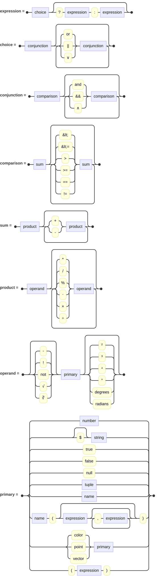
</picture>

**A tuple** — A point, vector or color, written in square brackets. &nbsp; [_scene files_](scene-files.md#numbers-points-vectors-and-colors)

<picture>
  <source media="(prefers-color-scheme: dark)" srcset="images/scene-files/tuple-dark.svg">
  <source media="(prefers-color-scheme: light)" srcset="images/scene-files/tuple.svg">
  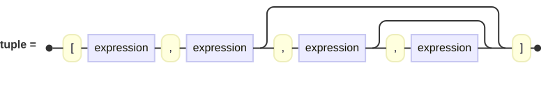
</picture>

**Setting a variable** — Naming a value so it can be reused. &nbsp; [_scene files_](scene-files.md#variables)

<picture>
  <source media="(prefers-color-scheme: dark)" srcset="images/scene-files/setVariableClause-dark.svg">
  <source media="(prefers-color-scheme: light)" srcset="images/scene-files/setVariableClause.svg">
  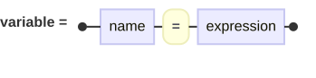
</picture>

**Including a file** — Reading another file in place. &nbsp; [_scene files_](scene-files.md#including-other-files)

<picture>
  <source media="(prefers-color-scheme: dark)" srcset="images/scene-files/includeClause-dark.svg">
  <source media="(prefers-color-scheme: light)" srcset="images/scene-files/includeClause.svg">
  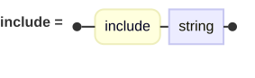
</picture>

**Importing from a library** — Taking named definitions from a library. &nbsp; [_scene files_](scene-files.md#importing-from-a-library)

<picture>
  <source media="(prefers-color-scheme: dark)" srcset="images/scene-files/importClause-dark.svg">
  <source media="(prefers-color-scheme: light)" srcset="images/scene-files/importClause.svg">
  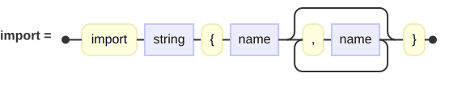
</picture>

**The render command** — Choosing which scene and camera to render. &nbsp; [_scene files_](scene-files.md#the-render-command)

<picture>
  <source media="(prefers-color-scheme: dark)" srcset="images/scene-files/renderClause-dark.svg">
  <source media="(prefers-color-scheme: light)" srcset="images/scene-files/renderClause.svg">
  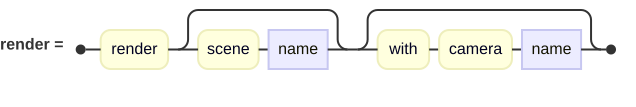
</picture>

#### The context block

**The context block** — The render-wide settings. &nbsp; [_context_](context.md#the-context-block)

<picture>
  <source media="(prefers-color-scheme: dark)" srcset="images/context/contextClause-dark.svg">
  <source media="(prefers-color-scheme: light)" srcset="images/context/contextClause.svg">
  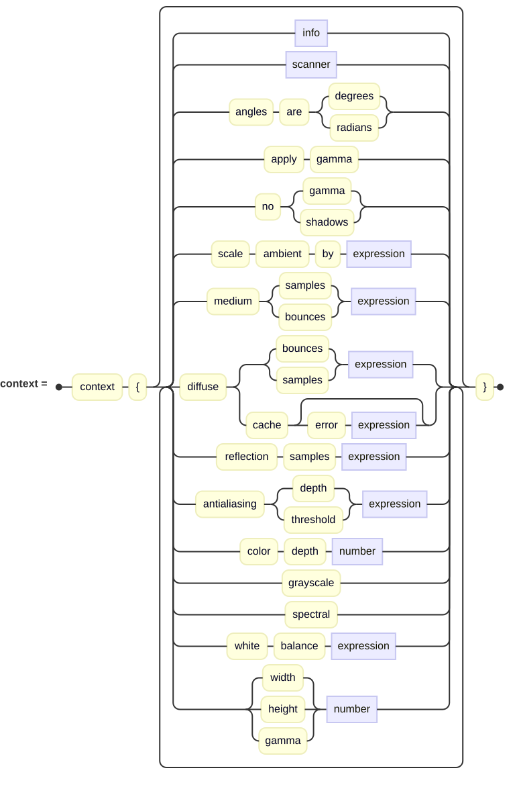
</picture>

**The info block** — The descriptive fields stored with the image. &nbsp; [_context_](context.md#image-information)

<picture>
  <source media="(prefers-color-scheme: dark)" srcset="images/context/infoClause-dark.svg">
  <source media="(prefers-color-scheme: light)" srcset="images/context/infoClause.svg">
  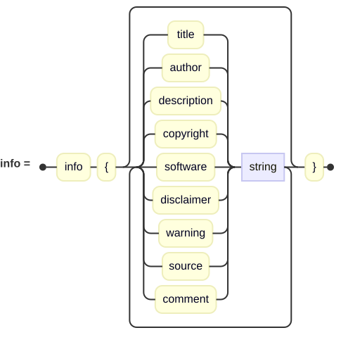
</picture>

**The scanner** — Which scanning strategy draws the image. &nbsp; [_context_](context.md#scanners)

<picture>
  <source media="(prefers-color-scheme: dark)" srcset="images/context/scannerClause-dark.svg">
  <source media="(prefers-color-scheme: light)" srcset="images/context/scannerClause.svg">
  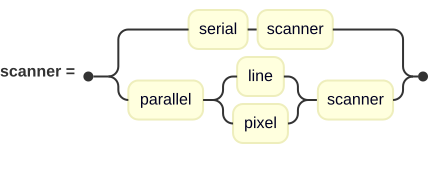
</picture>

#### Cameras

**A camera** — Where the scene is viewed from, and its lens and shutter. &nbsp; [_cameras_](cameras.md#placing-a-camera)

<picture>
  <source media="(prefers-color-scheme: dark)" srcset="images/cameras/cameraClause-dark.svg">
  <source media="(prefers-color-scheme: light)" srcset="images/cameras/cameraClause.svg">
  
</picture>

#### Lights

**A light** — The opener that begins every kind of light. &nbsp; [_lights_](lights.md#lights)

<picture>
  <source media="(prefers-color-scheme: dark)" srcset="images/lights/lightClause-dark.svg">
  <source media="(prefers-color-scheme: light)" srcset="images/lights/lightClause.svg">
  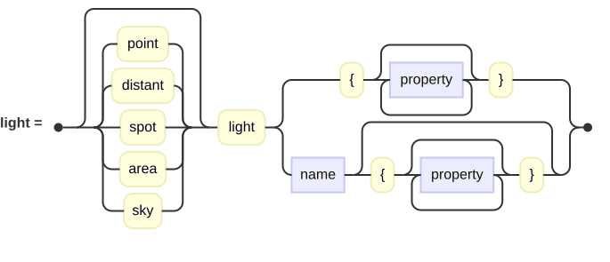
</picture>

**A point light** — A lamp at a single point. &nbsp; [_lights_](lights.md#point-lights)

<picture>
  <source media="(prefers-color-scheme: dark)" srcset="images/lights/pointLight-dark.svg">
  <source media="(prefers-color-scheme: light)" srcset="images/lights/pointLight.svg">
  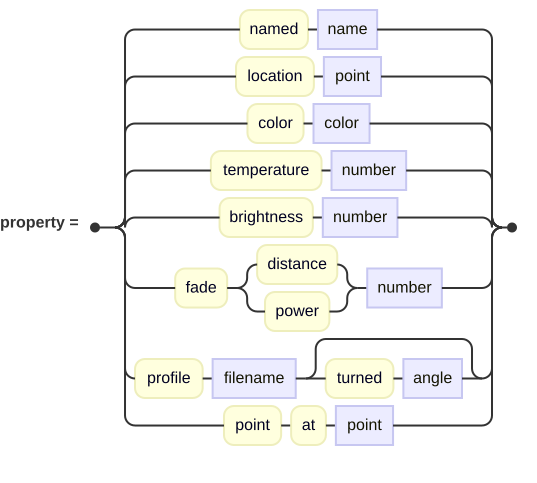
</picture>

**A distant light** — Parallel rays, like the sun. &nbsp; [_lights_](lights.md#distant-lights)

<picture>
  <source media="(prefers-color-scheme: dark)" srcset="images/lights/distantLight-dark.svg">
  <source media="(prefers-color-scheme: light)" srcset="images/lights/distantLight.svg">
  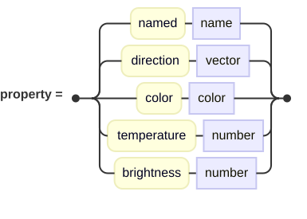
</picture>

**A spotlight** — A cone of light aimed at a point. &nbsp; [_lights_](lights.md#spotlights)

<picture>
  <source media="(prefers-color-scheme: dark)" srcset="images/lights/spotLight-dark.svg">
  <source media="(prefers-color-scheme: light)" srcset="images/lights/spotLight.svg">
  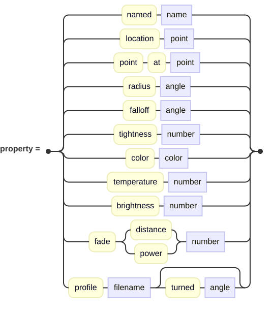
</picture>

**An area light** — A panel of light, for soft shadows. &nbsp; [_lights_](lights.md#area-lights)

<picture>
  <source media="(prefers-color-scheme: dark)" srcset="images/lights/areaLight-dark.svg">
  <source media="(prefers-color-scheme: light)" srcset="images/lights/areaLight.svg">
  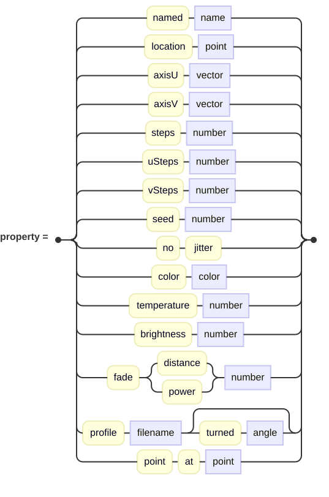
</picture>

#### Surfaces

**What a surface carries** — The material, transform and other things any surface may hold. &nbsp; [_surfaces_](surfaces.md#what-every-surface-has)

<picture>
  <source media="(prefers-color-scheme: dark)" srcset="images/surfaces/surfaceEntryClause-dark.svg">
  <source media="(prefers-color-scheme: light)" srcset="images/surfaces/surfaceEntryClause.svg">
  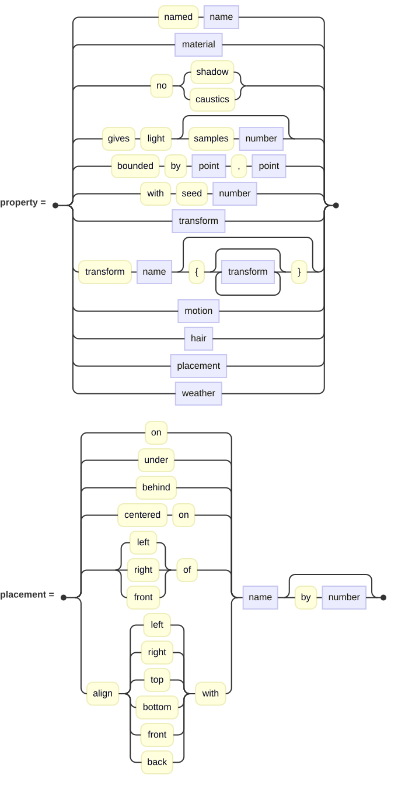
</picture>

**An extruded solid** — The `min Y`, `max Y` and `open` the cylinder, cone and extrusion share. &nbsp; [_surfaces_](surfaces.md#cylinder-and-conic)

<picture>
  <source media="(prefers-color-scheme: dark)" srcset="images/surfaces/extrudedSurface-dark.svg">
  <source media="(prefers-color-scheme: light)" srcset="images/surfaces/extrudedSurface.svg">
  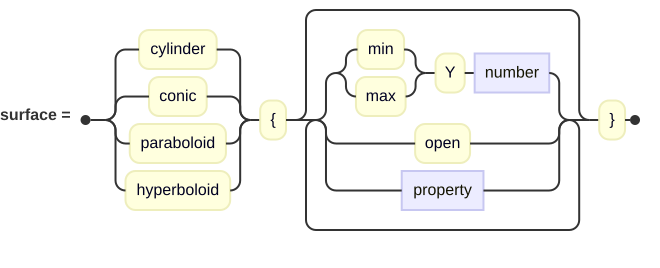
</picture>

**Combining surfaces** — Union, difference and intersection. &nbsp; [_surfaces_](surfaces.md#combining-surfaces)

<picture>
  <source media="(prefers-color-scheme: dark)" srcset="images/surfaces/csgClause-dark.svg">
  <source media="(prefers-color-scheme: light)" srcset="images/surfaces/csgClause.svg">
  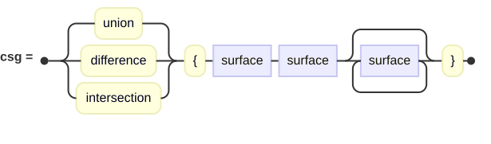
</picture>

**A group** — Gathering surfaces so one transform moves them all. &nbsp; [_surfaces_](surfaces.md#groups)

<picture>
  <source media="(prefers-color-scheme: dark)" srcset="images/surfaces/groupClause-dark.svg">
  <source media="(prefers-color-scheme: light)" srcset="images/surfaces/groupClause.svg">
  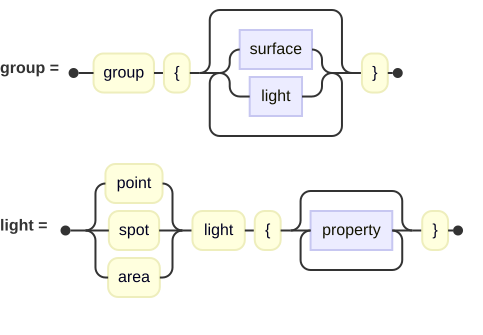
</picture>

#### Transforms

**A transform** — Translate, scale, rotate, shear and matrix. &nbsp; [_transforms_](transforms.md#order-matters)

<picture>
  <source media="(prefers-color-scheme: dark)" srcset="images/transforms/transformClause-dark.svg">
  <source media="(prefers-color-scheme: light)" srcset="images/transforms/transformClause.svg">
  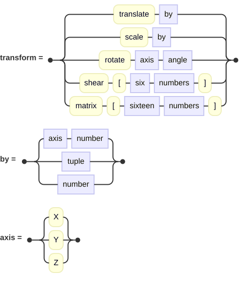
</picture>

**Motion** — Setting a surface moving, for motion blur. &nbsp; [_transforms_](transforms.md#setting-a-surface-moving)

<picture>
  <source media="(prefers-color-scheme: dark)" srcset="images/transforms/motionClause-dark.svg">
  <source media="(prefers-color-scheme: light)" srcset="images/transforms/motionClause.svg">
  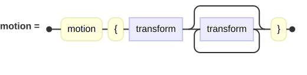
</picture>

#### Materials

**A material** — A surface's whole appearance: its pigment and finish. &nbsp; [_materials_](materials.md#the-finish)

<picture>
  <source media="(prefers-color-scheme: dark)" srcset="images/materials/materialClause-dark.svg">
  <source media="(prefers-color-scheme: light)" srcset="images/materials/materialClause.svg">
  
</picture>

**An interior** — What a surface is made of, and how it bends light. &nbsp; [_materials_](materials.md#transparency-and-interiors)

<picture>
  <source media="(prefers-color-scheme: dark)" srcset="images/materials/interiorClause-dark.svg">
  <source media="(prefers-color-scheme: light)" srcset="images/materials/interiorClause.svg">
  
</picture>

**A decal** — A marking painted over the pigment: one color inside an outline. &nbsp; [_materials_](materials.md#decals)

<picture>
  <source media="(prefers-color-scheme: dark)" srcset="images/materials/decalClause-dark.svg">
  <source media="(prefers-color-scheme: light)" srcset="images/materials/decalClause.svg">
  
</picture>

#### Pigments and patterns

**A pigment** — What colors a surface: a solid, a pattern, or an image. &nbsp; [_pigments and patterns_](pigments-and-patterns.md#pigments-and-patterns)

<picture>
  <source media="(prefers-color-scheme: dark)" srcset="images/pigments/pigmentClause-dark.svg">
  <source media="(prefers-color-scheme: light)" srcset="images/pigments/pigmentClause.svg">
  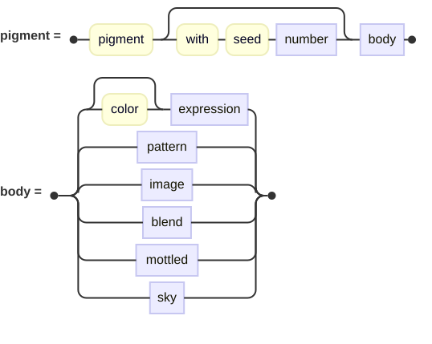
</picture>

**A pattern** — The spatial functions a pigment can sample. &nbsp; [_pigments and patterns_](pigments-and-patterns.md#patterns)

<picture>
  <source media="(prefers-color-scheme: dark)" srcset="images/pigments/patternClause-dark.svg">
  <source media="(prefers-color-scheme: light)" srcset="images/pigments/patternClause.svg">
  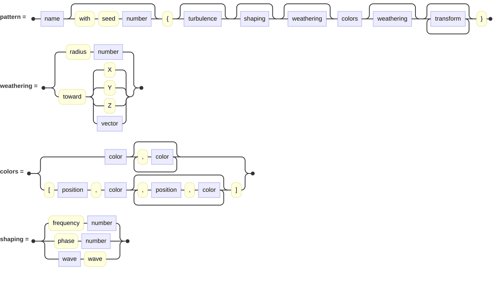
</picture>

**An image** — Reading an image, for an image pigment or a height field. &nbsp; [_pigments and patterns_](pigments-and-patterns.md#image-pigments)

<picture>
  <source media="(prefers-color-scheme: dark)" srcset="images/pigments/imageClause-dark.svg">
  <source media="(prefers-color-scheme: light)" srcset="images/pigments/imageClause.svg">
  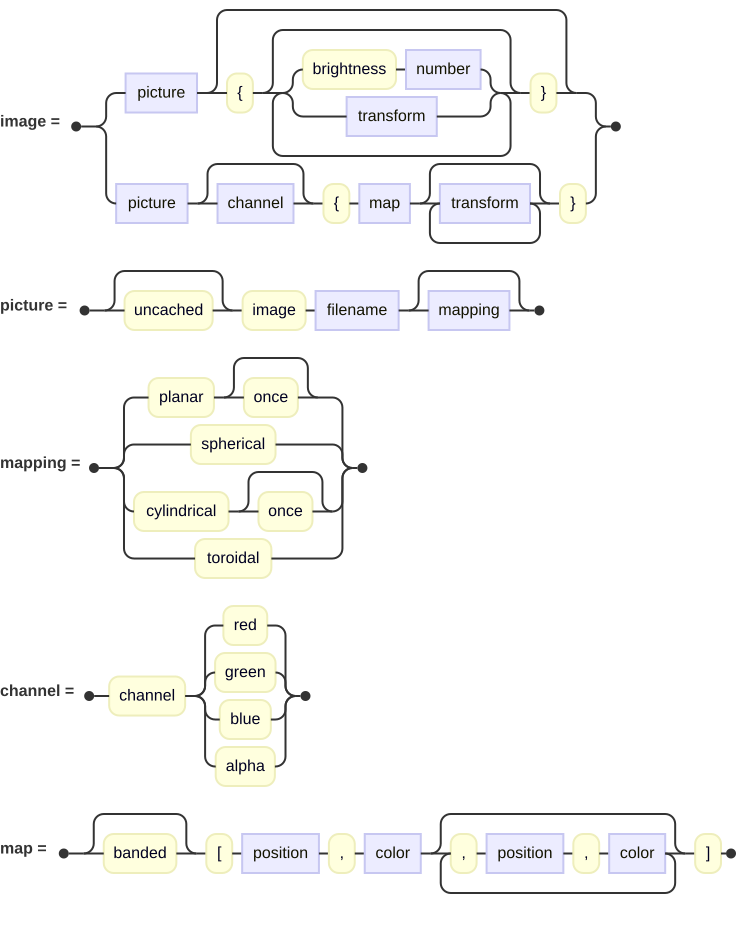
</picture>

#### Advanced surfaces

**A path** — The 2D outline an extrusion, lathe or generic shape is built from. &nbsp; [_advanced surfaces_](advanced-surfaces.md#paths)

<picture>
  <source media="(prefers-color-scheme: dark)" srcset="images/advanced/pathClause-dark.svg">
  <source media="(prefers-color-scheme: light)" srcset="images/advanced/pathClause.svg">
  
</picture>

**A spline** — The 3D path a sweep carries its profile along. &nbsp; [_advanced surfaces_](advanced-surfaces.md#sweep)

<picture>
  <source media="(prefers-color-scheme: dark)" srcset="images/advanced/splineClause-dark.svg">
  <source media="(prefers-color-scheme: light)" srcset="images/advanced/splineClause.svg">
  
</picture>

**A tube** — A round tube of varying radius along a path. &nbsp; [_advanced surfaces_](advanced-surfaces.md#tube)

<picture>
  <source media="(prefers-color-scheme: dark)" srcset="images/advanced/tubeClause-dark.svg">
  <source media="(prefers-color-scheme: light)" srcset="images/advanced/tubeClause.svg">
  
</picture>

**Text** — Letters turned into geometry. &nbsp; [_advanced surfaces_](advanced-surfaces.md#text)

<picture>
  <source media="(prefers-color-scheme: dark)" srcset="images/advanced/textClause-dark.svg">
  <source media="(prefers-color-scheme: light)" srcset="images/advanced/textClause.svg">
  
</picture>

**A text layout** — How text is set out, in lines or along a path. &nbsp; [_advanced surfaces_](advanced-surfaces.md#laying-out-text)

<picture>
  <source media="(prefers-color-scheme: dark)" srcset="images/advanced/layoutClause-dark.svg">
  <source media="(prefers-color-scheme: light)" srcset="images/advanced/layoutClause.svg">
  
</picture>

**A height field** — An image read as terrain. &nbsp; [_advanced surfaces_](advanced-surfaces.md#height-field)

<picture>
  <source media="(prefers-color-scheme: dark)" srcset="images/advanced/heightFieldClause-dark.svg">
  <source media="(prefers-color-scheme: light)" srcset="images/advanced/heightFieldClause.svg">
  
</picture>

### Built-in names

Before it reads a line of a scene, the renderer fills a pool of names that every scene inherits,
so all of these may be used without defining them first.  It holds a handful of constants, and
then three families of names: the colors, the indices of refraction, and the direction vectors.

#### Global constants

| Name | Value | What it is |
| --- | --- | --- |
| `π` | 3.14159… | Pi, for turning by a fraction of a circle. |
| `Identity` | the identity matrix | A transform that changes nothing; a starting point for `matrix`. |
| `PositiveInfinity` | the largest double | Positive infinity. |
| `NegativeInfinity` | the smallest double | Negative infinity. |
| `__software__` | this ray tracer's name and version | The default an image's software field is stamped with. |

#### The frame

Two more names are set for every frame of an [animation](animation.md), and for a still as well, where they
are nought:

| Name | What it is |
| --- | --- |
| `time` | The frame's moment, in seconds: its number over the rate. |
| `frame` | The frame's number, from nought. |

#### Functions

Every function an [expression](scene-files.md#functions) may call.  Several take either numbers
or vectors; ask for a form that does not exist and the error names the ones that do.

| | | | |
| --- | --- | --- | --- |
| `abs` | `cross` | `log` | `round` |
| `acos` | `distance` | `log10` | `sign` |
| `asin` | `dot` | `magnitude` | `sin` |
| `atan` | `exp` | `max` | `sinh` |
| `atan2` | `floor` | `min` | `smoothstep` |
| `cbrt` | `headingAlong` | `mod` | `sqrt` |
| `ceil` | `item` | `noise` | `tan` |
| `clamp` | `kelvin` | `normalize` | `tanh` |
| `cos` | `length` | `pointAlong` | `toDegrees` |
| `cosh` | `lerp` | `pow` | `trunc` |
| `count` | `list` | `random` |  |

`pointAlong` and `headingAlong` take a spline and a share of its length — where along it that lies, and which way
it runs there — and `length` takes a spline as well as a vector; see [Along a Spline](animation.md#along-a-spline).
The order the others take their values in, and how `round` treats a half (to the even side), are under
[Functions](scene-files.md#functions).

#### Colors

The full set of named colors — the standard X11 and POV-Ray names.  Any of them may be used
wherever a color is wanted, as `color Red` or simply `Red`.

| | | | |
| --- | --- | --- | --- |
|  `AliceBlue` |  `DodgerBlue` |  `MediumSeaGreen` |  `SteelBlue` |
|  `AntiqueWhite` |  `DustyRose` |  `MediumSlateBlue` |  `SummerSky` |
|  `Aqua` |  `Feldspar` |  `MediumSpringGreen` |  `Tan` |
|  `Aquamarine` |  `Firebrick` |  `MediumTurquoise` |  `Teal` |
|  `Azure` |  `Flesh` |  `MediumVioletRed` |  `Thistle` |
|  `BakersChocolate` |  `FloralWhite` |  `MediumWood` |  `Tomato` |
|  `Beige` |  `ForestGreen` |  `Mica` |  `Transparent` |
|  `Bisque` |  `Fuchsia` |  `MidnightBlue` |  `Turquoise` |
|  `Black` |  `Gainsboro` |  `MintCream` |  `VeryDarkBrown` |
|  `BlanchedAlmond` |  `GhostWhite` |  `MistyRose` |  `VeryLightGray` |
|  `Blue` |  `Gold` |  `Moccasin` |  `VeryLightGrey` |
|  `BlueViolet` |  `Goldenrod` |  `NavajoWhite` |  `VeryLightPurple` |
|  `Brass` |  `Gray` |  `Navy` |  `Violet` |
|  `BrightGold` |  `Green` |  `NavyBlue` |  `VioletRed` |
|  `Bronze` |  `GreenCopper` |  `NeonBlue` |  `Wheat` |
|  `Bronze2` |  `GreenYellow` |  `NeonPink` |  `White` |
|  `Brown` |  `Grey` |  `NewMidnightBlue` |  `WhiteSmoke` |
|  `BurlyWood` |  `Honeydew` |  `NewTan` |  `Yellow` |
|  `CadetBlue` |  `HotPink` |  `OldGold` |  `YellowGreen` |
|  `Chartreuse` |  `HunterGreen` |  `OldLace` |  `Gray05` |
|  `Chocolate` |  `IndianRed` |  `Olive` |  `Gray10` |
|  `CoolCopper` |  `Indigo` |  `OliveDrab` |  `Gray15` |
|  `Copper` |  `Ivory` |  `Orange` |  `Gray20` |
|  `Coral` |  `Khaki` |  `OrangeRed` |  `Gray25` |
|  `CornflowerBlue` |  `Lavender` |  `Orchid` |  `Gray30` |
|  `Cornsilk` |  `LavenderBlush` |  `PaleGoldenrod` |  `Gray35` |
|  `CosmicLatte` |  `LawnGreen` |  `PaleGreen` |  `Gray40` |
|  `Crimson` |  `LemonChiffon` |  `PaleTurquoise` |  `Gray45` |
|  `Cyan` |  `LightBlue` |  `PaleVioletRed` |  `Gray50` |
|  `DarkBlue` |  `LightCoral` |  `PapayaWhip` |  `Gray55` |
|  `DarkBrown` |  `LightCyan` |  `PeachPuff` |  `Gray60` |
|  `DarkCyan` |  `LightGoldenrodYellow` |  `Peru` |  `Gray65` |
|  `DarkGoldenrod` |  `LightGray` |  `Pink` |  `Gray70` |
|  `DarkGray` |  `LightGreen` |  `Plum` |  `Gray75` |
|  `DarkGreen` | 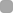 `LightGrey` |  `PowderBlue` |  `Gray80` |
|  `DarkGreenCopper` |  `LightPink` |  `Purple` |  `Gray85` |
|  `DarkGrey` |  `LightPurple` |  `Quartz` |  `Gray90` |
|  `DarkKhaki` |  `LightSalmon` |  `Red` |  `Gray95` |
|  `DarkMagenta` |  `LightSeaGreen` |  `RichBlue` |  `Grey05` |
|  `DarkOliveGreen` |  `LightSkyBlue` |  `RosyBrown` |  `Grey10` |
|  `DarkOrange` |  `LightSlateGray` |  `RoyalBlue` |  `Grey15` |
|  `DarkOrchid` |  `LightSlateGrey` |  `SaddleBrown` |  `Grey20` |
|  `DarkPurple` |  `LightSteelBlue` |  `Salmon` |  `Grey25` |
|  `DarkRed` |  `LightWood` |  `SandyBrown` |  `Grey30` |
|  `DarkSalmon` |  `LightYellow` |  `Scarlet` |  `Grey35` |
|  `DarkSeaGreen` |  `Lime` |  `SeaGreen` |  `Grey40` |
|  `DarkSlateBlue` |  `LimeGreen` |  `SeaShell` |  `Grey45` |
|  `DarkSlateGray` |  `Linen` |  `SemiSweetChocolate` |  `Grey50` |
|  `DarkSlateGrey` |  `Magenta` |  `Sienna` |  `Grey55` |
|  `DarkTan` |  `MandarinOrange` |  `Silver` |  `Grey60` |
|  `DarkTurquoise` |  `Maroon` |  `SkyBlue` | 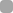 `Grey65` |
|  `DarkViolet` |  `MediumAquamarine` |  `SlateBlue` |  `Grey70` |
|  `DarkWood` |  `MediumBlue` |  `SlateGray` |  `Grey75` |
|  `DeepPink` |  `MediumForestGreen` |  `SlateGrey` |  `Grey80` |
|  `DeepSkyBlue` |  `MediumGoldenrod` |  `Snow` |  `Grey85` |
|  `DimGray` |  `MediumOrchid` |  `SpicyPink` |  `Grey90` |
|  `DimGrey` |  `MediumPurple` |  `SpringGreen` |  `Grey95` |

Names spelled with *Grey* are aliases of their *Gray* counterparts (`DarkGrey` is `DarkGray`),
and a few others double up too — `NavyBlue` is `Navy`, and `Mica` is `Black`.

#### Indices of refraction

Each of these may be used wherever an index of refraction is wanted, as `interior { ior Glass }`.
Several gemstones are also named colors; asking for the color of `Aquamarine` and asking for how
far it bends light are different questions of the same name.

**Gases, liquids and common solids**

| Name | IOR | Name | IOR |
| --- | --- | --- | --- |
| `Vacuum` | 1 | `WaterIce` | 1.31 |
| `Air` | 1.000293 | `Kerosene` | 1.39 |
| `CarbonDioxide` | 1.00045 | `Glass` | 1.52 |
| `Helium` | 1.000036 | `Amber` | 1.55 |
| `Hydrogen` | 1.000132 | `Diamond` | 2.417 |
| `Water` | 1.333 |  |  |

**Optical glasses**

| Name | IOR | Name | IOR |
| --- | --- | --- | --- |
| `CrownGlass` | 1.51673 | `FlintGlass` | 1.78446 |
| `CrownGlassBaK1` | 1.57241 | `FlintGlassF2` | 1.61989 |
| `WindowGlass` | 1.51673 | `FlintGlassLaSFN9` | 1.85002 |

**Gemstones**

| Name | IOR | Name | IOR | Name | IOR |
| --- | --- | --- | --- | --- | --- |
| `Agate` | 1.544 | `Fluorite` | 1.434 | `Peridot` | 1.654 |
| `Alexandrite` | 1.746 | `Iolite` | 1.55 | `Prehnite` | 1.64 |
| `Amazonite` | 1.53 | `Ivory` | 1.54 | `Quartz` | 1.544 |
| `Amethyst` | 1.544 | `Jadeite` | 1.67 | `RoseQuartz` | 1.544 |
| `Andalusite` | 1.64 | `Jasper` | 1.54 | `Ruby` | 1.766 |
| `Andesine` | 1.53 | `Kunzite` | 1.67 | `Sapphire` | 1.766 |
| `Apatite` | 1.63 | `Kyanite` | 1.73 | `SmokyQuartz` | 1.544 |
| `Aquamarine` | 1.58 | `Labradorite` | 1.56 | `Sphene` | 1.7 |
| `Aventurine` | 1.544 | `LapisLazuli` | 1.5 | `Spinel` | 1.712 |
| `Beryl` | 1.58 | `Malachite` | 1.655 | `Spodumene` | 1.67 |
| `Chalcedony` | 1.544 | `Moissanite` | 2.67 | `Tanzanite` | 1.7 |
| `ChromeDiopside` | 1.69 | `Moonstone` | 1.52 | `TigersEye` | 1.544 |
| `Chrysoberyl` | 1.746 | `Morganite` | 1.58 | `Topaz` | 1.62 |
| `Citrine` | 1.544 | `NephriteJade` | 1.62 | `Tourmaline` | 1.624 |
| `Coral` | 1.486 | `Onyx` | 1.544 | `Turquoise` | 1.61 |
| `Corundum` | 1.766 | `Opal` | 1.45 | `Zircon` | 1.95 |
| `CubicZirconia` | 2.16 | `Orthoclase` | 1.52 | `Zoisite` | 1.7 |
| `Emerald` | 1.58 | `Pearl` | 1.53 |  |  |

**Garnets**

| Name | IOR | Name | IOR |
| --- | --- | --- | --- |
| `AlmandineGarnet` | 1.79 | `PyropeGarnet` | 1.74 |
| `AndraditeGarnet` | 1.888 | `RhodoliteGarnet` | 1.76 |
| `DemantoidGarnet` | 1.885 | `SpessartiteGarnet` | 1.81 |
| `GrossulariteGarnet` | 1.74 | `TsavoriteGarnet` | 1.74 |

#### Direction vectors

Six unit vectors, handy wherever a direction or offset is written — a camera's `up`, a distant
light's `direction`, or a `translate`.

| Name | Vector |
| --- | --- |
| `Up` | [0,1,0] |
| `Down` | [0,-1,0] |
| `Left` | [-1,0,0] |
| `Right` | [1,0,0] |
| `In` | [0,0,1] |
| `Out` | [0,0,-1] |

### The command line

The ray tracer has three verbs.  `render` is the default — running it with no verb renders — and
[Command Line Options](getting-started.md#command-line-options) covers it at more length.  The
other two, `fonts` and `libraries`, have chapters of their own: [Managing Fonts](fonts.md) and
[Using Libraries](libraries.md).

#### render

| Option | What it does |
| --- | --- |
| `-i`, `--input-file` | The scene file to render.  This one is required. |
| `-o`, `--output-file` | Name the output image file. |
| `-d`, `--output-dir` | The directory to write the output in. |
| `-e`, `--output-extension` | Choose the output format by giving its extension. |
| `--scene` | The [scene](scene-files.md#scenes-and-cameras) to render, when the file has more than one. |
| `--camera` | The [camera](cameras.md#placing-a-camera) to render with, when the scene has more than one. |
| `-w`, `--width` | Image width; otherwise the scene's, otherwise 800. |
| `-h`, `--height` | Image height; otherwise the scene's, otherwise 600. |
| `-a`, `--antialias` | The [anti-aliasing](context.md#anti-aliasing) to apply: `off`, or `adaptive`, `adaptive:depth` or `adaptive:depth:threshold`, or just a depth; otherwise the scene's, otherwise off. |
| `-g`, `--gamma` | Write with a plain [gamma](context.md#gamma) power instead of the sRGB curve: more than 0, and no more than 5. |
| `--no-gamma` | Write the light as it stands, with no curve. |
| `--no-shadows` | Turn shadows off everywhere. |
| `--grayscale` | Write the image in shades of gray. |
| `--spectral` | Carry light [wavelength by wavelength](context.md#spectral-light). |
| `--white-balance` | The temperature, in kelvin, the picture is [balanced](context.md#white-balance) to show as white. |
| `--exposure` | How many [stops](cameras.md#exposure) to expose every camera by. |
| `--film-curve` | The [film curve](context.md#film-curve) to develop the picture by: `soft`, `neutral`, `agx` or `none`. |
| `-c`, `--bits-per-channel` | How many bits each color channel gets in the file, 8 or 16; otherwise the scene's, otherwise 8. |
| `-r`, `--frame-rate` | Frames per second for an [animation](animation.md) (the scene's, or 30). |
| `-m`, `--frame` | Render one frame of an animation alone, as a still at its time. |
| `--frames` | Render a run of an animation's frames, as `0-143`. |
| `--still` | Render an animation as the one frame it names as its still. |
| `-l`, `--output-level` | How much to print: `quiet`, `normal`, `chatty` or `verbose`. |
| `-p`, `--progress` | How to report progress: `bar`, `tool` or `none`. |
| `--stats` | Print a report of what the render cost and what its scene held. |

#### fonts

| Option | What it does |
| --- | --- |
| `-l`, `--list` | List the faces in the catalog. |
| `-f`, `--fetch` | Fetch a face from Google Fonts. |
| `-i`, `--import` | Import a face from a TrueType file. |
| `-g`, `--show-glyphs-for` | List the glyphs a face carries. |
| `-k`, `--show-kerning-for` | Show a face's stored kerning pairs. |
| `-a`, `--add-kerning-for` | Add a kerning pair (with `--pair`). |
| `-d`, `--remove-kerning-for` | Remove a kerning pair (with `--pair`). |
| `-p`, `--pair` | The pair itself, as `left:adjustment:right`. |
| `-r`, `--remove` | Remove a face. |
| `-o`, `--overwrite` | Allow an add or import to replace one already there. |

#### libraries

| Option | What it does |
| --- | --- |
| `-l`, `--list` | List the libraries the ray tracer knows about. |
| `-i`, `--import` | Import a library: an `.igl` file of definitions, or (with `--povray`) a POV-Ray include directory. |
| `-p`, `--povray` | With `--import`, convert a POV-Ray distribution's include files rather than copy one `.igl`. |
| `--install` | Install the libraries that ship with the ray tracer into your own library set, leaving any of the same name alone unless `--overwrite` is given. |
| `-r`, `--remove` | Remove a library. |
| `--fa-zip` | Install a FontAwesome zip, so scenes can use its icons as [2D paths](advanced-surfaces.md#icons). |
| `-o`, `--overwrite` | Allow an import to replace libraries already there. |
| `-d`, `--details` | List every definition that could not be converted. |
| `-n`, `--dry-run` | Report what an import, an install, a removal or a FontAwesome zip would do, but write nothing. |
